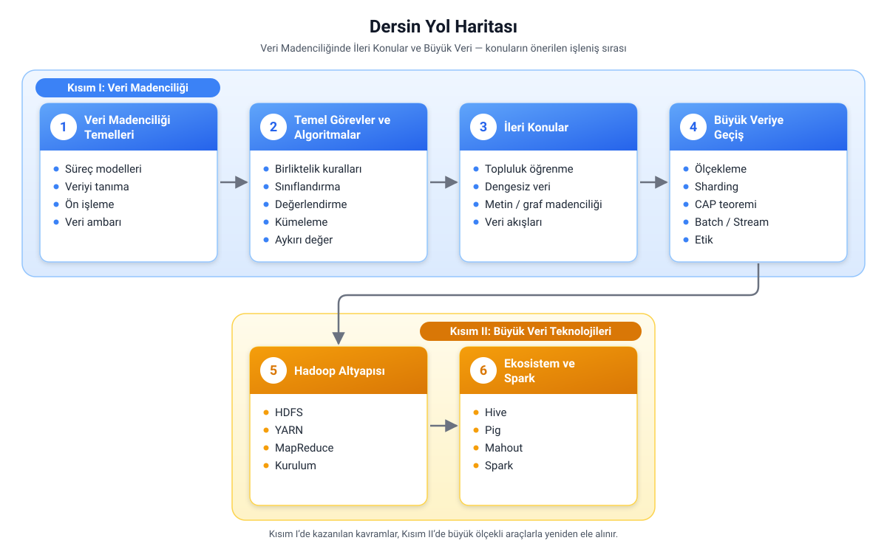

# 0. Dersin Yol Haritası

Bu ders iki büyük soruya cevap arar: **"Veriden nasıl bilgi çıkarırız?"** ve **"Veri tek bir bilgisayara sığmayacak kadar büyüdüğünde bunu nasıl yaparız?"** İlk soru *veri madenciliğinin*, ikincisi *büyük veri teknolojilerinin* konusudur. Bu iki alan birbirinden kopuk değildir: Büyük veri altyapıları (Hadoop, Spark vb.) kendi başına bir amaç değil, veri madenciliği ve analitik algoritmalarını devasa veri üzerinde çalıştırabilmek için geliştirilmiş araçlardır.

Notlar bu nedenle iki kısımdan oluşur:

* **Kısım I — Veri Madenciliği:** Süreç modelleri, veriyi tanıma ve hazırlama, temel görevler (birliktelik kuralları, sınıflandırma, kümeleme, aykırı değer tespiti), model değerlendirme ve ileri konular. Kısım, klasik algoritmaların neden büyük veride tıkandığını ve bu sorunun nasıl aşıldığını tartışan bir köprü bölümüyle biter.
* **Kısım II — Büyük Veri Teknolojileri:** Büyük verinin tanımı ve 5V, Hadoop (HDFS, YARN, MapReduce), Hadoop ekosistemi (Hive, Pig, Spark, Mahout, HBase), kurulum ve uygulamalar.
* **Ek not — [Spark ve YARN ile Dağıtık Veri Madenciliği](../spark_ders_notu.md):** Laboratuvardaki üç makineyle kurulan gerçek bir Hadoop + Spark kümesi. 1BRC, kelime sayma (MapReduce ve Spark), MLlib ile hiperparametre araması ve ölçekleme deneyi.

> **Okuma önerisi:** Her bölümde önce sezgiyi bir benzetmeyle kurmaya, ardından kavramı tanımlamaya ve en sonda küçük bir örnek ya da Python kodu ile somutlaştırmaya çalışacağız. Kod örnekleri `numpy`, `pandas`, `scipy`, `scikit-learn` ve `imbalanced-learn` kütüphanelerini kullanır (`pip install numpy pandas scipy scikit-learn imbalanced-learn`). Uygulamalarla birlikte gereken bütün paketler depo kökündeki [requirements.txt](../requirements.txt) dosyasında listelenmiştir (`pip install -r requirements.txt`).

---

[İçindekiler](../ders_notu.md) · [1. Veri Madenciliği Nedir? →](01-veri-madenciligi-nedir.md)
