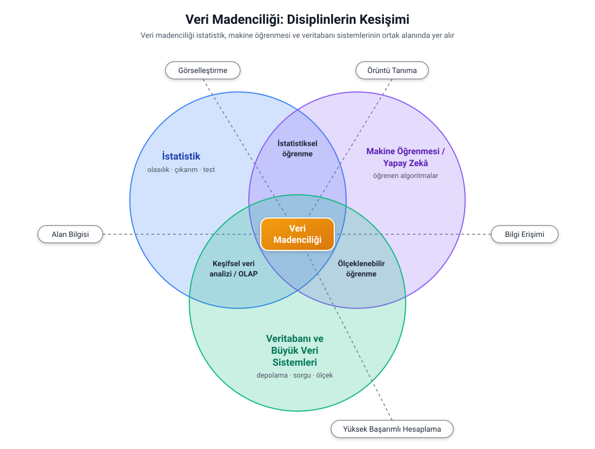

# 1. Veri Madenciliği Nedir?

## 1.1 Neden Veri Madenciliği?

Bir süpermarket zincirini düşünün. Her gün binlerce kasada milyonlarca ürün okutuluyor, her fiş bir veritabanına kaydediliyor. Yıllar içinde bu kayıtlar terabaytlara ulaşır. Peki bu veri yığını kendiliğinden bir şey söyler mi? Hayır. Veri, işlenmediği sürece sadece maliyettir: Depolanması, yedeklenmesi ve korunması gerekir. Değer, ancak verinin içine gömülü **örüntüler (patterns)** gün yüzüne çıkarıldığında ortaya çıkar: "Bebek bezi alan müşteriler sıklıkla ıslak mendil ve mama da alıyor", "Bu müşteri profili önümüzdeki üç ayda bizi terk etme eğiliminde" gibi.

Han ve arkadaşları bu durumu *"veri zengini ama bilgi fakiri" (data rich but information poor)* olarak özetler. Veri toplama kapasitemiz, veriyi anlama kapasitemizi çoktan geçmiştir. Veri madenciliği bu boşluğu doldurmak için doğmuştur.

## 1.2 Tanım ve Bilgi Keşfi (KDD)

**Veri madenciliği (data mining)**, büyük miktardaki veriden *ilginç*, *önceden bilinmeyen*, *potansiyel olarak yararlı* ve *anlaşılabilir* örüntülerin ve bilginin otomatik ya da yarı otomatik olarak çıkarılması sürecidir.

Tanımdaki sıfatların her biri önemlidir:

* **İlginç:** "Hamile müşteriler hamilelik vitamini alır" bir örüntüdür ama kimseyi şaşırtmaz.
* **Önceden bilinmeyen:** Uzmanın zaten bildiği bir kuralı yeniden bulmak keşif değildir.
* **Yararlı:** Örüntü bir karara, bir eyleme dönüşebilmelidir.
* **Anlaşılabilir:** Karar vericinin yorumlayabileceği biçimde sunulmalıdır.

"Madencilik" benzetmesi aslında biraz yanıltıcıdır. Altın madenciliğinde topraktan *altın* çıkarırız; buna "toprak madenciliği" demeyiz. Veri madenciliğinde de veriden *bilgi* çıkarırız. Bu yüzden literatürde daha doğru bir terim olarak **Veritabanlarında Bilgi Keşfi (Knowledge Discovery in Databases — KDD)** kullanılır. Dar anlamda "veri madenciliği", KDD sürecinin örüntülerin çıkarıldığı *tek bir adımıdır* (bkz. Bölüm 2). Geniş anlamda ise iki terim çoğunlukla eş anlamlı kullanılır.

## 1.3 Veri Madenciliği ve Komşu Disiplinler

Veri madenciliği tek bir disiplinin ürünü değildir. Birçok alanın kesişiminde durur:

| Disiplin | Veri madenciliğine katkısı | Vurguladığı soru |
|---|---|---|
| **İstatistik** | Olasılık modelleri, hipotez testleri, örnekleme, güven aralıkları | "Bu sonuç tesadüf olabilir mi?" |
| **Makine Öğrenmesi / Yapay Zekâ** | Veriden öğrenen algoritmalar (karar ağaçları, sinir ağları, SVM…) | "Bilgisayar örneklerden nasıl genelleme yapar?" |
| **Veritabanı Sistemleri** | Verimli depolama, indeksleme, sorgulama, veri ambarları | "Milyarlarca kayda nasıl hızlı erişiriz?" |
| **Yüksek Başarımlı / Dağıtık Hesaplama** | Paralel algoritmalar, kümeler, Hadoop/Spark | "Hesabı nasıl ölçekleriz?" |
| **Görselleştirme** | Veriyi ve sonuçları insan gözünün anlayacağı biçimde sunma | "Örüntüyü nasıl gösteririz?" |
| **İş Zekâsı (BI)** | Raporlama, panolar, OLAP | "Ne oldu, nerede, ne kadar?" |

Witten ve arkadaşları istatistik ile makine öğrenmesi arasındaki farkın tarihsel olduğunu, bugün iki alanın büyük ölçüde iç içe geçtiğini vurgular. Pratik bir ayrım şöyle yapılabilir: İstatistik daha çok *hipotez doğrulamaya*, veri madenciliği ise *hipotez üretmeye* (keşfe) odaklanır.

## 1.4 Hangi Veriler, Hangi Örüntüler?

**Madenlenebilecek veri türleri.** En yaygın kaynak ilişkisel veritabanları ve veri ambarlarıdır, ama veri madenciliği bunlarla sınırlı değildir:

* **İşlem (transaction) verisi:** Market fişleri, banka hareketleri.
* **Zaman serileri ve sıralı veri:** Borsa fiyatları, sensör ölçümleri, tıklama dizileri.
* **Uzamsal veri:** Harita koordinatları, uydu görüntüleri.
* **Metin ve web verisi:** E-postalar, haberler, sosyal medya, web sayfaları ve aralarındaki bağlantılar.
* **Graf ve ağ verisi:** Sosyal ağlar, protein etkileşim ağları.
* **Çoklu ortam:** Görüntü, ses, video.
* **Veri akışları (data streams):** Sürekli ve hızla akan, tamamı saklanamayan veri.

**Madenlenebilecek örüntü türleri.** Veri madenciliği görevleri iki büyük gruba ayrılır:

1. **Tanımlayıcı (descriptive) görevler:** Verideki genel özellikleri ve ilişkileri betimler. Hedef bir değişken yoktur.
   * *Karakterizasyon ve ayrımlama:* "Sadık müşterilerin ortak özellikleri neler?"
   * *Sık örüntüler ve birliktelik kuralları:* "Ekmek alan süt de alıyor mu?"
   * *Kümeleme:* "Müşterilerimiz doğal olarak hangi gruplara ayrılıyor?"
   * *Aykırı değer analizi:* "Hangi kredi kartı işlemi diğerlerine hiç benzemiyor?"
2. **Tahmin edici (predictive) görevler:** Mevcut veriden bir model kurup bilinmeyen bir değeri tahmin eder.
   * *Sınıflandırma:* Kategorik bir etiketi tahmin etmek ("Bu e-posta spam mı?").
   * *Regresyon:* Sayısal bir değeri tahmin etmek ("Bu evin fiyatı ne olur?").

Makine öğrenmesi dilinde tahmin edici görevlere **denetimli öğrenme (supervised learning)**, etiket gerektirmeyen kümeleme gibi görevlere ise **denetimsiz öğrenme (unsupervised learning)** denir.

## 1.5 Uygulama Alanları

| Alan | Tipik uygulama | İlgili görev |
|---|---|---|
| Perakende | Pazar sepeti analizi, raf düzeni, öneri sistemleri | Birliktelik kuralları |
| Bankacılık / Finans | Kredi skorlama, sahtekârlık tespiti | Sınıflandırma, aykırı değer |
| Telekomünikasyon | Müşteri kaybı (churn) tahmini | Sınıflandırma |
| Pazarlama | Müşteri segmentasyonu, hedefli kampanya | Kümeleme |
| Sağlık | Hastalık teşhisi, ilaç etkileşimleri, genom analizi | Sınıflandırma, örüntü madenciliği |
| Üretim | Kestirimci bakım, kalite kontrol | Regresyon, aykırı değer |
| Siber güvenlik | Saldırı tespiti | Aykırı değer, sınıflandırma |
| Web | Arama motoru sıralaması, içerik önerisi | Web/graf madenciliği |

## 1.6 Veri Madenciliğinin Temel Sorunları

Han ve arkadaşları alanın başlıca zorluklarını şöyle gruplar. Bu başlıklar dersin geri kalanında karşımıza tekrar tekrar çıkacak:

* **Yöntemsel sorunlar:** Gürültülü veya eksik veriyle başa çıkmak, bulunan örüntülerin gerçekten ilginç olup olmadığını değerlendirmek, alan bilgisini sürece katmak.
* **Kullanıcı etkileşimi:** Sonuçların yorumlanabilir ve görselleştirilebilir olması.
* **Verimlilik ve ölçeklenebilirlik:** Algoritmaların veri büyüdükçe makul sürede çalışabilmesi. *Bu, Kısım II'deki büyük veri teknolojilerinin varlık sebebidir.*
* **Veri çeşitliliği:** Yapılandırılmamış, karmaşık ve dağıtık veri türleri.
* **Toplumsal etkiler:** Gizlilik, güvenlik ve algoritmik adalet (bkz. Bölüm 13).

---

[← 0. Dersin Yol Haritası](00-dersin-yol-haritasi.md) · [İçindekiler](../ders_notu.md) · [2. Bilgi Keşfi Süreç Modelleri →](02-bilgi-kesfi-surec-modelleri.md)
