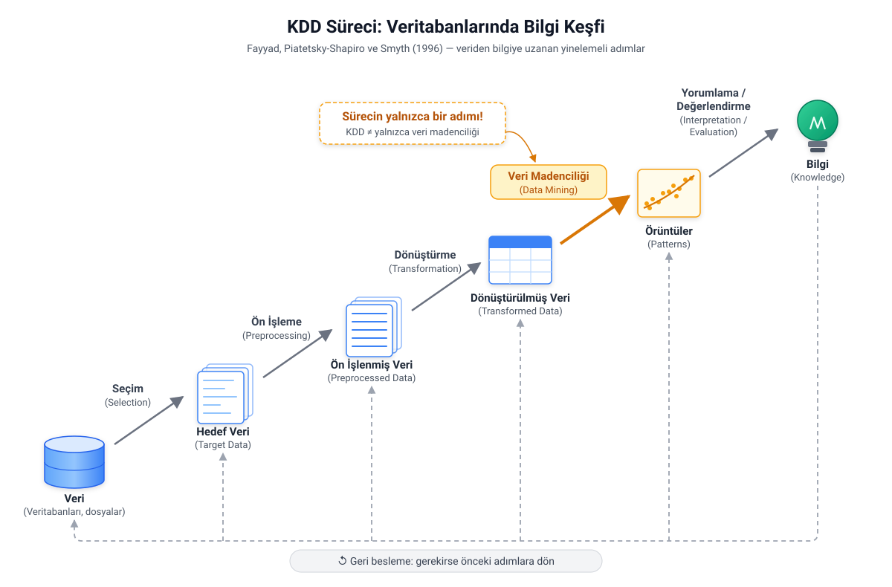
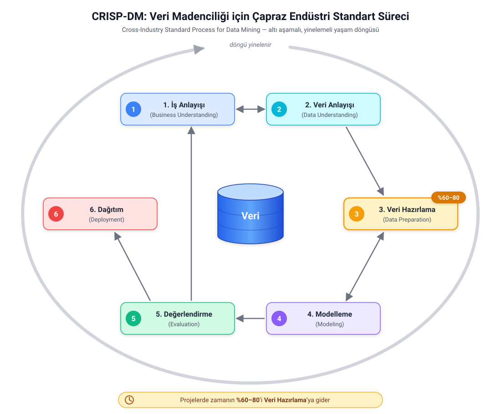

# 2. Bilgi Keşfi Süreç Modelleri

Veri madenciliği "veriyi algoritmaya ver, sonucu al" kadar basit değildir. Başarılı projeler iyi tanımlanmış bir süreci izler. Bu bölümde üç yaygın süreç modelini inceleyeceğiz.

## 2.1 KDD Süreci

Fayyad, Piatetsky-Shapiro ve Smyth'in (1996) tanımladığı KDD süreci, ham veriden bilgiye uzanan adımları sıralar:

1. **Seçim (Selection):** Analiz hedefine uygun veri kaynakları ve değişkenler seçilir. Örneğin müşteri kaybı analizi için son iki yılın abonelik ve çağrı kayıtları.
2. **Ön işleme (Preprocessing):** Eksik, hatalı ve tutarsız kayıtlar temizlenir (bkz. Bölüm 4).
3. **Dönüştürme (Transformation):** Veri, madencilik algoritmasına uygun biçime getirilir: normalizasyon, yeni nitelik türetme, boyut indirgeme.
4. **Veri madenciliği (Data Mining):** Uygun algoritma (sınıflandırma, kümeleme vb.) uygulanarak örüntüler çıkarılır.
5. **Yorumlama / Değerlendirme (Interpretation / Evaluation):** Bulunan örüntülerin geçerliliği, ilginçliği ve yararlılığı değerlendirilir. Gerekirse önceki adımlara dönülür.

Şekildeki geri besleme oku önemlidir: KDD doğrusal değil **yinelemeli (iterative)** bir süreçtir. Model beklenen başarıyı vermezse çoğu zaman sorun algoritmada değil, verinin hazırlanışındadır.

## 2.2 CRISP-DM

**CRISP-DM (Cross-Industry Standard Process for Data Mining)**, 1990'ların sonunda bir sanayi konsorsiyumu tarafından geliştirilmiş, sektörden bağımsız bir süreç modelidir. KDD'ye göre daha *iş odaklıdır* ve bugün hâlâ en yaygın kullanılan metodolojidir.

| Aşama | Temel soru | Örnek çıktılar |
|---|---|---|
| **1. İş Anlayışı** | İşletme neyi çözmek istiyor? Başarı nasıl ölçülecek? | Proje hedefi, başarı kriteri ("churn'ü %10 azalt") |
| **2. Veri Anlayışı** | Hangi veri var? Kalitesi nasıl? | Veri sözlüğü, keşifsel analiz raporu |
| **3. Veri Hazırlama** | Veri modellemeye nasıl hazırlanır? | Temizlenmiş, birleştirilmiş, dönüştürülmüş veri seti |
| **4. Modelleme** | Hangi algoritmalar denenecek? | Eğitilmiş modeller, parametre ayarları |
| **5. Değerlendirme** | Model iş hedefini karşılıyor mu? | Performans raporu, devam/dur kararı |
| **6. Dağıtım** | Model gerçek sisteme nasıl entegre edilecek? | Canlı servis, izleme planı, bakım süreci |

İki gözlem önemlidir:

* İş Anlayışı ile Veri Anlayışı ve Veri Hazırlama ile Modelleme arasındaki oklar **çift yönlüdür**. Veriyi tanıdıkça iş sorusu netleşir; modelleme sırasında verinin farklı hazırlanması gerektiği ortaya çıkar.
* Pratikte proje süresinin büyük bölümü (%60–80) **veri hazırlama** aşamasında geçer. Algoritma seçimi çoğu zaman işin en kısa kısmıdır.

## 2.3 Büyük Veri Analitiği Yaşam Döngüsü

Erl, Khattak ve Buhler, büyük veri projelerinin hacim, hız ve çeşitlilik nedeniyle klasik süreçlerden farklı ihtiyaçları olduğunu belirterek dokuz aşamalı bir **Büyük Veri Analitiği Yaşam Döngüsü** önerir:

1. **İş vakasının değerlendirilmesi (Business Case Evaluation):** Projenin gerekçesi, bütçesi ve başarı ölçütleri.
2. **Veri tanımlama (Data Identification):** İç ve dış veri kaynaklarının belirlenmesi.
3. **Veri edinme ve filtreleme (Data Acquisition & Filtering):** Bozuk ve gereksiz verinin ayıklanması.
4. **Veri çıkarma (Data Extraction):** Farklı formatlardaki verinin (JSON, XML, log) analiz edilebilir yapıya dönüştürülmesi.
5. **Veri doğrulama ve temizleme (Data Validation & Cleansing).**
6. **Veri birleştirme ve temsil (Data Aggregation & Representation):** Farklı kaynakların ortak bir şemada bütünleştirilmesi.
7. **Veri analizi (Data Analysis):** Veri madenciliği, istatistik, makine öğrenmesi.
8. **Veri görselleştirme (Data Visualization).**
9. **Analiz sonuçlarının kullanımı (Utilization of Analysis Results):** Sonuçların karar süreçlerine, panolara ve otomatik sistemlere aktarılması.

Bu döngü özünde CRISP-DM'in büyük veriye uyarlanmış hâlidir. Farkı, veri edinme ve çıkarma aşamalarına ayrı ağırlık vermesidir. Çünkü büyük veri projelerinde veri çoğunlukla yapılandırılmamış ve çok sayıda kaynaktan gelir.

---

[← 1. Veri Madenciliği Nedir?](01-veri-madenciligi-nedir.md) · [İçindekiler](../ders_notu.md) · [3. Veriyi Tanımak →](03-veriyi-tanimak.md)
