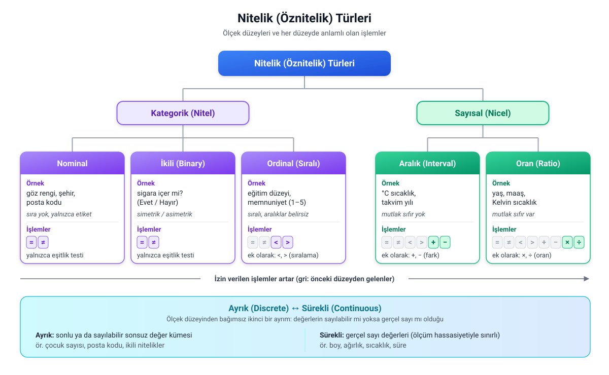
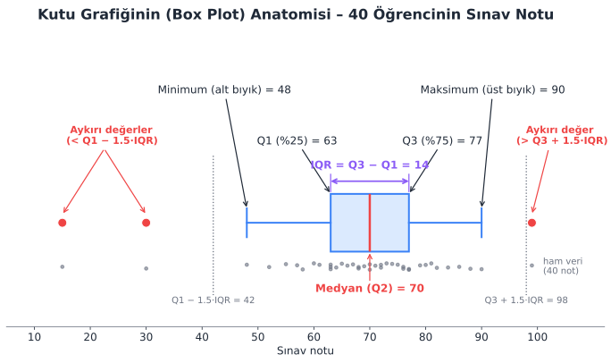
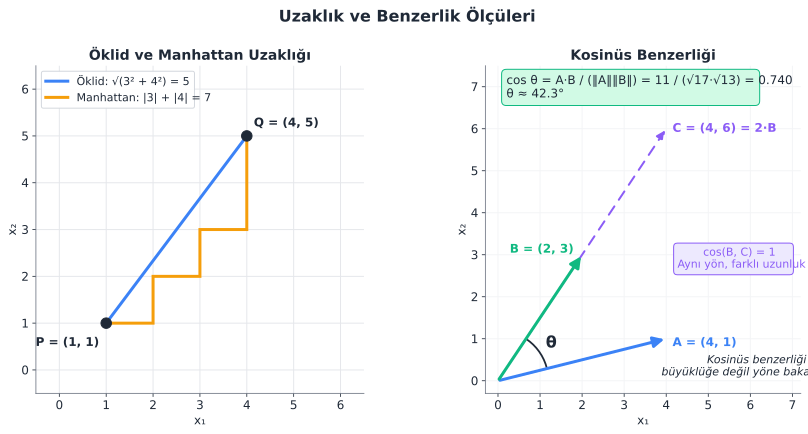

# 3. Veriyi Tanımak

Bir doktor tedaviye başlamadan önce hastayı muayene eder. Veri madencisi de algoritmaya başlamadan önce veriyi "muayene etmelidir": Hangi tür değişkenler var, değerler nasıl dağılıyor, kayıtlar birbirine ne kadar benziyor?

## 3.1 Veri Nesneleri ve Nitelik Türleri

Bir veri seti **veri nesnelerinden (data objects)** oluşur. Bu nesnelere bağlama göre *örnek (instance)*, *kayıt*, *gözlem* ya da *satır* denir. Her nesne bir dizi **nitelikle (attribute)** tanımlanır; nitelik yerine *öznitelik*, *özellik (feature)*, *değişken* ya da *sütun* da denir. Bir müşteri tablosunda her müşteri bir nesne; yaş, şehir ve gelir ise niteliklerdir.

Niteliğin **türü**, onunla hangi işlemleri yapabileceğimizi belirler:



| Tür | Açıklama | Örnek | Anlamlı işlemler | Merkezi eğilim |
|---|---|---|---|---|
| **Nominal** | Sadece isim/etiket; sıra yok | Göz rengi, şehir, meslek | =, ≠ | Mod |
| **İkili (Binary)** | İki durumlu nominal | Sigara içiyor mu? (E/H) | =, ≠ | Mod |
| **Ordinal (Sıralı)** | Sıra anlamlı, aralıklar değil | Eğitim düzeyi, memnuniyet (1–5) | =, ≠, <, > | Medyan, mod |
| **Aralık (Interval)** | Farklar anlamlı, mutlak sıfır yok | °C sıcaklık, takvim yılı | + , − | Ortalama, medyan, mod |
| **Oran (Ratio)** | Mutlak sıfır var, oranlar anlamlı | Yaş, maaş, uzunluk, Kelvin | +, −, ×, ÷ | Tüm ölçüler |

Neden önemli? "20 °C, 10 °C'nin iki katı sıcaktır" demek **yanlıştır**, çünkü Celsius'ta sıfır noktası keyfidir (aralık ölçeği). Oysa "40 yaşındaki biri 20 yaşındakinin iki katı yaşlıdır" demek doğrudur (oran ölçeği). Benzer şekilde, şehirleri 1, 2, 3 diye kodlayıp ortalamasını almak anlamsızdır.

İkili nitelikler de kendi içinde ayrılır. **Simetrik** ikili nitelikte iki durum eşit önemdedir (cinsiyet). **Asimetrik** ikili nitelikte ise bir durum çok daha nadir ve önemlidir (bir hastalık testinin pozitif çıkması). Bu ayrım, aşağıda göreceğimiz benzerlik ölçülerini doğrudan etkiler.

Niteliklerin bir de **ayrık (discrete)** ya da **sürekli (continuous)** olup olmadığına bakılır. Ayrık nitelikler sonlu veya sayılabilir sayıda değer alır (çocuk sayısı, posta kodu). Sürekli nitelikler gerçel sayılarla ifade edilir (boy, sıcaklık).

## 3.2 Temel İstatistiksel Betimlemeler

Veriyi tanımanın ilk adımı birkaç özet istatistiğe bakmaktır.

> **Formülleri okuma rehberi.** Bu notta önemli formüllerin hemen altında aynı formülün **açıklamalı** bir kopyası vardır: Üst ve alt parantezler (︷ ︸), formülün hangi parçasının ne anlama geldiğini gösterir. **"Ne anlatıyor?"** satırı ise formülün ne söylediğini sade bir dille açıklar; tablodaki "Nasıl okunur?" sütunu yalnızca sembollerin okunuşunu verir. En sık karşılaşacağınız semboller:
>
> | Sembol | Nasıl okunur? | Anlamı |
> |---|---|---|
> | $\sum_{i=1}^{n} x_i$ | "i eşittir 1'den n'ye kadar x alt i'lerin toplamı" | $x_1 + x_2 + \dots + x_n$ |
> | $x_i$ | "x alt i" | i. değer (i yalnızca bir sıra numarasıdır) |
> | $\bar{x}$ | "x bar" | x değerlerinin ortalaması |
> | $\mu$, $\sigma$ | "mü", "sigma" | ortalama (merkez), standart sapma |
> | $\lvert a \rvert$ | "a'nın mutlak değeri" | işaretsiz büyüklük; bir küme için ($\lvert A \rvert$) **eleman sayısı** |
> | $\lVert x \rVert$ | "x'in normu" | vektörün uzunluğu |
> | $A \cap B$, $A \cup B$ | "A kesişim B", "A birleşim B" | iki kümenin ortak öğeleri; iki kümedeki tüm öğeler |
> | $x \in A$ | "x, A'nın elemanı" | x, A kümesinde yer alıyor |
> | $P(Y \mid X)$ | "X verildiğinde Y'nin olasılığı" | X'in gerçekleştiği bilinirken Y'nin olasılığı |
> | $\log_2 p$ | "log iki tabanında p" | 2'nin kaçıncı kuvveti p eder? |
> | $X \Rightarrow Y$ | "X ise Y" | kural: X varsa Y de vardır |

**Merkezi eğilim ölçüleri:**

* **Ortalama (mean):** $\bar{x} = \frac{1}{n}\sum_{i=1}^{n} x_i$. Aykırı değerlere çok duyarlıdır: Bir mahallede 9 kişi ayda 30 bin TL, 1 kişi 3 milyon TL kazanıyorsa ortalama gelir yaklaşık 327 bin TL çıkar. Bu rakam kimseyi temsil etmez.

```math
\underbrace{\bar{x}}_{\text{ortalama}} = \underbrace{\frac{1}{n}}_{\substack{\text{toplamı}\\\text{n'ye böl}}} \; \underbrace{\sum_{i=1}^{n}}_{\substack{\text{i = 1'den n'ye kadar}\\\text{hepsini topla}}} \overbrace{x_i}^{\text{i. değer}}
```

**Ne anlatıyor?** Bütün değerler toplanır ve değer sayısına bölünür.

* **Medyan (median):** Sıralanmış verinin ortasındaki değerdir. Aykırı değerlere dayanıklıdır; yukarıdaki örnekte medyan 30 bin TL'dir.
* **Mod (mode):** En sık görülen değerdir. Nominal veride kullanılabilen tek merkezi eğilim ölçüsüdür.

Dağılım simetrikse bu üç ölçü birbirine yakındır. Gelir gibi **sağa çarpık (pozitif çarpık)** dağılımlarda ise genellikle *mod < medyan < ortalama* olur.

**Yayılım ölçüleri:**

* **Değişim aralığı (range):** maks − min.
* **Çeyrekler (quartiles):** Q1 (%25), Q2 = medyan (%50), Q3 (%75).
* **Çeyrekler arası açıklık (IQR):** Q3 − Q1. Verinin ortadaki %50'sinin yayıldığı aralıktır.
* **Varyans ve standart sapma:** $\sigma^2 = \frac{1}{n}\sum_{i=1}^{n}(x_i - \bar{x})^2$, $\sigma = \sqrt{\sigma^2}$.

```math
\underbrace{\sigma^2}_{\text{varyans}} = \underbrace{\frac{1}{n}\sum_{i=1}^{n}}_{\substack{\text{n değerin}\\\text{ortalamasını al}}} \underbrace{\big(\overbrace{x_i - \bar{x}}^{\text{ortalamadan sapma}}\big)^2}_{\text{sapmanın karesi}} \qquad \underbrace{\sigma}_{\text{standart sapma}} = \sqrt{\sigma^2}
```

**Ne anlatıyor?** Her değerin ortalamadan ne kadar saptığı bulunur ve karesi alınır (ortalamanın altındaki ve üstündeki sapmalar birbirini götürmesin diye); bu karelerin ortalaması varyanstır. Karekök almak, birimi verinin birimine geri döndürür (TL² → TL).

**Beş sayı özeti ve kutu grafiği.** *Minimum, Q1, Medyan, Q3, Maksimum* değerlerine **beş sayı özeti** denir ve **kutu grafiği (box plot)** ile görselleştirilir. Kutu Q1'den Q3'e uzanır, içindeki çizgi medyandır. Bıyıklar (whiskers), aykırı sayılmayan en uç değerlere kadar uzanır. **Q1 − 1.5·IQR**'nin altında veya **Q3 + 1.5·IQR**'nin üstünde kalan noktalar aykırı değer adayı olarak tek tek işaretlenir.

```math
\underbrace{\overbrace{Q_1}^{\text{1. çeyrek}} - \overbrace{1.5 \cdot \text{IQR}}^{\substack{\text{kutu boyunun}\\\text{1.5 katı}}}}_{\substack{\text{alt sınır: altındaki noktalar}\\\text{aykırı değer adayı}}} \qquad \underbrace{\overbrace{Q_3}^{\text{3. çeyrek}} + \overbrace{1.5 \cdot \text{IQR}}^{\substack{\text{kutu boyunun}\\\text{1.5 katı}}}}_{\substack{\text{üst sınır: üstündeki noktalar}\\\text{aykırı değer adayı}}}
```

**Ne anlatıyor?** Kutunun boyu (IQR = Q3 − Q1) 1.5 ile çarpılır ve bu pay, kutunun alt kenarından (Q1) aşağıya, üst kenarından (Q3) yukarıya doğru eklenir. Bu iki sınırın dışında kalan noktalar, verinin ortadaki yarısından alışılmadık ölçüde uzak olduğu için aykırı değer adayı sayılır.



Şekildeki örnekte 40 öğrencinin sınav notları kullanılmıştır: Q1 = 63, medyan = 70, Q3 = 77, dolayısıyla IQR = 14'tür. Aykırı değer sınırları 63 − 1.5·14 = **42** ve 77 + 1.5·14 = **98** olarak hesaplanır. Bu nedenle 15, 30 ve 99 notları aykırı değer olarak işaretlenmiş, bıyıklar ise sınırlar içindeki en uç değerlere (48 ve 90) kadar uzanmıştır. Sınıf ortalaması (68.6) iki düşük aykırı değer yüzünden medyanın (70) altında kalmıştır.

## 3.3 Veri Görselleştirme

"Bir resim bin kelimeye bedeldir" sözü veri analizinde de geçerlidir. Keşifsel veri analizinde en çok kullanılan grafikler şunlardır:

| Grafik | Ne gösterir? | Ne zaman? |
|---|---|---|
| **Histogram** | Tek bir sayısal değişkenin dağılımı | Çarpıklık, çok tepelilik kontrolü |
| **Kutu grafiği** | Beş sayı özeti ve aykırı değerler | Grupları karşılaştırma |
| **Saçılım grafiği (scatter)** | İki sayısal değişken arasındaki ilişki | Korelasyon, kümelenme |
| **Saçılım matrisi (pair plot)** | Tüm değişken çiftleri | Çok değişkenli ilk bakış |
| **Isı haritası (heatmap)** | Korelasyon matrisi | Fazlalık (redundancy) tespiti |
| **Çubuk grafik** | Kategorik değişkenin frekansları | Sınıf dengesizliği kontrolü |
| **Paralel koordinatlar** | Yüksek boyutlu veride her nesne bir çizgi | Çok boyutlu örüntüler |

Anscombe dörtlüsü (Anscombe's quartet) görselleştirmenin neden vazgeçilmez olduğunu çarpıcı biçimde gösterir. Ortalaması, varyansı, korelasyonu ve regresyon doğrusu neredeyse aynı olan dört veri seti, grafiğe döküldüğünde tamamen farklı yapılar sergiler. *Özet istatistiklere bakmak yetmez; veriyi mutlaka çizin.*

## 3.4 Benzerlik ve Uzaklık Ölçüleri

Kümeleme, k-en yakın komşu ve aykırı değer tespiti gibi pek çok yöntem tek bir soruya dayanır: **"İki nesne birbirine ne kadar benziyor?"** Bu soruyu sayısallaştıran fonksiyonlara **uzaklık (distance)** veya **benzemezlik (dissimilarity)** ölçüleri denir. Bir uzaklık ölçüsü genellikle şu özellikleri sağlamalıdır: negatif olmama, simetri: $d(x,y)=d(y,x)$ ve üçgen eşitsizliği: $d(x,z) \le d(x,y)+d(y,z)$.

**Sayısal nitelikler için Minkowski ailesi.** $p$ boyutlu iki nokta $x$ ve $y$ için:

$$d(x, y) = \left( \sum_{i=1}^{p} |x_i - y_i|^h \right)^{1/h}$$

```math
\underbrace{d(x, y)}_{\substack{\text{x ile y arasındaki}\\\text{uzaklık}}} = \Bigg( \underbrace{\sum_{i=1}^{p}}_{\substack{\text{p boyutun}\\\text{hepsinde topla}}} \overbrace{|x_i - y_i|}^{\substack{\text{i. boyuttaki fark}\\\text{(işaretsiz)}}}{}^{\,h} \Bigg)^{1/h}
```

**Ne anlatıyor?** İki nokta arasındaki farklar her boyutta ayrı ayrı alınır, mutlak değerlerinin h. kuvvetleri toplanır ve toplamın h. dereceden kökü alınır. $h = 2$ için her boyuttaki farkın karesi alınır, toplanır ve karekökü alınır; bu, Pisagor teoreminin p boyuta genişletilmiş hâlidir.

* $h = 2$ → **Öklid uzaklığı (Euclidean):** Kuş uçuşu uzaklık.
* $h = 1$ → **Manhattan uzaklığı (City-block):** Izgara biçimli sokaklarda taksinin gideceği yol.
* $h \to \infty$ → **Supremum (Chebyshev) uzaklığı:** En büyük tek boyut farkı.

**Kosinüs benzerliği (Cosine similarity)** iki vektör arasındaki açının kosinüsüdür:

```math
\cos(x, y) = \frac{x \cdot y}{\|x\| \, \|y\|}
```

```math
\underbrace{\cos(x, y)}_{\substack{\text{x ile y'nin}\\\text{benzerliği}}} = \frac{\overbrace{x \cdot y}^{\substack{\text{iç çarpım: aynı boyuttaki}\\\text{değerleri çarp, topla}}}}{\underbrace{\|x\|}_{\text{x'in uzunluğu}} \, \underbrace{\|y\|}_{\text{y'nin uzunluğu}}}
```

**Ne anlatıyor?** İki vektörün iç çarpımı, uzunluklarının çarpımına bölünür; sonuç, vektörler arasındaki açının kosinüsüdür. Vektörün uzunluğu $\lVert x \rVert = \sqrt{x_1^2 + \dots + x_p^2}$'dir. Paydaki iç çarpımı uzunluklara bölmek, vektörlerin büyüklüğünün etkisini siler; geriye yalnızca **yön** kalır.

Kosinüs benzerliği vektörlerin *büyüklüğüne değil yönüne* bakar. Bu yüzden metin madenciliğinde vazgeçilmezdir. Bir makale ile aynı makalenin iki kez arka arkaya yazılmış hâlinin kelime sayıları farklıdır, ama "konuları" aynıdır ve kosinüs benzerlikleri 1 çıkar.



**İkili ve küme verisi için Jaccard katsayısı.** Asimetrik ikili verilerde (ör. iki müşterinin satın aldığı ürünler) "ikisinin de almadığı" ürünler bir benzerlik göstergesi değildir. Bir markette 10.000 ürün varsa, herhangi iki müşteri ürünlerin neredeyse tamamını almamıştır! Jaccard katsayısı bu yüzden yalnızca en az birinde bulunan öğelere bakar:

$$J(A, B) = \frac{|A \cap B|}{|A \cup B|}$$

```math
\underbrace{J(A, B)}_{\substack{\text{A ile B'nin}\\\text{benzerliği}}} = \frac{\overbrace{|A \cap B|}^{\substack{\text{ikisinde de olan}\\\text{öğe sayısı}}}}{\underbrace{|A \cup B|}_{\substack{\text{en az birinde olan}\\\text{öğe sayısı}}}}
```

**Ne anlatıyor?** İki kümenin ortak öğe sayısı, iki kümedeki toplam farklı öğe sayısına bölünür. Buradaki dikey çizgiler mutlak değer değil, **kümenin eleman sayısıdır**. Örnek: A = {ekmek, süt, peynir}, B = {süt, peynir, zeytin} ise ortak 2 öğe, toplam 4 farklı öğe vardır: J = 2/4 = 0.5.

> **Ölçeklendirme uyarısı:** Uzaklık tabanlı yöntemlerde nitelikler farklı ölçeklerdeyse (yaş: 18–80, gelir: 10.000–1.000.000) büyük ölçekli nitelik uzaklığı tek başına belirler. Bu yüzden uzaklık hesaplamadan önce veri mutlaka **normalize** edilmelidir (bkz. Bölüm 4.5).

**Python ile uzaklık ölçüleri:**

```python
import numpy as np
from scipy.spatial import distance

P = np.array([1, 1])
Q = np.array([4, 5])
print("Öklid    :", distance.euclidean(P, Q))         # 5.0
print("Manhattan:", distance.cityblock(P, Q))         # 7
print("Chebyshev:", distance.chebyshev(P, Q))         # 4

A = np.array([4, 1])
B = np.array([2, 3])
C = np.array([4, 6])                                  # B ile aynı yönde, 2 kat uzun
print("cos(A, B):", round(1 - distance.cosine(A, B), 3))
print("cos(B, C):", round(1 - distance.cosine(B, C), 3))   # 1.0 → yön aynı

# Jaccard: iki müşterinin sepetleri
sepet1 = {"ekmek", "süt", "yumurta"}
sepet2 = {"ekmek", "süt", "peynir", "zeytin"}
jaccard = len(sepet1 & sepet2) / len(sepet1 | sepet2)
print("Jaccard  :", round(jaccard, 3))                # 2 / 5 = 0.4
```

> **Kendinizi sınayın**
>
> 1. P = (1, 0, 2) ve Q = (4, 4, 8) noktaları arasındaki Öklid, Manhattan ve Chebyshev uzaklıklarını hesaplayın.
> 2. A = {çay, şeker, ekmek} ve B = {çay, simit} sepetlerinin Jaccard katsayısı nedir?
> 3. Bir sınıftaki öğrencilerin "doğum yılı" niteliği hangi ölçek türündendir? "2004 doğumlu, 1002 doğumlunun iki katı yaşlıdır" demek neden anlamsızdır?
>
> **Cevaplar:** (1) Farklar 3, 4 ve 6'dır. Öklid = √(9 + 16 + 36) = √61 ≈ 7.81, Manhattan = 3 + 4 + 6 = 13, Chebyshev = 6. (2) Ortak öğe 1 (çay), toplam farklı öğe 4: J = 1/4 = 0.25. (3) Takvim yılı bir **aralık** ölçeğidir: Farklar anlamlıdır, ama sıfır noktası (yıl 0) keyfidir; bu yüzden oran almak anlamsızdır.

---

[← 2. Bilgi Keşfi Süreç Modelleri](02-bilgi-kesfi-surec-modelleri.md) · [İçindekiler](../ders_notu.md) · [4. Veri Ön İşleme →](04-veri-on-isleme.md)
