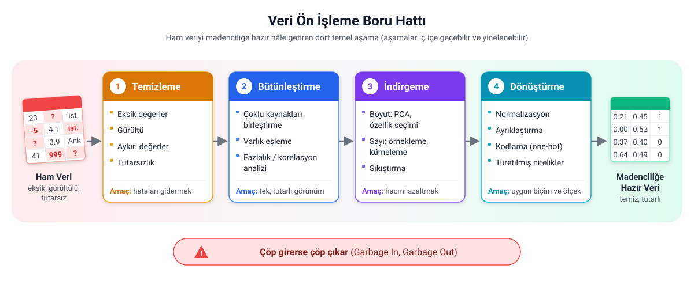
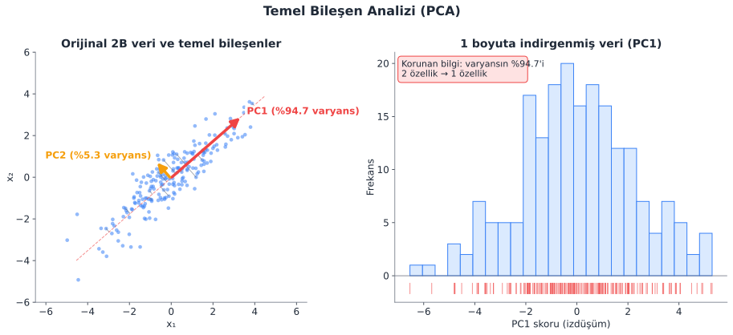
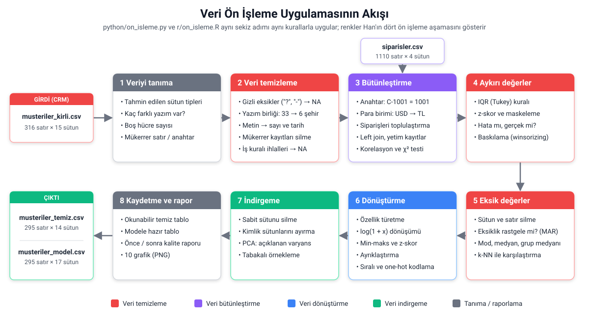

# 4. Veri Ön İşleme

## 4.1 Neden Ön İşleme?

Gerçek dünya verisi kirlidir. Han ve arkadaşları veri kalitesini belirleyen başlıca boyutları şöyle sıralar: **doğruluk, bütünlük (eksiksizlik), tutarlılık, güncellik, güvenilirlik ve yorumlanabilirlik.** Tipik sorunlar şunlardır:

* **Eksik değerler:** Müşteri gelirini girmemiş, sensör bir süre veri gönderememiş.
* **Gürültü ve hatalar:** Yaş = 250, maaş = −10.000, yazım hataları ("İstanbul", "istanbul", "Istanbul").
* **Tutarsızlıklar:** Bir sistemde doğum tarihi GG/AA/YYYY, diğerinde AA/GG/YYYY.
* **Fazlalık (redundancy):** Aynı bilginin iki farklı sütunda tutulması (yıllık ve aylık gelir).

"**Çöp girerse çöp çıkar (Garbage In, Garbage Out)**." En gelişmiş algoritma bile kötü veriden iyi sonuç üretemez. Ön işleme dört ana adımda ele alınır:



## 4.2 Veri Temizleme

**Eksik değerlerle başa çıkma yöntemleri:**

1. **Kaydı silmek:** Eksik oranı çok düşükse ve eksiklik rastgeleyse kabul edilebilir. Aksi hâlde ciddi bilgi kaybına ve yanlılığa yol açar.
2. **Elle doldurmak:** Küçük veride mümkündür, büyük veride pratik değildir.
3. **Sabit bir değerle doldurmak:** "Bilinmiyor" gibi. Algoritma bunu anlamlı bir kategori sanabilir.
4. **Merkezi eğilim ölçüsüyle doldurmak:** Sayısal nitelikte ortalama (çarpık dağılımda medyan), kategorik nitelikte mod.
5. **Sınıf bazında doldurmak:** Eksik gelir değerini, aynı kredi risk sınıfındaki müşterilerin ortalamasıyla doldurmak.
6. **Tahminle doldurmak:** Regresyon, k-NN veya karar ağacı ile eksik değeri diğer niteliklerden tahmin etmek. Genellikle en iyi sonucu verir.

**Gürültüyü azaltma:**

* **Kovalama (binning):** Değerler sıralanıp eşit frekanslı kovalara bölünür. Her kovadaki değerler kova ortalaması, medyanı veya sınırlarıyla değiştirilerek yumuşatılır.
* **Regresyon:** Veriye bir fonksiyon uydurup değerleri bu fonksiyonla düzeltmek.
* **Aykırı değer analizi:** Kümeleme veya istatistiksel yöntemlerle aykırı değerleri tespit edip incelemek (bkz. Bölüm 10).

## 4.3 Veri Bütünleştirme

Veri çoğunlukla birden fazla kaynaktan gelir: CRM sistemi, muhasebe yazılımı, web logları. Bunları birleştirirken üç tipik sorunla karşılaşılır:

* **Varlık tanımlama (entity identification):** Bir sistemdeki `musteri_no` ile diğerindeki `cust_id` aynı şeyi mi ifade ediyor? Aynı kişi iki sistemde farklı yazılmış olabilir.
* **Fazlalık ve korelasyon analizi:** İki nitelik birbirinden türetilebiliyorsa biri gereksizdir. Sayısal nitelikler için **Pearson korelasyon katsayısı**, kategorik nitelikler için **χ² (ki-kare) testi** ile tespit edilir.
* **Değer çakışmaları:** Bir sistemde fiyat KDV dahil, diğerinde hariç; bir sistemde mesafe km, diğerinde mil.

## 4.4 Veri İndirgeme

Veri çok büyükse analiz hem yavaşlar hem de zorlaşır. Veri indirgemenin amacı, *analiz sonuçlarını neredeyse aynı bırakacak* şekilde daha küçük bir temsil elde etmektir.

**1) Sayı indirgeme (numerosity reduction):** Satır sayısını azaltmak.

* **Basit rastgele örnekleme:** Yerine koymadan veya yerine koyarak.
* **Tabakalı örnekleme (stratified sampling):** Her sınıftan, popülasyondaki oranıyla örnek alınır. Dengesiz verilerde nadir sınıfın kaybolmaması için şarttır.
* Kümeleme veya histogram ile veriyi özet temsillere dönüştürmek.

**2) Boyut indirgeme (dimensionality reduction):** Sütun sayısını azaltmak.

* **Özellik seçimi (feature selection):** Mevcut niteliklerden en bilgilendirici alt küme seçilir. Üç yaklaşım vardır: **filtre (filter)** yöntemleri (korelasyon, bilgi kazancı, χ²), **sarmalayıcı (wrapper)** yöntemler (alt kümeleri bir modelle deneme) ve **gömülü (embedded)** yöntemler (Lasso, karar ağaçlarının önem skorları).
* **Özellik çıkarma (feature extraction):** Mevcut niteliklerin birleşiminden yeni, daha az sayıda nitelik üretilir. En bilineni **Temel Bileşenler Analizi (Principal Component Analysis — PCA)**'dir.

**PCA'nın sezgisi:** Bir el fenerinin önüne üç boyutlu bir nesne koyduğunuzu ve duvara düşen gölgesine baktığınızı düşünün. Bazı açılardan gölge nesneyi çok iyi anlatır, bazılarından hiçbir şey anlatmaz. PCA, veriyi en "bilgilendirici gölgeyi" verecek yönlere izdüşürür. Matematiksel olarak, verinin **en çok varyans gösterdiği** dik (ortogonal) yönleri bulur:

* **PC1 (1. temel bileşen):** Verinin en çok yayıldığı yön.
* **PC2:** PC1'e dik yönler arasında en çok varyansın olduğu yön, vb.

Bu yönler, verinin kovaryans matrisinin **özvektörleridir (eigenvectors)**. Her yönde açıklanan varyans ise ilgili **özdeğer (eigenvalue)** ile orantılıdır. Genellikle toplam varyansın %90–95'ini açıklayan ilk birkaç bileşen tutulur, gerisi atılır.



Şekildeki iki boyutlu, güçlü korelasyonlu veride PC1 tek başına toplam varyansın **%94.7**'sini açıklar. Veriyi yalnızca PC1'e izdüşürerek tek boyuta indirmek, bilginin yaklaşık %5'ini kaybetmek pahasına boyutu yarıya düşürür.

> **Dikkat:** PCA ölçeğe duyarlıdır; uygulamadan önce veri standartlaştırılmalıdır. Ayrıca yeni bileşenler orijinal niteliklerin karışımı olduğundan yorumlanabilirlik azalır.

## 4.5 Veri Dönüştürme ve Ayrıklaştırma

**Normalizasyon.** Nitelikleri ortak bir ölçeğe taşır:

* **Min-maks normalizasyonu:** $v' = \dfrac{v - \min_A}{\max_A - \min_A}$ → değerler [0, 1] aralığına taşınır. Aykırı değerlere duyarlıdır.

```math
\underbrace{v'}_{\text{yeni değer}} = \frac{\overbrace{v - \min_A}^{\substack{\text{değerin en küçük}\\\text{değerden uzaklığı}}}}{\underbrace{\max_A - \min_A}_{\substack{\text{A niteliğinin}\\\text{değişim aralığı}}}}
```

**Ne anlatıyor?** Değerin, en küçükten en büyüğe giden aralığın yüzde kaçında olduğu bulunur. Yaş 18–80 aralığındaysa 49 yaş, (49 − 18) / (80 − 18) = 0.5 olur.

* **Z-skor standardizasyonu:** $v' = \dfrac{v - \bar{A}}{\sigma_A}$ → ortalama 0, standart sapma 1 olur. Aykırı değer varsa min-maksa göre daha güvenlidir.

```math
\underbrace{v'}_{\text{z-skoru}} = \frac{\overbrace{v - \bar{A}}^{\text{ortalamadan sapma}}}{\underbrace{\sigma_A}_{\substack{\text{A'nın standart}\\\text{sapması}}}}
```

**Ne anlatıyor?** Değerin ortalamadan kaç standart sapma uzakta olduğu bulunur. Sınav ortalaması 60, standart sapma 10 ise 80 alan öğrencinin z-skoru (80 − 60) / 10 = **2**'dir.

* **Ondalık ölçekleme:** $v' = v / 10^j$ (en büyük mutlak değer 1'in altına inecek şekilde).

```math
\underbrace{v'}_{\text{yeni değer}} = \frac{\overbrace{v}^{\text{özgün değer}}}{\underbrace{10^j}_{\substack{\text{10'un j. kuvveti: en büyük mutlak}\\\text{değeri 1'in altına indirir}}}}
```

**Ne anlatıyor?** Değer 10'un bir kuvvetine bölünür; böylece yalnızca ondalık virgülün yeri kayar. j, verideki en büyük mutlak değer 1'in altına inecek biçimde seçilir. Bütün değerler aynı sayıya bölündüğü için aralarındaki oranlar değişmez.

**Ayrıklaştırma (discretization).** Sürekli bir niteliği aralıklara bölerek kategorik hâle getirir. Örneğin yaş → {genç, orta yaş, yaşlı}. Bazı algoritmalar (ör. klasik Apriori, bazı Naive Bayes sürümleri) yalnızca kategorik veriyle çalışır. Yaklaşımlar:

* **Eşit genişlikli (equal-width):** Aralıklar aynı genişlikte.
* **Eşit frekanslı (equal-frequency):** Her aralıkta yaklaşık aynı sayıda örnek.
* **Entropi tabanlı (denetimli):** Sınıf etiketini en iyi ayıracak kesim noktaları seçilir.

**Kategorik değişkenleri kodlama.** Çoğu algoritma sayısal girdi bekler:

* **One-hot kodlama:** "Şehir" niteliği {İstanbul, Ankara, İzmir} için üç ikili sütun üretir. Nominal veride doğru yöntemdir.
* **Ordinal (etiket) kodlama:** {düşük, orta, yüksek} → {0, 1, 2}. Yalnızca sıralı veride anlamlıdır.

**Python ile tipik bir ön işleme hattı:**

```python
import numpy as np
import pandas as pd
from sklearn.compose import ColumnTransformer
from sklearn.impute import SimpleImputer
from sklearn.pipeline import Pipeline
from sklearn.preprocessing import OneHotEncoder, StandardScaler

df = pd.DataFrame({
    "yas":   [25, 32, np.nan, 51, 46, 29],
    "gelir": [18000, 42000, 35000, np.nan, 120000, 27000],
    "sehir": ["İstanbul", "Ankara", "İzmir", "İstanbul", np.nan, "Ankara"],
})

sayisal = Pipeline([
    ("doldur", SimpleImputer(strategy="median")),        # eksikleri medyanla doldur
    ("olcekle", StandardScaler()),                       # z-skor standardizasyonu
])
kategorik = Pipeline([
    ("doldur", SimpleImputer(strategy="most_frequent")), # eksikleri modla doldur
    ("kodla", OneHotEncoder(handle_unknown="ignore")),   # one-hot kodlama
])

on_isleme = ColumnTransformer([
    ("sayisal", sayisal, ["yas", "gelir"]),
    ("kategorik", kategorik, ["sehir"]),
])

X = on_isleme.fit_transform(df)
pd.set_option("display.width", 120)
print(pd.DataFrame(X, columns=on_isleme.get_feature_names_out()).round(2))
```

`Pipeline` kullanmanın önemli bir faydası vardır: Doldurma ve ölçekleme parametreleri (medyan, ortalama, standart sapma) **yalnızca eğitim verisinden** öğrenilir ve test verisine aynen uygulanır. Böylece test verisinden eğitime bilgi sızması **(data leakage)** önlenir.

## 4.6 Uygulama: Kirli Bir Veri Setini Uçtan Uca Temizlemek

Bu bölümde anlatılan adımların hepsi, bilerek "kirletilmiş" bir müşteri veri seti üzerinde uygulamalı olarak gösterilmiştir. Veri setinde gizli eksik değerler, mükerrer kayıtlar, yazım tutarsızlıkları, imkânsız ve aykırı değerler, karışık tarih biçimleri, farklı para birimleri ve gereksiz sütunlar vardır. Aynı iş hem **Python (pandas)** hem de **R (tidyverse)** ile yapılır ve iki betik aynı temiz tabloyu üretir.



Kodlar, veri seti, grafikler ve adım adım açıklamalar için: **[uygulamalar/veri_on_isleme](../uygulamalar/veri_on_isleme/README.md)**

> **Kendinizi sınayın**
>
> 1. Yaş niteliği 18–80 aralığındadır. 30 yaşındaki bir müşterinin min-maks normalizasyonu sonrası değeri nedir?
> 2. Sınav ortalaması 60, standart sapması 10 ise 45 alan öğrencinin z-skoru nedir? Bu değer neyi anlatır?
> 3. Gelir niteliği sağa çarpıktır ve %8 oranında eksiktir. Eksikleri ortalama yerine medyanla doldurmak neden daha güvenlidir?
>
> **Cevaplar:** (1) (30 − 18) / (80 − 18) = 12 / 62 ≈ 0.194. (2) (45 − 60) / 10 = −1.5; öğrenci ortalamanın 1.5 standart sapma altındadır. (3) Sağa çarpık dağılımda birkaç çok yüksek gelir ortalamayı yukarı çeker; medyan bu uç değerlerden etkilenmediği için tipik müşteriyi daha iyi temsil eder (Bölüm 3.2).

---

[← 3. Veriyi Tanımak](03-veriyi-tanimak.md) · [İçindekiler](../ders_notu.md) · [5. Veri Ambarı ve OLAP →](05-veri-ambari-ve-olap.md)
