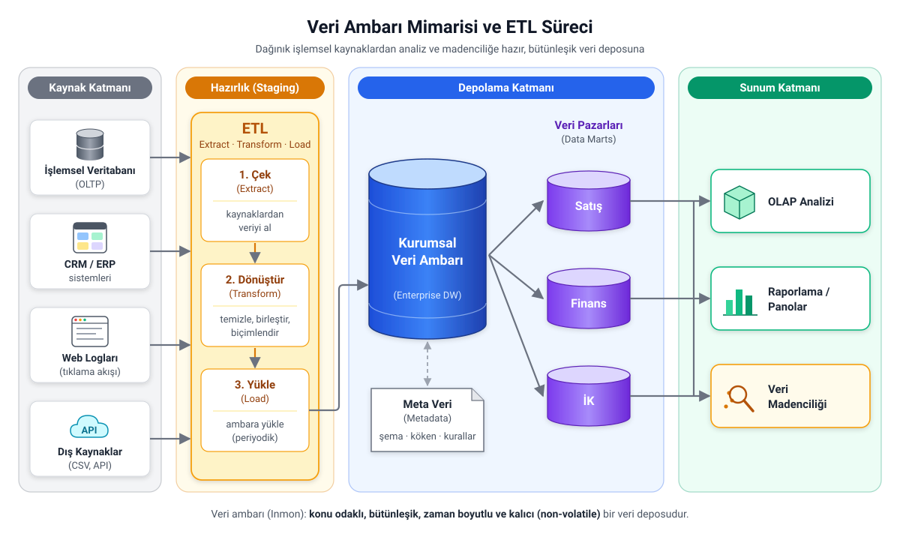
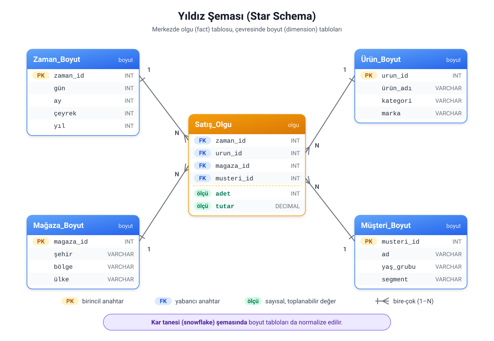
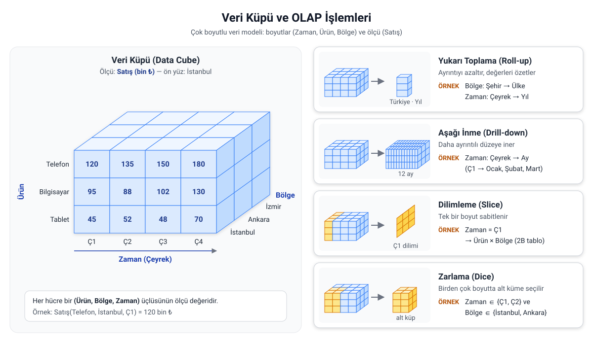

# 5. Veri Ambarı ve OLAP

Kısım II'de Hive'ı "Hadoop üzerinde bir veri ambarı" olarak tanıyacağız. Bu bölümde veri ambarı kavramının kendisini ve analitik sorgulamanın temelini oluşturan OLAP'ı inceleyeceğiz.

## 5.1 OLTP ve OLAP

Bir bankanın veritabanı sistemlerini düşünün. Gün boyunca ATM'lerden, şubelerden ve mobil uygulamadan saniyede binlerce **para yatırma, çekme ve havale** işlemi gelir. Bu işlemler hızlı, küçük ve tutarlı olmalıdır. Öte yandan ay sonunda yönetim "Son üç yılda bölgelere göre kredi kartı harcamaları nasıl değişti?" diye sorar. Bu sorgu milyonlarca kaydı tarar ve dakikalar sürebilir. Bu iki iş yükü o kadar farklıdır ki ayrı sistemlerde çalıştırılır:

| Özellik | **OLTP** (Online Transaction Processing) | **OLAP** (Online Analytical Processing) |
|---|---|---|
| Amaç | Günlük operasyonlar | Analiz ve karar destek |
| Kullanıcı | Memur, müşteri, uygulama | Analist, yönetici |
| İşlem tipi | Kısa okuma/yazma (INSERT, UPDATE) | Uzun, karmaşık, salt okunur sorgular |
| Veri | Güncel, ayrıntılı | Tarihsel, özetlenmiş, bütünleştirilmiş |
| Tasarım | Normalize (3NF), ER modeli | Yıldız / kar tanesi şeması |
| Erişilen kayıt sayısı | Onlarca | Milyonlarca |
| Öncelik | Tutarlılık, eşzamanlılık, hız | Sorgu verimi, esneklik |

## 5.2 Veri Ambarı ve ETL

Bill Inmon'un klasik tanımıyla **veri ambarı (data warehouse)**, yönetimin karar verme süreçlerini desteklemek için tutulan **konu odaklı (subject-oriented)**, **bütünleşik (integrated)**, **zaman boyutlu (time-variant)** ve **kalıcı (nonvolatile)** bir veri koleksiyonudur:

* **Konu odaklı:** Uygulamalara değil müşteri, ürün, satış gibi iş konularına göre düzenlenir.
* **Bütünleşik:** Farklı kaynaklardan gelen veri ortak adlandırma, birim ve formatlara dönüştürülür.
* **Zaman boyutlu:** Geçmiş yılların verisini de içerir; her kayıt bir zaman bağlamına sahiptir.
* **Kalıcı:** Veri yüklendikten sonra genellikle güncellenmez veya silinmez; sadece yenisi eklenir.

Veri, ambara **ETL (Extract–Transform–Load)** süreciyle taşınır:

1. **Çek (Extract):** Kaynak sistemlerden veri alınır.
2. **Dönüştür (Transform):** Temizleme, birim dönüştürme, birleştirme, özetleme yapılır (Bölüm 4'teki adımların büyük kısmı).
3. **Yükle (Load):** Dönüştürülmüş veri ambara yazılır. Bu genellikle gece, toplu (batch) olarak yapılır.

Kurumun tamamına hizmet eden ambarın yanında, tek bir departmana odaklanan daha küçük **veri pazarları (data marts)** da kurulabilir (satış veri pazarı, finans veri pazarı vb.).

## 5.3 Çok Boyutlu Model: Yıldız Şeması ve Veri Küpü

Analistler veriyi doğal olarak **boyutlar** üzerinden düşünür: "*Hangi ürün*, *hangi bölgede*, *hangi dönemde* ne kadar sattı?" Veri ambarları bu düşünce biçimine uygun olarak **çok boyutlu (multidimensional)** modellenir:

* **Olgu (fact) tablosu:** Ölçülen sayısal değerleri (satış tutarı, adet) ve boyut tablolarına işaret eden anahtarları içerir. Çok sayıda satırı vardır.
* **Boyut (dimension) tabloları:** Olguları bağlamlandıran tanımlayıcı bilgileri içerir: zaman, ürün, mağaza, müşteri.

Merkezde bir olgu tablosu ve ona bağlı boyut tablolarından oluşan bu yapıya **yıldız şeması (star schema)** denir:

Boyut tabloları da normalize edilirse (ör. Mağaza → Şehir → Bölge ayrı tablolar) **kar tanesi şeması (snowflake schema)** elde edilir. Bu şema depolamadan tasarruf sağlar, ama sorgularda daha fazla JOIN gerektirir.

Çok boyutlu model kavramsal olarak bir **veri küpü (data cube)** ile görselleştirilir. Küpün her ekseni bir boyut, her hücresi ise ilgili boyut değerlerinin kesişimindeki ölçüdür. Örneğin (Telefon, İstanbul, Ç1) hücresi, İstanbul'da 1. çeyrekte satılan telefonların toplam tutarıdır. "Küp" adı üç boyuttan gelir, ama pratikte boyut sayısı çok daha fazla olabilir (*n-boyutlu küp*, hiperküp).

**Temel OLAP işlemleri:**

| İşlem | Ne yapar? | Örnek |
|---|---|---|
| **Yukarı toplama (Roll-up)** | Bir boyutta hiyerarşide yukarı çıkarak özetler | Şehir → Ülke; Çeyrek → Yıl |
| **Aşağı inme (Drill-down)** | Daha ayrıntılı seviyeye iner | Çeyrek → Ay → Gün |
| **Dilimleme (Slice)** | Bir boyutu tek değere sabitler, alt küp çıkarır | Zaman = Ç1 |
| **Zarlama (Dice)** | Birden fazla boyutta değer aralıkları seçer | Zaman ∈ {Ç1, Ç2} ve Bölge ∈ {İstanbul, Ankara} |
| **Döndürme (Pivot)** | Görünüm eksenlerini değiştirir | Satırlar ↔ sütunlar |

SQL'deki `GROUP BY` ile `ROLLUP` ve `CUBE` uzantıları bu işlemlerin doğrudan karşılığıdır. Örneğin `GROUP BY CUBE(urun, bolge, ceyrek)` sorgusu, üç boyutun tüm $2^3 = 8$ alt kümesi için toplamları tek seferde hesaplar.

## 5.4 Veri Ambarından Veri Gölüne

Klasik veri ambarları iki varsayıma dayanır: Veri **yapılandırılmıştır** ve şema **yazmadan önce (schema-on-write)** belirlenir. Büyük veri çağında ise bu varsayımlar zorlanır. Log dosyaları, JSON belgeleri, görüntüler ve sensör akışları önceden tanımlanmış tablolara kolayca sığmaz.

**Veri gölü (data lake)**, verinin ham hâliyle, düşük maliyetli ve ölçeklenebilir bir depoda (HDFS, Amazon S3 vb.) saklandığı yaklaşımdır. Şema veri **okunurken (schema-on-read)** uygulanır.

| | Veri Ambarı | Veri Gölü |
|---|---|---|
| Veri | Yapılandırılmış, işlenmiş | Her türlü, ham |
| Şema | Yazmadan önce | Okurken |
| Depolama maliyeti | Yüksek | Düşük |
| Kullanıcı | İş analistleri | Veri bilimciler, mühendisler |
| Risk | Esneklik eksikliği | Yönetilmezse **veri bataklığına (data swamp)** dönüşme |

Günümüzde iki yaklaşımı birleştiren **lakehouse** mimarileri (Delta Lake, Apache Iceberg vb.) de yaygınlaşmaktadır. Bu mimariler veri gölünün esnekliğini, ambarın işlem garantileri ve sorgu performansıyla birleştirir. Kısım II'de göreceğimiz **Apache Hive**, HDFS üzerindeki dosyalara tablo yapısı giydirerek SQL ile sorgulanmasını sağlar. Hive bu açıdan veri gölü üzerinde ambar deneyimi sunmanın ilk örneklerinden biridir.

---

[← 4. Veri Ön İşleme](04-veri-on-isleme.md) · [İçindekiler](../ders_notu.md) · [6. Sık Örüntüler ve Birliktelik Kuralları →](06-birliktelik-kurallari.md)
