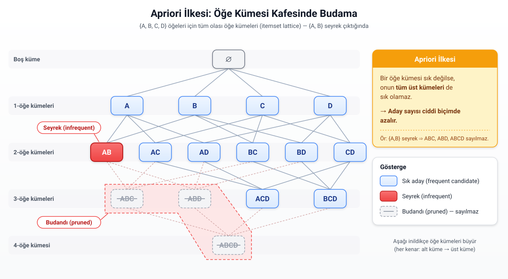

# 6. Sık Örüntüler ve Birliktelik Kuralları

Bir market zincirinin kasa kayıtlarını incelediğini düşünün: Bebek bezi alan müşterilerin sepetinde çoğu zaman bebek maması ve ıslak mendil de var; makarna alanlar domates sosunu, çay alanlar şekeri de sepete koyuyor. Bu örüntülerin bir kısmı sezgiyle tahmin edilebilir, bir kısmı ise ancak veriye bakınca ortaya çıkar. **Birlikte satın alınan ürünleri bulmak**, raf düzeninden kampanya tasarımına, çapraz satıştan öneri sistemlerine kadar pek çok kararı besler. Bu analize **pazar sepeti analizi (market basket analysis)** denir.

## 6.1 Temel Kavramlar: Destek, Güven, Lift

Aşağıdaki beş alışveriş fişini (işlem) ele alalım (Tan ve ark.'ndan uyarlanmıştır):

| İşlem No | Ürünler |
|---|---|
| 1 | Ekmek, Süt |
| 2 | Ekmek, Bez, Mama, Yumurta |
| 3 | Süt, Bez, Mama, Kola |
| 4 | Ekmek, Süt, Bez, Mama |
| 5 | Ekmek, Süt, Bez, Kola |

* **Öğe (item):** Tek bir ürün, ör. *Mama*.
* **Öğe kümesi (itemset):** Bir veya daha fazla öğeden oluşan küme. *k* öğeli kümeye *k-öğe kümesi* denir, ör. {Bez, Mama} bir 2-öğe kümesidir.
* **Birliktelik kuralı (association rule):** $X \Rightarrow Y$ biçiminde bir çıkarım. $X$ ve $Y$ ayrık öğe kümeleridir, ör. {Bez} ⇒ {Mama}.

Bir kuralın gücü üç ölçüyle değerlendirilir:

**Destek (Support):** Kuraldaki öğelerin tamamının birlikte görüldüğü işlemlerin oranıdır. Kuralın *ne kadar sık* geçerli olduğunu gösterir.

$$\text{destek}(X \Rightarrow Y) = P(X \cup Y) = \frac{\text{X ve Y'yi birlikte içeren işlem sayısı}}{\text{toplam işlem sayısı}}$$

```math
\underbrace{\text{destek}(X \Rightarrow Y)}_{\text{kuralın desteği}} = \underbrace{P(X \cup Y)}_{\substack{\text{bir fişte X'in ve Y'nin}\\\text{birlikte bulunma olasılığı}}}
```

**Ne anlatıyor?** Kuralın desteği, X'i ve Y'yi birlikte içeren fişlerin bütün fişlere oranıdır. **Dikkat:** Buradaki $\cup$ "X veya Y" anlamına gelmez. $X \cup Y$, X'teki ve Y'deki öğelerin hepsinden oluşan öğe kümesidir. Fişin bu kümenin **tamamını**, yani X'i ve Y'yi **birlikte** içermesi gerekir.

**Güven (Confidence):** X'i içeren işlemlerin ne kadarının Y'yi de içerdiğini gösterir. Kuralın *ne kadar güvenilir* olduğunun ölçüsüdür.

$$\text{güven}(X \Rightarrow Y) = P(Y \mid X) = \frac{\text{destek}(X \cup Y)}{\text{destek}(X)}$$

```math
\underbrace{\text{güven}(X \Rightarrow Y)}_{\text{kuralın güveni}} = \underbrace{P(Y \mid X)}_{\substack{\text{X alındığı bilinirken}\\\text{Y'nin de alınma olasılığı}}} = \frac{\overbrace{\text{destek}(X \cup Y)}^{\text{X ve Y birlikte}}}{\underbrace{\text{destek}(X)}_{\substack{\text{yalnızca X'i içeren}\\\text{fişlere bakılır}}}}
```

**Ne anlatıyor?** Güven, X'i içeren fişlerin ne kadarında Y'nin de bulunduğunu gösterir: X ile Y'nin birlikte desteği, X'in desteğine bölünür. Dikey çizgi ($\mid$) **"verildiğinde"** diye okunur: Bütün fişleri bırakıp yalnızca X'i içeren fişlere bakarız. Bu yüzden $P(Y \mid X)$ ile $P(X \mid Y)$ genellikle farklıdır.

**Lift:** Güvenin, Y'nin zaten ne kadar yaygın olduğuna göre düzeltilmiş hâlidir.

```math
\text{lift}(X \Rightarrow Y) = \frac{\text{güven}(X \Rightarrow Y)}{\text{destek}(Y)} = \frac{P(X \cup Y)}{P(X)\,P(Y)}
```

```math
\text{lift}(X \Rightarrow Y) = \frac{\overbrace{\text{güven}(X \Rightarrow Y)}^{\substack{\text{X alanlarda}\\\text{Y oranı}}}}{\underbrace{\text{destek}(Y)}_{\substack{\text{tüm fişlerde}\\\text{Y oranı}}}} = \frac{\overbrace{P(X \cup Y)}^{\substack{\text{gerçekte birlikte}\\\text{görülme}}}}{\underbrace{P(X)\,P(Y)}_{\substack{\text{bağımsız olsalardı beklenen}\\\text{birlikte görülme}}}}
```

**Ne anlatıyor?** Lift, X'i alanların Y'yi genel müşteri kitlesine göre **kaç kat** daha sık aldığını gösterir: Güven, Y'nin desteğine bölünür.

* Lift > 1 → X ve Y **pozitif ilişkili**: Birlikte görülme beklenenden sık.
* Lift = 1 → X ve Y **bağımsız**.
* Lift < 1 → X ve Y **negatif ilişkili**: Biri diğerinin olasılığını düşürüyor.

**Örnek:** {Bez} ⇒ {Mama} kuralı için:

* Bez ve Mama'yı birlikte içeren işlemler: 2, 3, 4 → destek = 3/5 = **0.60**
* Bez içeren işlemler: 2, 3, 4, 5 → güven = 3/4 = **0.75**
* Mama'nın desteği 3/5 = 0.60 → lift = 0.75 / 0.60 = **1.25** (pozitif ilişki)

Ters yöndeki {Mama} ⇒ {Bez} kuralının güveni ise 3/3 = **1.00**'dır: Mama alan herkes bez de almış. Bu örnek, birliktelik kurallarının **yönlü** olduğunu ve iki yönün güven değerlerinin farklı olabileceğini gösterir.

> **Neden lift?** "Çay ⇒ Kahve" kuralının güveni %75 olsun. Kulağa güçlü gelir. Ama müşterilerin zaten %90'ı kahve alıyorsa, çay almak kahve alma olasılığını *düşürüyor* demektir (lift = 0.75/0.90 ≈ 0.83). Güven tek başına yanıltıcı olabilir.

**Birliktelik kuralı madenciliği problemi:** Kullanıcının belirlediği bir **minimum destek (min_sup)** ve **minimum güven (min_conf)** eşiğini geçen tüm kuralları bulmak. Bu problem iki adımda çözülür:

1. **Sık öğe kümelerini bulmak:** Desteği ≥ min_sup olan tüm öğe kümeleri. *Hesaplama açısından pahalı kısım budur.*
2. **Kural üretmek:** Her sık öğe kümesinden güveni ≥ min_conf olan kuralları türetmek.

## 6.2 Apriori Algoritması

**Kaba kuvvetin sorunu.** *d* farklı ürün varsa, olası öğe kümesi sayısı $2^d - 1$'dir. Sadece 100 ürünlük bir markette bu sayı yaklaşık $1.27 \times 10^{30}$'dur. Her birinin desteğini tek tek saymak imkânsızdır.

**Apriori ilkesi (Agrawal ve Srikant, 1994):** *Bir öğe kümesi sık ise, onun tüm alt kümeleri de sıktır.* Bunun mantıksal karşıtı daha da işe yarar: **Bir öğe kümesi sık değilse, onun hiçbir üst kümesi sık olamaz.** {Ekmek, Mama} nadiren birlikte alınıyorsa, {Ekmek, Mama, Süt} daha da nadir alınacaktır. Bu özelliğe desteğin **anti-monoton** olması denir. Algoritmanın arama uzayını budamasını (pruning) sağlayan da budur.



**Algoritma (seviye seviye arama):**

1. Tüm 1-öğe kümelerinin desteğini say; min_sup altında kalanları ele → $L_1$.
2. $k = 2$'den başlayarak:
   * **Aday üretme:** $L_{k-1}$'deki kümeleri birleştirerek $k$-öğeli aday kümeler $C_k$ üret.
   * **Budama:** Herhangi bir $(k-1)$-alt kümesi $L_{k-1}$'de olmayan adayları ele (Apriori ilkesi).
   * **Sayma:** Veritabanını bir kez tarayarak kalan adayların desteğini say; min_sup'u geçenler → $L_k$.
3. Yeni sık küme bulunamayana kadar devam et.

**Örnek uygulama** (yukarıdaki 5 işlem, min_sup = 3/5 = %60):

*1. tarama — 1-öğe kümeleri:*

| Öğe | Ekmek | Süt | Bez | Mama | Kola | Yumurta |
|---|---|---|---|---|---|---|
| Sayı | 4 | 4 | 4 | 3 | 2 ✗ | 1 ✗ |

$L_1$ = {Ekmek, Süt, Bez, Mama}

*2. tarama — 2-öğe kümeleri* (dört sık öğeden $\binom{4}{2} = 6$ aday; Kola ve Yumurta içeren 9 aday hiç üretilmedi):

| Aday | {Ekmek, Süt} | {Ekmek, Bez} | {Ekmek, Mama} | {Süt, Bez} | {Süt, Mama} | {Bez, Mama} |
|---|---|---|---|---|---|---|
| Sayı | 3 | 3 | 2 ✗ | 3 | 2 ✗ | 3 |

$L_2$ = {Ekmek, Süt}, {Ekmek, Bez}, {Süt, Bez}, {Bez, Mama}

*3. tarama — 3-öğe kümeleri:*

* {Ekmek, Süt, Bez}: Tüm 2-alt kümeleri sık → aday. Sayı = 2 (işlem 4 ve 5) → **sık değil**.
* {Ekmek, Bez, Mama}: {Ekmek, Mama} sık değil → **sayılmadan budandı**.
* {Süt, Bez, Mama}: {Süt, Mama} sık değil → **sayılmadan budandı**.

Sonuç olarak en büyük sık öğe kümeleri 2 öğelidir. Bunlardan güveni %70'i geçen kurallar:

| Kural | Destek | Güven | Lift |
|---|---|---|---|
| {Mama} ⇒ {Bez} | 0.60 | 1.00 | 1.25 |
| {Bez} ⇒ {Mama} | 0.60 | 0.75 | 1.25 |
| {Ekmek} ⇒ {Süt} | 0.60 | 0.75 | 0.94 |
| {Süt} ⇒ {Ekmek} | 0.60 | 0.75 | 0.94 |
| {Ekmek} ⇒ {Bez} | 0.60 | 0.75 | 0.94 |
| {Bez} ⇒ {Ekmek} | 0.60 | 0.75 | 0.94 |
| {Süt} ⇒ {Bez} | 0.60 | 0.75 | 0.94 |
| {Bez} ⇒ {Süt} | 0.60 | 0.75 | 0.94 |

Tablo öğreticidir: Güven değerleri neredeyse aynı olduğu hâlde yalnızca Bez–Mama ilişkisi *gerçekten* pozitiftir (lift > 1). Diğerleri bu ürünlerin zaten çok yaygın olmasından kaynaklanır.

**Python ile Apriori** (öğretici amaçlı, kütüphanesiz):

```python
from itertools import combinations

islemler = [
    {"Ekmek", "Süt"},
    {"Ekmek", "Bez", "Mama", "Yumurta"},
    {"Süt", "Bez", "Mama", "Kola"},
    {"Ekmek", "Süt", "Bez", "Mama"},
    {"Ekmek", "Süt", "Bez", "Kola"},
]
N = len(islemler)
MIN_SUP, MIN_CONF = 0.6, 0.7

def destek(kume):
    return sum(kume <= t for t in islemler) / N

# 1-öğe kümeleri
ogeler = sorted(set().union(*islemler))
L = [frozenset([o]) for o in ogeler if destek({o}) >= MIN_SUP]
sik_kumeler = list(L)

k = 2
while L:
    # Aday üretme: (k-1)-kümelerin birleşimi
    adaylar = {a | b for a in L for b in L if len(a | b) == k}
    # Apriori budaması: tüm (k-1)-alt kümeleri sık olmalı
    adaylar = [c for c in adaylar
               if all(frozenset(s) in L for s in combinations(c, k - 1))]
    L = [c for c in adaylar if destek(c) >= MIN_SUP]
    sik_kumeler += L
    k += 1

print("Sık öğe kümeleri:")
for s in sik_kumeler:
    print(f"  {set(s)}  destek={destek(s):.2f}")

print("\nKurallar:")
for s in (s for s in sik_kumeler if len(s) > 1):
    for r in range(1, len(s)):
        for X in map(frozenset, combinations(s, r)):
            Y = s - X
            guven = destek(s) / destek(X)
            if guven >= MIN_CONF:
                lift = guven / destek(Y)
                print(f"  {set(X)} => {set(Y)}  güven={guven:.2f}  lift={lift:.2f}")
```

Gerçek projelerde `mlxtend` kütüphanesinin `apriori`, `fpgrowth` ve `association_rules` fonksiyonları, büyük veride ise Spark MLlib'in **FP-Growth** uygulaması kullanılır. Weka'da da aynı iki algoritma hazır bulunur (bkz. Bölüm 6.4).

## 6.3 FP-Growth Algoritması

Apriori'nin iki zayıf noktası vardır: Çok sayıda **aday küme üretir** ve her seviye için **veritabanını baştan tarar**. Sık öğe kümeleri 10 öğeye kadar uzanıyorsa veri 10 kez okunur. **FP-Growth (Frequent Pattern Growth; Han, Pei ve Yin, 2000)** bu iki sorunu birden çözer: Aday üretmez ve veritabanını yalnızca **iki kez** tarar.

**Fikir.** Veriyi, ortak önekleri paylaşan sıkıştırılmış bir ağaçta, **FP-ağacında (FP-tree)** saklamak ve sık kümeleri bu ağaçtan "büyüterek" bulmak.

**Adım 1 — İlk tarama.** Her öğenin desteği sayılır, seyrek öğeler atılır. Kalan öğeler **destekleri azalan sırada** dizilir. Yukarıdaki 5 fişte (min_sup = 3 fiş): Bez 4, Ekmek 4, Süt 4, Mama 3. Kola ve Yumurta atılır. Eşit desteklerde sabit bir sıra seçilir (burada Bez, Ekmek, Süt).

**Adım 2 — İkinci tarama ve ağacın kurulması.** Her fişin sık öğeleri bu sıraya göre dizilir ve ağaca bir yol olarak eklenir. Aynı önekle başlayan fişler aynı düğümleri paylaşır, yalnızca sayaçları artar:

| Fiş | Sıralanmış sık öğeler |
|---|---|
| 1 | Ekmek, Süt |
| 2 | Bez, Ekmek, Mama |
| 3 | Bez, Süt, Mama |
| 4 | Bez, Ekmek, Süt, Mama |
| 5 | Bez, Ekmek, Süt |

```text
(kök)
├── Bez:4
│   ├── Ekmek:3
│   │   ├── Mama:1
│   │   └── Süt:2
│   │       └── Mama:1
│   └── Süt:1
│       └── Mama:1
└── Ekmek:1
    └── Süt:1
```

Beş fiş 9 düğüme sığdı. Gerçek market verisinde fişlerin büyük kısmı "ekmek, süt, …" gibi ortak öneklerle başladığı için sıkıştırma çok daha belirgindir. Ağacın yanında, her öğenin ağaçtaki tüm düğümlerine bağlantı tutan bir **başlık tablosu (header table)** bulunur. Böylece "Mama geçen bütün yollar" hızla gezilebilir.

**Adım 3 — Ağaçtan sık kümeleri çıkarma.** En seyrek öğeden başlanır. Her öğe için, o öğeye giden yolların öneklerinden oluşan **koşullu örüntü tabanı (conditional pattern base)** toplanır:

* **Mama:** Önekler {Bez, Ekmek}:1, {Bez, Ekmek, Süt}:1, {Bez, Süt}:1. Bu tabanda Bez 3, Ekmek 2, Süt 2 kez geçer. Yalnızca Bez eşiği geçer → **{Bez, Mama}: 3**.
* **Süt:** Önekler {Bez, Ekmek}:2, {Bez}:1, {Ekmek}:1. Bez 3, Ekmek 3 → **{Bez, Süt}: 3** ve **{Ekmek, Süt}: 3**. Üçlü {Bez, Ekmek, Süt} ise yalnızca 2 kez geçer → sık değil.
* **Ekmek:** Önekler {Bez}:3 ve boş önek:1 → **{Bez, Ekmek}: 3**.
* **Bez:** Kökün hemen altında olduğu için öneki yoktur.

Sonuç, Apriori'nin bulduğu $L_2$ ile aynıdır. Fark, buraya **aday üretmeden ve veriyi yalnızca iki kez okuyarak** ulaşılmasıdır. Daha büyük veride koşullu örüntü tabanından küçük bir **koşullu FP-ağacı** kurulur ve aynı işlem bu ağaç üzerinde özyinelemeli olarak tekrarlanır.

| | Apriori | FP-Growth |
|---|---|---|
| Aday üretimi | Var (seviye seviye) | Yok |
| Veritabanı taraması | Her seviye için bir kez | 2 |
| Bellek | Aday kümeler | FP-ağacı (veri sığmazsa sorun) |
| Güçlü olduğu durum | Az öğe, yüksek destek eşiği | Çok öğe, düşük destek eşiği, uzun örüntüler |

İki algoritma da **aynı sık öğe kümelerini** bulur. Değişen yalnızca hızdır; kurallar da aynı biçimde (güven eşiğiyle) üretilir.

## 6.4 Uygulama: Weka ve Python ile Pazar Sepeti Analizi

Bu bölümde anlatılanlar, 20 ürün ve 1000 alışveriş fişinden oluşan **sentetik bir market verisi** üzerinde uygulamalı olarak gösterilmiştir. Veriye bilerek gerçekçi örüntüler gömülmüştür: Bez–mama–ıslak mendil, makarna–domates sosu, çay–şeker, peynir–zeytin. Ekmek ise fişlerin %60'ından fazlasında *bağımsız olarak* bulunur, bu yüzden "… ⇒ {ekmek}" kurallarının güveni yüksek ama lift değeri 1'e yakın çıkar.

Aynı veri önce **Weka**'da (Explorer → Associate) **Apriori** ve **FPGrowth** ile, sonra **Python**'da (`mlxtend`) analiz edilir. min_sup = 0.10 ve min_conf = 0.60 ile üç yol da aynı 39 sık öğe kümesini ve aynı 27 kuralı bulur. Ayrıca yukarıdaki 5 fişlik örneğin ARFF dosyası da verilmiştir. Weka bu örnekte, Bölüm 6.2'de elle hesaplanan 8 kuralı aynen üretir.

Veri dosyaları, Weka'da adım adım kullanım, Python kodu ve çıktılar için: **[uygulamalar/birliktelik_kurallari](../uygulamalar/birliktelik_kurallari/README.md)**

> **Kendinizi sınayın** (Bölüm 6.1'deki 5 fiş)
>
> 1. {Kola} ⇒ {Süt} kuralının destek, güven ve lift değerlerini hesaplayın. Bu kural, min_sup = %60 ile çalışan Apriori'nin çıktısında neden yoktur?
> 2. {Ekmek, Süt} ⇒ {Bez} kuralının destek ve güven değerleri nedir?
> 3. Markette 6 farklı ürün varsa, boş küme dışında kaç olası öğe kümesi vardır?
>
> **Cevaplar:** (1) Kola 2 fişte (3 ve 5), ikisinde de süt var: destek = 2/5 = 0.40, güven = 2/2 = 1.00, lift = 1.00 / 0.80 = 1.25. Kural pozitif ilişki gösterir, ama {Kola} kümesinin desteği (0.40) eşiğin altında kaldığı için Kola 1. taramada elenir ve bu kural hiç üretilmez. Destek eşiği, nadir ama güçlü ilişkileri gözden kaçırabilir. (2) Üç ürün birlikte yalnızca 4 ve 5 numaralı fişlerde var: destek = 2/5 = 0.40; {Ekmek, Süt} 3 fişte geçtiği için güven = 2/3 ≈ 0.67. (3) $2^6 - 1 = 63$.

---

[← 5. Veri Ambarı ve OLAP](05-veri-ambari-ve-olap.md) · [İçindekiler](../ders_notu.md) · [7. Sınıflandırma →](07-siniflandirma.md)
