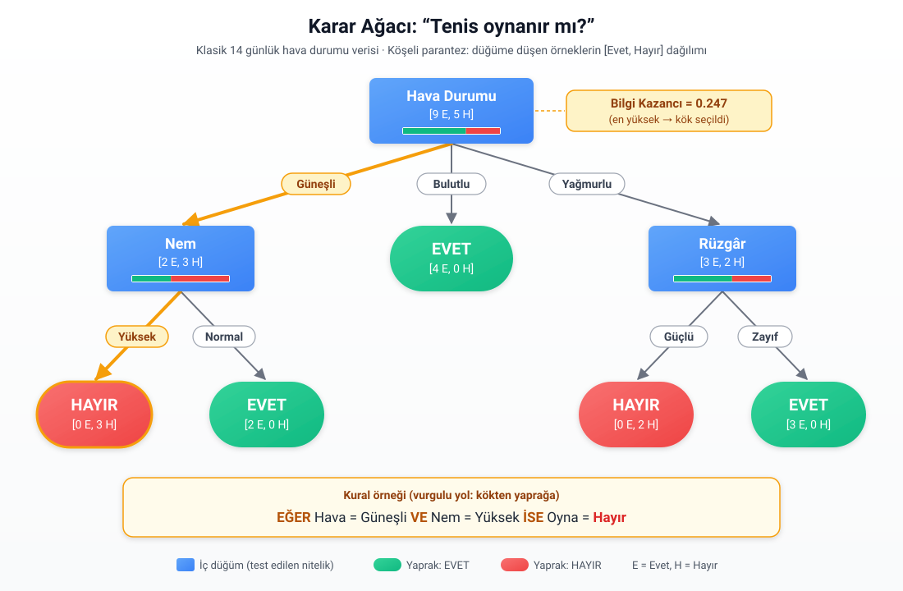
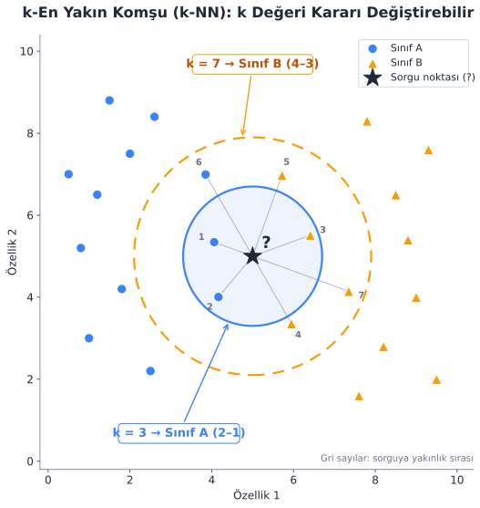

# 7. Sınıflandırma

## 7.1 Temel Kavramlar

**Sınıflandırma (classification)**, önceden etiketlenmiş örneklerden bir model öğrenip yeni örneklerin **kategorik** sınıf etiketini tahmin etme işidir. Bir bankanın geçmiş kredi başvurularını ve bu başvuruların "ödendi / ödenmedi" sonuçlarını kullanarak yeni bir başvurunun riskini tahmin etmesi tipik bir sınıflandırma problemidir.

Süreç iki adımlıdır:

1. **Öğrenme (eğitim) adımı:** Sınıf etiketi bilinen **eğitim verisi** ile bir model kurulur.
2. **Sınıflandırma (tahmin) adımı:** Model önce eğitimde hiç görmediği **test verisi** üzerinde değerlendirilir, başarılıysa yeni verilere uygulanır.

Model eğitim verisini ezberlerse yeni veride başarısız olur. Buna **aşırı öğrenme (overfitting)** denir. İyi bir modelin amacı eğitim verisini değil, **genellemeyi** öğrenmektir (bkz. Bölüm 8.4).

Bu bölümde algoritmaları açıklamak için Quinlan'ın klasik "tenis oynanır mı?" veri setini kullanacağız:

| Gün | Hava Durumu | Sıcaklık | Nem | Rüzgâr | Oyna? |
|---|---|---|---|---|---|
| 1 | Güneşli | Sıcak | Yüksek | Zayıf | Hayır |
| 2 | Güneşli | Sıcak | Yüksek | Güçlü | Hayır |
| 3 | Bulutlu | Sıcak | Yüksek | Zayıf | Evet |
| 4 | Yağmurlu | Ilık | Yüksek | Zayıf | Evet |
| 5 | Yağmurlu | Serin | Normal | Zayıf | Evet |
| 6 | Yağmurlu | Serin | Normal | Güçlü | Hayır |
| 7 | Bulutlu | Serin | Normal | Güçlü | Evet |
| 8 | Güneşli | Ilık | Yüksek | Zayıf | Hayır |
| 9 | Güneşli | Serin | Normal | Zayıf | Evet |
| 10 | Yağmurlu | Ilık | Normal | Zayıf | Evet |
| 11 | Güneşli | Ilık | Normal | Güçlü | Evet |
| 12 | Bulutlu | Ilık | Yüksek | Güçlü | Evet |
| 13 | Bulutlu | Sıcak | Normal | Zayıf | Evet |
| 14 | Yağmurlu | Ilık | Yüksek | Güçlü | Hayır |

## 7.2 Karar Ağaçları

**Karar ağacı (decision tree)**, "20 soru" oyununa benzer. Her iç düğümde bir nitelik sınanır, her dal sınamanın bir sonucunu temsil eder, her yaprak ise bir sınıf etiketidir. Karar ağaçlarının en büyük avantajı **yorumlanabilirliktir**: Kökten yaprağa her yol, insanın okuyabileceği bir EĞER–İSE kuralıdır.



**Ağaç nasıl kurulur?** ID3, C4.5 ve CART gibi algoritmalar ağacı yukarıdan aşağıya, **açgözlü (greedy)** ve özyinelemeli olarak kurar. Her düğümde veriyi *en saf* alt gruplara ayıran nitelik seçilir. "Saflık" ise genellikle **entropi** ile ölçülür.

**Entropi**, bir kümedeki belirsizliğin (karışıklığın) ölçüsüdür. $m$ sınıflı bir $S$ kümesinde $p_i$, $i$. sınıfın oranı olmak üzere:

$$\text{Entropi}(S) = -\sum_{i=1}^{m} p_i \log_2 p_i$$

```math
\underbrace{\text{Entropi}(S)}_{\substack{\text{S kümesindeki}\\\text{belirsizlik (bit)}}} = \overbrace{-}^{\substack{\text{sonucu pozitif}\\\text{yapar}}} \underbrace{\sum_{i=1}^{m}}_{\substack{\text{m sınıfın}\\\text{hepsi için topla}}} \overbrace{p_i}^{\substack{\text{i. sınıfın oranı}\\\text{(ağırlık)}}} \; \underbrace{\log_2 p_i}_{\substack{\text{i. sınıfın}\\\text{"sürpriz" değeri}}}
```

**Ne anlatıyor?** Entropi, bir kümedeki sınıf karışıklığını ölçer: Her sınıfın oranı, o oranın 2 tabanında logaritmasıyla çarpılır, sonuçlar toplanır ve işareti çevrilir. Bütün örnekler aynı sınıftaysa entropi 0, iki sınıf yarı yarıyaysa 1 bittir.

* $p_i$: S'deki örneklerin kaçta kaçının i. sınıfta olduğu. Tenis verisinde $p_{\text{Evet}} = 9/14$.
* $\log_2 p_i$: $p_i$ 1'den küçük olduğu için bu değer **negatiftir**. Sınıf ne kadar nadirse mutlak değeri o kadar büyüktür: Nadir bir sonuç gerçekleştiğinde daha çok "şaşırırız". Taban 2 olduğu için birim **bit**'tir.
* Baştaki eksi işareti: Negatif logaritmaları pozitife çevirir.
* $\sum p_i \cdot (\dots)$: Her sınıfın sürprizini o sınıfın oranıyla ağırlıklandırıp toplar. Entropi, **ortalama sürprizdir**.
* Hiç örneği olmayan sınıf ($p_i = 0$) için $0 \cdot \log_2 0 = 0$ kabul edilir.

Küme tamamen saf ise (tek sınıf) entropi **0**'dır. İki sınıf eşit dağılmışsa entropi **1** (en yüksek belirsizlik) olur.

**Bilgi kazancı (information gain)**, bir $A$ niteliğine göre bölmenin entropiyi ne kadar azalttığını ölçer:

```math
\text{Kazanç}(S, A) = \text{Entropi}(S) - \sum_{v \in \text{Değerler}(A)} \frac{|S_v|}{|S|}\,\text{Entropi}(S_v)
```

```math
\underbrace{\text{Kazanç}(S, A)}_{\substack{\text{A'ya göre bölmenin}\\\text{kazancı}}} = \underbrace{\text{Entropi}(S)}_{\text{bölmeden önce}} - \underbrace{\sum_{v \in \text{Değerler}(A)} \overbrace{\frac{|S_v|}{|S|}}^{\substack{\text{v dalına düşen}\\\text{örnek oranı}}}\,\overbrace{\text{Entropi}(S_v)}^{\text{v dalının entropisi}}}_{\text{bölmeden sonra: dalların ağırlıklı ortalama entropisi}}
```

**Ne anlatıyor?** Bilgi kazancı, bölmeden önceki entropiden, A niteliğine göre bölme sonrasında oluşan alt kümelerin büyüklükleriyle ağırlıklandırılmış entropilerinin toplamı çıkarılarak bulunur. Kazanç ne kadar büyükse bölme, sınıf belirsizliğini o kadar çok azaltır.

* $v \in \text{Değerler}(A)$: "v, A'nın değerlerinden biri". A = Hava Durumu ise v sırasıyla Güneşli, Bulutlu ve Yağmurlu olur.
* $S_v$: S'nin, A niteliği v değerini alan örnekleri; yani v dalına düşen örnekler. $\lvert S_v \rvert$ bunların sayısıdır.
* Kazanç, "bölmeden önceki belirsizlik eksi bölmeden sonraki belirsizlik"tir. Büyük dallar ortalamada daha çok ağırlık alır.

**Elle hesaplama.** Veri setinde 9 Evet, 5 Hayır var:

$$\text{Entropi}(S) = -\tfrac{9}{14}\log_2\tfrac{9}{14} - \tfrac{5}{14}\log_2\tfrac{5}{14} = 0.940$$

Formülün her parçası adım adım:

| Sınıf | $p_i$ | $\log_2 p_i$ (sürpriz, negatif) | $p_i \cdot \log_2 p_i$ |
|---|---|---|---|
| Evet | 9/14 = 0.6429 | −0.6374 | −0.4098 |
| Hayır | 5/14 = 0.3571 | −1.4854 | −0.5305 |
| **Toplam** | | | **−0.9403** |

Baştaki eksi işaretiyle entropi **0.940** olur. Hayır sınıfı daha nadir olduğu için sürprizi daha büyüktür (1.485 bit), ama ağırlığı (0.357) daha küçüktür.

*Hava Durumu* niteliğine göre bölersek:

| Değer | Evet | Hayır | Entropi |
|---|---|---|---|
| Güneşli (5) | 2 | 3 | 0.971 |
| Bulutlu (4) | 4 | 0 | 0.000 |
| Yağmurlu (5) | 3 | 2 | 0.971 |

$$\text{Kazanç}(S, \text{Hava}) = 0.940 - \left(\tfrac{5}{14}\cdot 0.971 + \tfrac{4}{14}\cdot 0 + \tfrac{5}{14}\cdot 0.971\right) = 0.940 - 0.694 = 0.247$$

Aynı hesap diğer nitelikler için yapıldığında: Kazanç(Nem) = 0.152, Kazanç(Rüzgâr) = 0.048, Kazanç(Sıcaklık) = 0.029. **En yüksek kazanç Hava Durumu'nda** olduğundan kök düğüm odur. "Bulutlu" dalı tamamen saftır (4 Evet) ve yaprak olur. Diğer dallarda aynı işlem kalan nitelikler için özyinelemeli olarak tekrarlanır. Sonuçta yukarıdaki ağaç elde edilir.

**Diğer bölme ölçütleri.** Bilgi kazancı çok değerli niteliklere (ör. müşteri numarası) yanlıdır; her müşteriye ayrı dal açan bir nitelik mükemmel(!) kazanç verir. C4.5 bu sorunu **kazanç oranı (gain ratio)** ile düzeltir. CART ise **Gini indeksi** kullanır: $\text{Gini}(S) = 1 - \sum_i p_i^2$. scikit-learn'ün karar ağaçları varsayılan olarak Gini ile çalışan, ikili bölmeler yapan CART algoritmasını kullanır.

```math
\underbrace{\text{Gini}(S)}_{\substack{\text{S kümesinin}\\\text{safsızlığı}}} = 1 - \underbrace{\sum_{i}}_{\substack{\text{bütün sınıflar}\\\text{için topla}}} \overbrace{p_i^2}^{\substack{\text{i. sınıfın oranının}\\\text{karesi}}}
```

**Ne anlatıyor?** Gini indeksi de entropi gibi bir kümedeki sınıf karışıklığını ölçer: Her sınıfın oranının karesi alınır, bu kareler toplanır ve sonuç 1'den çıkarılır. Karelerin toplamı, kümeden (iadeli olarak) rastgele çekilen iki örneğin aynı sınıftan çıkma olasılığıdır; Gini ise bu iki örneğin farklı sınıflardan çıkma olasılığını verir. Bütün örnekler aynı sınıftaysa Gini 0'dır. Logaritma içermediği için entropiden daha hızlı hesaplanır.

**Budama (pruning).** Sınırsız büyüyen bir ağaç, gürültü dahil eğitim verisindeki her ayrıntıyı ezberler. **Ön budama (pre-pruning)**, ağacın büyümesini erken durdurur (maksimum derinlik, yapraktaki minimum örnek sayısı). **Son budama (post-pruning)** ise ağacı tam büyütüp sonra genellemeye katkı sağlamayan dalları keser.

**Python ile bilgi kazancı ve karar ağacı:**

```python
import numpy as np
import pandas as pd
from sklearn.datasets import load_iris
from sklearn.model_selection import train_test_split
from sklearn.tree import DecisionTreeClassifier, export_text

# --- 1) Tenis verisinde bilgi kazancını elle hesaplama ---
veri = pd.DataFrame({
    "Hava":     ["Güneşli","Güneşli","Bulutlu","Yağmurlu","Yağmurlu","Yağmurlu","Bulutlu",
                 "Güneşli","Güneşli","Yağmurlu","Güneşli","Bulutlu","Bulutlu","Yağmurlu"],
    "Sicaklik": ["Sıcak","Sıcak","Sıcak","Ilık","Serin","Serin","Serin",
                 "Ilık","Serin","Ilık","Ilık","Ilık","Sıcak","Ilık"],
    "Nem":      ["Yüksek","Yüksek","Yüksek","Yüksek","Normal","Normal","Normal",
                 "Yüksek","Normal","Normal","Normal","Yüksek","Normal","Yüksek"],
    "Ruzgar":   ["Zayıf","Güçlü","Zayıf","Zayıf","Zayıf","Güçlü","Güçlü",
                 "Zayıf","Zayıf","Zayıf","Güçlü","Güçlü","Zayıf","Güçlü"],
    "Oyna":     ["Hayır","Hayır","Evet","Evet","Evet","Hayır","Evet",
                 "Hayır","Evet","Evet","Evet","Evet","Evet","Hayır"],
})

def entropi(y):
    p = y.value_counts(normalize=True)
    return -(p * np.log2(p)).sum()

def bilgi_kazanci(df, nitelik, hedef="Oyna"):
    agirlikli = sum(len(g) / len(df) * entropi(g[hedef]) for _, g in df.groupby(nitelik))
    return entropi(df[hedef]) - agirlikli

for n in ["Hava", "Sicaklik", "Nem", "Ruzgar"]:
    print(f"Kazanç({n}) = {bilgi_kazanci(veri, n):.3f}")

# --- 2) scikit-learn ile gerçek bir veri setinde karar ağacı ---
X, y = load_iris(return_X_y=True, as_frame=True)
X_egt, X_test, y_egt, y_test = train_test_split(X, y, test_size=0.3,
                                                stratify=y, random_state=42)
agac = DecisionTreeClassifier(criterion="entropy", max_depth=3, random_state=42)
agac.fit(X_egt, y_egt)
print(f"\nTest doğruluğu: {agac.score(X_test, y_test):.3f}")
print(export_text(agac, feature_names=list(X.columns)))
```

İkinci kısım, Fisher'ın klasik **iris** veri setini (üç iris türünden 150 çiçek; taç ve çanak yaprağının boyu ve eni) kullanır. Derinliği 3 ile sınırlanan ağaç test verisinde **0.933** doğruluk verir. `export_text` çıktısında kökün `petal length (cm) <= 2.45` sorusu olduğu görülür: Bu tek soru, *setosa* türünü diğer iki türden tamamen ayırır ve o dal hemen saf bir yaprak olur.

## 7.3 Naive Bayes

**Naive Bayes**, olasılık teorisinin temel taşlarından **Bayes teoremine** dayanır. $X$ gözlenen nitelik değerleri, $C$ bir sınıf olmak üzere:

```math
P(C \mid X) = \frac{P(X \mid C)\, P(C)}{P(X)}
```

```math
\underbrace{P(C \mid X)}_{\substack{\text{sonsal: X'i gördükten}\\\text{sonra C'nin olasılığı}}} = \frac{\overbrace{P(X \mid C)}^{\text{olabilirlik}}\;\overbrace{P(C)}^{\text{önsel}}}{\underbrace{P(X)}_{\substack{\text{X'i görme olasılığı}\\\text{(tüm sınıflar için aynı)}}}}
```

**Ne anlatıyor?** Bayes teoremi, gözlem görüldükten sonraki (sonsal) olasılığı, sınıfın baştaki olasılığı ile bu sınıfta o gözlemin görülme olasılığının çarpımından elde eder; payda bütün sınıflar için aynıdır. Tenis örneğinde C = "Evet", X = (Güneşli, Serin, Yüksek, Güçlü) olur. Soru şudur: "Bu hava koşullarını gördükten sonra tenis oynanma olasılığı nedir?"

* $P(C)$: **Önsel (prior)** olasılık. Veriyi görmeden önce sınıfın olasılığı.
* $P(X \mid C)$: **Olabilirlik (likelihood)**. Sınıf $C$ iken $X$'i görme olasılığı.
* $P(C \mid X)$: **Sonsal (posterior)** olasılık. $X$'i gördükten sonra sınıfın olasılığı.

Sınıflandırıcı, sonsal olasılığı en yüksek sınıfı seçer. $P(X)$ tüm sınıflar için aynı olduğundan karşılaştırmada ihmal edilebilir.

**"Naif" varsayım:** $P(X \mid C)$'yi doğrudan tahmin etmek, nitelik sayısı arttıkça imkânsızlaşır. Naive Bayes, sınıf verildiğinde niteliklerin birbirinden **koşullu bağımsız** olduğunu varsayar:

$$P(X \mid C) = P(x_1 \mid C) \cdot P(x_2 \mid C) \cdots P(x_n \mid C)$$

```math
\underbrace{P(X \mid C)}_{\substack{\text{tüm niteliklerin birlikte}\\\text{görülme olasılığı}}} = \underbrace{P(x_1 \mid C)}_{\text{1. nitelik}} \cdot \underbrace{P(x_2 \mid C)}_{\text{2. nitelik}} \cdots \underbrace{P(x_n \mid C)}_{\text{n. nitelik}}
```

**Ne anlatıyor?** Naive Bayes, nitelikleri sınıf verildiğinde birbirinden bağımsız kabul eder; böylece bütün niteliklerin birlikte görülme olasılığı, tek tek olasılıkların çarpımına dönüşür. Her çarpan tek bir nitelikten kolayca sayılır. Örneğin $P(\text{Güneşli} \mid \text{Evet}) = 2/9$ şu demektir: "Tenis oynanan 9 günün 2'si güneşli."

Bu varsayım gerçekte nadiren doğrudur. Yine de Naive Bayes pratikte şaşırtıcı derecede iyi çalışır, çok hızlıdır ve özellikle **metin sınıflandırmada** (spam filtreleme) standart bir başlangıç modelidir.

**Örnek:** Yeni gün: *Hava = Güneşli, Sıcaklık = Serin, Nem = Yüksek, Rüzgâr = Güçlü*. Tenis oynanır mı?

$$P(\text{Evet}) \cdot P(\text{Güneşli}|\text{Evet}) \cdot P(\text{Serin}|\text{Evet}) \cdot P(\text{Yüksek}|\text{Evet}) \cdot P(\text{Güçlü}|\text{Evet}) = \tfrac{9}{14}\cdot\tfrac{2}{9}\cdot\tfrac{3}{9}\cdot\tfrac{3}{9}\cdot\tfrac{3}{9} \approx 0.0053$$

$$P(\text{Hayır}) \cdot P(\text{Güneşli}|\text{Hayır}) \cdot P(\text{Serin}|\text{Hayır}) \cdot P(\text{Yüksek}|\text{Hayır}) \cdot P(\text{Güçlü}|\text{Hayır}) = \tfrac{5}{14}\cdot\tfrac{3}{5}\cdot\tfrac{1}{5}\cdot\tfrac{4}{5}\cdot\tfrac{3}{5} \approx 0.0206$$

Normalize edersek $P(\text{Hayır} \mid X) = 0.0206 / (0.0206 + 0.0053) \approx 0.795$, yani %79.5 olur. Tahmin: **Hayır**.

> **Sıfır olasılık sorunu:** Bir nitelik değeri eğitimde belirli bir sınıfla hiç görülmemişse (ör. "Bulutlu" ve "Hayır" hiç birlikte yok), ilgili olasılık 0 olur ve tüm çarpımı sıfırlar. Bunu önlemek için her sayıma 1 eklenir. Bu yönteme **Laplace düzeltmesi** denir.

Laplace düzeltmesinde payın yanında paydanın da büyütülmesi gerekir. Aksi hâlde bir niteliğin bütün değerleri için hesaplanan olasılıkların toplamı 1'i aşar. $j$. niteliğin alabileceği farklı değerlerin kümesi $V_j$ olmak üzere:

```math
\underbrace{P(x_j = v \mid C)}_{\substack{\text{düzeltilmiş}\\\text{olasılık}}} = \frac{\overbrace{n_{v,C}}^{\substack{\text{C sınıfında v değerini}\\\text{alan örnek sayısı}}} + 1}{\underbrace{n_C}_{\substack{\text{C sınıfındaki}\\\text{örnek sayısı}}} + \underbrace{\lvert V_j \rvert}_{\substack{\text{niteliğin farklı}\\\text{değer sayısı}}}}
```

**Ne anlatıyor?** Her değere, veride hiç görülmemiş olsa bile "bir kez görülmüş" muamelesi yapılır; böylece eğitimde hiç görülmemiş bir değer de sıfır olmayan küçük bir olasılık alır. Niteliğin $\lvert V_j \rvert$ farklı değeri olduğu için paya toplam $\lvert V_j \rvert$ tane 1 eklenmiş olur; paydaya da aynı sayı eklenince olasılıkların toplamı yine 1 kalır.

**Örnek:** Hava Durumu niteliğinin 3 değeri vardır (Güneşli, Bulutlu, Yağmurlu). Tenis oynanmayan 5 günün hiçbiri bulutlu değildir:

* Düzeltmesiz: $P(\text{Bulutlu} \mid \text{Hayır}) = 0/5 = 0$
* Laplace ile: $P(\text{Bulutlu} \mid \text{Hayır}) = (0+1)/(5+3) = 1/8 = 0.125$ ve $P(\text{Bulutlu} \mid \text{Evet}) = (4+1)/(9+3) = 5/12 \approx 0.417$

Yeni gün *Bulutlu, Serin, Yüksek, Güçlü* olsun. Düzeltmesiz hesapta Hayır sınıfının çarpımı, diğer üç nitelik ne söylerse söylesin **0** çıkar; Evet sınıfının çarpımı ise 0.0106'dır. Laplace düzeltmesiyle (Sıcaklık 3, Nem 2, Rüzgâr 2 değerlidir) çarpımlar Evet için 0.0118, Hayır için 0.0046 olur; normalize edince $P(\text{Hayır} \mid X) \approx 0.278$ bulunur. Karar yine **Evet**'tir, ama artık tek bir sıfır diğer bütün kanıtları silmez. Yukarıdaki ilk örneğe (Güneşli, Serin, Yüksek, Güçlü) Laplace düzeltmesi uygulandığında da $P(\text{Hayır} \mid X)$ 0.795'ten 0.720'ye iner ve tahmin değişmez: Düzeltme, az veriyle aşırı kesin konuşan olasılıkları biraz yumuşatır.

## 7.4 k-En Yakın Komşu (k-NN)

**k-NN**, "bana arkadaşını söyle, sana kim olduğunu söyleyeyim" atasözünün algoritmasıdır. Yeni bir örneği sınıflandırmak için eğitim verisinde ona **en yakın k örneği** bulur ve bu komşuların **çoğunluk oyuna** göre karar verir. Yakınlık, Bölüm 3.4'teki uzaklık ölçüleriyle (genellikle Öklid) hesaplanır.



Şekil k seçiminin ne kadar kritik olduğunu gösteriyor: Aynı sorgu noktası **k = 3** için Sınıf A'ya (2'ye 1), **k = 7** için ise Sınıf B'ye (4'e 3) atanıyor.

* **Küçük k:** Gürültüye duyarlıdır; karar sınırı girintili çıkıntılıdır (aşırı öğrenme riski).
* **Büyük k:** Daha pürüzsüz bir karar sınırı oluşur, ama yerel yapılar kaybolur. k = n olursa model her zaman çoğunluk sınıfını söyler.
* İkili sınıflandırmada beraberliği önlemek için **tek sayılı k** tercih edilir. En iyi k genellikle çapraz doğrulama ile seçilir.

k-NN bir **tembel öğrenicidir (lazy learner)**: Eğitim aşamasında hiçbir şey öğrenmez, sadece veriyi saklar. Bütün iş tahmin anında yapılır. Her yeni örnek için tüm eğitim verisine uzaklık hesaplanır. n örnek ve p nitelik için tek bir tahminin maliyeti $O(n \cdot p)$'dir. Bu durum, milyarlarca kayıtta k-NN'i doğrudan uygulanamaz kılar ve bizi yaklaşık en yakın komşu yöntemlerine ve dağıtık hesaplamaya götürür (bkz. Bölüm 12).

## 7.5 SVM ve Yapay Sinir Ağlarına Kısa Bakış

**Destek Vektör Makineleri (Support Vector Machines — SVM)** iki sınıfı ayıran hiper düzlemler arasından, iki sınıfa da **en uzak** olanı (en geniş marjlı olanı) seçer. Marjı belirleyen, sınıra en yakın örneklere **destek vektörleri** denir. Doğrusal olarak ayrılamayan veriler için **çekirdek hilesi (kernel trick)** kullanılır. Veri, açıkça hesaplanmadan daha yüksek boyutlu bir uzaya taşınır ve orada doğrusal olarak ayrılır (RBF ve polinom çekirdekleri). SVM'ler orta büyüklükteki, yüksek boyutlu verilerde (ör. metin) çok başarılıdır. Ancak eğitim maliyeti örnek sayısıyla hızla arttığı için çok büyük verilerde zorlanır.

**Yapay Sinir Ağları (YSA)** birbirine bağlı yapay nöron katmanlarından oluşur. Her nöron girdilerinin ağırlıklı toplamını alır ve doğrusal olmayan bir **aktivasyon fonksiyonundan** (sigmoid, ReLU) geçirir. Ağırlıklar, tahmin hatasının katmanlar boyunca geriye doğru yayılmasıyla (**geri yayılım — backpropagation**) güncellenir. Çok katmanlı (derin) ağlar, Bölüm 11.7'de ele alacağımız **derin öğrenmenin** temelidir.

| Algoritma | Güçlü yön | Zayıf yön | Yorumlanabilirlik |
|---|---|---|---|
| Karar ağacı | Hızlı, ön işleme gerektirmez | Kararsız, aşırı öğrenmeye yatkın | Yüksek |
| Naive Bayes | Çok hızlı, az veriyle çalışır | Bağımsızlık varsayımı | Orta |
| k-NN | Basit, eğitim yok | Tahmin yavaş, ölçeğe duyarlı | Orta |
| SVM | Yüksek boyutta güçlü | Büyük veride yavaş, parametre seçimi | Düşük |
| YSA | Çok esnek, karmaşık örüntüler | Çok veri ve hesap gücü ister | Düşük |

> **Kendinizi sınayın** (tenis veri seti)
>
> 1. *Nem* niteliğine göre bölmenin bilgi kazancını adım adım hesaplayın.
> 2. Laplace düzeltmesiyle $P(\text{Yağmurlu} \mid \text{Hayır})$ nedir?
> 3. k-NN'de k = 1 seçmek ile k = n seçmek arasındaki fark nedir?
>
> **Cevaplar:** (1) Yüksek nemli 7 gün (3 Evet, 4 Hayır) için entropi 0.985, normal nemli 7 gün (6 Evet, 1 Hayır) için 0.592'dir. Kazanç = 0.940 − (7/14 · 0.985 + 7/14 · 0.592) ≈ 0.152. (2) Hayır sınıfındaki 5 günün 2'si (6 ve 14) yağmurludur; Hava Durumu 3 değerlidir: (2 + 1) / (5 + 3) = 3/8 = 0.375. (3) k = 1 eğitim verisini ezberler ve gürültüye çok duyarlıdır (aşırı öğrenme); k = n her örneğe çoğunluk sınıfını verir (eksik öğrenme).

---

[← 6. Sık Örüntüler ve Birliktelik Kuralları](06-birliktelik-kurallari.md) · [İçindekiler](../ders_notu.md) · [8. Model Değerlendirme →](08-model-degerlendirme.md)
