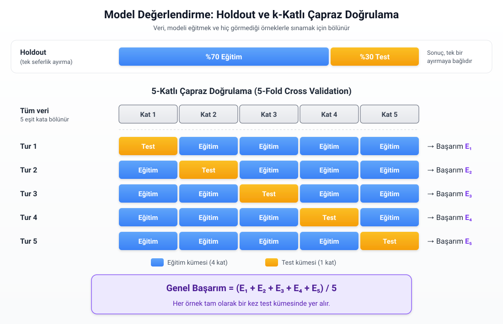
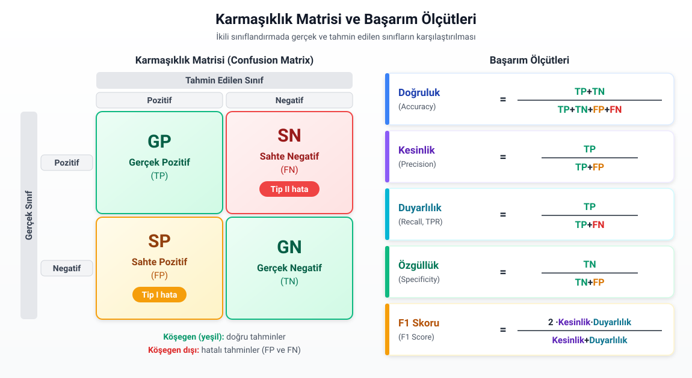
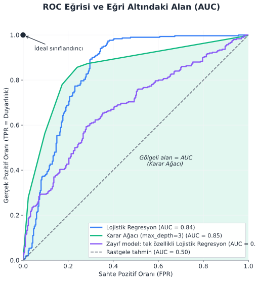
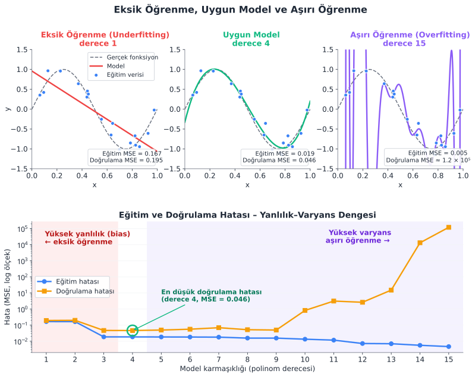

# 8. Model Değerlendirme

Bir model kurduk. Peki ne kadar iyi? Bu sorunun cevabı göründüğünden zordur. Yanlış bir değerlendirme, gerçekte işe yaramayan bir modeli üretime almamıza yol açabilir.

## 8.1 Holdout ve k-Katlı Çapraz Doğrulama

**Altın kural:** Model, eğitildiği veriyle değerlendirilmez. Öğrenciye sınavdan önce soruları ve cevapları verirseniz, sınav notu öğrenmeyi değil ezberi ölçer.

**Holdout yöntemi.** Veri rastgele iki parçaya ayrılır. Genellikle %70–80'i **eğitim**, %20–30'u **test** için kullanılır. Basit ve hızlıdır, ama iki zayıflığı vardır: (1) Verinin bir kısmı eğitimde hiç kullanılmaz. (2) Sonuç, bölmenin şansına bağlıdır; başka bir rastgele bölme farklı bir sonuç verebilir.

**k-katlı çapraz doğrulama (k-fold cross-validation).** Veri *k* eşit parçaya (kata) bölünür. Model *k* kez eğitilir; her seferinde bir kat test, kalan *k−1* kat eğitim için kullanılır. Sonuçların ortalaması modelin başarım tahminidir. Her örnek tam bir kez test kümesinde yer alır. Pratikte en sık **k = 10** veya **k = 5** kullanılır.



* **Tabakalı (stratified) çapraz doğrulama:** Her katta sınıf oranları korunur. Dengesiz verilerde varsayılan tercih olmalıdır.
* **Birini dışarıda bırak (leave-one-out):** k = n. Çok küçük veri setlerinde kullanılır, büyük veride çok pahalıdır.
* **Model seçimi için üçlü bölme:** Hiperparametre ayarlanacaksa veri *eğitim / doğrulama / test* olarak üçe bölünür. Test kümesi yalnızca **en sonda, bir kez** kullanılır. Aksi hâlde test kümesine de "aşırı uyum" sağlanmış olur.

## 8.2 Karmaşıklık Matrisi ve Temel Metrikler

İkili sınıflandırmada modelin tüm tahminleri dört kutuya ayrılabilir. Bu tabloya **karmaşıklık matrisi (confusion matrix)** denir:



Dört kutunun adları şunlardır:

| Kısaltma | Türkçe adı | İngilizce adı | Anlamı |
|---|---|---|---|
| **GP (TP)** | Gerçek Pozitif | True Positive | Gerçekte pozitif, model de pozitif dedi |
| **SN (FN)** | Sahte Negatif | False Negative | Gerçekte pozitif, model negatif dedi (kaçırılan örnek) |
| **SP (FP)** | Sahte Pozitif | False Positive | Gerçekte negatif, model pozitif dedi (yanlış alarm) |
| **GN (TN)** | Gerçek Negatif | True Negative | Gerçekte negatif, model de negatif dedi |

> **Adları karıştırmamak için:** İkinci kelime (*Pozitif/Negatif*) modelin **ne dediğini**, ilk kelime (*Gerçek/Sahte*) bu sözün **doğru çıkıp çıkmadığını** söyler. "Sahte Negatif", modelin "negatif" dediği, ama bu sözün sahte çıktığı, yani aslında pozitif olan örnektir. Metinde ve formüllerde literatürle uyum için İngilizce kısaltmalar (TP, FN, FP, TN) kullanılmaya devam edilecektir.

Şekildeki metriklerin açıklamalı formülleri şunlardır:

```math
\text{Doğruluk} = \frac{\overbrace{\text{TP} + \text{TN}}^{\text{doğru tahminler}}}{\underbrace{\text{TP} + \text{TN} + \text{FP} + \text{FN}}_{\text{bütün tahminler}}}
```

**Ne anlatıyor?** Doğruluk, modelin doğru sınıflandırdığı örneklerin bütün örneklere oranıdır. Hatanın türünü (FP mi, FN mi) ayırt etmez; bu yüzden aşağıda görülecek doğruluk paradoksuna açıktır.

```math
\text{Kesinlik} = \frac{\overbrace{\text{TP}}^{\substack{\text{isabetli}\\\text{"pozitif" kararlar}}}}{\underbrace{\text{TP} + \text{FP}}_{\substack{\text{modelin "pozitif"}\\\text{dediği bütün örnekler}}}} \qquad \text{Duyarlılık} = \frac{\overbrace{\text{TP}}^{\substack{\text{yakalanan}\\\text{pozitifler}}}}{\underbrace{\text{TP} + \text{FN}}_{\substack{\text{gerçekte pozitif olan}\\\text{bütün örnekler}}}}
```

**Ne anlatıyor?** İki metriğin payı aynıdır (TP); fark paydadadır. Kesinlik, modelin "pozitif" dediği örneklerin ne kadarının gerçekten pozitif olduğunu; duyarlılık ise gerçekte pozitif olan örneklerin ne kadarının yakalandığını gösterir. Özgüllük, duyarlılığın negatif sınıf için hesaplanmış karşılığıdır: $\text{TN} / (\text{TN} + \text{FP})$.

```math
\underbrace{\text{F1}}_{\substack{\text{kesinlik ve duyarlılığın}\\\text{harmonik ortalaması}}} = \frac{\overbrace{2 \cdot \text{Kesinlik} \cdot \text{Duyarlılık}}^{\text{iki metriğin çarpımının 2 katı}}}{\underbrace{\text{Kesinlik} + \text{Duyarlılık}}_{\text{iki metriğin toplamı}}}
```

**Ne anlatıyor?** F1, kesinlik ile duyarlılığın harmonik ortalamasıdır. Aritmetik ortalamadan farkı, küçük olan değere daha çok ağırlık vermesidir: İki metrikten biri 0'a yaklaştığında F1 de 0'a yaklaşır. Bu yüzden F1'in yüksek çıkması için kesinliğin ve duyarlılığın birlikte yüksek olması gerekir.

**Örnek: Hastalık taraması.** 1000 kişi taranıyor, bunlardan 50'si gerçekten hasta. Modelimizin sonuçları:

| | Tahmin: Hasta | Tahmin: Sağlıklı | Toplam |
|---|---|---|---|
| **Gerçek: Hasta** | TP = 40 | FN = 10 | 50 |
| **Gerçek: Sağlıklı** | FP = 60 | TN = 890 | 950 |

* **Doğruluk (Accuracy)** = (40 + 890) / 1000 = **0.930**
* **Kesinlik (Precision)** = 40 / (40 + 60) = **0.400**. "Hasta" dediklerimizin sadece %40'ı gerçekten hasta.
* **Duyarlılık (Recall)** = 40 / (40 + 10) = **0.800**. Gerçek hastaların %80'ini yakaladık.
* **Özgüllük (Specificity)** = 890 / (890 + 60) = **0.937**
* **F1 skoru** = 2 · 0.40 · 0.80 / (0.40 + 0.80) = **0.533**

**Doğruluk paradoksu.** Herkese "sağlıklı" diyen, hiçbir şey öğrenmemiş bir model ne kadar doğru olur? 950/1000 = **%95**! Bu "model", bizim modelimizden daha yüksek doğruluk alır, ama tek bir hastayı bile yakalayamaz (duyarlılık = 0). **Dengesiz veri setlerinde doğruluk tek başına yanıltıcıdır.**

**Hangi metrik ne zaman?** Bu sorunun cevabı, hataların *maliyetine* bağlıdır:

* **Duyarlılık öncelikli:** Kanser taraması, sahtekârlık tespiti. Bir hastayı/dolandırıcıyı kaçırmak (FN) çok pahalıdır.
* **Kesinlik öncelikli:** Spam filtresi. Önemli bir e-postayı spam'e atmak (FP) kullanıcıyı çok rahatsız eder.
* **F1 skoru:** Kesinlik ve duyarlılığın harmonik ortalamasıdır. İkisini dengelemek istendiğinde kullanılır.

Sınıflandırıcıların çoğu aslında bir **olasılık** üretir. "Pozitif" kararı, bu olasılığın bir **eşik** değerini (varsayılan 0.5) geçip geçmemesine göre verilir. Eşiği düşürmek duyarlılığı artırır ama kesinliği düşürür; yükseltmek ise tersini yapar. Bu ödünleşimi (trade-off) bütünüyle görmenin yolu ROC eğrisidir.

## 8.3 ROC Eğrisi ve AUC

**ROC (Receiver Operating Characteristic) eğrisi**, eşik değeri 1'den 0'a kaydırılırken her eşik için **Gerçek Pozitif Oranı** (True Positive Rate — TPR = duyarlılık) ile **Sahte Pozitif Oranı** (False Positive Rate — FPR = 1 − özgüllük) değerlerini çizer.



* **Sol üst köşe (0, 1):** Mükemmel sınıflandırıcı. Tüm pozitifler yakalanmış, hiç yanlış alarm yok.
* **Köşegen:** Yazı-tura atan rastgele bir sınıflandırıcı.
* **Eğri sol üste ne kadar yakınsa** model o kadar iyidir.

**AUC (Area Under the Curve)**, ROC eğrisinin altında kalan alandır ve modeli tek bir sayıyla özetler: 1.0 mükemmel, 0.5 rastgele tahmindir. AUC'nin sezgisel bir yorumu da vardır: *Rastgele seçilen bir pozitif örneğin, rastgele seçilen bir negatif örnekten daha yüksek skor alma olasılığı.* AUC eşikten bağımsızdır, bu yüzden modelleri karşılaştırmak için çok kullanışlıdır.

> Sınıf dengesizliği çok şiddetliyse (ör. %0.1 sahtekârlık), ROC eğrisi iyimser bir tablo çizebilir. Bu durumda **Kesinlik–Duyarlılık (Precision–Recall) eğrisi** daha bilgilendiricidir.

## 8.4 Aşırı Öğrenme ve Yanlılık–Varyans Dengesi

Bir modelin hatası kabaca üç bileşene ayrılabilir:

$$\text{Beklenen hata} = \text{Yanlılık}^2 + \text{Varyans} + \text{İndirgenemez gürültü}$$

```math
\underbrace{\text{Beklenen hata}}_{\substack{\text{yeni veride}\\\text{ortalama hata}}} = \underbrace{\text{Yanlılık}^2}_{\substack{\text{model ortalamada}\\\text{ne kadar ıskalıyor?}}} + \underbrace{\text{Varyans}}_{\substack{\text{eğitim verisi değişince}\\\text{model ne kadar oynuyor?}}} + \underbrace{\text{İndirgenemez gürültü}}_{\substack{\text{verinin kendi rastgeleliği;}\\\text{hiçbir model gideremez}}}
```

**Ne anlatıyor?** Bir modelin yeni verideki beklenen hatası üç parçaya ayrılır: modelin sistematik sapması (yanlılığın karesi), farklı eğitim verilerine göre oynaması (varyans) ve hiçbir modelin gideremeyeceği gürültü. İlk ikisi arasında bir denge kurulur; üçüncüsü azaltılamaz.

* **Yanlılık (bias):** Modelin aşırı basit varsayımlar yüzünden gerçek ilişkiyi yakalayamamasından kaynaklanan hata. Yüksek yanlılık **eksik öğrenmeye (underfitting)** yol açar. Eğri bir ilişkiye düz bir çizgi uydurmak buna örnektir.
* **Varyans (variance):** Modelin eğitim verisindeki küçük değişikliklere aşırı duyarlı olmasından kaynaklanan hata. Yüksek varyans **aşırı öğrenmeye (overfitting)** yol açar; model gürültüyü de ezberler.



Model karmaşıklığı arttıkça **eğitim hatası sürekli azalır**. **Doğrulama hatası** ise önce azalır, bir noktadan sonra yeniden artmaya başlar. İdeal model, doğrulama hatasının en düşük olduğu noktadaki karmaşıklığa sahip olandır.

**Aşırı öğrenmeyle mücadele:** daha fazla veri toplamak, modeli basitleştirmek (budama, derinlik sınırı), **düzenlileştirme (regularization)** (L1/L2 cezaları), erken durdurma, çapraz doğrulama ile model seçimi ve topluluk yöntemleri (Bölüm 11.1).

**Python ile çapraz doğrulama ve aşırı öğrenmenin gözlenmesi:**

```python
from sklearn.datasets import load_breast_cancer
from sklearn.model_selection import StratifiedKFold, cross_validate
from sklearn.tree import DecisionTreeClassifier

X, y = load_breast_cancer(return_X_y=True)
cv = StratifiedKFold(n_splits=5, shuffle=True, random_state=42)

print(f"{'derinlik':>8} {'eğitim':>8} {'doğrulama':>10}")
for derinlik in [1, 2, 3, 5, 8, None]:
    model = DecisionTreeClassifier(max_depth=derinlik, random_state=42)
    sonuc = cross_validate(model, X, y, cv=cv, scoring="accuracy",
                           return_train_score=True)
    print(f"{str(derinlik):>8} {sonuc['train_score'].mean():8.3f} "
          f"{sonuc['test_score'].mean():10.3f}")
```

Derinlik sınırı kaldırıldığında (`None`) eğitim başarımı 1.000'e ulaşır: Ağaç eğitim verisini ezberlemiştir. Doğrulama başarımı ise bu artışı izlemez. Eğitim ile doğrulama arasındaki açılan fark, aşırı öğrenmenin klasik işaretidir.

> **Kendinizi sınayın**
>
> 1. Bölüm 8.2'deki tarama örneğinde karar eşiği düşürülünce sonuçlar TP = 45, FN = 5, FP = 150, TN = 800 olmuştur. Doğruluk, kesinlik, duyarlılık, özgüllük ve F1 skorunu hesaplayın. Eşiği düşürmek hangi metrikleri iyileştirdi, hangilerini kötüleştirdi?
> 2. Hiperparametre seçimini test kümesine bakarak yapmak neden yanlıştır?
>
> **Cevaplar:** (1) Doğruluk = 845/1000 = 0.845, kesinlik = 45/195 ≈ 0.231, duyarlılık = 45/50 = 0.900, özgüllük = 800/950 ≈ 0.842, F1 = 2·45 / (2·45 + 150 + 5) ≈ 0.367. Duyarlılık 0.800'den 0.900'e çıktı; buna karşılık kesinlik (0.400 → 0.231), özgüllük, doğruluk ve F1 düştü. Bu, Bölüm 8.2'deki eşik ödünleşiminin sayısal hâlidir. (2) Test kümesi seçim sürecine katılırsa model ona uydurulmuş olur ve test başarımı gerçek başarımı iyimser biçimde gösterir; seçim için doğrulama kümesi ya da çapraz doğrulama kullanılmalıdır.

---

[← 7. Sınıflandırma](07-siniflandirma.md) · [İçindekiler](../ders_notu.md) · [9. Kümeleme →](09-kumeleme.md)
