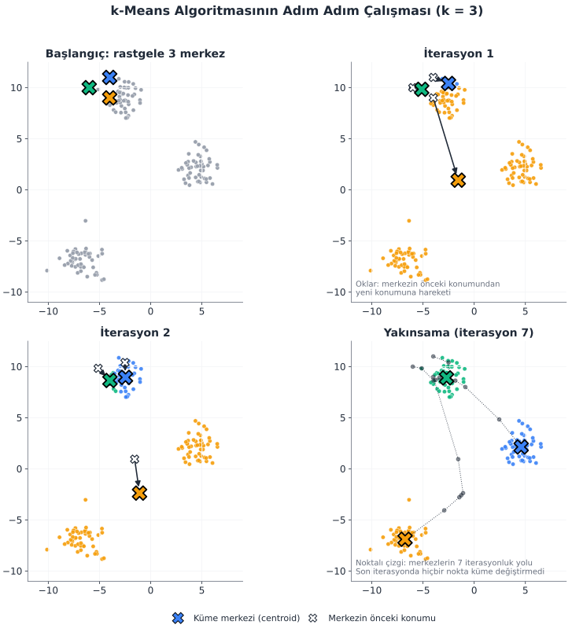
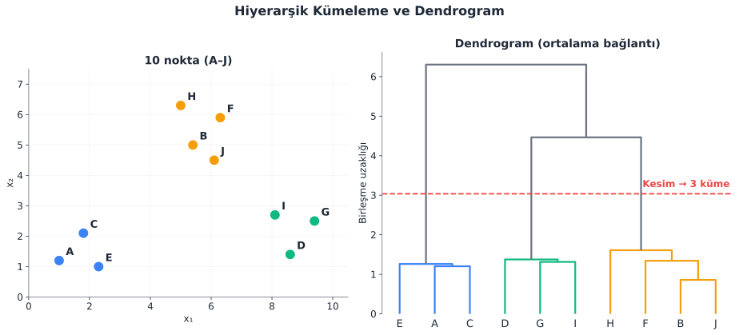
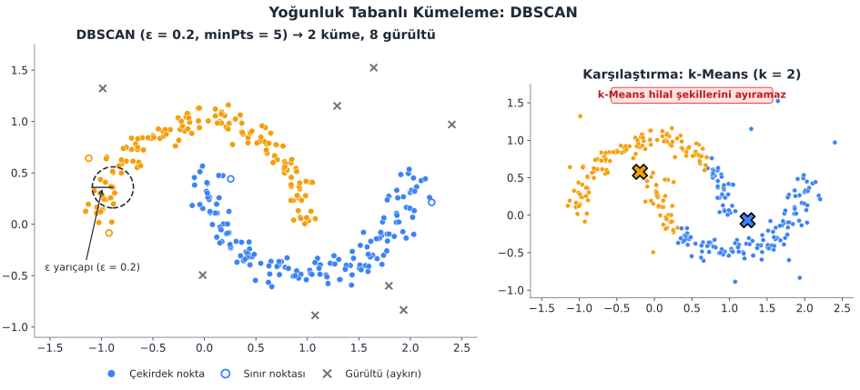

# 9. Kümeleme

## 9.1 Kümeleme Nedir?

Bir kütüphaneye binlerce kitap bağışlandığını, ama hiçbirinin üzerinde konu etiketi olmadığını düşünün. Kitapları karıştırıp benzer olanları aynı rafa koyarsınız: Bir rafta yemek kitapları, birinde tarih, birinde bilim kurgu toplanır. Kimse size "doğru" rafları söylemedi; gruplamayı verinin kendisinden çıkardınız. İşte **kümeleme (clustering)** budur.

Kümeleme, nesneleri **küme içi benzerlik yüksek**, **kümeler arası benzerlik düşük** olacak şekilde gruplara ayırma işidir. Sınıflandırmanın aksine önceden tanımlı etiketler yoktur. Bu yüzden kümeleme bir **denetimsiz öğrenme** yöntemidir.

Uygulama alanlarına örnekler: müşteri segmentasyonu, belge gruplama, görüntü bölütleme, gen ifadesi analizi, anomali tespiti için "normal" davranışın modellenmesi.

Başlıca yaklaşımlar:

| Yaklaşım | Fikir | Örnek algoritma |
|---|---|---|
| **Bölümleme (partitioning)** | Veriyi k gruba böl, iteratif iyileştir | k-Means, k-Medoids |
| **Hiyerarşik** | İç içe kümelerden ağaç oluştur | AGNES (birleştirici), DIANA (bölücü) |
| **Yoğunluk tabanlı** | Yoğun bölgeleri küme, seyrek bölgeleri gürültü say | DBSCAN, OPTICS |
| **Izgara tabanlı** | Uzayı hücrelere böl, hücreler üzerinde çalış | STING, CLIQUE |
| **Model tabanlı** | Verinin olasılık dağılımlarının karışımından geldiğini varsay | Gauss Karışım Modeli (EM) |

## 9.2 k-Means

**k-Means**, en yaygın kullanılan kümeleme algoritmasıdır. Her küme bir **merkez (centroid)**, yani kümedeki noktaların ortalaması ile temsil edilir.

**Algoritma:**

1. Küme sayısı **k**'yı belirle ve k başlangıç merkezini (genellikle rastgele) seç.
2. **Atama adımı:** Her noktayı en yakın merkezin kümesine ata.
3. **Güncelleme adımı:** Her kümenin merkezini, kümeye atanan noktaların ortalaması olarak yeniden hesapla.
4. Atamalar değişmeyene (veya merkezler sabitlenene) kadar 2. ve 3. adımları tekrarla.



Şekilde başlangıç merkezleri kasıtlı olarak kötü seçilmiş, üçü de sol üst köşeye yerleştirilmiştir. Buna rağmen merkezler her iterasyonda kendi kümelerinin ortasına doğru kayar ve algoritma **7. iterasyonda** hiçbir noktanın küme değiştirmediği duruma, yani yakınsamaya ulaşır.

k-Means aslında **küme içi kareler toplamını (Within-Cluster Sum of Squares — WCSS, sklearn'de `inertia_`)** en aza indirmeye çalışır:

```math
\text{WCSS} = \sum_{j=1}^{k} \sum_{x \in C_j} \|x - \mu_j\|^2
```

```math
\text{WCSS} = \underbrace{\sum_{j=1}^{k}}_{\substack{\text{k kümenin}\\\text{hepsi için}}} \; \underbrace{\sum_{x \in C_j}}_{\substack{\text{j. kümedeki}\\\text{her x noktası için}}} \overbrace{\|x - \mu_j\|^2}^{\substack{\text{noktanın kendi merkezine}\\\text{uzaklığının karesi}}}
```

**Ne anlatıyor?** Her noktanın kendi küme merkezine uzaklığının karesi alınır ve bütün kümeler için toplanır; küçük değer, kümelerin sıkı olduğunu gösterir. $\mu_j$ ("mü alt j") j. kümenin merkezidir. İç içe iki toplam vardır: İçteki toplam bir kümenin içini, dıştaki toplam ise bütün kümeleri toplar.

**Güçlü yönleri:** Basittir, anlaşılırdır ve hızlıdır. Her iterasyonun maliyeti $O(n \cdot k \cdot p)$'dir ve büyük veriye iyi ölçeklenir. Spark MLlib'de dağıtık bir sürümü vardır.

**Zayıf yönleri:**

* **k önceden bilinmelidir.** Seçmek için **dirsek yöntemi (elbow method)** veya **siluet skoru** (Bölüm 9.5) kullanılır.
* **Başlangıca duyarlıdır** ve yerel minimumda takılabilir. Çözüm olarak **k-Means++** başlatması kullanılır (merkezleri birbirinden uzak seçer) ve algoritma farklı başlangıçlarla birkaç kez çalıştırılır (`n_init`).
* **Küresel ve benzer büyüklükte kümeler varsayar.** Uzun, hilal biçimli veya iç içe geçmiş kümeleri ayıramaz.
* **Aykırı değerlere duyarlıdır,** çünkü ortalama aykırı değerlerden etkilenir. Merkez yerine gerçek bir veri noktasını (medoid) kullanan **k-Medoids (PAM)** daha dayanıklıdır.

**Python ile k-Means ve dirsek yöntemi:**

```python
from sklearn.cluster import KMeans
from sklearn.datasets import make_blobs

X, _ = make_blobs(n_samples=500, centers=4, cluster_std=0.9, random_state=42)

print(" k   WCSS (inertia)")
for k in range(1, 9):
    km = KMeans(n_clusters=k, n_init=10, random_state=42).fit(X)
    print(f"{k:2d}   {km.inertia_:10.1f}")
# WCSS'teki düşüş k=4'ten sonra belirgin biçimde yavaşlar → "dirsek" k=4

km = KMeans(n_clusters=4, n_init=10, random_state=42).fit(X)
print("Merkezler:\n", km.cluster_centers_.round(2))
```

## 9.3 Hiyerarşik Kümeleme

Hiyerarşik kümeleme, tek bir bölümleme yerine iç içe geçmiş kümelerden oluşan bir **ağaç** üretir. Bu ağaca **dendrogram** denir.

* **Birleştirici (agglomerative, aşağıdan yukarı):** Her nokta başlangıçta kendi kümesidir. Her adımda **en yakın iki küme birleştirilir.** Tek küme kalana kadar devam edilir. En yaygın yaklaşım budur.
* **Bölücü (divisive, yukarıdan aşağı):** Tüm noktalar tek kümede başlar ve kümeler adım adım bölünür.

İki *küme* arasındaki uzaklık farklı şekillerde tanımlanabilir. Buna **bağlantı (linkage)** ölçütü denir:

| Bağlantı | Küme uzaklığı | Etkisi |
|---|---|---|
| **Tekli (single)** | En yakın iki nokta arası | Zincirleme etki; uzun, ince kümeler |
| **Tam (complete)** | En uzak iki nokta arası | Sıkı, küresel kümeler |
| **Ortalama (average)** | Tüm nokta çiftlerinin ortalaması | Dengeli bir orta yol |
| **Ward** | Birleşmenin varyansta yaptığı artış | k-Means'e benzer, kompakt kümeler |



Dendrogramın en büyük avantajı **k'nın önceden belirlenmesine gerek olmamasıdır.** Ağaç istenen yükseklikten yatay olarak "kesilir"; kesim çizgisinin kestiği dikey çizgi sayısı küme sayısını verir. Dezavantajı ise maliyettir. Tüm nokta çiftleri arasındaki uzaklık matrisi $O(n^2)$ bellek, klasik algoritma ise $O(n^2)$ ile $O(n^3)$ arası zaman gerektirir. 100.000 nokta için uzaklık matrisinin yalnızca üst üçgeni bile yaklaşık 40 GB yer tutar (float64). Bu yüzden klasik hiyerarşik kümeleme büyük veriye doğrudan uygulanamaz.

## 9.4 DBSCAN: Yoğunluk Tabanlı Kümeleme

**DBSCAN (Density-Based Spatial Clustering of Applications with Noise)** kümeleri, **seyrek bölgelerle birbirinden ayrılmış yoğun bölgeler** olarak tanımlar. İki parametresi vardır: komşuluk yarıçapı **ε (eps)** ve bir noktanın çekirdek sayılması için gereken minimum komşu sayısı **minPts**.

Noktalar üç türe ayrılır:

* **Çekirdek nokta (core):** ε yarıçapında en az minPts nokta (kendisi dahil) bulunan nokta.
* **Sınır noktası (border):** Çekirdek değildir, ama bir çekirdek noktanın ε komşuluğundadır.
* **Gürültü (noise):** Ne çekirdek ne sınır olan nokta. Bunlar aykırı değer olarak etiketlenir.

Birbirinin ε komşuluğundaki çekirdek noktalar zincirleme olarak aynı kümeye bağlanır; sınır noktaları da bu kümelere katılır.



Şekildeki veri iki hilal ve bunlara eklenmiş 15 rastgele noktadan oluşur (toplam 315 nokta). DBSCAN (ε = 0.2, minPts = 5) iki hilali **2 ayrı küme** olarak doğru biçimde bulur ve **8 noktayı gürültü** olarak ayırır. Rastgele noktaların diğer 7'si hilallerin içine düştüğü için kümelere katılmıştır. Yandaki panelde aynı veriye uygulanan k-Means (k = 2) ise hilalleri ortadan düz bir çizgiyle böler.

**Güçlü yönleri:** k'yı önceden bilmek gerekmez. **Keyfi şekilli** kümeleri bulabilir (k-Means'in ayıramadığı hilal biçimli kümeler gibi). Gürültüyü doğal olarak ayıklar.

**Zayıf yönleri:** ε ve minPts seçimi hassastır. **Yoğunluğu farklı** kümeleri aynı anda bulmakta zorlanır (OPTICS bu sorunu hafifletir). Yüksek boyutta uzaklıklar anlamını yitirdiğinden başarımı düşer.

## 9.5 Kümeleme Değerlendirmesi: Siluet Skoru

Etiket olmadığı için kümelemeyi değerlendirmek sınıflandırmadan daha zordur. Yaygın bir **iç (intrinsic)** ölçüt, her nokta için hesaplanan **siluet katsayısıdır (silhouette coefficient)**:

```math
s(i) = \frac{b(i) - a(i)}{\max\{a(i),\, b(i)\}}
```

```math
\underbrace{s(i)}_{\substack{\text{i. noktanın}\\\text{siluet değeri}}} = \frac{\overbrace{b(i)}^{\substack{\text{en yakın diğer}\\\text{kümeye uzaklık}}} - \overbrace{a(i)}^{\substack{\text{kendi kümesine}\\\text{uzaklık}}}}{\underbrace{\max\{a(i),\, b(i)\}}_{\substack{\text{ikisinden büyüğü: sonucu}\\\text{-1 ile +1 arasına sıkıştırır}}}}
```

**Ne anlatıyor?** Bir noktanın kendi kümesine ortalama uzaklığı (a) ile en yakın diğer kümeye ortalama uzaklığı (b) karşılaştırılır; sonuç −1 ile 1 arasındadır. Örnek: a(i) = 2 ve b(i) = 8 ise s = (8 − 2) / 8 = **0.75**; nokta doğru kümededir. Tersine a(i) = 8 ve b(i) = 2 ise s = (2 − 8) / 8 = **−0.75**; nokta komşu kümeye daha yakındır.

* $a(i)$: Noktanın **kendi kümesindeki** diğer noktalara ortalama uzaklığı (ne kadar sıkı?).
* $b(i)$: Noktanın **en yakın diğer kümedeki** noktalara ortalama uzaklığı (ne kadar ayrık?).

$s(i)$, −1 ile +1 arasında değer alır. +1'e yakın değer, noktanın doğru kümede ve diğer kümelerden uzak olduğunu gösterir. 0 civarı, iki kümenin sınırında olduğunu; negatif değer ise muhtemelen yanlış kümeye atandığını gösterir. Tüm noktaların ortalama siluet değeri, kümelemenin genel kalitesini özetler ve **en uygun k'yı seçmek** için kullanılabilir.

Gerçek etiketler biliniyorsa (ör. algoritma karşılaştırması yaparken), **Düzeltilmiş Rand İndeksi (ARI)** ve **Normalleştirilmiş Karşılıklı Bilgi (NMI)** gibi **dış (extrinsic)** ölçütler de kullanılabilir.

**Python ile siluet skoru ve DBSCAN / k-Means karşılaştırması:**

```python
from sklearn.cluster import DBSCAN, KMeans
from sklearn.datasets import make_blobs, make_moons
from sklearn.metrics import adjusted_rand_score, silhouette_score

# 1) En uygun k'yı siluet skoru ile seçme
X, _ = make_blobs(n_samples=500, centers=4, cluster_std=0.9, random_state=42)
for k in range(2, 8):
    etiket = KMeans(n_clusters=k, n_init=10, random_state=42).fit_predict(X)
    print(f"k={k}  siluet={silhouette_score(X, etiket):.3f}")

# 2) Hilal biçimli kümeler: k-Means ve DBSCAN
X, y = make_moons(n_samples=300, noise=0.07, random_state=42)
km = KMeans(n_clusters=2, n_init=10, random_state=42).fit_predict(X)
db = DBSCAN(eps=0.2, min_samples=5).fit_predict(X)
print(f"\nk-Means: siluet = {silhouette_score(X, km):.3f}   ARI = {adjusted_rand_score(y, km):.3f}")
print(f"DBSCAN : siluet = {silhouette_score(X, db):.3f}   ARI = {adjusted_rand_score(y, db):.3f}")
print("DBSCAN küme sayısı:", len(set(db)) - (1 if -1 in db else 0),
      "| gürültü noktası:", (db == -1).sum())
```

İlk döngüde siluet skoru en yüksek değerini (0.812) gerçek küme sayısı olan **k = 4**'te alır. İkinci kısım ise önemli bir dersi gösterir: Siluet skoru küresel kümeleri ödüllendirir. Bu yüzden hilal biçimli veride k-Means'e (0.485) DBSCAN'den (0.329) *daha yüksek* siluet skoru verir. Oysa gerçek etiketlere göre DBSCAN kusursuzdur (ARI = 1.000), k-Means ise hilalleri ayıramaz (ARI = 0.254). **Hiçbir değerlendirme ölçütü her duruma uygun değildir.**

---

[← 8. Model Değerlendirme](08-model-degerlendirme.md) · [İçindekiler](../ders_notu.md) · [10. Aykırı Değer Tespiti →](10-aykiri-deger-tespiti.md)
