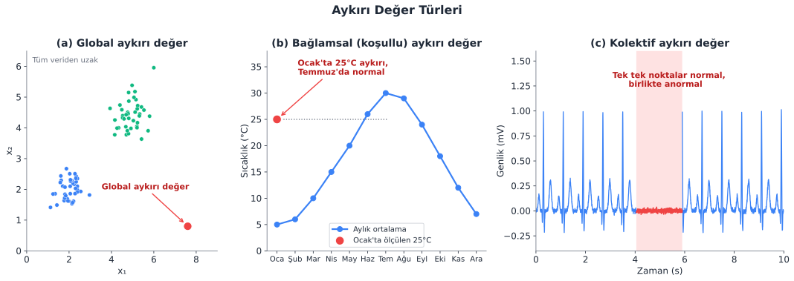

# 10. Aykırı Değer Tespiti

## 10.1 Aykırı Değer Nedir?

Hawkins'in klasik tanımıyla **aykırı değer (outlier)**, *"diğer gözlemlerden o kadar farklıdır ki, farklı bir mekanizma tarafından üretildiği şüphesini uyandırır."* Aykırı değerler iki farklı gözle görülebilir:

* **Temizlenmesi gereken gürültü:** Ölçüm veya veri girişi hatası (yaş = 250). Bölüm 4'te bu açıdan ele aldık.
* **Asıl aranan bilgi:** Kredi kartı sahtekârlığı, ağ saldırısı, makine arızasının erken belirtisi, yeni bir hastalık türü. Bu durumda "aykırı değer" madenciliğin *hedefidir*. Buna **anomali tespiti (anomaly detection)** de denir.

Han ve arkadaşları aykırı değerleri üç türe ayırır:



1. **Global (nokta) aykırı değer:** Verinin geri kalanından açıkça sapan tek bir gözlem. Ortalama harcaması 500 TL olan bir müşterinin kartından 80.000 TL'lik işlem yapılması buna örnektir.
2. **Bağlamsal (koşullu) aykırı değer:** Değer kendi başına olağan, ama **bağlamına** göre anormaldir. 25 °C Temmuz'da sıradan, Ocak'ta ise aykırıdır. Bağlam genellikle zaman veya konumdur.
3. **Kolektif aykırı değer:** Tek tek bakıldığında normal olan gözlemlerin **bir arada** anormal bir örüntü oluşturması. Bir EKG sinyalinde kısa bir süreliğine düz çizgi görülmesi, ya da bir ağda çok sayıda bilgisayarın aynı anda aynı sunucuya bağlanması (DDoS saldırısı) buna örnektir.

## 10.2 Tespit Yöntemleri

Etiketli veri varsa aykırı değer tespiti bir sınıflandırma problemine dönüşür. Ancak aykırı değerler doğası gereği nadirdir ve etiketli örnek bulmak zordur. Bu yüzden çoğunlukla **denetimsiz** yöntemler kullanılır:

**İstatistiksel (model tabanlı) yöntemler.** Normal verinin bir olasılık dağılımına uyduğu varsayılır. Bu modele göre olasılığı çok düşük kalan noktalar aykırıdır.

* **Z-skor kuralı:** $|z| = |x - \mu| / \sigma > 3$ olan noktalar aykırıdır (normal dağılımda verinin %99.7'si ±3σ içindedir).

```math
\underbrace{|z|}_{\substack{\text{z-skorunun}\\\text{mutlak değeri}}} = \frac{\overbrace{|x - \mu|}^{\substack{\text{ortalamadan uzaklık}\\\text{(işaretsiz)}}}}{\underbrace{\sigma}_{\text{standart sapma}}} > \underbrace{3}_{\substack{\text{eşik: 3 standart}\\\text{sapma}}}
```

**Ne anlatıyor?** Noktanın ortalamadan kaç standart sapma uzakta olduğu, yönüne bakılmaksızın hesaplanır; bu uzaklık 3 standart sapmayı aşıyorsa nokta aykırı sayılır. Ortalama ve standart sapma da aykırı değerlerden etkilendiği için birkaç çok uç değer içeren verilerde bu kural, aykırı değerleri gözden kaçırabilir.

* **IQR kuralı (Tukey):** Kutu grafiğindeki bıyıkların dışı. Dağılım varsayımı yapmaz, aykırı değerlere dayanıklıdır (bkz. Bölüm 3.2).
* **Çok değişkenli:** Mahalanobis uzaklığı, Gauss karışım modelleri.

**Yakınlık tabanlı yöntemler.** Bir noktanın komşularından ne kadar uzak olduğuna bakılır.

* **Uzaklık tabanlı:** k. en yakın komşusuna uzaklığı çok büyük olan noktalar aykırıdır.
* **Yoğunluk tabanlı — LOF (Local Outlier Factor):** Bir noktanın yerel yoğunluğu, komşularının yoğunluğuyla karşılaştırılır. Böylece farklı yoğunluktaki kümelerin bulunduğu verilerde de doğru sonuç verir. LOF ≈ 1 normal, LOF ≫ 1 aykırı demektir.

**Kümeleme tabanlı yöntemler.** Hiçbir kümeye ait olmayan (DBSCAN'in gürültü noktaları) veya çok küçük/seyrek kümelerde kalan noktalar aykırı kabul edilir.

**Ağaç tabanlı yöntemler — Isolation Forest.** Fikir zekicedir: Aykırı değerler "az ve farklı" olduğu için rastgele bölmelerle **çok daha çabuk izole edilir.** Rastgele ağaçlarda köke yakın (kısa yolda) izole edilen noktalar aykırı sayılır. Hızlıdır ve büyük, yüksek boyutlu veriye iyi ölçeklenir.

> **Yüksek boyut sorunu:** Boyut sayısı arttıkça tüm noktalar arasındaki uzaklıklar birbirine benzemeye başlar ve "en yakın" ile "en uzak" komşu arasındaki fark kaybolur. Bu durum uzaklık tabanlı aykırı değer tespitini zorlaştırır (bkz. Bölüm 11.3).

---

[← 9. Kümeleme](09-kumeleme.md) · [İçindekiler](../ders_notu.md) · [11. Veri Madenciliğinde İleri Konular →](11-ileri-konular.md)
