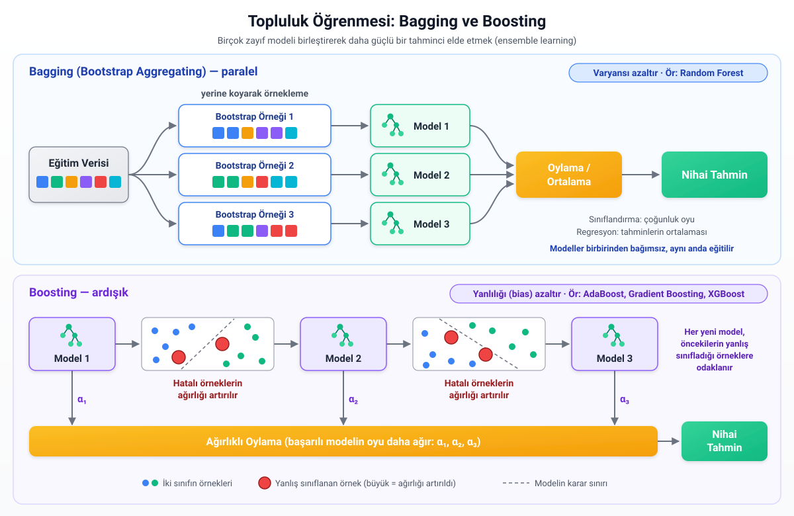
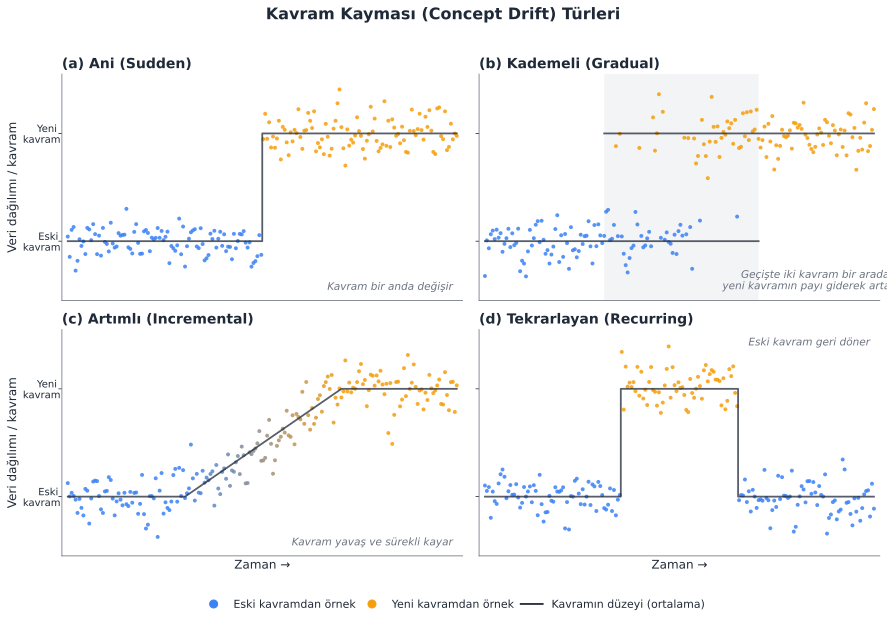

# 11. Veri Madenciliğinde İleri Konular

Önceki bölümlerde temel görevleri ve algoritmaları gördük. Bu bölümde, gerçek dünya problemlerinde karşılaşılan ve dersin "ileri konular" kısmını oluşturan yaklaşımları ele alacağız.

## 11.1 Topluluk Öğrenme (Ensemble Learning)

Bir televizyon yarışmasında "seyirciye sorma" jokeri çoğu zaman tek bir uzmana sormaktan daha isabetlidir. Birbirinden bağımsız hata yapan çok sayıda "orta karar" kişinin oy çokluğu, çoğu zaman tek bir kişiden daha doğrudur. Buna **kalabalığın bilgeliği** denir. **Topluluk öğrenme**, aynı fikri modellere uygular: Birden fazla modelin tahminleri birleştirilerek tek bir modelden daha doğru ve daha kararlı bir tahmin elde edilir.

Topluluğun işe yaraması için iki koşul gerekir: Temel modeller **rastgele tahminden daha iyi** olmalı ve **birbirinden farklı (çeşitli)** hatalar yapmalıdır. Aynı hatayı yapan 100 modeli oylatmak hiçbir şey kazandırmaz.



**Bagging (Bootstrap Aggregating).** Eğitim verisinden **yerine koyarak** örnekleme (bootstrap) ile çok sayıda farklı eğitim kümesi üretilir. Her biriyle ayrı bir model eğitilir; sınıflandırmada oylama, regresyonda ortalama ile sonuç birleştirilir. Modeller birbirinden bağımsızdır, bu yüzden **paralel** eğitilebilir. Bagging özellikle **varyansı** yüksek, kararsız modellerde (derin karar ağaçları) büyük iyileşme sağlar.

**Random Forest (Rastgele Orman).** Bagging'in karar ağaçlarına özel, güçlendirilmiş hâlidir. Her ağaç bir bootstrap örneğiyle eğitilir. Ek olarak, her düğümde bölme için niteliklerin yalnızca **rastgele bir alt kümesi** değerlendirilir (genellikle $\sqrt{p}$ tanesi). Bu ek rastgelelik ağaçlar arasındaki korelasyonu azaltır ve topluluğun çeşitliliğini artırır. Random Forest az ayar gerektirir, aşırı öğrenmeye dayanıklıdır ve nitelik önem skorları üretir. Bu yüzden tablo verilerinde en güvenilir "ilk deneme" modellerinden biridir.

**Boosting.** Modeller **ardışık** olarak eğitilir. Her yeni model, öncekilerin **hata yaptığı örneklere** odaklanır. Zayıf öğrenicilerden (ör. tek bölmeli karar kütükleri) güçlü bir öğrenici inşa edilir ve öncelikle **yanlılık** azaltılır.

* **AdaBoost:** Yanlış sınıflanan örneklerin ağırlığını artırır. Son karar, başarılı modellere daha çok söz hakkı veren ağırlıklı oylamayla alınır.
* **Gradient Boosting:** Her yeni model, önceki topluluğun **artıklarını (residuals)**, genel olarak da hata fonksiyonunun negatif gradyanını tahmin etmeye çalışır (kareli hata için negatif gradyan tam olarak artıktır).
* **XGBoost, LightGBM, CatBoost:** Gradient boosting'in düzenlileştirilmiş, paralelleştirilmiş, büyük veriye optimize edilmiş uygulamalarıdır. Yapılandırılmış (tablo) veri yarışmalarında uzun yıllardır en başarılı yöntemler arasındadır.

**Stacking (Yığınlama).** Farklı türdeki modellerin (ör. ağaç, SVM, k-NN) tahminleri, bir **üst model (meta-learner)** için girdi olarak kullanılır. Üst model, hangi temel modele ne zaman güveneceğini öğrenir.

| | Bagging / Random Forest | Boosting |
|---|---|---|
| Eğitim | Paralel, bağımsız | Ardışık, bağımlı |
| Öncelikle azalttığı | Varyans | Yanlılık |
| Temel model | Güçlü, kararsız (derin ağaç) | Zayıf (sığ ağaç) |
| Aşırı öğrenme riski | Düşük | Daha yüksek (öğrenme oranı ve iterasyon ayarı gerekir) |
| Dağıtık ortam | Çok uygun (her ağaç ayrı düğümde) | Daha zor (ama XGBoost/LightGBM dağıtık çalışabilir) |

**Python ile tek ağaç ve topluluk yöntemlerinin karşılaştırılması:**

```python
from sklearn.datasets import load_breast_cancer
from sklearn.ensemble import (AdaBoostClassifier, GradientBoostingClassifier,
                              RandomForestClassifier)
from sklearn.model_selection import StratifiedKFold, cross_val_score
from sklearn.tree import DecisionTreeClassifier

X, y = load_breast_cancer(return_X_y=True)
cv = StratifiedKFold(n_splits=5, shuffle=True, random_state=42)

modeller = {
    "Tek karar ağacı":   DecisionTreeClassifier(random_state=42),
    "Random Forest":     RandomForestClassifier(n_estimators=300, random_state=42),
    "AdaBoost":          AdaBoostClassifier(n_estimators=300, random_state=42),
    "Gradient Boosting": GradientBoostingClassifier(random_state=42),
}
for ad, model in modeller.items():
    skor = cross_val_score(model, X, y, cv=cv, scoring="roc_auc")
    print(f"{ad:18s} AUC = {skor.mean():.3f} ± {skor.std():.3f}")
```

Çıktıda topluluk yöntemlerinin tek ağaca göre hem daha yüksek ortalama başarım hem de daha düşük standart sapma (daha kararlı sonuç) verdiği görülür.

## 11.2 Dengesiz Veri Setleri

Gerçek hayatta ilginç olan sınıf çoğunlukla **nadirdir**: Sahtekârlık işlemlerin %0.1'i, arızalı ürünler üretimin %0.5'i, nadir hastalıklar popülasyonun binde biri olabilir. Bölüm 8.2'deki *doğruluk paradoksu* burada ciddi bir sorun hâline gelir. Model, çoğunluk sınıfını tahmin ederek yüksek doğruluk elde eder ve azınlık sınıfını öğrenmez.

**Çözüm yaklaşımları:**

1. **Doğru metriği kullanmak:** Doğruluk yerine duyarlılık, F1, Kesinlik–Duyarlılık eğrisi, PR-AUC.
2. **Veri düzeyi (yeniden örnekleme):**
   * **Alt örnekleme (undersampling):** Çoğunluk sınıfından örnek atılır. Hızlıdır ama bilgi kaybına yol açar.
   * **Üst örnekleme (oversampling):** Azınlık sınıfı çoğaltılır. Basit kopyalama aşırı öğrenmeye yol açabilir.
   * **SMOTE (Synthetic Minority Over-sampling Technique):** Azınlık örneklerini kopyalamak yerine, bir azınlık örneği ile onun azınlık sınıfındaki komşuları arasındaki doğru parçası üzerinde **yapay yeni örnekler** üretir.
3. **Algoritma düzeyi:**
   * **Maliyet duyarlı öğrenme:** Azınlık sınıfındaki hataya daha yüksek ceza verilir (sklearn'de `class_weight="balanced"`).
   * **Eşik ayarı:** Karar eşiği 0.5 yerine iş ihtiyacına göre seçilir.
   * Dengeli örneklerle eğitilen topluluk yöntemleri (Balanced Random Forest, EasyEnsemble).

> **Kritik uyarı:** Yeniden örnekleme **yalnızca eğitim verisine**, çapraz doğrulamada **her katın içinde ayrı ayrı** uygulanmalıdır. Örnekleme bölmeden önce yapılırsa, test kümesine eğitimdeki örneklerin yapay kopyaları sızar ve sonuçlar gerçekdışı derecede iyi çıkar. `imbalanced-learn` kütüphanesinin `Pipeline` sınıfı bunu otomatik olarak doğru yapar.

```python
from imblearn.over_sampling import SMOTE
from imblearn.pipeline import Pipeline
from sklearn.datasets import make_classification
from sklearn.ensemble import RandomForestClassifier
from sklearn.model_selection import StratifiedKFold, cross_val_score

# %2 azınlık sınıfı içeren yapay veri
X, y = make_classification(n_samples=5000, n_features=20, weights=[0.98],
                           flip_y=0, random_state=42)
cv = StratifiedKFold(n_splits=5, shuffle=True, random_state=42)

duz   = RandomForestClassifier(random_state=42)
smote = Pipeline([("smote", SMOTE(random_state=42)),
                  ("rf", RandomForestClassifier(random_state=42))])

for ad, model in [("Düz RF", duz), ("SMOTE + RF", smote)]:
    f1 = cross_val_score(model, X, y, cv=cv, scoring="f1").mean()
    rec = cross_val_score(model, X, y, cv=cv, scoring="recall").mean()
    print(f"{ad:11s} F1 = {f1:.3f}   Duyarlılık = {rec:.3f}")
```

Bu örnekte SMOTE, azınlık sınıfını yakalama oranını (duyarlılık) belirgin biçimde artırır (yaklaşık 0.29 → 0.44). Buna karşılık daha fazla yanlış alarm ürettiği için F1 skoru biraz düşer. SMOTE sihirli bir değnek değildir; asıl yaptığı, kesinlik–duyarlılık dengesini azınlık sınıfı lehine kaydırmaktır. Hangi dengenin doğru olduğuna, Bölüm 8.2'de tartıştığımız gibi, hataların iş maliyeti karar verir.

## 11.3 Yüksek Boyutlu Veri ve Boyutun Laneti

Metin (on binlerce kelime), gen ifadesi (on binlerce gen) ya da tıklama verisi gibi alanlarda nitelik sayısı yüzlerle on binler arasındadır. Boyut arttıkça sezgilerimiz bozulur. Bellman'ın deyişiyle bu duruma **boyutun laneti (curse of dimensionality)** denir:

* **Veri seyrekleşir:** Bir birim küpün her kenarını 10 parçaya bölersek, 2 boyutta 100, 10 boyutta $10^{10}$ hücre elde ederiz. Aynı yoğunluğu korumak için gereken veri miktarı boyutla **üstel** olarak artar.
* **Uzaklıklar anlamını yitirir:** Yüksek boyutta bir noktanın en yakın ve en uzak komşusuna olan uzaklıkları birbirine yaklaşır. "En yakın komşu" kavramı ayırt ediciliğini kaybeder. k-NN, k-Means, DBSCAN ve uzaklık tabanlı aykırı değer yöntemlerinin hepsi bundan etkilenir.
* **Aşırı öğrenme riski artar:** Nitelik sayısı örnek sayısına yaklaştıkça model, tesadüfi korelasyonları gerçek örüntü sanabilir.

**Python ile uzaklıkların "yoğunlaşması":** Aşağıdaki kod, birim küpe rastgele dağılmış 1000 noktadan rastgele bir sorgu noktasına en yakın ve en uzak noktanın uzaklığını farklı boyutlarda karşılaştırır:

```python
import numpy as np

rng = np.random.default_rng(42)
for d in [2, 10, 100, 1000]:
    X = rng.random((1000, d))            # d boyutlu birim küpte 1000 nokta
    q = rng.random(d)                    # sorgu noktası
    u = np.linalg.norm(X - q, axis=1)    # sorgudan her noktaya Öklid uzaklığı
    print(f"d={d:5d}  en yakın={u.min():7.3f}  en uzak={u.max():7.3f}  oran={u.max() / u.min():7.2f}")
```

| Boyut (d) | En yakın | En uzak | En uzak / en yakın |
|---|---|---|---|
| 2 | 0.008 | 0.963 | 123.63 |
| 10 | 0.545 | 2.146 | 3.94 |
| 100 | 3.446 | 4.846 | 1.41 |
| 1000 | 12.188 | 13.624 | 1.12 |

İki boyutta en uzak nokta en yakın noktadan yüz kattan fazla uzaktadır; "yakın" ve "uzak" çok farklı kavramlardır. 1000 boyutta ise en uzak nokta en yakın noktadan yalnızca %12 daha uzaktadır: Bütün noktalar sorgu noktasına aşağı yukarı aynı uzaklıktadır ve "en yakın komşu" seçimi neredeyse rastgele hâle gelir.

**Çözümler:** özellik seçimi, PCA gibi boyut indirgeme (Bölüm 4.4), seyrek veriye uygun modeller (doğrusal modeller, Naive Bayes), düzenlileştirme ve **alt uzay kümeleme (subspace clustering)**. Alt uzay kümelemede kümeler tüm boyutlarda değil, boyutların bir alt kümesinde aranır (CLIQUE, PROCLUS).

## 11.4 Yarı Denetimli Öğrenme

Etiketli veri pahalıdır. Bir radyoloğun binlerce röntgeni tek tek etiketlemesi haftalar sürer. Oysa etiketsiz veri bol ve ucuzdur. **Yarı denetimli öğrenme (semi-supervised learning)**, az sayıda etiketli örneği çok sayıda etiketsiz örnekle birlikte kullanarak modeli iyileştirir:

* **Kendi kendine eğitim (self-training):** Model etiketli veriyle eğitilir. Etiketsiz veride **en emin olduğu** tahminleri "sözde etiket (pseudo-label)" olarak eğitim kümesine ekler ve tekrar eğitilir.
* **Ortak eğitim (co-training):** Veri iki farklı "görünümle" temsil edilir (ör. bir web sayfasının metni ve ona gelen bağlantıların metni). Her görünümde eğitilen model, diğeri için etiket üretir.
* **Etiket yayılımı (label propagation):** Benzer örneklerin aynı etikete sahip olması gerektiği varsayımıyla etiketler bir benzerlik grafı üzerinde yayılır.

İlgili bir yaklaşım da **aktif öğrenmedir (active learning)**. Model, insan uzmandan **en çok bilgi kazandıracak** örnekleri, yani genellikle en emin olmadığı örnekleri etiketlemesini ister. Böylece etiketleme bütçesi en verimli şekilde kullanılır.

## 11.5 Metin, Web ve Graf Madenciliği

Kurumsal verinin büyük çoğunluğu (sıkça %80 olarak dile getirilir) **yapılandırılmamış** verilerdir: e-postalar, raporlar, müşteri yorumları, sosyal medya. Bu tür veriler, Bölüm 1.4'te saydığımız "karmaşık veri türleri" içinde en yaygın olanlardır.

**Metin madenciliği (text mining).** Metni algoritmaların işleyebileceği sayısal bir temsile dönüştürmekle başlar:

1. **Ön işleme:** Küçük harfe çevirme, noktalama temizliği, **belirteçleme (tokenization)**, **durak kelimelerin** (ve, ile, bu…) çıkarılması, **kök/gövde bulma (stemming / lemmatization)**. Türkçe gibi eklemeli dillerde gövde bulma özellikle önemlidir ("kitaplarımızdan" → "kitap"); bunun için Zemberek gibi araçlar kullanılır.
2. **Temsil — kelime torbası (bag of words):** Her belge, kelime frekanslarından oluşan (çok seyrek) bir vektör olur. Kelime sırası kaybolur.
3. **TF-IDF ağırlıklandırma:** Her kelimenin ağırlığı, belgedeki sıklığı (TF) ile tüm koleksiyondaki nadirliğinin (IDF) çarpımıdır. Her belgede geçen "ve" kelimesi düşük, yalnızca birkaç belgede sık geçen "Hadoop" kelimesi yüksek ağırlık alır.

$$\text{tf-idf}(t, d) = \text{tf}(t, d) \times \log \frac{N}{\text{df}(t)}$$

```math
\underbrace{\text{tf-idf}(t, d)}_{\substack{\text{t kelimesinin}\\\text{d belgesindeki ağırlığı}}} = \underbrace{\text{tf}(t, d)}_{\substack{\text{t, d'de kaç kez}\\\text{geçiyor?}}} \times \underbrace{\log \frac{\overbrace{N}^{\text{toplam belge sayısı}}}{\text{df}(t)}}_{\substack{\text{idf: t ne kadar nadir?}\\\text{df(t): t'yi içeren belge sayısı}}}
```

**Ne anlatıyor?** Bir terimin belgede ne kadar sık geçtiği, terimin bütün koleksiyonda ne kadar nadir olduğuyla çarpılır; her belgede geçen sıradan kelimelerin ağırlığı sıfıra iner. 1000 belgelik bir koleksiyonda (10 tabanında logaritma ile) her belgede geçen "ve" için idf = log(1000/1000) = **0**, yalnızca 10 belgede geçen "Hadoop" için idf = log(1000/10) = **2** olur.

4. **Madencilik:** Belge sınıflandırma (spam, duygu analizi), belge kümeleme, konu modelleme (LDA), varlık ismi tanıma. Belgeler arası benzerlikte **kosinüs benzerliği** kullanılır (Bölüm 3.4).

Günümüzde kelime torbasının yerini büyük ölçüde **kelime gömmeleri (word embeddings — Word2Vec, GloVe)** ve **dönüştürücü (transformer)** tabanlı dil modelleri (BERT vb.) almıştır. Bu temsiller kelimelerin anlamını ve bağlamını yoğun vektörlerle yakalar.

**Web madenciliği** üç alt alana ayrılır:

* **Web içerik madenciliği:** Sayfa metinlerinin ve çoklu ortam içeriğinin analizi (metin madenciliğinin web'e uygulanması).
* **Web yapı madenciliği:** Sayfalar arası bağlantıların analizi. Google'ın **PageRank** algoritması bunun en ünlü örneğidir: *Önemli sayfalardan bağlantı alan sayfa önemlidir.* PageRank, MapReduce'un ilk "öldürücü uygulamalarından" biridir.
* **Web kullanım madenciliği:** Sunucu loglarından ve tıklama akışlarından kullanıcı davranışının analizi (oturum analizi, öneri sistemleri).

**Graf ve sosyal ağ madenciliği.** Sosyal ağlar, protein etkileşimleri, ulaşım ağları ve bilgi grafları gibi veriler **düğümler** ve **kenarlar** ile temsil edilir. Başlıca görevler:

* **Merkezilik analizi:** En etkili kişiyi bulmak (derece, arasındalık ve PageRank merkeziliği).
* **Topluluk tespiti (community detection):** Ağ içinde birbirine yoğun bağlı grupları bulmak; grafların kümelemesi.
* **Bağlantı tahmini (link prediction):** "Tanıyor olabileceğiniz kişiler" önerisi.
* **Sık alt graf madenciliği:** Kimyasal bileşiklerde tekrarlayan yapısal motifler.

Milyarlarca düğümlü graflar tek makineye sığmaz. Bu ölçekte Spark'ın **GraphX** kütüphanesi gibi dağıtık graf işleme sistemleri kullanılır.

## 11.6 Veri Akışı Madenciliği ve Kavram Kayması

Klasik veri madenciliği, verinin tamamının diskte durduğunu ve istediğimiz kadar tekrar okunabileceğini varsayar. **Veri akışlarında (data streams)** ise durum farklıdır. Sensörler, borsa işlemleri, ağ trafiği ve tıklama akışları **sürekli, hızlı ve potansiyel olarak sonsuzdur.** Bu, büyük verinin **Hız (Velocity)** boyutudur.

Witten ve arkadaşlarına göre akış madenciliği algoritmaları şu kısıtlara uymalıdır:

* Her örneği **en fazla bir kez** görebilir (tek geçiş). Veri saklanamayacak kadar hızlı ve büyüktür.
* **Sınırlı bellek** kullanmalıdır; veri büyüse de bellek sabit kalmalıdır.
* Örnek başına **sınırlı zaman** harcamalıdır. Akıştan geri kalmamalıdır.
* **Her an kullanılabilir** bir model sunmalıdır (anytime).

Bu kısıtlar altında **artımlı (incremental / online)** algoritmalar kullanılır. Örneğin **Hoeffding ağacı (VFDT)**, bir düğümde bölme kararı vermek için yeterli sayıda örnek görüp görmediğini Hoeffding sınırıyla istatistiksel olarak belirler ve ağacı akış üzerinde büyütür. Akış üzerinde yaklaşık sayma ve özetleme için **kayan pencereler (sliding windows)**, **rezervuar örnekleme**, **Bloom filtresi** ve **Count-Min Sketch** gibi veri yapıları kullanılır.

**Kavram kayması (concept drift).** Akış verisinin en sinsi sorunu, verinin altındaki ilişkinin **zamanla değişmesidir.** Pandemi döneminde alışveriş alışkanlıkları bir gecede değişti; dolandırıcılar yakalandıkça yöntem değiştirir; bir sensör yaşlandıkça ölçümleri kayar. Dün mükemmel çalışan bir model bugün sessizce başarısız olabilir.



| Tür | Açıklama | Örnek |
|---|---|---|
| **Ani (sudden)** | Kavram bir anda değişir | Yeni bir yasal düzenleme, pandemi |
| **Kademeli (gradual)** | Eski ve yeni kavram bir süre karışık görülür, yeni kavram giderek baskın olur | Kullanıcıların yeni bir ürüne geçişi |
| **Artımlı (incremental)** | Kavram yavaş ve sürekli kayar | Sensör aşınması, enflasyon |
| **Tekrarlayan (recurring)** | Eski kavram periyodik olarak geri döner | Mevsimsel alışveriş örüntüleri |

**Kayma ile başa çıkma:** Modelin hata oranını izleyen **kayma dedektörleri** (DDM, ADWIN), yalnızca son verilerle eğitim (kayan pencere), eski örneklere azalan ağırlık verme ve farklı dönemlerde eğitilmiş modellerden oluşan **uyarlanabilir topluluklar** kullanılır. Üretimdeki her model için bu izleme **MLOps** süreçlerinin ayrılmaz bir parçasıdır. CRISP-DM'in "Dağıtım" aşaması (Bölüm 2.2) bu yüzden bir son değil, sürekli bir döngüdür.

## 11.7 Derin Öğrenmeye Köprü

**Derin öğrenme (deep learning)**, çok sayıda gizli katmana sahip yapay sinir ağlarıyla öğrenmedir. Klasik veri madenciliğinden en önemli farkı **temsil öğrenmesidir (representation learning)**. Klasik yaklaşımda iyi nitelikleri (feature) uzmanlar elle tasarlar: kenar dedektörleri, TF-IDF ağırlıkları, istatistiksel özetler. Derin ağlar ise uygun temsilleri doğrudan ham veriden, katman katman öğrenir. Örneğin bir görüntü ağında ilk katmanlar kenarları, orta katmanlar dokuları ve parçaları, son katmanlar nesneleri temsil eder.

| Mimari | Uygun veri | Tipik görev |
|---|---|---|
| **İleri beslemeli ağ (MLP)** | Tablo verisi | Sınıflandırma, regresyon |
| **Evrişimli sinir ağı (CNN)** | Görüntü, uzamsal veri | Nesne tanıma, tıbbi görüntü analizi |
| **Tekrarlayan ağ (RNN, LSTM)** | Diziler, zaman serileri | Zaman serisi tahmini, konuşma |
| **Dönüştürücü (Transformer)** | Metin, diziler, artık görüntü de | Dil modelleri, çeviri, özetleme |
| **Otokodlayıcı (Autoencoder)** | Her tür | Boyut indirgeme, anomali tespiti |

Derin öğrenmenin son on yıldaki yükselişinin üç temel nedeni vardır: **büyük veri** (milyonlarca etiketli görüntü, internet ölçeğinde metin), **paralel donanım** (GPU/TPU) ve **algoritmik ilerlemeler** (ReLU, dropout, batch normalization, dikkat mekanizması). Bu üçlü, derin öğrenmeyi büyük veri altyapılarıyla doğrudan ilişkilendirir.

**Ne zaman klasik veri madenciliği, ne zaman derin öğrenme?** Yapılandırılmış tablo verisinde ve orta büyüklükteki veri setlerinde Random Forest ve XGBoost gibi topluluk yöntemleri genellikle derin ağlar kadar iyi, hatta daha iyi sonuç verir. Üstelik daha hızlı, daha ucuz ve daha yorumlanabilirdirler. Derin öğrenme ise görüntü, ses ve metin gibi **yapılandırılmamış ve çok büyük** verilerde açık ara üstündür.

> **Açıklanabilirlik (XAI):** Model karmaşıklaştıkça "Model neden bu kararı verdi?" sorusu önem kazanır. Kredi reddi veya tıbbi teşhis gibi kararlar için yasal düzenlemeler de açıklama talep eder. **SHAP** ve **LIME** gibi yöntemler, karmaşık modellerin tekil tahminlerini niteliklerin katkıları üzerinden açıklamaya çalışır.

---

[← 10. Aykırı Değer Tespiti](10-aykiri-deger-tespiti.md) · [İçindekiler](../ders_notu.md) · [12. Klasik Veri Madenciliğinden Büyük Veriye →](12-klasik-veri-madenciliginden-buyuk-veriye.md)
