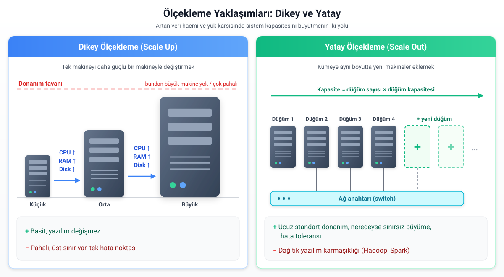
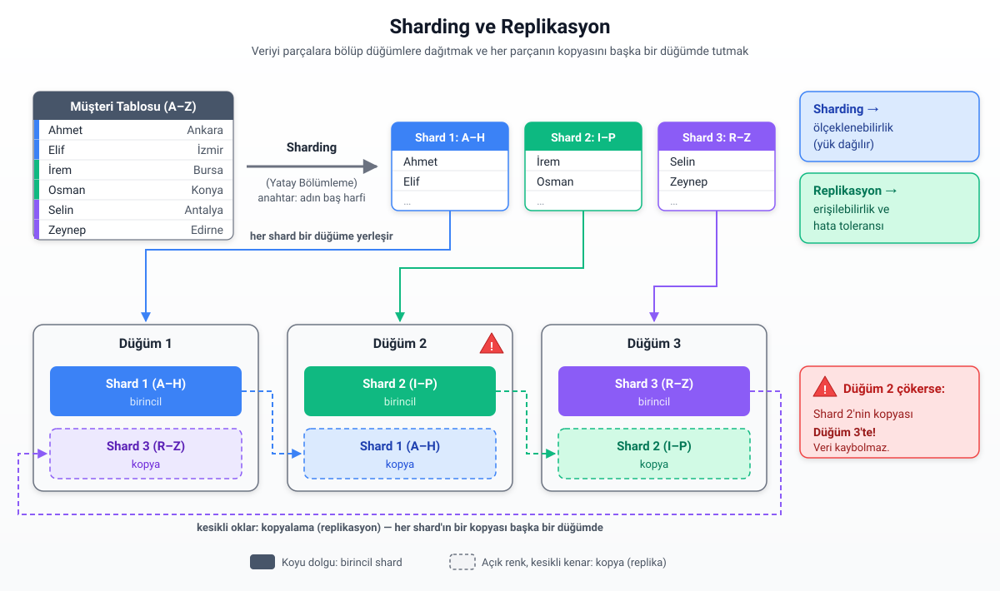
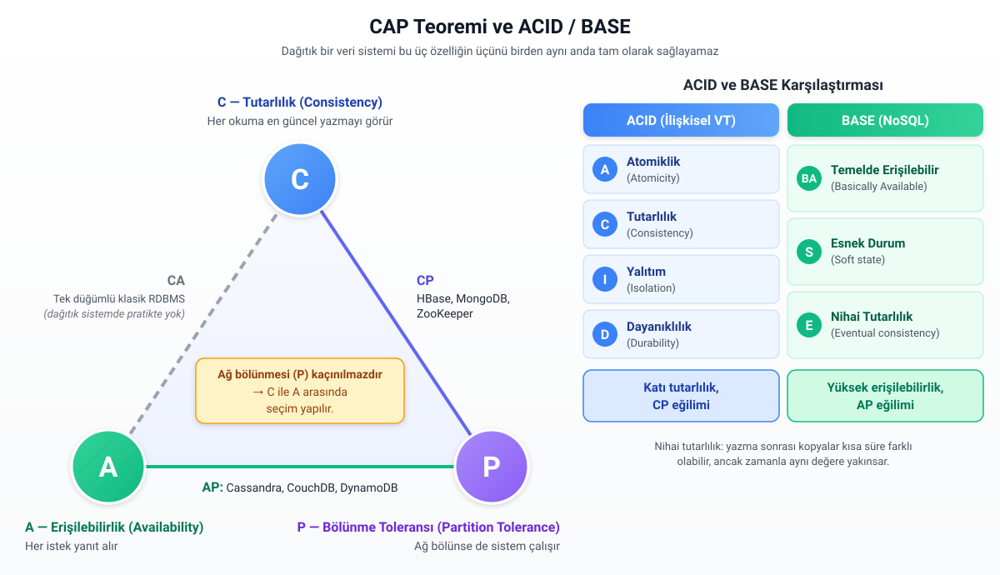
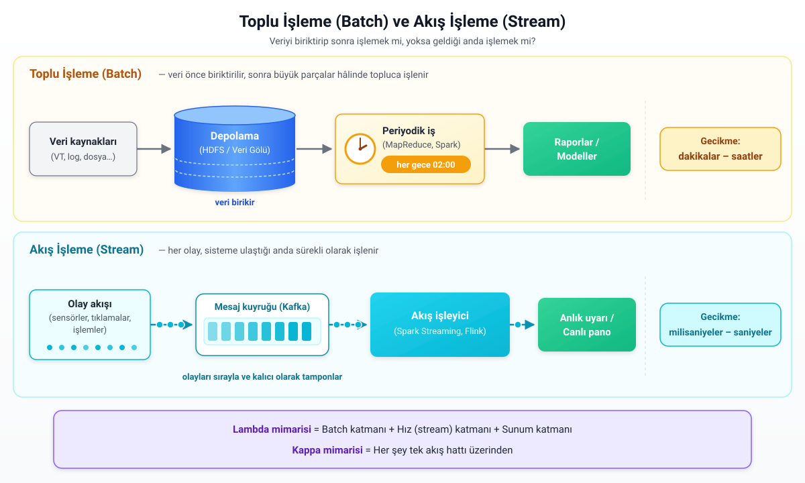

# 12. Klasik Veri Madenciliğinden Büyük Veriye

Şimdiye kadar gördüğümüz algoritmalar, verinin **tek bir bilgisayarın belleğine sığdığını** zımnen varsayıyordu. Bu bölüm, bu varsayım çöktüğünde ne olduğunu ve Kısım II'deki teknolojilerin bu soruna nasıl cevap verdiğini tartışarak iki kısım arasında köprü kurar.

## 12.1 Algoritmalar Tek Makinede Neden Tıkanır?

**1) Bellek duvarı.** scikit-learn, pandas ve R'nin klasik veri çerçeveleri veriyi **RAM'e** yükler. 16 GB belleği olan bir dizüstü bilgisayar, 50 GB'lık bir CSV dosyasını açamaz. Bazı algoritmaların bellek ihtiyacı veriden bile hızlı büyür: Hiyerarşik kümeleme için uzaklık matrisi $O(n^2)$'dir; 100.000 nokta için yalnızca matrisin üst üçgeni bile yaklaşık 40 GB tutar (Bölüm 9.3).

**2) Disk G/Ç duvarı.** Veri belleğe sığmasa bile diskten okunabilir, ama disk yavaştır. Yaklaşık 200 MB/s okuma hızındaki bir disk düşünelim. **1 TB** veriyi baştan sona *sadece okumak* yaklaşık 5.000 saniye, yani **~83 dakika** sürer. Apriori gibi veriyi defalarca tarayan bir algoritma için bu süre tarama sayısıyla çarpılır. Aynı veriyi **100 diske** bölüp paralel okursak süre **~50 saniyeye** iner. Hadoop'un temel fikri tam olarak budur.

**3) Hesaplama karmaşıklığı.** Algoritmaların zaman maliyeti veri boyutuyla doğrusal artsa bile büyük veride sorun yaratır; doğrusalın üzerinde artanlar ise hızla imkânsız hâle gelir:

| Algoritma | Yaklaşık maliyet | Büyük veride sorun |
|---|---|---|
| k-NN (tek tahmin) | $O(n \cdot p)$ | Her tahminde tüm veri taranır |
| Hiyerarşik kümeleme | $O(n^2)$ bellek, $O(n^2)$ – $O(n^3)$ zaman | 10⁶ noktada pratikte imkânsız |
| Apriori | Her seviyede bir tam tarama + aday patlaması | Çok sayıda disk taraması |
| SVM (çekirdekli) | $O(n^2)$ – $O(n^3)$ | Milyonlarca örnekte çok yavaş |
| k-Means (iterasyon başına) | $O(n \cdot k \cdot p)$ | Ölçeklenebilir, paralelleştirilebilir |

**Witten ve arkadaşlarına göre büyük veri setlerinden öğrenmenin yolları:**

1. **Örnekleme:** Verinin temsilî bir alt kümesiyle çalışmak. Çoğu zaman yeterlidir, ama nadir örüntüler kaybolabilir.
2. **Artımlı (çevrimiçi) öğrenme:** Veriyi parça parça okuyup modeli güncellemek (Bölüm 11.6; sklearn'de `partial_fit`).
3. **Paralelleştirme ve dağıtık hesaplama:** İşi birçok işlemciye veya makineye bölmek. *Kısım II'nin konusu budur.*

## 12.2 Paralel ve Dağıtık İşleme; Dikey ve Yatay Ölçekleme

Erl ve arkadaşları iki kavramı birbirinden ayırır:

* **Paralel veri işleme:** Büyük bir görev alt görevlere bölünür ve **tek bir makinenin** birden fazla işlemci çekirdeğinde eş zamanlı çalıştırılır. Çekirdekler belleği paylaşır.
* **Dağıtık veri işleme:** Alt görevler, ağ ile birbirine bağlı **birden fazla makinede** çalıştırılır. Her makinenin kendi belleği ve diski vardır; aralarında iletişim ağ üzerinden olur. Bu yaklaşım her zaman böl ve yönet (divide and conquer) ilkesine dayanır.

Bir sistemi büyütmenin iki yolu vardır:



| | Dikey Ölçekleme (Scale Up) | Yatay Ölçekleme (Scale Out) |
|---|---|---|
| Yöntem | Mevcut makineye daha güçlü CPU, daha fazla RAM/disk | Kümeye yeni (standart) makineler eklemek |
| Maliyet | Üst segmentte üstel artar | Yaklaşık doğrusal artar |
| Sınır | Tek makinenin fiziksel sınırı | Pratikte binlerce düğüm |
| Hata toleransı | Tek hata noktası | Bir düğüm çökse de sistem çalışır |
| Yazılım | Değişiklik gerekmez | Dağıtık yazılım gerekir (Hadoop, Spark) |

Büyük veri teknolojileri **yatay ölçeklemeyi** esas alır. Google'ın 2000'lerin başındaki yaklaşımı, pahalı süper bilgisayarlar yerine binlerce ucuz **standart (commodity)** sunucu kullanmak ve donanım arızalarını *istisna değil olağan durum* kabul edip yazılımla tolere etmekti. Bu yaklaşım GFS ve MapReduce makalelerine, onlar da Hadoop'a ilham verdi.

**Hesaplamayı veriye götürmek (data locality).** Dağıtık sistemlerde en pahalı işlem, veriyi ağ üzerinden taşımaktır. 1 TB veriyi işlem sunucusuna taşımak yerine, birkaç kilobaytlık programı verinin bulunduğu düğümlere göndermek çok daha verimlidir. Bu ilke, Kısım II'de göreceğimiz HDFS ve YARN tasarımının merkezindedir.

> **Amdahl Yasası:** Paralelleştirmenin de bir sınırı vardır. Bir programın paralelleştirilemeyen (seri) kısmının oranı $s$ ise, $N$ işlemciyle elde edilebilecek en yüksek hızlanma $\frac{1}{s + (1-s)/N}$ olur. Programın %10'u seri ise, sonsuz işlemciyle bile en fazla **10 kat** hızlanma elde edilir. Bu yüzden MapReduce ve Spark gibi çerçeveler işi, birbirinden bağımsız ve **utanç verici derecede paralel (embarrassingly parallel)** parçalara bölmeye çalışır.
>
> ```math
> \underbrace{\text{Hızlanma}(N)}_{\substack{\text{N işlemciyle en}\\\text{yüksek hızlanma}}} = \frac{\overbrace{1}^{\substack{\text{tek işlemcideki}\\\text{süre (1 birim)}}}}{\underbrace{s}_{\substack{\text{seri kısım:}\\\text{kısalmaz}}} + \underbrace{(1-s)/N}_{\substack{\text{paralel kısım:}\\\text{N işlemciye bölünür}}}}
> ```
>
> **Ne anlatıyor?** Programın tek işlemcideki çalışma süresi 1 birim kabul edilir. Paralel kısım N işlemciye bölündükçe kısalır, ama seri kısım (s) olduğu gibi kalır; N ne kadar büyürse büyüsün payda s'nin altına inemez. Bu yüzden hızlanma hiçbir zaman 1/s'yi aşamaz.

## 12.3 Sharding ve Replikasyon

Veri tek bir makineye sığmıyorsa onu **bölmek**, makineler arızalanabiliyorsa onu **çoğaltmak** gerekir.

**Sharding (yatay bölümleme).** Büyük bir veri seti, satırlar bazında daha küçük parçalara (**shard**) bölünür ve her parça farklı bir düğümde saklanır. Örneğin bir müşteri tablosu soyadının baş harfine göre A–H, I–P ve R–Z diye üç düğüme dağıtılabilir. Böylece hem depolama kapasitesi hem de okuma/yazma yükü düğümlere dağılır. Bölme anahtarının iyi seçilmesi önemlidir; aksi hâlde bazı düğümler aşırı yüklenir (*sıcak nokta — hotspot*). Bu yüzden pratikte çoğunlukla **özet (hash) tabanlı** bölümleme kullanılır.

**Replikasyon (çoğaltma).** Her veri parçasının birden fazla kopyası farklı düğümlerde tutulur. Bir düğüm çöktüğünde veri kopyalardan okunmaya devam eder. Replikasyon ayrıca okuma yükünü kopyalar arasında dağıtarak performansı artırır. İki temel modeli vardır:

* **Ana–yardımcı (master–slave):** Yazmalar ana düğüme yapılır, kopyalara aktarılır. Okumalar her düğümden yapılabilir.
* **Eşler arası (peer-to-peer):** Tüm düğümler eşittir; her biri okuma ve yazma kabul eder. Daha erişilebilirdir, ama tutarlılık sorunları doğurabilir.



Gerçek sistemler ikisini birlikte kullanır: Veri önce shard'lara bölünür, sonra her shard çoğaltılır. **HDFS** de dosyaları 128 MB'lık bloklara böler (bir tür sharding) ve her bloğu varsayılan olarak **3 kopya** hâlinde farklı düğümlerde saklar (replikasyon). Kısım II'de bu yapıyı ayrıntılı göreceğiz.

## 12.4 CAP Teoremi; ACID ve BASE

Veriyi birden fazla düğümde tutmanın bedava olmayan bir sonucu vardır. Eric Brewer'ın **CAP teoremine** göre dağıtık bir veri sistemi aşağıdaki üç özellikten **en fazla ikisini aynı anda** garanti edebilir:

* **C — Tutarlılık (Consistency):** Her okuma, en son yapılan yazmayı görür. Tüm düğümler aynı anda aynı veriyi gösterir.
* **A — Erişilebilirlik (Availability):** Çalışan her düğüme gelen her istek (hata değil) bir yanıt alır.
* **P — Bölünme toleransı (Partition tolerance):** Düğümler arasındaki ağ bağlantısı koptuğunda (bölünme) sistem çalışmaya devam eder.



Dağıtık bir sistemde ağ arızaları kaçınılmazdır, bu yüzden **P'den vazgeçilemez.** Asıl seçim, bir bölünme anında **tutarlılık ile erişilebilirlik arasındadır**:

* **CP sistemler** (HBase, MongoDB, ZooKeeper): Bölünme sırasında tutarsız veri döndürmektense bazı isteklere yanıt vermemeyi tercih eder. *Bankacılık bakiyesi* gibi verilerde uygundur.
* **AP sistemler** (Cassandra, CouchDB, DynamoDB): Her isteğe yanıt verir, ama bazı düğümler geçici olarak eski veri döndürebilir. *Sosyal medya beğeni sayısı* gibi verilerde uygundur.

**ACID ve BASE.** Bu seçim, iki farklı veritabanı felsefesine karşılık gelir:

| ACID (ilişkisel veritabanları) | BASE (çoğu NoSQL sistemi) |
|---|---|
| **A**tomiklik: İşlem ya tamamen yapılır ya hiç yapılmaz | **B**asically **A**vailable: Sistem temelde her zaman yanıt verir |
| **C**onsistency: Her işlem veritabanını geçerli bir durumdan geçerli bir duruma taşır | **S**oft state: Durum, yeni yazma olmasa da (kopyalar eşitlenirken) değişebilir |
| **I**solation: Eşzamanlı işlemler birbirini etkilemez | **E**ventual consistency: Yeni yazma gelmezse tüm kopyalar *sonunda* tutarlı hâle gelir |
| **D**urability: Onaylanan işlem kalıcıdır | |
| Katı tutarlılık → **CP** eğilimi | Yüksek erişilebilirlik → **AP** eğilimi |

## 12.5 NoSQL Veritabanı Türleri

Büyük verinin hacmi ve çeşitliliği, sabit şemalı ilişkisel veritabanlarının sınırlarını zorlayınca **NoSQL ("Not only SQL")** veritabanları ortaya çıktı. Ortak özellikleri şunlardır: esnek veya şemasız yapı, yatay ölçeklenebilirlik, sharding ve replikasyon desteği, çoğunlukla BASE modeli. Dört ana türe ayrılırlar:

| Tür | Veri modeli | Güçlü olduğu yer | Örnekler |
|---|---|---|---|
| **Anahtar–değer** | Anahtar → opak değer (sözlük) | Oturum bilgisi, önbellek, alışveriş sepeti | Redis, Amazon DynamoDB, Riak |
| **Belge** | Anahtar → JSON/BSON belge | İçerik yönetimi, katalog, esnek şemalı kayıtlar | MongoDB, CouchDB |
| **Geniş sütun (column-family)** | Satır anahtarı → değişken sütun aileleri | Çok büyük, seyrek tablolar, zaman serisi | Apache HBase, Cassandra |
| **Graf** | Düğümler, kenarlar, özellikler | İlişkilerin kendisinin önemli olduğu veri | Neo4j, JanusGraph |

Kısım II'de (Bölüm 16.5) tanıyacağımız **HBase**, Google'ın Bigtable'ından esinlenmiş, HDFS üzerinde çalışan geniş sütunlu bir NoSQL veritabanıdır.

NoSQL, ilişkisel veritabanlarının yerini almaz, onları tamamlar. Modern sistemler çoğunlukla **çok dilli kalıcılık (polyglot persistence)** ilkesini izler: Her veri türü için en uygun depolama kullanılır.

## 12.6 Toplu (Batch) ve Gerçek Zamanlı (Stream) İşleme

Erl ve arkadaşları büyük veri işleme iş yüklerini ikiye ayırır:



* **Toplu işleme (batch):** Veri bir süre biriktirilir, sonra büyük bloklar hâlinde işlenir. Örnekler: gece çalışan raporlar, haftalık model eğitimi, aylık faturalama. Gecikme dakikalar ile saatler arasındadır, ama çok büyük hacimler verimli şekilde işlenir. **Hadoop MapReduce** bu modelin klasik temsilcisidir. Spark da toplu işlemede yaygın olarak kullanılır.
* **Akış / gerçek zamanlı işleme (stream):** Veri geldiği anda, olay olay ya da küçük mikro-yığınlar hâlinde işlenir. Örnekler: anlık sahtekârlık tespiti, canlı panolar, IoT alarmları. Gecikme milisaniyeler ile saniyeler arasındadır. Tipik araçlar: **Apache Kafka** (mesaj kuyruğu), **Spark Structured Streaming**, **Apache Flink**, **Apache Storm**. Bu işlemenin bir türü olan **karmaşık olay işleme (Complex Event Processing — CEP)**, birden fazla akıştaki olaylar arasındaki örüntüleri gerçek zamanlı yakalar.

İki ihtiyacı birlikte karşılamak için iki referans mimari önerilmiştir:

* **Lambda mimarisi:** Doğru ama yavaş bir **toplu katman** ile hızlı ama yaklaşık bir **hız (akış) katmanı** paralel çalışır; bir **sunum katmanı** iki sonucu birleştirir. Dezavantajı, aynı mantığın iki ayrı sistemde kodlanmasıdır.
* **Kappa mimarisi:** Her şey tek bir akış hattı üzerinden işlenir. Yeniden hesaplama gerektiğinde akış baştan "yeniden oynatılır" (replay).

## 12.7 Vaka: 1 Milyar Satır Yarışması (1BRC)

2024'ün başında Java topluluğunda başlayan **One Billion Row Challenge (1BRC)**, ölçeklenme sorununu somutlaştıran mükemmel bir örnektir. Görev basittir: Her satırında `istasyon_adı;sıcaklık` bulunan **1 milyar satırlık (~13.8 GB)** bir metin dosyasını okuyup, her istasyon için **minimum, ortalama ve maksimum** sıcaklığı hesaplamak. SQL'de bir `GROUP BY` sorgusundan ibaret olan bu iş, ölçek büyüyünce bambaşka bir probleme dönüşür.

Appsilon'un R ile yaptığı deneyde (12 çekirdekli, 36 GB RAM'li bir dizüstü bilgisayar) şu sonuçlar alınmıştır:

| Yaklaşım | Ortalama süre | Not |
|---|---|---|
| Saf R, tek iş parçacığı (satır satır okuma) | **~50 dakika** | En basit, en yavaş |
| Saf R, 11 çekirdekte paralel (`doParallel`) | **~17 dakika** | Dosya parçalara bölünüp çekirdeklere dağıtıldı |
| R `aggregate()` (tüm veriyi belleğe yükleme) | **Bellek yetmedi** | 13.8 GB metin, bellekte çok daha fazla yer tutar |
| **DuckDB** (SQL, sütunlu ve paralel motor) | **< 10 saniye** | Tek iş parçacıklı R'den **~335 kat**, paralel R'den **~115 kat** hızlı |

Karşılaştırma için Java'daki en hızlı çözüm yaklaşık **1.5 saniyede** tamamlanmıştır.

**Bu vakadan çıkan dersler:**

1. **Paralelleştirme işe yarar, ama tek başına yetmez:** 11 çekirdek ~3 kat hızlanma getirdi, 11 kat değil. Dosya okuma, parçaların birleştirilmesi ve dilin ek yükü gibi seri kısımlar hızlanmayı sınırladı (Amdahl Yasası).
2. **Bellek duvarı gerçektir:** "Hepsini belleğe yükle, sonra işle" yaklaşımı ilk aşamada çöktü.
3. **Doğru araç ve veri yapısı her şeyi değiştirir:** DuckDB'nin sütunlu (columnar) işleme, vektörleştirilmiş yürütme ve otomatik paralellik kullanması, aynı donanımda iki-üç mertebe fark yarattı.
4. **Dosya formatı önemlidir:** Sıkıştırılmamış düz metin yerine **Parquet** gibi sütunlu ve sıkıştırılmış bir format kullanılsaydı, dosya boyutu yaklaşık 5 kat küçülecek ve süre daha da kısalacaktı. Parquet, Hadoop ve Spark dünyasının standart formatlarındandır.
5. **Sınırın ötesi:** 1 milyar satır (~14 GB), iyi bir araçla hâlâ tek makinede işlenebilir. Peki veri 14 **TB** olsaydı? Ya da her gün o kadar veri gelseydi? İşte bu noktada tek makinenin bittiği ve **dağıtık sistemlerin** (Hadoop, Spark) başladığı yere geliriz.

**Python ile küçük ölçekte 1BRC denemesi.** Aşağıdaki kod 10 milyon satırlık bir test dosyası üretir ve aynı hesabı üç farklı yolla yapar. Kendi bilgisayarınızda süreleri karşılaştırın. Satır sayısını artırdıkça farkın nasıl büyüdüğünü gözlemleyin.

```python
import multiprocessing as mp
import os
import time

import numpy as np
import pandas as pd

DOSYA = "olcumler.txt"
N = 10_000_000          # 10 milyon satır (~130 MB); 1BRC'de 1 milyar

def veri_uret():
    rng = np.random.default_rng(42)
    istasyonlar = np.array(["İstanbul", "Ankara", "İzmir", "Erzurum", "Antalya",
                            "Trabzon", "Van", "Edirne", "Konya", "Muğla"])
    ortalama = np.array([15, 12, 18, 6, 19, 15, 9, 14, 12, 17])
    idx = rng.integers(0, len(istasyonlar), N)
    sicaklik = np.round(ortalama[idx] + rng.normal(0, 8, N), 1)
    pd.DataFrame({"i": istasyonlar[idx], "t": sicaklik}).to_csv(
        DOSYA, sep=";", header=False, index=False)

# 1) Saf Python: satır satır, tek iş parçacığı
def saf_python(yol=DOSYA, bas=0, son=None):
    ist = {}
    with open(yol, "rb") as f:
        if bas:                       # parça, başlangıcı [bas, son] içinde olan satırları işler
            f.seek(bas - 1)
            f.readline()              # önceki parçaya ait (yarım) satırı atla
        while son is None or f.tell() <= son:
            satir = f.readline()
            if not satir:
                break
            ad, deger = satir.rstrip(b"\n").split(b";")
            t = float(deger)
            s = ist.get(ad)
            if s is None:
                ist[ad] = [t, t, t, 1]
            else:
                s[0] = min(s[0], t); s[1] = max(s[1], t); s[2] += t; s[3] += 1
    return ist

# 2) Paralel Python: dosyayı çekirdek sayısı kadar parçaya böl
def paralel_python():
    boyut = os.path.getsize(DOSYA)
    n = mp.cpu_count()
    sinirlar = [(i * boyut // n, (i + 1) * boyut // n - 1) for i in range(n)]
    with mp.Pool(n) as havuz:
        parcalar = havuz.starmap(saf_python, [(DOSYA, b, s) for b, s in sinirlar])
    sonuc = {}
    for p in parcalar:                # parça sonuçlarını birleştir ("reduce")
        for ad, (mn, mx, top, say) in p.items():
            r = sonuc.setdefault(ad, [mn, mx, 0.0, 0])
            r[0] = min(r[0], mn); r[1] = max(r[1], mx); r[2] += top; r[3] += say
    return sonuc

# 3) pandas: vektörleştirilmiş, C ile yazılmış okuyucu ve groupby
def pandas_ile():
    df = pd.read_csv(DOSYA, sep=";", header=None, names=["istasyon", "sicaklik"])
    return df.groupby("istasyon")["sicaklik"].agg(["min", "mean", "max"])

if __name__ == "__main__":
    if not os.path.exists(DOSYA):
        veri_uret()
    for ad, f in [("Saf Python", saf_python), ("Paralel Python", paralel_python),
                  ("pandas", pandas_ile)]:
        t0 = time.perf_counter()
        f()
        print(f"{ad:15s}: {time.perf_counter() - t0:6.2f} sn")
    print(pandas_ile().round(1))
```

Örnek bir çalıştırmada (10 milyon satır, standart bir masaüstü bilgisayar) saf Python yaklaşık 11 saniye, paralel Python yaklaşık 7 saniye, pandas ise yaklaşık 3 saniye sürmüştür. Paralel sürüm, çekirdek sayısı kadar değil yalnızca ~1.6 kat hızlanmıştır. Süreç başlatma ve sonuçların birleştirilmesi gibi seri işler hızlanmayı sınırlar (Amdahl Yasası). Vektörleştirilmiş, C ile yazılmış pandas ise tek çekirdekte bile en hızlısıdır. 1BRC'deki R deneyiyle aynı ders!

DuckDB kuruluysa (`pip install duckdb`), aynı iş tek bir SQL sorgusuyla, dosya belleğe tamamen yüklenmeden ve tüm çekirdekler kullanılarak yapılır:

```python
import duckdb

print(duckdb.sql("""
    SELECT istasyon, MIN(sicaklik) AS en_dusuk,
           ROUND(AVG(sicaklik), 1) AS ortalama, MAX(sicaklik) AS en_yuksek
    FROM read_csv('olcumler.txt', delim=';', header=false,
                  columns={'istasyon': 'VARCHAR', 'sicaklik': 'DOUBLE'})
    GROUP BY istasyon ORDER BY istasyon
"""))
```

> **Spark ile devamı:** Aynı problem 100 milyon satırla laboratuvar kümesinde Spark ile çözülmüştür: [spark_ders_notu.md, 8. bölüm](../spark_ders_notu.md#8-uygulama-2-1brcyi-spark-ile-çözmek).

> **Kısım II'ye köprü:** Paralel Python çözümündeki yapıya dikkat edin. Önce veri parçalara bölünüyor, her parça bağımsız olarak işlenip ara sonuçlar (istasyon → min/maks/toplam/sayı) üretiliyor, sonra bu ara sonuçlar birleştiriliyor. Bu, **MapReduce** programlama modelinin ta kendisidir: Bölme ve parçaları işleme adımı **Map**, birleştirme adımı **Reduce**'tur. Hadoop bu fikri tek makinenin çekirdeklerinden binlerce makineye, dosya sisteminden hata toleransına kadar her şeyiyle ölçekler.

---

[← 11. Veri Madenciliğinde İleri Konular](11-ileri-konular.md) · [İçindekiler](../ders_notu.md) · [13. Etik, Gizlilik ve Veri Yönetişimi →](13-etik-gizlilik-ve-veri-yonetisimi.md)
