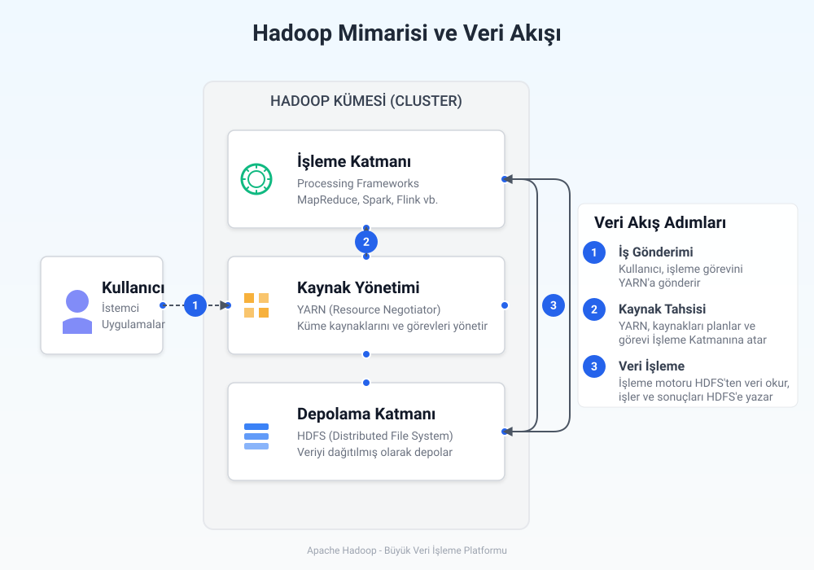
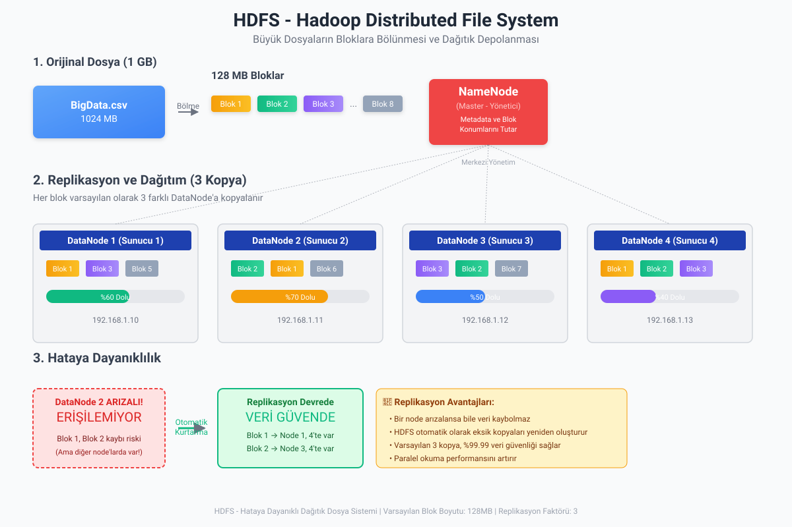

# 15. Hadoop'a Giriş

## 15.1 Küme ve Dağıtık Dosya Sistemi

1 TB'lık bir metin dosyasındaki her kelimenin kaç kez geçtiğini saymak istediğimizi düşünelim. Bölüm 12.1'de gördüğümüz gibi, tek bir diskten bu dosyayı yalnızca okumak bile 80 dakikayı aşar. Aynı dosyanın farklı parçaları üzerinde 100 bilgisayar aynı anda çalışırsa süre dakikalardan saniyelere iner. Dağıtık sistemlerin temel mantığı budur: Büyük bir problemi küçük parçalara böl, her parçayı farklı bir makinede işle, sonuçları birleştir.

Bunun için iki yapı taşı gerekir:

* **Küme (cluster):** Birbirine hızlı bir ağ ile bağlı çok sayıda standart bilgisayarın tek bir sistem gibi çalışmasıdır. Kümedeki her bilgisayara **düğüm (node)** denir.
* **Dağıtık dosya sistemi (distributed file system):** Büyük bir dosyayı tek bir bilgisayarda saklamak yerine **bloklara (block)** bölerek kümedeki farklı bilgisayarlara dağıtan sistemdir. Böylece hem depolama kapasitesi artar hem de veriye aynı anda birden çok bilgisayar erişebilir.

Bir benzetmeyle: Çok büyük bir yapbozu tek başınıza tamamlamanız haftalar sürebilir. Aynı yapbozu 100 kişiye paylaştırırsanız, her biri kendi parçasını tamamlar ve sonra parçalar birleştirilir. **Apache Hadoop**, bu mantıkla çalışan açık kaynaklı bir yazılım çerçevesidir: Devasa bir veri işleme görevini, standart donanıma sahip yüzlerce, hatta binlerce bilgisayardan oluşan bir kümeye dağıtır ve paralel olarak çözer. Google'ın GFS ve MapReduce makalelerinden esinlenerek geliştirilmiştir (Bölüm 12.2).

## 15.2 Hadoop'un Bileşenleri

Hadoop dört modülden oluşur. Bunlardan ikisi, **depolama** ve **kaynak yönetimi**, sistemin taşıyıcı katmanlarıdır; MapReduce bu katmanların üzerinde çalışan işleme modeli, Hadoop Common ise hepsinin ortak kütüphanesidir:

1. **HDFS (Hadoop Distributed File System):** Hadoop'un dağıtık depolama katmanıdır. Büyük dosyaları varsayılan olarak 128 MB'lık bloklara ayırır ve kümedeki farklı makinelere dağıtır. Veri kaybını önlemek için her bloğun varsayılan olarak 3 kopyasını farklı makinelerde tutar. Bu işleme **replikasyon (replication, Latince *replicare*: tekrarlamak)** denir; bir makine bozulsa da veri diğer kopyalardan okunmaya devam eder (Bölüm 12.3).

   

2. **YARN (Yet Another Resource Negotiator):** Kümenin kaynak yöneticisidir. Hangi işin hangi makinede çalışacağını planlar; işlemci çekirdeği ve bellek gibi kaynakları işler arasında paylaştırır. Bu yönüyle kümenin işletim sistemi gibi davranır (Bölüm 15.4).
3. **MapReduce:** Büyük veriyi paralel işlemek için kullanılan programlama modelidir (Bölüm 15.5).
4. **Hadoop Common:** Diğer modüllerin ihtiyaç duyduğu ortak kütüphaneleri ve yardımcı programları içerir.

Bu yapı sayesinde Hadoop, çok büyük verileri hem uygun maliyetle depolayabilir hem de paralel olarak işleyebilir. Hadoop'un ilk sürümünde kaynak yönetimi MapReduce'un içindeydi; YARN, Hadoop 2 ile ayrı bir katman hâline geldi. Bu ayrım sayesinde bugün aynı kümede MapReduce'un yanında Spark gibi başka işleme motorları da çalışabilmektedir.

## 15.3 Hadoop Mimarisi: Kim Ne Yapar?

Bir Hadoop kümesi bir kurumun örgüt yapısına benzer: Bir **yönetici (master)** düğüm ve birden fazla **işçi (worker)** düğüm vardır.

**Yönetici düğümde çalışan servisler:**

* **NameNode:** HDFS'in beynidir. Dosya sistemi ağacını ve her dosyanın hangi bloklardan oluştuğunu tutar; yani **meta veriyi (metadata)** yönetir. Verinin kendisini saklamaz, yalnızca "haritayı" tutar.
* **ResourceManager:** YARN'ın merkezidir. Kümedeki bütün hesaplama kaynaklarını izler ve gelen işlere kaynak ayırır.
* **SecondaryNameNode:** Adına rağmen yedek bir NameNode değildir. NameNode'un değişiklik günlüğünü (edit log) belirli aralıklarla (varsayılan olarak saatte bir) dosya sistemi görüntüsüyle (fsimage) birleştirerek bir **denetim noktası (checkpoint)** oluşturur. Böylece günlük dosyası aşırı büyümez ve NameNode'un yeniden başlama süresi kısalır.

**İşçi düğümlerde çalışan servisler:**

* **DataNode:** Verinin kendisini, yani blokları saklayan servistir. NameNode ile iki ayrı mekanizmayla haberleşir:
  * **Kalp atışı (heartbeat):** Her DataNode varsayılan olarak 3 saniyede bir NameNode'a "ayaktayım" sinyali gönderir. NameNode yaklaşık 10 dakika boyunca kalp atışı alamadığı DataNode'u ölü kabul eder ve o düğümdeki blokların kopyalarını başka düğümlerde yeniden oluşturur.
  * **Blok raporu (block report):** DataNode, sakladığı blokların tam listesini açılışta ve sonra belirli aralıklarla (varsayılan olarak 6 saatte bir) NameNode'a gönderir. NameNode bloğun hangi makinelerde bulunduğunu bu raporlardan öğrenir.
* **NodeManager:** Her işçi makinedeki kaynak sorumlusudur. ResourceManager'dan gelen taleplere göre **konteynerler (container)** başlatır ve işlerin görevlerini bu konteynerlerde çalıştırır.

Tek makineli kurulumda bu servislerin hepsi aynı bilgisayarda çalışır; çok makineli kümede yönetici servisleri bir makinede, DataNode ve NodeManager ise her işçi makinede çalışır.

## 15.4 YARN: Kaynakların Paylaştırılması

YARN, kümedeki her işin "ne kadar bellek ve kaç çekirdek" istediğini, her düğümün ne kadar boş kaynağı olduğunu bilir ve ikisini eşleştirir. Kaynak tahsisinin birimi **konteynerdir**: belirli miktarda bellek ve sanal çekirdekten oluşan, bir görevin çalıştığı kaynak paketi.

Bir iş YARN'a gönderildiğinde şu adımlar izlenir:

1. İstemci işi **ResourceManager**'a gönderir.
2. ResourceManager, uygun bir düğümdeki **NodeManager**'a o işin **ApplicationMaster**'ını (uygulama yöneticisi) başlatmasını söyler. Her uygulamanın kendi kaynak pazarlığını yapan küçük bir yöneticisi vardır.
3. ApplicationMaster, işin görevleri için ResourceManager'dan konteyner ister (ör. "2 çekirdek ve 4 GB bellekli 2 konteyner").
4. ResourceManager uygun düğümlerde konteyner ayırır, NodeManager'lar bu konteynerleri başlatır ve görevler çalışır.
5. İş bitince ApplicationMaster sonucu bildirir ve konteynerler serbest bırakılır.

Birden çok iş aynı anda kaynak istediğinde kimin önce hizmet alacağına **zamanlayıcı (scheduler)** karar verir. *FIFO* zamanlayıcı işleri geliş sırasıyla çalıştırır; *Capacity* zamanlayıcı kaynakları kuyruklara böler ve her ekibe garanti edilmiş bir pay ayırır (Hadoop 3'ün varsayılanıdır); *Fair* zamanlayıcı ise kaynakları çalışan işler arasında zamanla eşit paylaştırır. Spark'ın aynı adımları nasıl izlediği ve gerçek bir kümede bellek hesabının nasıl yapıldığı ek notta anlatılmıştır: [Spark, YARN Üzerinde Nasıl Çalışır?](../spark_ders_notu.md#3-spark-yarn-üzerinde-nasıl-çalışır)

## 15.5 MapReduce Programlama Modeli

MapReduce'ta programcı yalnızca iki fonksiyon yazar; verinin bölünmesi, görevlerin makinelere dağıtılması, ara sonuçların taşınması ve hata durumunda görevlerin yeniden çalıştırılması çerçevenin işidir. Bir MapReduce işi üç aşamadan geçer:

1. **Map (eşleme):** Çerçeve, girdi dosyasını **girdi parçalarına (input split)** böler; tipik olarak her HDFS bloğu bir parçadır. Her parça için bir map görevi başlatılır ve mümkünse bloğun bulunduğu makinede çalıştırılır (**veri yerelliği**, Bölüm 12.2). Map fonksiyonu kayıtları tek tek okur ve her kayıttan **anahtar–değer (key–value)** çiftleri üretir.
2. **Shuffle ve sort (karıştırma ve sıralama):** Çerçeve, map çıktılarını anahtara göre gruplar ve sıralar. Aynı anahtara ait bütün değerler, ağ üzerinden aynı reduce görevine taşınır. Kullanıcı bu aşama için kod yazmaz, ama bir işin en pahalı kısmı çoğunlukla burasıdır.
3. **Reduce (indirgeme):** Reduce fonksiyonu her anahtar için o anahtarın değer listesini alır ve bir sonuç üretir. Sonuçlar HDFS'e yazılır.

**Örnek: Kelime sayma.** Girdi tek satırlık bir metin olsun: `merhaba dunya hosgeldin dunya`.

| Aşama | Çıktı |
|---|---|
| Map (her kelime için `(kelime, 1)`) | `(merhaba, 1)`, `(dunya, 1)`, `(hosgeldin, 1)`, `(dunya, 1)` |
| Shuffle ve sort (anahtara göre grupla) | `dunya → [1, 1]`, `hosgeldin → [1]`, `merhaba → [1]` |
| Reduce (listeyi topla) | `(dunya, 2)`, `(hosgeldin, 1)`, `(merhaba, 1)` |

Gerçek bir işte binlerce map görevi aynı anda çalışır ve her biri kendi parçasından binlerce `(kelime, 1)` çifti üretir. Bu çiftlerin hepsini ağ üzerinden taşımak pahalıdır. Bu yüzden map tarafında isteğe bağlı bir **birleştirici (combiner)** kullanılabilir: Her map görevi kendi çıktısını önce yerelde toplar (`(dunya, 2)`) ve ağa yalnızca bu ara toplamları gönderir. Bölüm 12.7'deki paralel Python çözümünde ara sonuçların parça parça hesaplanması bu fikrin aynısıdır; Spark bunu **kısmi toplama (partial aggregation)** adıyla otomatik yapar (ek not, Bölüm 2.3).

---

[← 14. Büyük Veri Nedir?](14-buyuk-veri-nedir.md) · [İçindekiler](../ders_notu.md) · [16. Hadoop Ekosistemi →](16-hadoop-ekosistemi.md)
