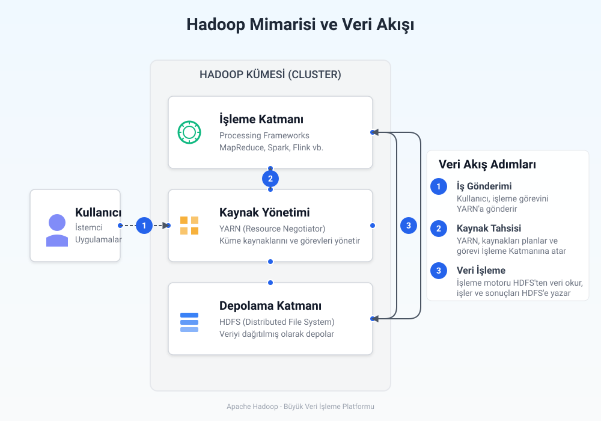

# Kısım I — Veri Madenciliği: Temeller ve İleri Konular

## 0. Dersin Yol Haritası

Bu ders iki büyük soruya cevap arar: **"Veriden nasıl bilgi çıkarırız?"** ve **"Veri tek bir bilgisayara sığmayacak kadar büyüdüğünde bunu nasıl yaparız?"** İlk soru *veri madenciliğinin*, ikincisi *büyük veri teknolojilerinin* konusudur. Bu iki alan birbirinden kopuk değildir: Büyük veri altyapıları (Hadoop, Spark vb.) kendi başına bir amaç değil, veri madenciliği ve analitik algoritmalarını devasa veri üzerinde çalıştırabilmek için geliştirilmiş araçlardır.

Notlar bu nedenle iki kısımdan oluşur:

* **Kısım I — Veri Madenciliği:** Süreç modelleri, veriyi tanıma ve hazırlama, temel görevler (birliktelik kuralları, sınıflandırma, kümeleme, aykırı değer tespiti), model değerlendirme ve ileri konular. Kısım, klasik algoritmaların neden büyük veride tıkandığını ve bu sorunun nasıl aşıldığını tartışan bir köprü bölümüyle biter.
* **Kısım II — Büyük Veri Teknolojileri:** Büyük verinin tanımı ve 5V, Hadoop (HDFS, YARN, MapReduce), Hadoop ekosistemi (Hive, Pig, Spark, Mahout, HBase), kurulum ve uygulamalar.
* **Ek not — [Spark ve YARN ile Dağıtık Veri Madenciliği](spark_ders_notu.md):** Laboratuvardaki üç makineyle kurulan gerçek bir Hadoop + Spark kümesi. 1BRC, kelime sayma (MapReduce ve Spark), MLlib ile hiperparametre araması ve ölçekleme deneyi.


> **Okuma önerisi:** Her bölümde önce sezgiyi bir benzetmeyle kurmaya, ardından kavramı tanımlamaya ve en sonda küçük bir örnek ya da Python kodu ile somutlaştırmaya çalışacağız. Kod örnekleri `numpy`, `pandas`, `scipy`, `scikit-learn` ve `imbalanced-learn` kütüphanelerini kullanır (`pip install numpy pandas scipy scikit-learn imbalanced-learn`). Uygulamalarla birlikte gereken bütün paketler depo kökündeki [requirements.txt](requirements.txt) dosyasında listelenmiştir (`pip install -r requirements.txt`).

***

## 1. Veri Madenciliği Nedir?

### 1.1 Neden Veri Madenciliği?

Bir süpermarket zincirini düşünün. Her gün binlerce kasada milyonlarca ürün okutuluyor, her fiş bir veritabanına kaydediliyor. Yıllar içinde bu kayıtlar terabaytlara ulaşır. Peki bu veri yığını kendiliğinden bir şey söyler mi? Hayır. Veri, işlenmediği sürece sadece maliyettir: Depolanması, yedeklenmesi ve korunması gerekir. Değer, ancak verinin içine gömülü **örüntüler (patterns)** gün yüzüne çıkarıldığında ortaya çıkar: "Bebek bezi alan müşteriler sıklıkla ıslak mendil ve mama da alıyor", "Bu müşteri profili önümüzdeki üç ayda bizi terk etme eğiliminde" gibi.

Han ve arkadaşları bu durumu *"veri zengini ama bilgi fakiri" (data rich but information poor)* olarak özetler. Veri toplama kapasitemiz, veriyi anlama kapasitemizi çoktan geçmiştir. Veri madenciliği bu boşluğu doldurmak için doğmuştur.

### 1.2 Tanım ve Bilgi Keşfi (KDD)

**Veri madenciliği (data mining)**, büyük miktardaki veriden *ilginç*, *önceden bilinmeyen*, *potansiyel olarak yararlı* ve *anlaşılabilir* örüntülerin ve bilginin otomatik ya da yarı otomatik olarak çıkarılması sürecidir.

Tanımdaki sıfatların her biri önemlidir:

* **İlginç:** "Hamile müşteriler hamilelik vitamini alır" bir örüntüdür ama kimseyi şaşırtmaz.
* **Önceden bilinmeyen:** Uzmanın zaten bildiği bir kuralı yeniden bulmak keşif değildir.
* **Yararlı:** Örüntü bir karara, bir eyleme dönüşebilmelidir.
* **Anlaşılabilir:** Karar vericinin yorumlayabileceği biçimde sunulmalıdır.

"Madencilik" benzetmesi aslında biraz yanıltıcıdır. Altın madenciliğinde topraktan *altın* çıkarırız; buna "toprak madenciliği" demeyiz. Veri madenciliğinde de veriden *bilgi* çıkarırız. Bu yüzden literatürde daha doğru bir terim olarak **Veritabanlarında Bilgi Keşfi (Knowledge Discovery in Databases — KDD)** kullanılır. Dar anlamda "veri madenciliği", KDD sürecinin örüntülerin çıkarıldığı *tek bir adımıdır* (bkz. Bölüm 2). Geniş anlamda ise iki terim çoğunlukla eş anlamlı kullanılır.

### 1.3 Veri Madenciliği ve Komşu Disiplinler

Veri madenciliği tek bir disiplinin ürünü değildir. Birçok alanın kesişiminde durur:


| Disiplin | Veri madenciliğine katkısı | Vurguladığı soru |
|---|---|---|
| **İstatistik** | Olasılık modelleri, hipotez testleri, örnekleme, güven aralıkları | "Bu sonuç tesadüf olabilir mi?" |
| **Makine Öğrenmesi / Yapay Zekâ** | Veriden öğrenen algoritmalar (karar ağaçları, sinir ağları, SVM…) | "Bilgisayar örneklerden nasıl genelleme yapar?" |
| **Veritabanı Sistemleri** | Verimli depolama, indeksleme, sorgulama, veri ambarları | "Milyarlarca kayda nasıl hızlı erişiriz?" |
| **Yüksek Başarımlı / Dağıtık Hesaplama** | Paralel algoritmalar, kümeler, Hadoop/Spark | "Hesabı nasıl ölçekleriz?" |
| **Görselleştirme** | Veriyi ve sonuçları insan gözünün anlayacağı biçimde sunma | "Örüntüyü nasıl gösteririz?" |
| **İş Zekâsı (BI)** | Raporlama, panolar, OLAP | "Ne oldu, nerede, ne kadar?" |

Witten ve arkadaşları istatistik ile makine öğrenmesi arasındaki farkın tarihsel olduğunu, bugün iki alanın büyük ölçüde iç içe geçtiğini vurgular. Pratik bir ayrım şöyle yapılabilir: İstatistik daha çok *hipotez doğrulamaya*, veri madenciliği ise *hipotez üretmeye* (keşfe) odaklanır.

### 1.4 Hangi Veriler, Hangi Örüntüler?

**Madenlenebilecek veri türleri.** En yaygın kaynak ilişkisel veritabanları ve veri ambarlarıdır, ama veri madenciliği bunlarla sınırlı değildir:

* **İşlem (transaction) verisi:** Market fişleri, banka hareketleri.
* **Zaman serileri ve sıralı veri:** Borsa fiyatları, sensör ölçümleri, tıklama dizileri.
* **Uzamsal veri:** Harita koordinatları, uydu görüntüleri.
* **Metin ve web verisi:** E-postalar, haberler, sosyal medya, web sayfaları ve aralarındaki bağlantılar.
* **Graf ve ağ verisi:** Sosyal ağlar, protein etkileşim ağları.
* **Çoklu ortam:** Görüntü, ses, video.
* **Veri akışları (data streams):** Sürekli ve hızla akan, tamamı saklanamayan veri.

**Madenlenebilecek örüntü türleri.** Veri madenciliği görevleri iki büyük gruba ayrılır:

1. **Tanımlayıcı (descriptive) görevler:** Verideki genel özellikleri ve ilişkileri betimler. Hedef bir değişken yoktur.
   * *Karakterizasyon ve ayrımlama:* "Sadık müşterilerin ortak özellikleri neler?"
   * *Sık örüntüler ve birliktelik kuralları:* "Ekmek alan süt de alıyor mu?"
   * *Kümeleme:* "Müşterilerimiz doğal olarak hangi gruplara ayrılıyor?"
   * *Aykırı değer analizi:* "Hangi kredi kartı işlemi diğerlerine hiç benzemiyor?"
2. **Tahmin edici (predictive) görevler:** Mevcut veriden bir model kurup bilinmeyen bir değeri tahmin eder.
   * *Sınıflandırma:* Kategorik bir etiketi tahmin etmek ("Bu e-posta spam mı?").
   * *Regresyon:* Sayısal bir değeri tahmin etmek ("Bu evin fiyatı ne olur?").

Makine öğrenmesi dilinde tahmin edici görevlere **denetimli öğrenme (supervised learning)**, etiket gerektirmeyen kümeleme gibi görevlere ise **denetimsiz öğrenme (unsupervised learning)** denir.

### 1.5 Uygulama Alanları

| Alan | Tipik uygulama | İlgili görev |
|---|---|---|
| Perakende | Pazar sepeti analizi, raf düzeni, öneri sistemleri | Birliktelik kuralları |
| Bankacılık / Finans | Kredi skorlama, sahtekârlık tespiti | Sınıflandırma, aykırı değer |
| Telekomünikasyon | Müşteri kaybı (churn) tahmini | Sınıflandırma |
| Pazarlama | Müşteri segmentasyonu, hedefli kampanya | Kümeleme |
| Sağlık | Hastalık teşhisi, ilaç etkileşimleri, genom analizi | Sınıflandırma, örüntü madenciliği |
| Üretim | Kestirimci bakım, kalite kontrol | Regresyon, aykırı değer |
| Siber güvenlik | Saldırı tespiti | Aykırı değer, sınıflandırma |
| Web | Arama motoru sıralaması, içerik önerisi | Web/graf madenciliği |

### 1.6 Veri Madenciliğinin Temel Sorunları

Han ve arkadaşları alanın başlıca zorluklarını şöyle gruplar. Bu başlıklar dersin geri kalanında karşımıza tekrar tekrar çıkacak:

* **Yöntemsel sorunlar:** Gürültülü veya eksik veriyle başa çıkmak, bulunan örüntülerin gerçekten ilginç olup olmadığını değerlendirmek, alan bilgisini sürece katmak.
* **Kullanıcı etkileşimi:** Sonuçların yorumlanabilir ve görselleştirilebilir olması.
* **Verimlilik ve ölçeklenebilirlik:** Algoritmaların veri büyüdükçe makul sürede çalışabilmesi. *Bu, Kısım II'deki büyük veri teknolojilerinin varlık sebebidir.*
* **Veri çeşitliliği:** Yapılandırılmamış, karmaşık ve dağıtık veri türleri.
* **Toplumsal etkiler:** Gizlilik, güvenlik ve algoritmik adalet (bkz. Bölüm 13).

***

## 2. Bilgi Keşfi Süreç Modelleri

Veri madenciliği "veriyi algoritmaya ver, sonucu al" kadar basit değildir. Başarılı projeler iyi tanımlanmış bir süreci izler. Bu bölümde üç yaygın süreç modelini inceleyeceğiz.

### 2.1 KDD Süreci

Fayyad, Piatetsky-Shapiro ve Smyth'in (1996) tanımladığı KDD süreci, ham veriden bilgiye uzanan adımları sıralar:


1. **Seçim (Selection):** Analiz hedefine uygun veri kaynakları ve değişkenler seçilir. Örneğin müşteri kaybı analizi için son iki yılın abonelik ve çağrı kayıtları.
2. **Ön işleme (Preprocessing):** Eksik, hatalı ve tutarsız kayıtlar temizlenir (bkz. Bölüm 4).
3. **Dönüştürme (Transformation):** Veri, madencilik algoritmasına uygun biçime getirilir: normalizasyon, yeni nitelik türetme, boyut indirgeme.
4. **Veri madenciliği (Data Mining):** Uygun algoritma (sınıflandırma, kümeleme vb.) uygulanarak örüntüler çıkarılır.
5. **Yorumlama / Değerlendirme (Interpretation / Evaluation):** Bulunan örüntülerin geçerliliği, ilginçliği ve yararlılığı değerlendirilir. Gerekirse önceki adımlara dönülür.

Şekildeki geri besleme oku önemlidir: KDD doğrusal değil **yinelemeli (iterative)** bir süreçtir. Model beklenen başarıyı vermezse çoğu zaman sorun algoritmada değil, verinin hazırlanışındadır.

### 2.2 CRISP-DM

**CRISP-DM (Cross-Industry Standard Process for Data Mining)**, 1990'ların sonunda bir sanayi konsorsiyumu tarafından geliştirilmiş, sektörden bağımsız bir süreç modelidir. KDD'ye göre daha *iş odaklıdır* ve bugün hâlâ en yaygın kullanılan metodolojidir.


| Aşama | Temel soru | Örnek çıktılar |
|---|---|---|
| **1. İş Anlayışı** | İşletme neyi çözmek istiyor? Başarı nasıl ölçülecek? | Proje hedefi, başarı kriteri ("churn'ü %10 azalt") |
| **2. Veri Anlayışı** | Hangi veri var? Kalitesi nasıl? | Veri sözlüğü, keşifsel analiz raporu |
| **3. Veri Hazırlama** | Veri modellemeye nasıl hazırlanır? | Temizlenmiş, birleştirilmiş, dönüştürülmüş veri seti |
| **4. Modelleme** | Hangi algoritmalar denenecek? | Eğitilmiş modeller, parametre ayarları |
| **5. Değerlendirme** | Model iş hedefini karşılıyor mu? | Performans raporu, devam/dur kararı |
| **6. Dağıtım** | Model gerçek sisteme nasıl entegre edilecek? | Canlı servis, izleme planı, bakım süreci |

İki gözlem önemlidir:

* İş Anlayışı ile Veri Anlayışı ve Veri Hazırlama ile Modelleme arasındaki oklar **çift yönlüdür**. Veriyi tanıdıkça iş sorusu netleşir; modelleme sırasında verinin farklı hazırlanması gerektiği ortaya çıkar.
* Pratikte proje süresinin büyük bölümü (%60–80) **veri hazırlama** aşamasında geçer. Algoritma seçimi çoğu zaman işin en kısa kısmıdır.

### 2.3 Büyük Veri Analitiği Yaşam Döngüsü

Erl, Khattak ve Buhler, büyük veri projelerinin hacim, hız ve çeşitlilik nedeniyle klasik süreçlerden farklı ihtiyaçları olduğunu belirterek dokuz aşamalı bir **Büyük Veri Analitiği Yaşam Döngüsü** önerir:

1. **İş vakasının değerlendirilmesi (Business Case Evaluation):** Projenin gerekçesi, bütçesi ve başarı ölçütleri.
2. **Veri tanımlama (Data Identification):** İç ve dış veri kaynaklarının belirlenmesi.
3. **Veri edinme ve filtreleme (Data Acquisition & Filtering):** Bozuk ve gereksiz verinin ayıklanması.
4. **Veri çıkarma (Data Extraction):** Farklı formatlardaki verinin (JSON, XML, log) analiz edilebilir yapıya dönüştürülmesi.
5. **Veri doğrulama ve temizleme (Data Validation & Cleansing).**
6. **Veri birleştirme ve temsil (Data Aggregation & Representation):** Farklı kaynakların ortak bir şemada bütünleştirilmesi.
7. **Veri analizi (Data Analysis):** Veri madenciliği, istatistik, makine öğrenmesi.
8. **Veri görselleştirme (Data Visualization).**
9. **Analiz sonuçlarının kullanımı (Utilization of Analysis Results):** Sonuçların karar süreçlerine, panolara ve otomatik sistemlere aktarılması.

Bu döngü özünde CRISP-DM'in büyük veriye uyarlanmış hâlidir. Farkı, veri edinme ve çıkarma aşamalarına ayrı ağırlık vermesidir. Çünkü büyük veri projelerinde veri çoğunlukla yapılandırılmamış ve çok sayıda kaynaktan gelir.

***

## 3. Veriyi Tanımak

Bir doktor tedaviye başlamadan önce hastayı muayene eder. Veri madencisi de algoritmaya başlamadan önce veriyi "muayene etmelidir": Hangi tür değişkenler var, değerler nasıl dağılıyor, kayıtlar birbirine ne kadar benziyor?

### 3.1 Veri Nesneleri ve Nitelik Türleri

Bir veri seti **veri nesnelerinden (data objects)** oluşur. Bu nesnelere bağlama göre *örnek (instance)*, *kayıt*, *gözlem* ya da *satır* denir. Her nesne bir dizi **nitelikle (attribute)** tanımlanır; nitelik yerine *öznitelik*, *özellik (feature)*, *değişken* ya da *sütun* da denir. Bir müşteri tablosunda her müşteri bir nesne; yaş, şehir ve gelir ise niteliklerdir.

Niteliğin **türü**, onunla hangi işlemleri yapabileceğimizi belirler:


| Tür | Açıklama | Örnek | Anlamlı işlemler | Merkezi eğilim |
|---|---|---|---|---|
| **Nominal** | Sadece isim/etiket; sıra yok | Göz rengi, şehir, meslek | =, ≠ | Mod |
| **İkili (Binary)** | İki durumlu nominal | Sigara içiyor mu? (E/H) | =, ≠ | Mod |
| **Ordinal (Sıralı)** | Sıra anlamlı, aralıklar değil | Eğitim düzeyi, memnuniyet (1–5) | =, ≠, <, > | Medyan, mod |
| **Aralık (Interval)** | Farklar anlamlı, mutlak sıfır yok | °C sıcaklık, takvim yılı | + , − | Ortalama, medyan, mod |
| **Oran (Ratio)** | Mutlak sıfır var, oranlar anlamlı | Yaş, maaş, uzunluk, Kelvin | +, −, ×, ÷ | Tüm ölçüler |

Neden önemli? "20 °C, 10 °C'nin iki katı sıcaktır" demek **yanlıştır**, çünkü Celsius'ta sıfır noktası keyfidir (aralık ölçeği). Oysa "40 yaşındaki biri 20 yaşındakinin iki katı yaşlıdır" demek doğrudur (oran ölçeği). Benzer şekilde, şehirleri 1, 2, 3 diye kodlayıp ortalamasını almak anlamsızdır.

İkili nitelikler de kendi içinde ayrılır. **Simetrik** ikili nitelikte iki durum eşit önemdedir (cinsiyet). **Asimetrik** ikili nitelikte ise bir durum çok daha nadir ve önemlidir (bir hastalık testinin pozitif çıkması). Bu ayrım, aşağıda göreceğimiz benzerlik ölçülerini doğrudan etkiler.

Niteliklerin bir de **ayrık (discrete)** ya da **sürekli (continuous)** olup olmadığına bakılır. Ayrık nitelikler sonlu veya sayılabilir sayıda değer alır (çocuk sayısı, posta kodu). Sürekli nitelikler gerçel sayılarla ifade edilir (boy, sıcaklık).

### 3.2 Temel İstatistiksel Betimlemeler

Veriyi tanımanın ilk adımı birkaç özet istatistiğe bakmaktır.

> **Formülleri okuma rehberi.** Bu notta önemli formüllerin hemen altında aynı formülün **açıklamalı** bir kopyası vardır: Üst ve alt parantezler (︷ ︸), formülün hangi parçasının ne anlama geldiğini gösterir. **"Ne anlatıyor?"** satırı ise formülün ne söylediğini sade bir dille açıklar; tablodaki "Nasıl okunur?" sütunu yalnızca sembollerin okunuşunu verir. En sık karşılaşacağınız semboller:
>
> | Sembol | Nasıl okunur? | Anlamı |
> |---|---|---|
> | $\sum_{i=1}^{n} x_i$ | "i eşittir 1'den n'ye kadar x alt i'lerin toplamı" | $x_1 + x_2 + \dots + x_n$ |
> | $x_i$ | "x alt i" | i. değer (i yalnızca bir sıra numarasıdır) |
> | $\bar{x}$ | "x bar" | x değerlerinin ortalaması |
> | $\mu$, $\sigma$ | "mü", "sigma" | ortalama (merkez), standart sapma |
> | $\lvert a \rvert$ | "a'nın mutlak değeri" | işaretsiz büyüklük; bir küme için ($\lvert A \rvert$) **eleman sayısı** |
> | $\lVert x \rVert$ | "x'in normu" | vektörün uzunluğu |
> | $A \cap B$, $A \cup B$ | "A kesişim B", "A birleşim B" | iki kümenin ortak öğeleri; iki kümedeki tüm öğeler |
> | $x \in A$ | "x, A'nın elemanı" | x, A kümesinde yer alıyor |
> | $P(Y \mid X)$ | "X verildiğinde Y'nin olasılığı" | X'in gerçekleştiği bilinirken Y'nin olasılığı |
> | $\log_2 p$ | "log iki tabanında p" | 2'nin kaçıncı kuvveti p eder? |
> | $X \Rightarrow Y$ | "X ise Y" | kural: X varsa Y de vardır |

**Merkezi eğilim ölçüleri:**

* **Ortalama (mean):** $\bar{x} = \frac{1}{n}\sum_{i=1}^{n} x_i$. Aykırı değerlere çok duyarlıdır: Bir mahallede 9 kişi ayda 30 bin TL, 1 kişi 3 milyon TL kazanıyorsa ortalama gelir yaklaşık 327 bin TL çıkar. Bu rakam kimseyi temsil etmez.

```math
\underbrace{\bar{x}}_{\text{ortalama}} = \underbrace{\frac{1}{n}}_{\substack{\text{toplamı}\\\text{n'ye böl}}} \; \underbrace{\sum_{i=1}^{n}}_{\substack{\text{i = 1'den n'ye kadar}\\\text{hepsini topla}}} \overbrace{x_i}^{\text{i. değer}}
```

**Ne anlatıyor?** Bütün değerler toplanır ve değer sayısına bölünür.

* **Medyan (median):** Sıralanmış verinin ortasındaki değerdir. Aykırı değerlere dayanıklıdır; yukarıdaki örnekte medyan 30 bin TL'dir.
* **Mod (mode):** En sık görülen değerdir. Nominal veride kullanılabilen tek merkezi eğilim ölçüsüdür.

Dağılım simetrikse bu üç ölçü birbirine yakındır. Gelir gibi **sağa çarpık (pozitif çarpık)** dağılımlarda ise genellikle *mod < medyan < ortalama* olur.

**Yayılım ölçüleri:**

* **Değişim aralığı (range):** maks − min.
* **Çeyrekler (quartiles):** Q1 (%25), Q2 = medyan (%50), Q3 (%75).
* **Çeyrekler arası açıklık (IQR):** Q3 − Q1. Verinin ortadaki %50'sinin yayıldığı aralıktır.
* **Varyans ve standart sapma:** $\sigma^2 = \frac{1}{n}\sum_{i=1}^{n}(x_i - \bar{x})^2$, $\sigma = \sqrt{\sigma^2}$.

```math
\underbrace{\sigma^2}_{\text{varyans}} = \underbrace{\frac{1}{n}\sum_{i=1}^{n}}_{\substack{\text{n değerin}\\\text{ortalamasını al}}} \underbrace{\big(\overbrace{x_i - \bar{x}}^{\text{ortalamadan sapma}}\big)^2}_{\text{sapmanın karesi}} \qquad \underbrace{\sigma}_{\text{standart sapma}} = \sqrt{\sigma^2}
```

**Ne anlatıyor?** Her değerin ortalamadan ne kadar saptığı bulunur ve karesi alınır (ortalamanın altındaki ve üstündeki sapmalar birbirini götürmesin diye); bu karelerin ortalaması varyanstır. Karekök almak, birimi verinin birimine geri döndürür (TL² → TL).

**Beş sayı özeti ve kutu grafiği.** *Minimum, Q1, Medyan, Q3, Maksimum* değerlerine **beş sayı özeti** denir ve **kutu grafiği (box plot)** ile görselleştirilir. Kutu Q1'den Q3'e uzanır, içindeki çizgi medyandır. Bıyıklar (whiskers), aykırı sayılmayan en uç değerlere kadar uzanır. **Q1 − 1.5·IQR**'nin altında veya **Q3 + 1.5·IQR**'nin üstünde kalan noktalar aykırı değer adayı olarak tek tek işaretlenir.

```math
\underbrace{\overbrace{Q_1}^{\text{1. çeyrek}} - \overbrace{1.5 \cdot \text{IQR}}^{\substack{\text{kutu boyunun}\\\text{1.5 katı}}}}_{\substack{\text{alt sınır: altındaki noktalar}\\\text{aykırı değer adayı}}} \qquad \underbrace{\overbrace{Q_3}^{\text{3. çeyrek}} + \overbrace{1.5 \cdot \text{IQR}}^{\substack{\text{kutu boyunun}\\\text{1.5 katı}}}}_{\substack{\text{üst sınır: üstündeki noktalar}\\\text{aykırı değer adayı}}}
```

**Ne anlatıyor?** Kutunun boyu (IQR = Q3 − Q1) 1.5 ile çarpılır ve bu pay, kutunun alt kenarından (Q1) aşağıya, üst kenarından (Q3) yukarıya doğru eklenir. Bu iki sınırın dışında kalan noktalar, verinin ortadaki yarısından alışılmadık ölçüde uzak olduğu için aykırı değer adayı sayılır.


Şekildeki örnekte 40 öğrencinin sınav notları kullanılmıştır: Q1 = 63, medyan = 70, Q3 = 77, dolayısıyla IQR = 14'tür. Aykırı değer sınırları 63 − 1.5·14 = **42** ve 77 + 1.5·14 = **98** olarak hesaplanır. Bu nedenle 15, 30 ve 99 notları aykırı değer olarak işaretlenmiş, bıyıklar ise sınırlar içindeki en uç değerlere (48 ve 90) kadar uzanmıştır. Sınıf ortalaması (68.6) iki düşük aykırı değer yüzünden medyanın (70) altında kalmıştır.

### 3.3 Veri Görselleştirme

"Bir resim bin kelimeye bedeldir" sözü veri analizinde de geçerlidir. Keşifsel veri analizinde en çok kullanılan grafikler şunlardır:

| Grafik | Ne gösterir? | Ne zaman? |
|---|---|---|
| **Histogram** | Tek bir sayısal değişkenin dağılımı | Çarpıklık, çok tepelilik kontrolü |
| **Kutu grafiği** | Beş sayı özeti ve aykırı değerler | Grupları karşılaştırma |
| **Saçılım grafiği (scatter)** | İki sayısal değişken arasındaki ilişki | Korelasyon, kümelenme |
| **Saçılım matrisi (pair plot)** | Tüm değişken çiftleri | Çok değişkenli ilk bakış |
| **Isı haritası (heatmap)** | Korelasyon matrisi | Fazlalık (redundancy) tespiti |
| **Çubuk grafik** | Kategorik değişkenin frekansları | Sınıf dengesizliği kontrolü |
| **Paralel koordinatlar** | Yüksek boyutlu veride her nesne bir çizgi | Çok boyutlu örüntüler |

Anscombe dörtlüsü (Anscombe's quartet) görselleştirmenin neden vazgeçilmez olduğunu çarpıcı biçimde gösterir. Ortalaması, varyansı, korelasyonu ve regresyon doğrusu neredeyse aynı olan dört veri seti, grafiğe döküldüğünde tamamen farklı yapılar sergiler. *Özet istatistiklere bakmak yetmez; veriyi mutlaka çizin.*

### 3.4 Benzerlik ve Uzaklık Ölçüleri

Kümeleme, k-en yakın komşu ve aykırı değer tespiti gibi pek çok yöntem tek bir soruya dayanır: **"İki nesne birbirine ne kadar benziyor?"** Bu soruyu sayısallaştıran fonksiyonlara **uzaklık (distance)** veya **benzemezlik (dissimilarity)** ölçüleri denir. Bir uzaklık ölçüsü genellikle şu özellikleri sağlamalıdır: negatif olmama, simetri: $d(x,y)=d(y,x)$ ve üçgen eşitsizliği: $d(x,z) \le d(x,y)+d(y,z)$.

**Sayısal nitelikler için Minkowski ailesi.** $p$ boyutlu iki nokta $x$ ve $y$ için:

$$d(x, y) = \left( \sum_{i=1}^{p} |x_i - y_i|^h \right)^{1/h}$$

```math
\underbrace{d(x, y)}_{\substack{\text{x ile y arasındaki}\\\text{uzaklık}}} = \Bigg( \underbrace{\sum_{i=1}^{p}}_{\substack{\text{p boyutun}\\\text{hepsinde topla}}} \overbrace{|x_i - y_i|}^{\substack{\text{i. boyuttaki fark}\\\text{(işaretsiz)}}}{}^{\,h} \Bigg)^{1/h}
```

**Ne anlatıyor?** İki nokta arasındaki farklar her boyutta ayrı ayrı alınır, mutlak değerlerinin h. kuvvetleri toplanır ve toplamın h. dereceden kökü alınır. $h = 2$ için her boyuttaki farkın karesi alınır, toplanır ve karekökü alınır; bu, Pisagor teoreminin p boyuta genişletilmiş hâlidir.

* $h = 2$ → **Öklid uzaklığı (Euclidean):** Kuş uçuşu uzaklık.
* $h = 1$ → **Manhattan uzaklığı (City-block):** Izgara biçimli sokaklarda taksinin gideceği yol.
* $h \to \infty$ → **Supremum (Chebyshev) uzaklığı:** En büyük tek boyut farkı.

**Kosinüs benzerliği (Cosine similarity)** iki vektör arasındaki açının kosinüsüdür:

```math
\cos(x, y) = \frac{x \cdot y}{\|x\| \, \|y\|}
```

```math
\underbrace{\cos(x, y)}_{\substack{\text{x ile y'nin}\\\text{benzerliği}}} = \frac{\overbrace{x \cdot y}^{\substack{\text{iç çarpım: aynı boyuttaki}\\\text{değerleri çarp, topla}}}}{\underbrace{\|x\|}_{\text{x'in uzunluğu}} \, \underbrace{\|y\|}_{\text{y'nin uzunluğu}}}
```

**Ne anlatıyor?** İki vektörün iç çarpımı, uzunluklarının çarpımına bölünür; sonuç, vektörler arasındaki açının kosinüsüdür. Vektörün uzunluğu $\lVert x \rVert = \sqrt{x_1^2 + \dots + x_p^2}$'dir. Paydaki iç çarpımı uzunluklara bölmek, vektörlerin büyüklüğünün etkisini siler; geriye yalnızca **yön** kalır.

Kosinüs benzerliği vektörlerin *büyüklüğüne değil yönüne* bakar. Bu yüzden metin madenciliğinde vazgeçilmezdir. Bir makale ile aynı makalenin iki kez arka arkaya yazılmış hâlinin kelime sayıları farklıdır, ama "konuları" aynıdır ve kosinüs benzerlikleri 1 çıkar.


**İkili ve küme verisi için Jaccard katsayısı.** Asimetrik ikili verilerde (ör. iki müşterinin satın aldığı ürünler) "ikisinin de almadığı" ürünler bir benzerlik göstergesi değildir. Bir markette 10.000 ürün varsa, herhangi iki müşteri ürünlerin neredeyse tamamını almamıştır! Jaccard katsayısı bu yüzden yalnızca en az birinde bulunan öğelere bakar:

$$J(A, B) = \frac{|A \cap B|}{|A \cup B|}$$

```math
\underbrace{J(A, B)}_{\substack{\text{A ile B'nin}\\\text{benzerliği}}} = \frac{\overbrace{|A \cap B|}^{\substack{\text{ikisinde de olan}\\\text{öğe sayısı}}}}{\underbrace{|A \cup B|}_{\substack{\text{en az birinde olan}\\\text{öğe sayısı}}}}
```

**Ne anlatıyor?** İki kümenin ortak öğe sayısı, iki kümedeki toplam farklı öğe sayısına bölünür. Buradaki dikey çizgiler mutlak değer değil, **kümenin eleman sayısıdır**. Örnek: A = {ekmek, süt, peynir}, B = {süt, peynir, zeytin} ise ortak 2 öğe, toplam 4 farklı öğe vardır: J = 2/4 = 0.5.

> **Ölçeklendirme uyarısı:** Uzaklık tabanlı yöntemlerde nitelikler farklı ölçeklerdeyse (yaş: 18–80, gelir: 10.000–1.000.000) büyük ölçekli nitelik uzaklığı tek başına belirler. Bu yüzden uzaklık hesaplamadan önce veri mutlaka **normalize** edilmelidir (bkz. Bölüm 4.5).

**Python ile uzaklık ölçüleri:**

```python
import numpy as np
from scipy.spatial import distance

P = np.array([1, 1])
Q = np.array([4, 5])
print("Öklid    :", distance.euclidean(P, Q))         # 5.0
print("Manhattan:", distance.cityblock(P, Q))         # 7
print("Chebyshev:", distance.chebyshev(P, Q))         # 4

A = np.array([4, 1])
B = np.array([2, 3])
C = np.array([4, 6])                                  # B ile aynı yönde, 2 kat uzun
print("cos(A, B):", round(1 - distance.cosine(A, B), 3))
print("cos(B, C):", round(1 - distance.cosine(B, C), 3))   # 1.0 → yön aynı

# Jaccard: iki müşterinin sepetleri
sepet1 = {"ekmek", "süt", "yumurta"}
sepet2 = {"ekmek", "süt", "peynir", "zeytin"}
jaccard = len(sepet1 & sepet2) / len(sepet1 | sepet2)
print("Jaccard  :", round(jaccard, 3))                # 2 / 5 = 0.4
```

> **Kendinizi sınayın**
>
> 1. P = (1, 0, 2) ve Q = (4, 4, 8) noktaları arasındaki Öklid, Manhattan ve Chebyshev uzaklıklarını hesaplayın.
> 2. A = {çay, şeker, ekmek} ve B = {çay, simit} sepetlerinin Jaccard katsayısı nedir?
> 3. Bir sınıftaki öğrencilerin "doğum yılı" niteliği hangi ölçek türündendir? "2004 doğumlu, 1002 doğumlunun iki katı yaşlıdır" demek neden anlamsızdır?
>
> **Cevaplar:** (1) Farklar 3, 4 ve 6'dır. Öklid = √(9 + 16 + 36) = √61 ≈ 7.81, Manhattan = 3 + 4 + 6 = 13, Chebyshev = 6. (2) Ortak öğe 1 (çay), toplam farklı öğe 4: J = 1/4 = 0.25. (3) Takvim yılı bir **aralık** ölçeğidir: Farklar anlamlıdır, ama sıfır noktası (yıl 0) keyfidir; bu yüzden oran almak anlamsızdır.

***

## 4. Veri Ön İşleme

### 4.1 Neden Ön İşleme?

Gerçek dünya verisi kirlidir. Han ve arkadaşları veri kalitesini belirleyen başlıca boyutları şöyle sıralar: **doğruluk, bütünlük (eksiksizlik), tutarlılık, güncellik, güvenilirlik ve yorumlanabilirlik.** Tipik sorunlar şunlardır:

* **Eksik değerler:** Müşteri gelirini girmemiş, sensör bir süre veri gönderememiş.
* **Gürültü ve hatalar:** Yaş = 250, maaş = −10.000, yazım hataları ("İstanbul", "istanbul", "Istanbul").
* **Tutarsızlıklar:** Bir sistemde doğum tarihi GG/AA/YYYY, diğerinde AA/GG/YYYY.
* **Fazlalık (redundancy):** Aynı bilginin iki farklı sütunda tutulması (yıllık ve aylık gelir).

"**Çöp girerse çöp çıkar (Garbage In, Garbage Out)**." En gelişmiş algoritma bile kötü veriden iyi sonuç üretemez. Ön işleme dört ana adımda ele alınır:


### 4.2 Veri Temizleme

**Eksik değerlerle başa çıkma yöntemleri:**

1. **Kaydı silmek:** Eksik oranı çok düşükse ve eksiklik rastgeleyse kabul edilebilir. Aksi hâlde ciddi bilgi kaybına ve yanlılığa yol açar.
2. **Elle doldurmak:** Küçük veride mümkündür, büyük veride pratik değildir.
3. **Sabit bir değerle doldurmak:** "Bilinmiyor" gibi. Algoritma bunu anlamlı bir kategori sanabilir.
4. **Merkezi eğilim ölçüsüyle doldurmak:** Sayısal nitelikte ortalama (çarpık dağılımda medyan), kategorik nitelikte mod.
5. **Sınıf bazında doldurmak:** Eksik gelir değerini, aynı kredi risk sınıfındaki müşterilerin ortalamasıyla doldurmak.
6. **Tahminle doldurmak:** Regresyon, k-NN veya karar ağacı ile eksik değeri diğer niteliklerden tahmin etmek. Genellikle en iyi sonucu verir.

**Gürültüyü azaltma:**

* **Kovalama (binning):** Değerler sıralanıp eşit frekanslı kovalara bölünür. Her kovadaki değerler kova ortalaması, medyanı veya sınırlarıyla değiştirilerek yumuşatılır.
* **Regresyon:** Veriye bir fonksiyon uydurup değerleri bu fonksiyonla düzeltmek.
* **Aykırı değer analizi:** Kümeleme veya istatistiksel yöntemlerle aykırı değerleri tespit edip incelemek (bkz. Bölüm 10).

### 4.3 Veri Bütünleştirme

Veri çoğunlukla birden fazla kaynaktan gelir: CRM sistemi, muhasebe yazılımı, web logları. Bunları birleştirirken üç tipik sorunla karşılaşılır:

* **Varlık tanımlama (entity identification):** Bir sistemdeki `musteri_no` ile diğerindeki `cust_id` aynı şeyi mi ifade ediyor? Aynı kişi iki sistemde farklı yazılmış olabilir.
* **Fazlalık ve korelasyon analizi:** İki nitelik birbirinden türetilebiliyorsa biri gereksizdir. Sayısal nitelikler için **Pearson korelasyon katsayısı**, kategorik nitelikler için **χ² (ki-kare) testi** ile tespit edilir.
* **Değer çakışmaları:** Bir sistemde fiyat KDV dahil, diğerinde hariç; bir sistemde mesafe km, diğerinde mil.

### 4.4 Veri İndirgeme

Veri çok büyükse analiz hem yavaşlar hem de zorlaşır. Veri indirgemenin amacı, *analiz sonuçlarını neredeyse aynı bırakacak* şekilde daha küçük bir temsil elde etmektir.

**1) Sayı indirgeme (numerosity reduction):** Satır sayısını azaltmak.

* **Basit rastgele örnekleme:** Yerine koymadan veya yerine koyarak.
* **Tabakalı örnekleme (stratified sampling):** Her sınıftan, popülasyondaki oranıyla örnek alınır. Dengesiz verilerde nadir sınıfın kaybolmaması için şarttır.
* Kümeleme veya histogram ile veriyi özet temsillere dönüştürmek.

**2) Boyut indirgeme (dimensionality reduction):** Sütun sayısını azaltmak.

* **Özellik seçimi (feature selection):** Mevcut niteliklerden en bilgilendirici alt küme seçilir. Üç yaklaşım vardır: **filtre (filter)** yöntemleri (korelasyon, bilgi kazancı, χ²), **sarmalayıcı (wrapper)** yöntemler (alt kümeleri bir modelle deneme) ve **gömülü (embedded)** yöntemler (Lasso, karar ağaçlarının önem skorları).
* **Özellik çıkarma (feature extraction):** Mevcut niteliklerin birleşiminden yeni, daha az sayıda nitelik üretilir. En bilineni **Temel Bileşenler Analizi (Principal Component Analysis — PCA)**'dir.

**PCA'nın sezgisi:** Bir el fenerinin önüne üç boyutlu bir nesne koyduğunuzu ve duvara düşen gölgesine baktığınızı düşünün. Bazı açılardan gölge nesneyi çok iyi anlatır, bazılarından hiçbir şey anlatmaz. PCA, veriyi en "bilgilendirici gölgeyi" verecek yönlere izdüşürür. Matematiksel olarak, verinin **en çok varyans gösterdiği** dik (ortogonal) yönleri bulur:

* **PC1 (1. temel bileşen):** Verinin en çok yayıldığı yön.
* **PC2:** PC1'e dik yönler arasında en çok varyansın olduğu yön, vb.

Bu yönler, verinin kovaryans matrisinin **özvektörleridir (eigenvectors)**. Her yönde açıklanan varyans ise ilgili **özdeğer (eigenvalue)** ile orantılıdır. Genellikle toplam varyansın %90–95'ini açıklayan ilk birkaç bileşen tutulur, gerisi atılır.


Şekildeki iki boyutlu, güçlü korelasyonlu veride PC1 tek başına toplam varyansın **%94.7**'sini açıklar. Veriyi yalnızca PC1'e izdüşürerek tek boyuta indirmek, bilginin yaklaşık %5'ini kaybetmek pahasına boyutu yarıya düşürür.

> **Dikkat:** PCA ölçeğe duyarlıdır; uygulamadan önce veri standartlaştırılmalıdır. Ayrıca yeni bileşenler orijinal niteliklerin karışımı olduğundan yorumlanabilirlik azalır.

### 4.5 Veri Dönüştürme ve Ayrıklaştırma

**Normalizasyon.** Nitelikleri ortak bir ölçeğe taşır:

* **Min-maks normalizasyonu:** $v' = \dfrac{v - \min_A}{\max_A - \min_A}$ → değerler [0, 1] aralığına taşınır. Aykırı değerlere duyarlıdır.

```math
\underbrace{v'}_{\text{yeni değer}} = \frac{\overbrace{v - \min_A}^{\substack{\text{değerin en küçük}\\\text{değerden uzaklığı}}}}{\underbrace{\max_A - \min_A}_{\substack{\text{A niteliğinin}\\\text{değişim aralığı}}}}
```

**Ne anlatıyor?** Değerin, en küçükten en büyüğe giden aralığın yüzde kaçında olduğu bulunur. Yaş 18–80 aralığındaysa 49 yaş, (49 − 18) / (80 − 18) = 0.5 olur.

* **Z-skor standardizasyonu:** $v' = \dfrac{v - \bar{A}}{\sigma_A}$ → ortalama 0, standart sapma 1 olur. Aykırı değer varsa min-maksa göre daha güvenlidir.

```math
\underbrace{v'}_{\text{z-skoru}} = \frac{\overbrace{v - \bar{A}}^{\text{ortalamadan sapma}}}{\underbrace{\sigma_A}_{\substack{\text{A'nın standart}\\\text{sapması}}}}
```

**Ne anlatıyor?** Değerin ortalamadan kaç standart sapma uzakta olduğu bulunur. Sınav ortalaması 60, standart sapma 10 ise 80 alan öğrencinin z-skoru (80 − 60) / 10 = **2**'dir.

* **Ondalık ölçekleme:** $v' = v / 10^j$ (en büyük mutlak değer 1'in altına inecek şekilde).

```math
\underbrace{v'}_{\text{yeni değer}} = \frac{\overbrace{v}^{\text{özgün değer}}}{\underbrace{10^j}_{\substack{\text{10'un j. kuvveti: en büyük mutlak}\\\text{değeri 1'in altına indirir}}}}
```

**Ne anlatıyor?** Değer 10'un bir kuvvetine bölünür; böylece yalnızca ondalık virgülün yeri kayar. j, verideki en büyük mutlak değer 1'in altına inecek biçimde seçilir. Bütün değerler aynı sayıya bölündüğü için aralarındaki oranlar değişmez.

**Ayrıklaştırma (discretization).** Sürekli bir niteliği aralıklara bölerek kategorik hâle getirir. Örneğin yaş → {genç, orta yaş, yaşlı}. Bazı algoritmalar (ör. klasik Apriori, bazı Naive Bayes sürümleri) yalnızca kategorik veriyle çalışır. Yaklaşımlar:

* **Eşit genişlikli (equal-width):** Aralıklar aynı genişlikte.
* **Eşit frekanslı (equal-frequency):** Her aralıkta yaklaşık aynı sayıda örnek.
* **Entropi tabanlı (denetimli):** Sınıf etiketini en iyi ayıracak kesim noktaları seçilir.

**Kategorik değişkenleri kodlama.** Çoğu algoritma sayısal girdi bekler:

* **One-hot kodlama:** "Şehir" niteliği {İstanbul, Ankara, İzmir} için üç ikili sütun üretir. Nominal veride doğru yöntemdir.
* **Ordinal (etiket) kodlama:** {düşük, orta, yüksek} → {0, 1, 2}. Yalnızca sıralı veride anlamlıdır.

**Python ile tipik bir ön işleme hattı:**

```python
import numpy as np
import pandas as pd
from sklearn.compose import ColumnTransformer
from sklearn.impute import SimpleImputer
from sklearn.pipeline import Pipeline
from sklearn.preprocessing import OneHotEncoder, StandardScaler

df = pd.DataFrame({
    "yas":   [25, 32, np.nan, 51, 46, 29],
    "gelir": [18000, 42000, 35000, np.nan, 120000, 27000],
    "sehir": ["İstanbul", "Ankara", "İzmir", "İstanbul", np.nan, "Ankara"],
})

sayisal = Pipeline([
    ("doldur", SimpleImputer(strategy="median")),        # eksikleri medyanla doldur
    ("olcekle", StandardScaler()),                       # z-skor standardizasyonu
])
kategorik = Pipeline([
    ("doldur", SimpleImputer(strategy="most_frequent")), # eksikleri modla doldur
    ("kodla", OneHotEncoder(handle_unknown="ignore")),   # one-hot kodlama
])

on_isleme = ColumnTransformer([
    ("sayisal", sayisal, ["yas", "gelir"]),
    ("kategorik", kategorik, ["sehir"]),
])

X = on_isleme.fit_transform(df)
pd.set_option("display.width", 120)
print(pd.DataFrame(X, columns=on_isleme.get_feature_names_out()).round(2))
```

`Pipeline` kullanmanın önemli bir faydası vardır: Doldurma ve ölçekleme parametreleri (medyan, ortalama, standart sapma) **yalnızca eğitim verisinden** öğrenilir ve test verisine aynen uygulanır. Böylece test verisinden eğitime bilgi sızması **(data leakage)** önlenir.

### 4.6 Uygulama: Kirli Bir Veri Setini Uçtan Uca Temizlemek

Bu bölümde anlatılan adımların hepsi, bilerek "kirletilmiş" bir müşteri veri seti üzerinde uygulamalı olarak gösterilmiştir. Veri setinde gizli eksik değerler, mükerrer kayıtlar, yazım tutarsızlıkları, imkânsız ve aykırı değerler, karışık tarih biçimleri, farklı para birimleri ve gereksiz sütunlar vardır. Aynı iş hem **Python (pandas)** hem de **R (tidyverse)** ile yapılır ve iki betik aynı temiz tabloyu üretir.


Kodlar, veri seti, grafikler ve adım adım açıklamalar için: **[uygulamalar/veri_on_isleme](uygulamalar/veri_on_isleme/README.md)**

> **Kendinizi sınayın**
>
> 1. Yaş niteliği 18–80 aralığındadır. 30 yaşındaki bir müşterinin min-maks normalizasyonu sonrası değeri nedir?
> 2. Sınav ortalaması 60, standart sapması 10 ise 45 alan öğrencinin z-skoru nedir? Bu değer neyi anlatır?
> 3. Gelir niteliği sağa çarpıktır ve %8 oranında eksiktir. Eksikleri ortalama yerine medyanla doldurmak neden daha güvenlidir?
>
> **Cevaplar:** (1) (30 − 18) / (80 − 18) = 12 / 62 ≈ 0.194. (2) (45 − 60) / 10 = −1.5; öğrenci ortalamanın 1.5 standart sapma altındadır. (3) Sağa çarpık dağılımda birkaç çok yüksek gelir ortalamayı yukarı çeker; medyan bu uç değerlerden etkilenmediği için tipik müşteriyi daha iyi temsil eder (Bölüm 3.2).

***

## 5. Veri Ambarı ve OLAP

Kısım II'de Hive'ı "Hadoop üzerinde bir veri ambarı" olarak tanıyacağız. Bu bölümde veri ambarı kavramının kendisini ve analitik sorgulamanın temelini oluşturan OLAP'ı inceleyeceğiz.

### 5.1 OLTP ve OLAP

Bir bankanın veritabanı sistemlerini düşünün. Gün boyunca ATM'lerden, şubelerden ve mobil uygulamadan saniyede binlerce **para yatırma, çekme ve havale** işlemi gelir. Bu işlemler hızlı, küçük ve tutarlı olmalıdır. Öte yandan ay sonunda yönetim "Son üç yılda bölgelere göre kredi kartı harcamaları nasıl değişti?" diye sorar. Bu sorgu milyonlarca kaydı tarar ve dakikalar sürebilir. Bu iki iş yükü o kadar farklıdır ki ayrı sistemlerde çalıştırılır:

| Özellik | **OLTP** (Online Transaction Processing) | **OLAP** (Online Analytical Processing) |
|---|---|---|
| Amaç | Günlük operasyonlar | Analiz ve karar destek |
| Kullanıcı | Memur, müşteri, uygulama | Analist, yönetici |
| İşlem tipi | Kısa okuma/yazma (INSERT, UPDATE) | Uzun, karmaşık, salt okunur sorgular |
| Veri | Güncel, ayrıntılı | Tarihsel, özetlenmiş, bütünleştirilmiş |
| Tasarım | Normalize (3NF), ER modeli | Yıldız / kar tanesi şeması |
| Erişilen kayıt sayısı | Onlarca | Milyonlarca |
| Öncelik | Tutarlılık, eşzamanlılık, hız | Sorgu verimi, esneklik |

### 5.2 Veri Ambarı ve ETL

Bill Inmon'un klasik tanımıyla **veri ambarı (data warehouse)**, yönetimin karar verme süreçlerini desteklemek için tutulan **konu odaklı (subject-oriented)**, **bütünleşik (integrated)**, **zaman boyutlu (time-variant)** ve **kalıcı (nonvolatile)** bir veri koleksiyonudur:

* **Konu odaklı:** Uygulamalara değil müşteri, ürün, satış gibi iş konularına göre düzenlenir.
* **Bütünleşik:** Farklı kaynaklardan gelen veri ortak adlandırma, birim ve formatlara dönüştürülür.
* **Zaman boyutlu:** Geçmiş yılların verisini de içerir; her kayıt bir zaman bağlamına sahiptir.
* **Kalıcı:** Veri yüklendikten sonra genellikle güncellenmez veya silinmez; sadece yenisi eklenir.

Veri, ambara **ETL (Extract–Transform–Load)** süreciyle taşınır:

1. **Çek (Extract):** Kaynak sistemlerden veri alınır.
2. **Dönüştür (Transform):** Temizleme, birim dönüştürme, birleştirme, özetleme yapılır (Bölüm 4'teki adımların büyük kısmı).
3. **Yükle (Load):** Dönüştürülmüş veri ambara yazılır. Bu genellikle gece, toplu (batch) olarak yapılır.


Kurumun tamamına hizmet eden ambarın yanında, tek bir departmana odaklanan daha küçük **veri pazarları (data marts)** da kurulabilir (satış veri pazarı, finans veri pazarı vb.).

### 5.3 Çok Boyutlu Model: Yıldız Şeması ve Veri Küpü

Analistler veriyi doğal olarak **boyutlar** üzerinden düşünür: "*Hangi ürün*, *hangi bölgede*, *hangi dönemde* ne kadar sattı?" Veri ambarları bu düşünce biçimine uygun olarak **çok boyutlu (multidimensional)** modellenir:

* **Olgu (fact) tablosu:** Ölçülen sayısal değerleri (satış tutarı, adet) ve boyut tablolarına işaret eden anahtarları içerir. Çok sayıda satırı vardır.
* **Boyut (dimension) tabloları:** Olguları bağlamlandıran tanımlayıcı bilgileri içerir: zaman, ürün, mağaza, müşteri.

Merkezde bir olgu tablosu ve ona bağlı boyut tablolarından oluşan bu yapıya **yıldız şeması (star schema)** denir:


Boyut tabloları da normalize edilirse (ör. Mağaza → Şehir → Bölge ayrı tablolar) **kar tanesi şeması (snowflake schema)** elde edilir. Bu şema depolamadan tasarruf sağlar, ama sorgularda daha fazla JOIN gerektirir.

Çok boyutlu model kavramsal olarak bir **veri küpü (data cube)** ile görselleştirilir. Küpün her ekseni bir boyut, her hücresi ise ilgili boyut değerlerinin kesişimindeki ölçüdür. Örneğin (Telefon, İstanbul, Ç1) hücresi, İstanbul'da 1. çeyrekte satılan telefonların toplam tutarıdır. "Küp" adı üç boyuttan gelir, ama pratikte boyut sayısı çok daha fazla olabilir (*n-boyutlu küp*, hiperküp).


**Temel OLAP işlemleri:**

| İşlem | Ne yapar? | Örnek |
|---|---|---|
| **Yukarı toplama (Roll-up)** | Bir boyutta hiyerarşide yukarı çıkarak özetler | Şehir → Ülke; Çeyrek → Yıl |
| **Aşağı inme (Drill-down)** | Daha ayrıntılı seviyeye iner | Çeyrek → Ay → Gün |
| **Dilimleme (Slice)** | Bir boyutu tek değere sabitler, alt küp çıkarır | Zaman = Ç1 |
| **Zarlama (Dice)** | Birden fazla boyutta değer aralıkları seçer | Zaman ∈ {Ç1, Ç2} ve Bölge ∈ {İstanbul, Ankara} |
| **Döndürme (Pivot)** | Görünüm eksenlerini değiştirir | Satırlar ↔ sütunlar |

SQL'deki `GROUP BY` ile `ROLLUP` ve `CUBE` uzantıları bu işlemlerin doğrudan karşılığıdır. Örneğin `GROUP BY CUBE(urun, bolge, ceyrek)` sorgusu, üç boyutun tüm $2^3 = 8$ alt kümesi için toplamları tek seferde hesaplar.

### 5.4 Veri Ambarından Veri Gölüne

Klasik veri ambarları iki varsayıma dayanır: Veri **yapılandırılmıştır** ve şema **yazmadan önce (schema-on-write)** belirlenir. Büyük veri çağında ise bu varsayımlar zorlanır. Log dosyaları, JSON belgeleri, görüntüler ve sensör akışları önceden tanımlanmış tablolara kolayca sığmaz.

**Veri gölü (data lake)**, verinin ham hâliyle, düşük maliyetli ve ölçeklenebilir bir depoda (HDFS, Amazon S3 vb.) saklandığı yaklaşımdır. Şema veri **okunurken (schema-on-read)** uygulanır.

| | Veri Ambarı | Veri Gölü |
|---|---|---|
| Veri | Yapılandırılmış, işlenmiş | Her türlü, ham |
| Şema | Yazmadan önce | Okurken |
| Depolama maliyeti | Yüksek | Düşük |
| Kullanıcı | İş analistleri | Veri bilimciler, mühendisler |
| Risk | Esneklik eksikliği | Yönetilmezse **veri bataklığına (data swamp)** dönüşme |

Günümüzde iki yaklaşımı birleştiren **lakehouse** mimarileri (Delta Lake, Apache Iceberg vb.) de yaygınlaşmaktadır. Bu mimariler veri gölünün esnekliğini, ambarın işlem garantileri ve sorgu performansıyla birleştirir. Kısım II'de göreceğimiz **Apache Hive**, HDFS üzerindeki dosyalara tablo yapısı giydirerek SQL ile sorgulanmasını sağlar. Hive bu açıdan veri gölü üzerinde ambar deneyimi sunmanın ilk örneklerinden biridir.

***

## 6. Sık Örüntüler ve Birliktelik Kuralları

Bir market zincirinin kasa kayıtlarını incelediğini düşünün: Bebek bezi alan müşterilerin sepetinde çoğu zaman bebek maması ve ıslak mendil de var; makarna alanlar domates sosunu, çay alanlar şekeri de sepete koyuyor. Bu örüntülerin bir kısmı sezgiyle tahmin edilebilir, bir kısmı ise ancak veriye bakınca ortaya çıkar. **Birlikte satın alınan ürünleri bulmak**, raf düzeninden kampanya tasarımına, çapraz satıştan öneri sistemlerine kadar pek çok kararı besler. Bu analize **pazar sepeti analizi (market basket analysis)** denir.

### 6.1 Temel Kavramlar: Destek, Güven, Lift

Aşağıdaki beş alışveriş fişini (işlem) ele alalım (Tan ve ark.'ndan uyarlanmıştır):

| İşlem No | Ürünler |
|---|---|
| 1 | Ekmek, Süt |
| 2 | Ekmek, Bez, Mama, Yumurta |
| 3 | Süt, Bez, Mama, Kola |
| 4 | Ekmek, Süt, Bez, Mama |
| 5 | Ekmek, Süt, Bez, Kola |

* **Öğe (item):** Tek bir ürün, ör. *Mama*.
* **Öğe kümesi (itemset):** Bir veya daha fazla öğeden oluşan küme. *k* öğeli kümeye *k-öğe kümesi* denir, ör. {Bez, Mama} bir 2-öğe kümesidir.
* **Birliktelik kuralı (association rule):** $X \Rightarrow Y$ biçiminde bir çıkarım. $X$ ve $Y$ ayrık öğe kümeleridir, ör. {Bez} ⇒ {Mama}.

Bir kuralın gücü üç ölçüyle değerlendirilir:

**Destek (Support):** Kuraldaki öğelerin tamamının birlikte görüldüğü işlemlerin oranıdır. Kuralın *ne kadar sık* geçerli olduğunu gösterir.

$$\text{destek}(X \Rightarrow Y) = P(X \cup Y) = \frac{\text{X ve Y'yi birlikte içeren işlem sayısı}}{\text{toplam işlem sayısı}}$$

```math
\underbrace{\text{destek}(X \Rightarrow Y)}_{\text{kuralın desteği}} = \underbrace{P(X \cup Y)}_{\substack{\text{bir fişte X'in ve Y'nin}\\\text{birlikte bulunma olasılığı}}}
```

**Ne anlatıyor?** Kuralın desteği, X'i ve Y'yi birlikte içeren fişlerin bütün fişlere oranıdır. **Dikkat:** Buradaki $\cup$ "X veya Y" anlamına gelmez. $X \cup Y$, X'teki ve Y'deki öğelerin hepsinden oluşan öğe kümesidir. Fişin bu kümenin **tamamını**, yani X'i ve Y'yi **birlikte** içermesi gerekir.

**Güven (Confidence):** X'i içeren işlemlerin ne kadarının Y'yi de içerdiğini gösterir. Kuralın *ne kadar güvenilir* olduğunun ölçüsüdür.

$$\text{güven}(X \Rightarrow Y) = P(Y \mid X) = \frac{\text{destek}(X \cup Y)}{\text{destek}(X)}$$

```math
\underbrace{\text{güven}(X \Rightarrow Y)}_{\text{kuralın güveni}} = \underbrace{P(Y \mid X)}_{\substack{\text{X alındığı bilinirken}\\\text{Y'nin de alınma olasılığı}}} = \frac{\overbrace{\text{destek}(X \cup Y)}^{\text{X ve Y birlikte}}}{\underbrace{\text{destek}(X)}_{\substack{\text{yalnızca X'i içeren}\\\text{fişlere bakılır}}}}
```

**Ne anlatıyor?** Güven, X'i içeren fişlerin ne kadarında Y'nin de bulunduğunu gösterir: X ile Y'nin birlikte desteği, X'in desteğine bölünür. Dikey çizgi ($\mid$) **"verildiğinde"** diye okunur: Bütün fişleri bırakıp yalnızca X'i içeren fişlere bakarız. Bu yüzden $P(Y \mid X)$ ile $P(X \mid Y)$ genellikle farklıdır.

**Lift:** Güvenin, Y'nin zaten ne kadar yaygın olduğuna göre düzeltilmiş hâlidir.

```math
\text{lift}(X \Rightarrow Y) = \frac{\text{güven}(X \Rightarrow Y)}{\text{destek}(Y)} = \frac{P(X \cup Y)}{P(X)\,P(Y)}
```

```math
\text{lift}(X \Rightarrow Y) = \frac{\overbrace{\text{güven}(X \Rightarrow Y)}^{\substack{\text{X alanlarda}\\\text{Y oranı}}}}{\underbrace{\text{destek}(Y)}_{\substack{\text{tüm fişlerde}\\\text{Y oranı}}}} = \frac{\overbrace{P(X \cup Y)}^{\substack{\text{gerçekte birlikte}\\\text{görülme}}}}{\underbrace{P(X)\,P(Y)}_{\substack{\text{bağımsız olsalardı beklenen}\\\text{birlikte görülme}}}}
```

**Ne anlatıyor?** Lift, X'i alanların Y'yi genel müşteri kitlesine göre **kaç kat** daha sık aldığını gösterir: Güven, Y'nin desteğine bölünür.

* Lift > 1 → X ve Y **pozitif ilişkili**: Birlikte görülme beklenenden sık.
* Lift = 1 → X ve Y **bağımsız**.
* Lift < 1 → X ve Y **negatif ilişkili**: Biri diğerinin olasılığını düşürüyor.

**Örnek:** {Bez} ⇒ {Mama} kuralı için:

* Bez ve Mama'yı birlikte içeren işlemler: 2, 3, 4 → destek = 3/5 = **0.60**
* Bez içeren işlemler: 2, 3, 4, 5 → güven = 3/4 = **0.75**
* Mama'nın desteği 3/5 = 0.60 → lift = 0.75 / 0.60 = **1.25** (pozitif ilişki)

Ters yöndeki {Mama} ⇒ {Bez} kuralının güveni ise 3/3 = **1.00**'dır: Mama alan herkes bez de almış. Bu örnek, birliktelik kurallarının **yönlü** olduğunu ve iki yönün güven değerlerinin farklı olabileceğini gösterir.

> **Neden lift?** "Çay ⇒ Kahve" kuralının güveni %75 olsun. Kulağa güçlü gelir. Ama müşterilerin zaten %90'ı kahve alıyorsa, çay almak kahve alma olasılığını *düşürüyor* demektir (lift = 0.75/0.90 ≈ 0.83). Güven tek başına yanıltıcı olabilir.

**Birliktelik kuralı madenciliği problemi:** Kullanıcının belirlediği bir **minimum destek (min_sup)** ve **minimum güven (min_conf)** eşiğini geçen tüm kuralları bulmak. Bu problem iki adımda çözülür:

1. **Sık öğe kümelerini bulmak:** Desteği ≥ min_sup olan tüm öğe kümeleri. *Hesaplama açısından pahalı kısım budur.*
2. **Kural üretmek:** Her sık öğe kümesinden güveni ≥ min_conf olan kuralları türetmek.

### 6.2 Apriori Algoritması

**Kaba kuvvetin sorunu.** *d* farklı ürün varsa, olası öğe kümesi sayısı $2^d - 1$'dir. Sadece 100 ürünlük bir markette bu sayı yaklaşık $1.27 \times 10^{30}$'dur. Her birinin desteğini tek tek saymak imkânsızdır.

**Apriori ilkesi (Agrawal ve Srikant, 1994):** *Bir öğe kümesi sık ise, onun tüm alt kümeleri de sıktır.* Bunun mantıksal karşıtı daha da işe yarar: **Bir öğe kümesi sık değilse, onun hiçbir üst kümesi sık olamaz.** {Ekmek, Mama} nadiren birlikte alınıyorsa, {Ekmek, Mama, Süt} daha da nadir alınacaktır. Bu özelliğe desteğin **anti-monoton** olması denir. Algoritmanın arama uzayını budamasını (pruning) sağlayan da budur.


**Algoritma (seviye seviye arama):**

1. Tüm 1-öğe kümelerinin desteğini say; min_sup altında kalanları ele → $L_1$.
2. $k = 2$'den başlayarak:
   * **Aday üretme:** $L_{k-1}$'deki kümeleri birleştirerek $k$-öğeli aday kümeler $C_k$ üret.
   * **Budama:** Herhangi bir $(k-1)$-alt kümesi $L_{k-1}$'de olmayan adayları ele (Apriori ilkesi).
   * **Sayma:** Veritabanını bir kez tarayarak kalan adayların desteğini say; min_sup'u geçenler → $L_k$.
3. Yeni sık küme bulunamayana kadar devam et.

**Örnek uygulama** (yukarıdaki 5 işlem, min_sup = 3/5 = %60):

*1. tarama — 1-öğe kümeleri:*

| Öğe | Ekmek | Süt | Bez | Mama | Kola | Yumurta |
|---|---|---|---|---|---|---|
| Sayı | 4 | 4 | 4 | 3 | 2 ✗ | 1 ✗ |

$L_1$ = {Ekmek, Süt, Bez, Mama}

*2. tarama — 2-öğe kümeleri* (dört sık öğeden $\binom{4}{2} = 6$ aday; Kola ve Yumurta içeren 9 aday hiç üretilmedi):

| Aday | {Ekmek, Süt} | {Ekmek, Bez} | {Ekmek, Mama} | {Süt, Bez} | {Süt, Mama} | {Bez, Mama} |
|---|---|---|---|---|---|---|
| Sayı | 3 | 3 | 2 ✗ | 3 | 2 ✗ | 3 |

$L_2$ = {Ekmek, Süt}, {Ekmek, Bez}, {Süt, Bez}, {Bez, Mama}

*3. tarama — 3-öğe kümeleri:*

* {Ekmek, Süt, Bez}: Tüm 2-alt kümeleri sık → aday. Sayı = 2 (işlem 4 ve 5) → **sık değil**.
* {Ekmek, Bez, Mama}: {Ekmek, Mama} sık değil → **sayılmadan budandı**.
* {Süt, Bez, Mama}: {Süt, Mama} sık değil → **sayılmadan budandı**.

Sonuç olarak en büyük sık öğe kümeleri 2 öğelidir. Bunlardan güveni %70'i geçen kurallar:

| Kural | Destek | Güven | Lift |
|---|---|---|---|
| {Mama} ⇒ {Bez} | 0.60 | 1.00 | 1.25 |
| {Bez} ⇒ {Mama} | 0.60 | 0.75 | 1.25 |
| {Ekmek} ⇒ {Süt} | 0.60 | 0.75 | 0.94 |
| {Süt} ⇒ {Ekmek} | 0.60 | 0.75 | 0.94 |
| {Ekmek} ⇒ {Bez} | 0.60 | 0.75 | 0.94 |
| {Bez} ⇒ {Ekmek} | 0.60 | 0.75 | 0.94 |
| {Süt} ⇒ {Bez} | 0.60 | 0.75 | 0.94 |
| {Bez} ⇒ {Süt} | 0.60 | 0.75 | 0.94 |

Tablo öğreticidir: Güven değerleri neredeyse aynı olduğu hâlde yalnızca Bez–Mama ilişkisi *gerçekten* pozitiftir (lift > 1). Diğerleri bu ürünlerin zaten çok yaygın olmasından kaynaklanır.

**Python ile Apriori** (öğretici amaçlı, kütüphanesiz):

```python
from itertools import combinations

islemler = [
    {"Ekmek", "Süt"},
    {"Ekmek", "Bez", "Mama", "Yumurta"},
    {"Süt", "Bez", "Mama", "Kola"},
    {"Ekmek", "Süt", "Bez", "Mama"},
    {"Ekmek", "Süt", "Bez", "Kola"},
]
N = len(islemler)
MIN_SUP, MIN_CONF = 0.6, 0.7

def destek(kume):
    return sum(kume <= t for t in islemler) / N

# 1-öğe kümeleri
ogeler = sorted(set().union(*islemler))
L = [frozenset([o]) for o in ogeler if destek({o}) >= MIN_SUP]
sik_kumeler = list(L)

k = 2
while L:
    # Aday üretme: (k-1)-kümelerin birleşimi
    adaylar = {a | b for a in L for b in L if len(a | b) == k}
    # Apriori budaması: tüm (k-1)-alt kümeleri sık olmalı
    adaylar = [c for c in adaylar
               if all(frozenset(s) in L for s in combinations(c, k - 1))]
    L = [c for c in adaylar if destek(c) >= MIN_SUP]
    sik_kumeler += L
    k += 1

print("Sık öğe kümeleri:")
for s in sik_kumeler:
    print(f"  {set(s)}  destek={destek(s):.2f}")

print("\nKurallar:")
for s in (s for s in sik_kumeler if len(s) > 1):
    for r in range(1, len(s)):
        for X in map(frozenset, combinations(s, r)):
            Y = s - X
            guven = destek(s) / destek(X)
            if guven >= MIN_CONF:
                lift = guven / destek(Y)
                print(f"  {set(X)} => {set(Y)}  güven={guven:.2f}  lift={lift:.2f}")
```

Gerçek projelerde `mlxtend` kütüphanesinin `apriori`, `fpgrowth` ve `association_rules` fonksiyonları, büyük veride ise Spark MLlib'in **FP-Growth** uygulaması kullanılır. Weka'da da aynı iki algoritma hazır bulunur (bkz. Bölüm 6.4).

### 6.3 FP-Growth Algoritması

Apriori'nin iki zayıf noktası vardır: Çok sayıda **aday küme üretir** ve her seviye için **veritabanını baştan tarar**. Sık öğe kümeleri 10 öğeye kadar uzanıyorsa veri 10 kez okunur. **FP-Growth (Frequent Pattern Growth; Han, Pei ve Yin, 2000)** bu iki sorunu birden çözer: Aday üretmez ve veritabanını yalnızca **iki kez** tarar.

**Fikir.** Veriyi, ortak önekleri paylaşan sıkıştırılmış bir ağaçta, **FP-ağacında (FP-tree)** saklamak ve sık kümeleri bu ağaçtan "büyüterek" bulmak.

**Adım 1 — İlk tarama.** Her öğenin desteği sayılır, seyrek öğeler atılır. Kalan öğeler **destekleri azalan sırada** dizilir. Yukarıdaki 5 fişte (min_sup = 3 fiş): Bez 4, Ekmek 4, Süt 4, Mama 3. Kola ve Yumurta atılır. Eşit desteklerde sabit bir sıra seçilir (burada Bez, Ekmek, Süt).

**Adım 2 — İkinci tarama ve ağacın kurulması.** Her fişin sık öğeleri bu sıraya göre dizilir ve ağaca bir yol olarak eklenir. Aynı önekle başlayan fişler aynı düğümleri paylaşır, yalnızca sayaçları artar:

| Fiş | Sıralanmış sık öğeler |
|---|---|
| 1 | Ekmek, Süt |
| 2 | Bez, Ekmek, Mama |
| 3 | Bez, Süt, Mama |
| 4 | Bez, Ekmek, Süt, Mama |
| 5 | Bez, Ekmek, Süt |

```text
(kök)
├── Bez:4
│   ├── Ekmek:3
│   │   ├── Mama:1
│   │   └── Süt:2
│   │       └── Mama:1
│   └── Süt:1
│       └── Mama:1
└── Ekmek:1
    └── Süt:1
```

Beş fiş 9 düğüme sığdı. Gerçek market verisinde fişlerin büyük kısmı "ekmek, süt, …" gibi ortak öneklerle başladığı için sıkıştırma çok daha belirgindir. Ağacın yanında, her öğenin ağaçtaki tüm düğümlerine bağlantı tutan bir **başlık tablosu (header table)** bulunur. Böylece "Mama geçen bütün yollar" hızla gezilebilir.

**Adım 3 — Ağaçtan sık kümeleri çıkarma.** En seyrek öğeden başlanır. Her öğe için, o öğeye giden yolların öneklerinden oluşan **koşullu örüntü tabanı (conditional pattern base)** toplanır:

* **Mama:** Önekler {Bez, Ekmek}:1, {Bez, Ekmek, Süt}:1, {Bez, Süt}:1. Bu tabanda Bez 3, Ekmek 2, Süt 2 kez geçer. Yalnızca Bez eşiği geçer → **{Bez, Mama}: 3**.
* **Süt:** Önekler {Bez, Ekmek}:2, {Bez}:1, {Ekmek}:1. Bez 3, Ekmek 3 → **{Bez, Süt}: 3** ve **{Ekmek, Süt}: 3**. Üçlü {Bez, Ekmek, Süt} ise yalnızca 2 kez geçer → sık değil.
* **Ekmek:** Önekler {Bez}:3 ve boş önek:1 → **{Bez, Ekmek}: 3**.
* **Bez:** Kökün hemen altında olduğu için öneki yoktur.

Sonuç, Apriori'nin bulduğu $L_2$ ile aynıdır. Fark, buraya **aday üretmeden ve veriyi yalnızca iki kez okuyarak** ulaşılmasıdır. Daha büyük veride koşullu örüntü tabanından küçük bir **koşullu FP-ağacı** kurulur ve aynı işlem bu ağaç üzerinde özyinelemeli olarak tekrarlanır.

| | Apriori | FP-Growth |
|---|---|---|
| Aday üretimi | Var (seviye seviye) | Yok |
| Veritabanı taraması | Her seviye için bir kez | 2 |
| Bellek | Aday kümeler | FP-ağacı (veri sığmazsa sorun) |
| Güçlü olduğu durum | Az öğe, yüksek destek eşiği | Çok öğe, düşük destek eşiği, uzun örüntüler |

İki algoritma da **aynı sık öğe kümelerini** bulur. Değişen yalnızca hızdır; kurallar da aynı biçimde (güven eşiğiyle) üretilir.

### 6.4 Uygulama: Weka ve Python ile Pazar Sepeti Analizi

Bu bölümde anlatılanlar, 20 ürün ve 1000 alışveriş fişinden oluşan **sentetik bir market verisi** üzerinde uygulamalı olarak gösterilmiştir. Veriye bilerek gerçekçi örüntüler gömülmüştür: Bez–mama–ıslak mendil, makarna–domates sosu, çay–şeker, peynir–zeytin. Ekmek ise fişlerin %60'ından fazlasında *bağımsız olarak* bulunur, bu yüzden "… ⇒ {ekmek}" kurallarının güveni yüksek ama lift değeri 1'e yakın çıkar.

Aynı veri önce **Weka**'da (Explorer → Associate) **Apriori** ve **FPGrowth** ile, sonra **Python**'da (`mlxtend`) analiz edilir. min_sup = 0.10 ve min_conf = 0.60 ile üç yol da aynı 39 sık öğe kümesini ve aynı 27 kuralı bulur. Ayrıca yukarıdaki 5 fişlik örneğin ARFF dosyası da verilmiştir. Weka bu örnekte, Bölüm 6.2'de elle hesaplanan 8 kuralı aynen üretir.

Veri dosyaları, Weka'da adım adım kullanım, Python kodu ve çıktılar için: **[uygulamalar/birliktelik_kurallari](uygulamalar/birliktelik_kurallari/README.md)**

> **Kendinizi sınayın** (Bölüm 6.1'deki 5 fiş)
>
> 1. {Kola} ⇒ {Süt} kuralının destek, güven ve lift değerlerini hesaplayın. Bu kural, min_sup = %60 ile çalışan Apriori'nin çıktısında neden yoktur?
> 2. {Ekmek, Süt} ⇒ {Bez} kuralının destek ve güven değerleri nedir?
> 3. Markette 6 farklı ürün varsa, boş küme dışında kaç olası öğe kümesi vardır?
>
> **Cevaplar:** (1) Kola 2 fişte (3 ve 5), ikisinde de süt var: destek = 2/5 = 0.40, güven = 2/2 = 1.00, lift = 1.00 / 0.80 = 1.25. Kural pozitif ilişki gösterir, ama {Kola} kümesinin desteği (0.40) eşiğin altında kaldığı için Kola 1. taramada elenir ve bu kural hiç üretilmez. Destek eşiği, nadir ama güçlü ilişkileri gözden kaçırabilir. (2) Üç ürün birlikte yalnızca 4 ve 5 numaralı fişlerde var: destek = 2/5 = 0.40; {Ekmek, Süt} 3 fişte geçtiği için güven = 2/3 ≈ 0.67. (3) $2^6 - 1 = 63$.

***

## 7. Sınıflandırma

### 7.1 Temel Kavramlar

**Sınıflandırma (classification)**, önceden etiketlenmiş örneklerden bir model öğrenip yeni örneklerin **kategorik** sınıf etiketini tahmin etme işidir. Bir bankanın geçmiş kredi başvurularını ve bu başvuruların "ödendi / ödenmedi" sonuçlarını kullanarak yeni bir başvurunun riskini tahmin etmesi tipik bir sınıflandırma problemidir.

Süreç iki adımlıdır:

1. **Öğrenme (eğitim) adımı:** Sınıf etiketi bilinen **eğitim verisi** ile bir model kurulur.
2. **Sınıflandırma (tahmin) adımı:** Model önce eğitimde hiç görmediği **test verisi** üzerinde değerlendirilir, başarılıysa yeni verilere uygulanır.

Model eğitim verisini ezberlerse yeni veride başarısız olur. Buna **aşırı öğrenme (overfitting)** denir. İyi bir modelin amacı eğitim verisini değil, **genellemeyi** öğrenmektir (bkz. Bölüm 8.4).

Bu bölümde algoritmaları açıklamak için Quinlan'ın klasik "tenis oynanır mı?" veri setini kullanacağız:

| Gün | Hava Durumu | Sıcaklık | Nem | Rüzgâr | Oyna? |
|---|---|---|---|---|---|
| 1 | Güneşli | Sıcak | Yüksek | Zayıf | Hayır |
| 2 | Güneşli | Sıcak | Yüksek | Güçlü | Hayır |
| 3 | Bulutlu | Sıcak | Yüksek | Zayıf | Evet |
| 4 | Yağmurlu | Ilık | Yüksek | Zayıf | Evet |
| 5 | Yağmurlu | Serin | Normal | Zayıf | Evet |
| 6 | Yağmurlu | Serin | Normal | Güçlü | Hayır |
| 7 | Bulutlu | Serin | Normal | Güçlü | Evet |
| 8 | Güneşli | Ilık | Yüksek | Zayıf | Hayır |
| 9 | Güneşli | Serin | Normal | Zayıf | Evet |
| 10 | Yağmurlu | Ilık | Normal | Zayıf | Evet |
| 11 | Güneşli | Ilık | Normal | Güçlü | Evet |
| 12 | Bulutlu | Ilık | Yüksek | Güçlü | Evet |
| 13 | Bulutlu | Sıcak | Normal | Zayıf | Evet |
| 14 | Yağmurlu | Ilık | Yüksek | Güçlü | Hayır |

### 7.2 Karar Ağaçları

**Karar ağacı (decision tree)**, "20 soru" oyununa benzer. Her iç düğümde bir nitelik sınanır, her dal sınamanın bir sonucunu temsil eder, her yaprak ise bir sınıf etiketidir. Karar ağaçlarının en büyük avantajı **yorumlanabilirliktir**: Kökten yaprağa her yol, insanın okuyabileceği bir EĞER–İSE kuralıdır.


**Ağaç nasıl kurulur?** ID3, C4.5 ve CART gibi algoritmalar ağacı yukarıdan aşağıya, **açgözlü (greedy)** ve özyinelemeli olarak kurar. Her düğümde veriyi *en saf* alt gruplara ayıran nitelik seçilir. "Saflık" ise genellikle **entropi** ile ölçülür.

**Entropi**, bir kümedeki belirsizliğin (karışıklığın) ölçüsüdür. $m$ sınıflı bir $S$ kümesinde $p_i$, $i$. sınıfın oranı olmak üzere:

$$\text{Entropi}(S) = -\sum_{i=1}^{m} p_i \log_2 p_i$$

```math
\underbrace{\text{Entropi}(S)}_{\substack{\text{S kümesindeki}\\\text{belirsizlik (bit)}}} = \overbrace{-}^{\substack{\text{sonucu pozitif}\\\text{yapar}}} \underbrace{\sum_{i=1}^{m}}_{\substack{\text{m sınıfın}\\\text{hepsi için topla}}} \overbrace{p_i}^{\substack{\text{i. sınıfın oranı}\\\text{(ağırlık)}}} \; \underbrace{\log_2 p_i}_{\substack{\text{i. sınıfın}\\\text{"sürpriz" değeri}}}
```

**Ne anlatıyor?** Entropi, bir kümedeki sınıf karışıklığını ölçer: Her sınıfın oranı, o oranın 2 tabanında logaritmasıyla çarpılır, sonuçlar toplanır ve işareti çevrilir. Bütün örnekler aynı sınıftaysa entropi 0, iki sınıf yarı yarıyaysa 1 bittir.

* $p_i$: S'deki örneklerin kaçta kaçının i. sınıfta olduğu. Tenis verisinde $p_{\text{Evet}} = 9/14$.
* $\log_2 p_i$: $p_i$ 1'den küçük olduğu için bu değer **negatiftir**. Sınıf ne kadar nadirse mutlak değeri o kadar büyüktür: Nadir bir sonuç gerçekleştiğinde daha çok "şaşırırız". Taban 2 olduğu için birim **bit**'tir.
* Baştaki eksi işareti: Negatif logaritmaları pozitife çevirir.
* $\sum p_i \cdot (\dots)$: Her sınıfın sürprizini o sınıfın oranıyla ağırlıklandırıp toplar. Entropi, **ortalama sürprizdir**.
* Hiç örneği olmayan sınıf ($p_i = 0$) için $0 \cdot \log_2 0 = 0$ kabul edilir.

Küme tamamen saf ise (tek sınıf) entropi **0**'dır. İki sınıf eşit dağılmışsa entropi **1** (en yüksek belirsizlik) olur.

**Bilgi kazancı (information gain)**, bir $A$ niteliğine göre bölmenin entropiyi ne kadar azalttığını ölçer:

```math
\text{Kazanç}(S, A) = \text{Entropi}(S) - \sum_{v \in \text{Değerler}(A)} \frac{|S_v|}{|S|}\,\text{Entropi}(S_v)
```

```math
\underbrace{\text{Kazanç}(S, A)}_{\substack{\text{A'ya göre bölmenin}\\\text{kazancı}}} = \underbrace{\text{Entropi}(S)}_{\text{bölmeden önce}} - \underbrace{\sum_{v \in \text{Değerler}(A)} \overbrace{\frac{|S_v|}{|S|}}^{\substack{\text{v dalına düşen}\\\text{örnek oranı}}}\,\overbrace{\text{Entropi}(S_v)}^{\text{v dalının entropisi}}}_{\text{bölmeden sonra: dalların ağırlıklı ortalama entropisi}}
```

**Ne anlatıyor?** Bilgi kazancı, bölmeden önceki entropiden, A niteliğine göre bölme sonrasında oluşan alt kümelerin büyüklükleriyle ağırlıklandırılmış entropilerinin toplamı çıkarılarak bulunur. Kazanç ne kadar büyükse bölme, sınıf belirsizliğini o kadar çok azaltır.

* $v \in \text{Değerler}(A)$: "v, A'nın değerlerinden biri". A = Hava Durumu ise v sırasıyla Güneşli, Bulutlu ve Yağmurlu olur.
* $S_v$: S'nin, A niteliği v değerini alan örnekleri; yani v dalına düşen örnekler. $\lvert S_v \rvert$ bunların sayısıdır.
* Kazanç, "bölmeden önceki belirsizlik eksi bölmeden sonraki belirsizlik"tir. Büyük dallar ortalamada daha çok ağırlık alır.

**Elle hesaplama.** Veri setinde 9 Evet, 5 Hayır var:

$$\text{Entropi}(S) = -\tfrac{9}{14}\log_2\tfrac{9}{14} - \tfrac{5}{14}\log_2\tfrac{5}{14} = 0.940$$

Formülün her parçası adım adım:

| Sınıf | $p_i$ | $\log_2 p_i$ (sürpriz, negatif) | $p_i \cdot \log_2 p_i$ |
|---|---|---|---|
| Evet | 9/14 = 0.6429 | −0.6374 | −0.4098 |
| Hayır | 5/14 = 0.3571 | −1.4854 | −0.5305 |
| **Toplam** | | | **−0.9403** |

Baştaki eksi işaretiyle entropi **0.940** olur. Hayır sınıfı daha nadir olduğu için sürprizi daha büyüktür (1.485 bit), ama ağırlığı (0.357) daha küçüktür.

*Hava Durumu* niteliğine göre bölersek:

| Değer | Evet | Hayır | Entropi |
|---|---|---|---|
| Güneşli (5) | 2 | 3 | 0.971 |
| Bulutlu (4) | 4 | 0 | 0.000 |
| Yağmurlu (5) | 3 | 2 | 0.971 |

$$\text{Kazanç}(S, \text{Hava}) = 0.940 - \left(\tfrac{5}{14}\cdot 0.971 + \tfrac{4}{14}\cdot 0 + \tfrac{5}{14}\cdot 0.971\right) = 0.940 - 0.694 = 0.247$$

Aynı hesap diğer nitelikler için yapıldığında: Kazanç(Nem) = 0.152, Kazanç(Rüzgâr) = 0.048, Kazanç(Sıcaklık) = 0.029. **En yüksek kazanç Hava Durumu'nda** olduğundan kök düğüm odur. "Bulutlu" dalı tamamen saftır (4 Evet) ve yaprak olur. Diğer dallarda aynı işlem kalan nitelikler için özyinelemeli olarak tekrarlanır. Sonuçta yukarıdaki ağaç elde edilir.

**Diğer bölme ölçütleri.** Bilgi kazancı çok değerli niteliklere (ör. müşteri numarası) yanlıdır; her müşteriye ayrı dal açan bir nitelik mükemmel(!) kazanç verir. C4.5 bu sorunu **kazanç oranı (gain ratio)** ile düzeltir. CART ise **Gini indeksi** kullanır: $\text{Gini}(S) = 1 - \sum_i p_i^2$. scikit-learn'ün karar ağaçları varsayılan olarak Gini ile çalışan, ikili bölmeler yapan CART algoritmasını kullanır.

```math
\underbrace{\text{Gini}(S)}_{\substack{\text{S kümesinin}\\\text{safsızlığı}}} = 1 - \underbrace{\sum_{i}}_{\substack{\text{bütün sınıflar}\\\text{için topla}}} \overbrace{p_i^2}^{\substack{\text{i. sınıfın oranının}\\\text{karesi}}}
```

**Ne anlatıyor?** Gini indeksi de entropi gibi bir kümedeki sınıf karışıklığını ölçer: Her sınıfın oranının karesi alınır, bu kareler toplanır ve sonuç 1'den çıkarılır. Karelerin toplamı, kümeden (iadeli olarak) rastgele çekilen iki örneğin aynı sınıftan çıkma olasılığıdır; Gini ise bu iki örneğin farklı sınıflardan çıkma olasılığını verir. Bütün örnekler aynı sınıftaysa Gini 0'dır. Logaritma içermediği için entropiden daha hızlı hesaplanır.

**Budama (pruning).** Sınırsız büyüyen bir ağaç, gürültü dahil eğitim verisindeki her ayrıntıyı ezberler. **Ön budama (pre-pruning)**, ağacın büyümesini erken durdurur (maksimum derinlik, yapraktaki minimum örnek sayısı). **Son budama (post-pruning)** ise ağacı tam büyütüp sonra genellemeye katkı sağlamayan dalları keser.

**Python ile bilgi kazancı ve karar ağacı:**

```python
import numpy as np
import pandas as pd
from sklearn.datasets import load_iris
from sklearn.model_selection import train_test_split
from sklearn.tree import DecisionTreeClassifier, export_text

# --- 1) Tenis verisinde bilgi kazancını elle hesaplama ---
veri = pd.DataFrame({
    "Hava":     ["Güneşli","Güneşli","Bulutlu","Yağmurlu","Yağmurlu","Yağmurlu","Bulutlu",
                 "Güneşli","Güneşli","Yağmurlu","Güneşli","Bulutlu","Bulutlu","Yağmurlu"],
    "Sicaklik": ["Sıcak","Sıcak","Sıcak","Ilık","Serin","Serin","Serin",
                 "Ilık","Serin","Ilık","Ilık","Ilık","Sıcak","Ilık"],
    "Nem":      ["Yüksek","Yüksek","Yüksek","Yüksek","Normal","Normal","Normal",
                 "Yüksek","Normal","Normal","Normal","Yüksek","Normal","Yüksek"],
    "Ruzgar":   ["Zayıf","Güçlü","Zayıf","Zayıf","Zayıf","Güçlü","Güçlü",
                 "Zayıf","Zayıf","Zayıf","Güçlü","Güçlü","Zayıf","Güçlü"],
    "Oyna":     ["Hayır","Hayır","Evet","Evet","Evet","Hayır","Evet",
                 "Hayır","Evet","Evet","Evet","Evet","Evet","Hayır"],
})

def entropi(y):
    p = y.value_counts(normalize=True)
    return -(p * np.log2(p)).sum()

def bilgi_kazanci(df, nitelik, hedef="Oyna"):
    agirlikli = sum(len(g) / len(df) * entropi(g[hedef]) for _, g in df.groupby(nitelik))
    return entropi(df[hedef]) - agirlikli

for n in ["Hava", "Sicaklik", "Nem", "Ruzgar"]:
    print(f"Kazanç({n}) = {bilgi_kazanci(veri, n):.3f}")

# --- 2) scikit-learn ile gerçek bir veri setinde karar ağacı ---
X, y = load_iris(return_X_y=True, as_frame=True)
X_egt, X_test, y_egt, y_test = train_test_split(X, y, test_size=0.3,
                                                stratify=y, random_state=42)
agac = DecisionTreeClassifier(criterion="entropy", max_depth=3, random_state=42)
agac.fit(X_egt, y_egt)
print(f"\nTest doğruluğu: {agac.score(X_test, y_test):.3f}")
print(export_text(agac, feature_names=list(X.columns)))
```

İkinci kısım, Fisher'ın klasik **iris** veri setini (üç iris türünden 150 çiçek; taç ve çanak yaprağının boyu ve eni) kullanır. Derinliği 3 ile sınırlanan ağaç test verisinde **0.933** doğruluk verir. `export_text` çıktısında kökün `petal length (cm) <= 2.45` sorusu olduğu görülür: Bu tek soru, *setosa* türünü diğer iki türden tamamen ayırır ve o dal hemen saf bir yaprak olur.

### 7.3 Naive Bayes

**Naive Bayes**, olasılık teorisinin temel taşlarından **Bayes teoremine** dayanır. $X$ gözlenen nitelik değerleri, $C$ bir sınıf olmak üzere:

```math
P(C \mid X) = \frac{P(X \mid C)\, P(C)}{P(X)}
```

```math
\underbrace{P(C \mid X)}_{\substack{\text{sonsal: X'i gördükten}\\\text{sonra C'nin olasılığı}}} = \frac{\overbrace{P(X \mid C)}^{\text{olabilirlik}}\;\overbrace{P(C)}^{\text{önsel}}}{\underbrace{P(X)}_{\substack{\text{X'i görme olasılığı}\\\text{(tüm sınıflar için aynı)}}}}
```

**Ne anlatıyor?** Bayes teoremi, gözlem görüldükten sonraki (sonsal) olasılığı, sınıfın baştaki olasılığı ile bu sınıfta o gözlemin görülme olasılığının çarpımından elde eder; payda bütün sınıflar için aynıdır. Tenis örneğinde C = "Evet", X = (Güneşli, Serin, Yüksek, Güçlü) olur. Soru şudur: "Bu hava koşullarını gördükten sonra tenis oynanma olasılığı nedir?"

* $P(C)$: **Önsel (prior)** olasılık. Veriyi görmeden önce sınıfın olasılığı.
* $P(X \mid C)$: **Olabilirlik (likelihood)**. Sınıf $C$ iken $X$'i görme olasılığı.
* $P(C \mid X)$: **Sonsal (posterior)** olasılık. $X$'i gördükten sonra sınıfın olasılığı.

Sınıflandırıcı, sonsal olasılığı en yüksek sınıfı seçer. $P(X)$ tüm sınıflar için aynı olduğundan karşılaştırmada ihmal edilebilir.

**"Naif" varsayım:** $P(X \mid C)$'yi doğrudan tahmin etmek, nitelik sayısı arttıkça imkânsızlaşır. Naive Bayes, sınıf verildiğinde niteliklerin birbirinden **koşullu bağımsız** olduğunu varsayar:

$$P(X \mid C) = P(x_1 \mid C) \cdot P(x_2 \mid C) \cdots P(x_n \mid C)$$

```math
\underbrace{P(X \mid C)}_{\substack{\text{tüm niteliklerin birlikte}\\\text{görülme olasılığı}}} = \underbrace{P(x_1 \mid C)}_{\text{1. nitelik}} \cdot \underbrace{P(x_2 \mid C)}_{\text{2. nitelik}} \cdots \underbrace{P(x_n \mid C)}_{\text{n. nitelik}}
```

**Ne anlatıyor?** Naive Bayes, nitelikleri sınıf verildiğinde birbirinden bağımsız kabul eder; böylece bütün niteliklerin birlikte görülme olasılığı, tek tek olasılıkların çarpımına dönüşür. Her çarpan tek bir nitelikten kolayca sayılır. Örneğin $P(\text{Güneşli} \mid \text{Evet}) = 2/9$ şu demektir: "Tenis oynanan 9 günün 2'si güneşli."

Bu varsayım gerçekte nadiren doğrudur. Yine de Naive Bayes pratikte şaşırtıcı derecede iyi çalışır, çok hızlıdır ve özellikle **metin sınıflandırmada** (spam filtreleme) standart bir başlangıç modelidir.

**Örnek:** Yeni gün: *Hava = Güneşli, Sıcaklık = Serin, Nem = Yüksek, Rüzgâr = Güçlü*. Tenis oynanır mı?

$$P(\text{Evet}) \cdot P(\text{Güneşli}|\text{Evet}) \cdot P(\text{Serin}|\text{Evet}) \cdot P(\text{Yüksek}|\text{Evet}) \cdot P(\text{Güçlü}|\text{Evet}) = \tfrac{9}{14}\cdot\tfrac{2}{9}\cdot\tfrac{3}{9}\cdot\tfrac{3}{9}\cdot\tfrac{3}{9} \approx 0.0053$$

$$P(\text{Hayır}) \cdot P(\text{Güneşli}|\text{Hayır}) \cdot P(\text{Serin}|\text{Hayır}) \cdot P(\text{Yüksek}|\text{Hayır}) \cdot P(\text{Güçlü}|\text{Hayır}) = \tfrac{5}{14}\cdot\tfrac{3}{5}\cdot\tfrac{1}{5}\cdot\tfrac{4}{5}\cdot\tfrac{3}{5} \approx 0.0206$$

Normalize edersek $P(\text{Hayır} \mid X) = 0.0206 / (0.0206 + 0.0053) \approx 0.795$, yani %79.5 olur. Tahmin: **Hayır**.

> **Sıfır olasılık sorunu:** Bir nitelik değeri eğitimde belirli bir sınıfla hiç görülmemişse (ör. "Bulutlu" ve "Hayır" hiç birlikte yok), ilgili olasılık 0 olur ve tüm çarpımı sıfırlar. Bunu önlemek için her sayıma 1 eklenir. Bu yönteme **Laplace düzeltmesi** denir.

Laplace düzeltmesinde payın yanında paydanın da büyütülmesi gerekir. Aksi hâlde bir niteliğin bütün değerleri için hesaplanan olasılıkların toplamı 1'i aşar. $j$. niteliğin alabileceği farklı değerlerin kümesi $V_j$ olmak üzere:

```math
\underbrace{P(x_j = v \mid C)}_{\substack{\text{düzeltilmiş}\\\text{olasılık}}} = \frac{\overbrace{n_{v,C}}^{\substack{\text{C sınıfında v değerini}\\\text{alan örnek sayısı}}} + 1}{\underbrace{n_C}_{\substack{\text{C sınıfındaki}\\\text{örnek sayısı}}} + \underbrace{\lvert V_j \rvert}_{\substack{\text{niteliğin farklı}\\\text{değer sayısı}}}}
```

**Ne anlatıyor?** Her değere, veride hiç görülmemiş olsa bile "bir kez görülmüş" muamelesi yapılır; böylece eğitimde hiç görülmemiş bir değer de sıfır olmayan küçük bir olasılık alır. Niteliğin $\lvert V_j \rvert$ farklı değeri olduğu için paya toplam $\lvert V_j \rvert$ tane 1 eklenmiş olur; paydaya da aynı sayı eklenince olasılıkların toplamı yine 1 kalır.

**Örnek:** Hava Durumu niteliğinin 3 değeri vardır (Güneşli, Bulutlu, Yağmurlu). Tenis oynanmayan 5 günün hiçbiri bulutlu değildir:

* Düzeltmesiz: $P(\text{Bulutlu} \mid \text{Hayır}) = 0/5 = 0$
* Laplace ile: $P(\text{Bulutlu} \mid \text{Hayır}) = (0+1)/(5+3) = 1/8 = 0.125$ ve $P(\text{Bulutlu} \mid \text{Evet}) = (4+1)/(9+3) = 5/12 \approx 0.417$

Yeni gün *Bulutlu, Serin, Yüksek, Güçlü* olsun. Düzeltmesiz hesapta Hayır sınıfının çarpımı, diğer üç nitelik ne söylerse söylesin **0** çıkar; Evet sınıfının çarpımı ise 0.0106'dır. Laplace düzeltmesiyle (Sıcaklık 3, Nem 2, Rüzgâr 2 değerlidir) çarpımlar Evet için 0.0118, Hayır için 0.0046 olur; normalize edince $P(\text{Hayır} \mid X) \approx 0.278$ bulunur. Karar yine **Evet**'tir, ama artık tek bir sıfır diğer bütün kanıtları silmez. Yukarıdaki ilk örneğe (Güneşli, Serin, Yüksek, Güçlü) Laplace düzeltmesi uygulandığında da $P(\text{Hayır} \mid X)$ 0.795'ten 0.720'ye iner ve tahmin değişmez: Düzeltme, az veriyle aşırı kesin konuşan olasılıkları biraz yumuşatır.

### 7.4 k-En Yakın Komşu (k-NN)

**k-NN**, "bana arkadaşını söyle, sana kim olduğunu söyleyeyim" atasözünün algoritmasıdır. Yeni bir örneği sınıflandırmak için eğitim verisinde ona **en yakın k örneği** bulur ve bu komşuların **çoğunluk oyuna** göre karar verir. Yakınlık, Bölüm 3.4'teki uzaklık ölçüleriyle (genellikle Öklid) hesaplanır.


Şekil k seçiminin ne kadar kritik olduğunu gösteriyor: Aynı sorgu noktası **k = 3** için Sınıf A'ya (2'ye 1), **k = 7** için ise Sınıf B'ye (4'e 3) atanıyor.

* **Küçük k:** Gürültüye duyarlıdır; karar sınırı girintili çıkıntılıdır (aşırı öğrenme riski).
* **Büyük k:** Daha pürüzsüz bir karar sınırı oluşur, ama yerel yapılar kaybolur. k = n olursa model her zaman çoğunluk sınıfını söyler.
* İkili sınıflandırmada beraberliği önlemek için **tek sayılı k** tercih edilir. En iyi k genellikle çapraz doğrulama ile seçilir.

k-NN bir **tembel öğrenicidir (lazy learner)**: Eğitim aşamasında hiçbir şey öğrenmez, sadece veriyi saklar. Bütün iş tahmin anında yapılır. Her yeni örnek için tüm eğitim verisine uzaklık hesaplanır. n örnek ve p nitelik için tek bir tahminin maliyeti $O(n \cdot p)$'dir. Bu durum, milyarlarca kayıtta k-NN'i doğrudan uygulanamaz kılar ve bizi yaklaşık en yakın komşu yöntemlerine ve dağıtık hesaplamaya götürür (bkz. Bölüm 12).

### 7.5 SVM ve Yapay Sinir Ağlarına Kısa Bakış

**Destek Vektör Makineleri (Support Vector Machines — SVM)** iki sınıfı ayıran hiper düzlemler arasından, iki sınıfa da **en uzak** olanı (en geniş marjlı olanı) seçer. Marjı belirleyen, sınıra en yakın örneklere **destek vektörleri** denir. Doğrusal olarak ayrılamayan veriler için **çekirdek hilesi (kernel trick)** kullanılır. Veri, açıkça hesaplanmadan daha yüksek boyutlu bir uzaya taşınır ve orada doğrusal olarak ayrılır (RBF ve polinom çekirdekleri). SVM'ler orta büyüklükteki, yüksek boyutlu verilerde (ör. metin) çok başarılıdır. Ancak eğitim maliyeti örnek sayısıyla hızla arttığı için çok büyük verilerde zorlanır.

**Yapay Sinir Ağları (YSA)** birbirine bağlı yapay nöron katmanlarından oluşur. Her nöron girdilerinin ağırlıklı toplamını alır ve doğrusal olmayan bir **aktivasyon fonksiyonundan** (sigmoid, ReLU) geçirir. Ağırlıklar, tahmin hatasının katmanlar boyunca geriye doğru yayılmasıyla (**geri yayılım — backpropagation**) güncellenir. Çok katmanlı (derin) ağlar, Bölüm 11.7'de ele alacağımız **derin öğrenmenin** temelidir.

| Algoritma | Güçlü yön | Zayıf yön | Yorumlanabilirlik |
|---|---|---|---|
| Karar ağacı | Hızlı, ön işleme gerektirmez | Kararsız, aşırı öğrenmeye yatkın | Yüksek |
| Naive Bayes | Çok hızlı, az veriyle çalışır | Bağımsızlık varsayımı | Orta |
| k-NN | Basit, eğitim yok | Tahmin yavaş, ölçeğe duyarlı | Orta |
| SVM | Yüksek boyutta güçlü | Büyük veride yavaş, parametre seçimi | Düşük |
| YSA | Çok esnek, karmaşık örüntüler | Çok veri ve hesap gücü ister | Düşük |

> **Kendinizi sınayın** (tenis veri seti)
>
> 1. *Nem* niteliğine göre bölmenin bilgi kazancını adım adım hesaplayın.
> 2. Laplace düzeltmesiyle $P(\text{Yağmurlu} \mid \text{Hayır})$ nedir?
> 3. k-NN'de k = 1 seçmek ile k = n seçmek arasındaki fark nedir?
>
> **Cevaplar:** (1) Yüksek nemli 7 gün (3 Evet, 4 Hayır) için entropi 0.985, normal nemli 7 gün (6 Evet, 1 Hayır) için 0.592'dir. Kazanç = 0.940 − (7/14 · 0.985 + 7/14 · 0.592) ≈ 0.152. (2) Hayır sınıfındaki 5 günün 2'si (6 ve 14) yağmurludur; Hava Durumu 3 değerlidir: (2 + 1) / (5 + 3) = 3/8 = 0.375. (3) k = 1 eğitim verisini ezberler ve gürültüye çok duyarlıdır (aşırı öğrenme); k = n her örneğe çoğunluk sınıfını verir (eksik öğrenme).

***

## 8. Model Değerlendirme

Bir model kurduk. Peki ne kadar iyi? Bu sorunun cevabı göründüğünden zordur. Yanlış bir değerlendirme, gerçekte işe yaramayan bir modeli üretime almamıza yol açabilir.

### 8.1 Holdout ve k-Katlı Çapraz Doğrulama

**Altın kural:** Model, eğitildiği veriyle değerlendirilmez. Öğrenciye sınavdan önce soruları ve cevapları verirseniz, sınav notu öğrenmeyi değil ezberi ölçer.

**Holdout yöntemi.** Veri rastgele iki parçaya ayrılır. Genellikle %70–80'i **eğitim**, %20–30'u **test** için kullanılır. Basit ve hızlıdır, ama iki zayıflığı vardır: (1) Verinin bir kısmı eğitimde hiç kullanılmaz. (2) Sonuç, bölmenin şansına bağlıdır; başka bir rastgele bölme farklı bir sonuç verebilir.

**k-katlı çapraz doğrulama (k-fold cross-validation).** Veri *k* eşit parçaya (kata) bölünür. Model *k* kez eğitilir; her seferinde bir kat test, kalan *k−1* kat eğitim için kullanılır. Sonuçların ortalaması modelin başarım tahminidir. Her örnek tam bir kez test kümesinde yer alır. Pratikte en sık **k = 10** veya **k = 5** kullanılır.


* **Tabakalı (stratified) çapraz doğrulama:** Her katta sınıf oranları korunur. Dengesiz verilerde varsayılan tercih olmalıdır.
* **Birini dışarıda bırak (leave-one-out):** k = n. Çok küçük veri setlerinde kullanılır, büyük veride çok pahalıdır.
* **Model seçimi için üçlü bölme:** Hiperparametre ayarlanacaksa veri *eğitim / doğrulama / test* olarak üçe bölünür. Test kümesi yalnızca **en sonda, bir kez** kullanılır. Aksi hâlde test kümesine de "aşırı uyum" sağlanmış olur.

### 8.2 Karmaşıklık Matrisi ve Temel Metrikler

İkili sınıflandırmada modelin tüm tahminleri dört kutuya ayrılabilir. Bu tabloya **karmaşıklık matrisi (confusion matrix)** denir:


Dört kutunun adları şunlardır:

| Kısaltma | Türkçe adı | İngilizce adı | Anlamı |
|---|---|---|---|
| **GP (TP)** | Gerçek Pozitif | True Positive | Gerçekte pozitif, model de pozitif dedi |
| **SN (FN)** | Sahte Negatif | False Negative | Gerçekte pozitif, model negatif dedi (kaçırılan örnek) |
| **SP (FP)** | Sahte Pozitif | False Positive | Gerçekte negatif, model pozitif dedi (yanlış alarm) |
| **GN (TN)** | Gerçek Negatif | True Negative | Gerçekte negatif, model de negatif dedi |

> **Adları karıştırmamak için:** İkinci kelime (*Pozitif/Negatif*) modelin **ne dediğini**, ilk kelime (*Gerçek/Sahte*) bu sözün **doğru çıkıp çıkmadığını** söyler. "Sahte Negatif", modelin "negatif" dediği, ama bu sözün sahte çıktığı, yani aslında pozitif olan örnektir. Metinde ve formüllerde literatürle uyum için İngilizce kısaltmalar (TP, FN, FP, TN) kullanılmaya devam edilecektir.

Şekildeki metriklerin açıklamalı formülleri şunlardır:

```math
\text{Doğruluk} = \frac{\overbrace{\text{TP} + \text{TN}}^{\text{doğru tahminler}}}{\underbrace{\text{TP} + \text{TN} + \text{FP} + \text{FN}}_{\text{bütün tahminler}}}
```

**Ne anlatıyor?** Doğruluk, modelin doğru sınıflandırdığı örneklerin bütün örneklere oranıdır. Hatanın türünü (FP mi, FN mi) ayırt etmez; bu yüzden aşağıda görülecek doğruluk paradoksuna açıktır.

```math
\text{Kesinlik} = \frac{\overbrace{\text{TP}}^{\substack{\text{isabetli}\\\text{"pozitif" kararlar}}}}{\underbrace{\text{TP} + \text{FP}}_{\substack{\text{modelin "pozitif"}\\\text{dediği bütün örnekler}}}} \qquad \text{Duyarlılık} = \frac{\overbrace{\text{TP}}^{\substack{\text{yakalanan}\\\text{pozitifler}}}}{\underbrace{\text{TP} + \text{FN}}_{\substack{\text{gerçekte pozitif olan}\\\text{bütün örnekler}}}}
```

**Ne anlatıyor?** İki metriğin payı aynıdır (TP); fark paydadadır. Kesinlik, modelin "pozitif" dediği örneklerin ne kadarının gerçekten pozitif olduğunu; duyarlılık ise gerçekte pozitif olan örneklerin ne kadarının yakalandığını gösterir. Özgüllük, duyarlılığın negatif sınıf için hesaplanmış karşılığıdır: $\text{TN} / (\text{TN} + \text{FP})$.

```math
\underbrace{\text{F1}}_{\substack{\text{kesinlik ve duyarlılığın}\\\text{harmonik ortalaması}}} = \frac{\overbrace{2 \cdot \text{Kesinlik} \cdot \text{Duyarlılık}}^{\text{iki metriğin çarpımının 2 katı}}}{\underbrace{\text{Kesinlik} + \text{Duyarlılık}}_{\text{iki metriğin toplamı}}}
```

**Ne anlatıyor?** F1, kesinlik ile duyarlılığın harmonik ortalamasıdır. Aritmetik ortalamadan farkı, küçük olan değere daha çok ağırlık vermesidir: İki metrikten biri 0'a yaklaştığında F1 de 0'a yaklaşır. Bu yüzden F1'in yüksek çıkması için kesinliğin ve duyarlılığın birlikte yüksek olması gerekir.

**Örnek: Hastalık taraması.** 1000 kişi taranıyor, bunlardan 50'si gerçekten hasta. Modelimizin sonuçları:

| | Tahmin: Hasta | Tahmin: Sağlıklı | Toplam |
|---|---|---|---|
| **Gerçek: Hasta** | TP = 40 | FN = 10 | 50 |
| **Gerçek: Sağlıklı** | FP = 60 | TN = 890 | 950 |

* **Doğruluk (Accuracy)** = (40 + 890) / 1000 = **0.930**
* **Kesinlik (Precision)** = 40 / (40 + 60) = **0.400**. "Hasta" dediklerimizin sadece %40'ı gerçekten hasta.
* **Duyarlılık (Recall)** = 40 / (40 + 10) = **0.800**. Gerçek hastaların %80'ini yakaladık.
* **Özgüllük (Specificity)** = 890 / (890 + 60) = **0.937**
* **F1 skoru** = 2 · 0.40 · 0.80 / (0.40 + 0.80) = **0.533**

**Doğruluk paradoksu.** Herkese "sağlıklı" diyen, hiçbir şey öğrenmemiş bir model ne kadar doğru olur? 950/1000 = **%95**! Bu "model", bizim modelimizden daha yüksek doğruluk alır, ama tek bir hastayı bile yakalayamaz (duyarlılık = 0). **Dengesiz veri setlerinde doğruluk tek başına yanıltıcıdır.**

**Hangi metrik ne zaman?** Bu sorunun cevabı, hataların *maliyetine* bağlıdır:

* **Duyarlılık öncelikli:** Kanser taraması, sahtekârlık tespiti. Bir hastayı/dolandırıcıyı kaçırmak (FN) çok pahalıdır.
* **Kesinlik öncelikli:** Spam filtresi. Önemli bir e-postayı spam'e atmak (FP) kullanıcıyı çok rahatsız eder.
* **F1 skoru:** Kesinlik ve duyarlılığın harmonik ortalamasıdır. İkisini dengelemek istendiğinde kullanılır.

Sınıflandırıcıların çoğu aslında bir **olasılık** üretir. "Pozitif" kararı, bu olasılığın bir **eşik** değerini (varsayılan 0.5) geçip geçmemesine göre verilir. Eşiği düşürmek duyarlılığı artırır ama kesinliği düşürür; yükseltmek ise tersini yapar. Bu ödünleşimi (trade-off) bütünüyle görmenin yolu ROC eğrisidir.

### 8.3 ROC Eğrisi ve AUC

**ROC (Receiver Operating Characteristic) eğrisi**, eşik değeri 1'den 0'a kaydırılırken her eşik için **Gerçek Pozitif Oranı** (True Positive Rate — TPR = duyarlılık) ile **Sahte Pozitif Oranı** (False Positive Rate — FPR = 1 − özgüllük) değerlerini çizer.


* **Sol üst köşe (0, 1):** Mükemmel sınıflandırıcı. Tüm pozitifler yakalanmış, hiç yanlış alarm yok.
* **Köşegen:** Yazı-tura atan rastgele bir sınıflandırıcı.
* **Eğri sol üste ne kadar yakınsa** model o kadar iyidir.

**AUC (Area Under the Curve)**, ROC eğrisinin altında kalan alandır ve modeli tek bir sayıyla özetler: 1.0 mükemmel, 0.5 rastgele tahmindir. AUC'nin sezgisel bir yorumu da vardır: *Rastgele seçilen bir pozitif örneğin, rastgele seçilen bir negatif örnekten daha yüksek skor alma olasılığı.* AUC eşikten bağımsızdır, bu yüzden modelleri karşılaştırmak için çok kullanışlıdır.

> Sınıf dengesizliği çok şiddetliyse (ör. %0.1 sahtekârlık), ROC eğrisi iyimser bir tablo çizebilir. Bu durumda **Kesinlik–Duyarlılık (Precision–Recall) eğrisi** daha bilgilendiricidir.

### 8.4 Aşırı Öğrenme ve Yanlılık–Varyans Dengesi

Bir modelin hatası kabaca üç bileşene ayrılabilir:

$$\text{Beklenen hata} = \text{Yanlılık}^2 + \text{Varyans} + \text{İndirgenemez gürültü}$$

```math
\underbrace{\text{Beklenen hata}}_{\substack{\text{yeni veride}\\\text{ortalama hata}}} = \underbrace{\text{Yanlılık}^2}_{\substack{\text{model ortalamada}\\\text{ne kadar ıskalıyor?}}} + \underbrace{\text{Varyans}}_{\substack{\text{eğitim verisi değişince}\\\text{model ne kadar oynuyor?}}} + \underbrace{\text{İndirgenemez gürültü}}_{\substack{\text{verinin kendi rastgeleliği;}\\\text{hiçbir model gideremez}}}
```

**Ne anlatıyor?** Bir modelin yeni verideki beklenen hatası üç parçaya ayrılır: modelin sistematik sapması (yanlılığın karesi), farklı eğitim verilerine göre oynaması (varyans) ve hiçbir modelin gideremeyeceği gürültü. İlk ikisi arasında bir denge kurulur; üçüncüsü azaltılamaz.

* **Yanlılık (bias):** Modelin aşırı basit varsayımlar yüzünden gerçek ilişkiyi yakalayamamasından kaynaklanan hata. Yüksek yanlılık **eksik öğrenmeye (underfitting)** yol açar. Eğri bir ilişkiye düz bir çizgi uydurmak buna örnektir.
* **Varyans (variance):** Modelin eğitim verisindeki küçük değişikliklere aşırı duyarlı olmasından kaynaklanan hata. Yüksek varyans **aşırı öğrenmeye (overfitting)** yol açar; model gürültüyü de ezberler.


Model karmaşıklığı arttıkça **eğitim hatası sürekli azalır**. **Doğrulama hatası** ise önce azalır, bir noktadan sonra yeniden artmaya başlar. İdeal model, doğrulama hatasının en düşük olduğu noktadaki karmaşıklığa sahip olandır.

**Aşırı öğrenmeyle mücadele:** daha fazla veri toplamak, modeli basitleştirmek (budama, derinlik sınırı), **düzenlileştirme (regularization)** (L1/L2 cezaları), erken durdurma, çapraz doğrulama ile model seçimi ve topluluk yöntemleri (Bölüm 11.1).

**Python ile çapraz doğrulama ve aşırı öğrenmenin gözlenmesi:**

```python
from sklearn.datasets import load_breast_cancer
from sklearn.model_selection import StratifiedKFold, cross_validate
from sklearn.tree import DecisionTreeClassifier

X, y = load_breast_cancer(return_X_y=True)
cv = StratifiedKFold(n_splits=5, shuffle=True, random_state=42)

print(f"{'derinlik':>8} {'eğitim':>8} {'doğrulama':>10}")
for derinlik in [1, 2, 3, 5, 8, None]:
    model = DecisionTreeClassifier(max_depth=derinlik, random_state=42)
    sonuc = cross_validate(model, X, y, cv=cv, scoring="accuracy",
                           return_train_score=True)
    print(f"{str(derinlik):>8} {sonuc['train_score'].mean():8.3f} "
          f"{sonuc['test_score'].mean():10.3f}")
```

Derinlik sınırı kaldırıldığında (`None`) eğitim başarımı 1.000'e ulaşır: Ağaç eğitim verisini ezberlemiştir. Doğrulama başarımı ise bu artışı izlemez. Eğitim ile doğrulama arasındaki açılan fark, aşırı öğrenmenin klasik işaretidir.

> **Kendinizi sınayın**
>
> 1. Bölüm 8.2'deki tarama örneğinde karar eşiği düşürülünce sonuçlar TP = 45, FN = 5, FP = 150, TN = 800 olmuştur. Doğruluk, kesinlik, duyarlılık, özgüllük ve F1 skorunu hesaplayın. Eşiği düşürmek hangi metrikleri iyileştirdi, hangilerini kötüleştirdi?
> 2. Hiperparametre seçimini test kümesine bakarak yapmak neden yanlıştır?
>
> **Cevaplar:** (1) Doğruluk = 845/1000 = 0.845, kesinlik = 45/195 ≈ 0.231, duyarlılık = 45/50 = 0.900, özgüllük = 800/950 ≈ 0.842, F1 = 2·45 / (2·45 + 150 + 5) ≈ 0.367. Duyarlılık 0.800'den 0.900'e çıktı; buna karşılık kesinlik (0.400 → 0.231), özgüllük, doğruluk ve F1 düştü. Bu, Bölüm 8.2'deki eşik ödünleşiminin sayısal hâlidir. (2) Test kümesi seçim sürecine katılırsa model ona uydurulmuş olur ve test başarımı gerçek başarımı iyimser biçimde gösterir; seçim için doğrulama kümesi ya da çapraz doğrulama kullanılmalıdır.

***

## 9. Kümeleme

### 9.1 Kümeleme Nedir?

Bir kütüphaneye binlerce kitap bağışlandığını, ama hiçbirinin üzerinde konu etiketi olmadığını düşünün. Kitapları karıştırıp benzer olanları aynı rafa koyarsınız: Bir rafta yemek kitapları, birinde tarih, birinde bilim kurgu toplanır. Kimse size "doğru" rafları söylemedi; gruplamayı verinin kendisinden çıkardınız. İşte **kümeleme (clustering)** budur.

Kümeleme, nesneleri **küme içi benzerlik yüksek**, **kümeler arası benzerlik düşük** olacak şekilde gruplara ayırma işidir. Sınıflandırmanın aksine önceden tanımlı etiketler yoktur. Bu yüzden kümeleme bir **denetimsiz öğrenme** yöntemidir.

Uygulama alanlarına örnekler: müşteri segmentasyonu, belge gruplama, görüntü bölütleme, gen ifadesi analizi, anomali tespiti için "normal" davranışın modellenmesi.

Başlıca yaklaşımlar:

| Yaklaşım | Fikir | Örnek algoritma |
|---|---|---|
| **Bölümleme (partitioning)** | Veriyi k gruba böl, iteratif iyileştir | k-Means, k-Medoids |
| **Hiyerarşik** | İç içe kümelerden ağaç oluştur | AGNES (birleştirici), DIANA (bölücü) |
| **Yoğunluk tabanlı** | Yoğun bölgeleri küme, seyrek bölgeleri gürültü say | DBSCAN, OPTICS |
| **Izgara tabanlı** | Uzayı hücrelere böl, hücreler üzerinde çalış | STING, CLIQUE |
| **Model tabanlı** | Verinin olasılık dağılımlarının karışımından geldiğini varsay | Gauss Karışım Modeli (EM) |

### 9.2 k-Means

**k-Means**, en yaygın kullanılan kümeleme algoritmasıdır. Her küme bir **merkez (centroid)**, yani kümedeki noktaların ortalaması ile temsil edilir.

**Algoritma:**

1. Küme sayısı **k**'yı belirle ve k başlangıç merkezini (genellikle rastgele) seç.
2. **Atama adımı:** Her noktayı en yakın merkezin kümesine ata.
3. **Güncelleme adımı:** Her kümenin merkezini, kümeye atanan noktaların ortalaması olarak yeniden hesapla.
4. Atamalar değişmeyene (veya merkezler sabitlenene) kadar 2. ve 3. adımları tekrarla.


Şekilde başlangıç merkezleri kasıtlı olarak kötü seçilmiş, üçü de sol üst köşeye yerleştirilmiştir. Buna rağmen merkezler her iterasyonda kendi kümelerinin ortasına doğru kayar ve algoritma **7. iterasyonda** hiçbir noktanın küme değiştirmediği duruma, yani yakınsamaya ulaşır.

k-Means aslında **küme içi kareler toplamını (Within-Cluster Sum of Squares — WCSS, sklearn'de `inertia_`)** en aza indirmeye çalışır:

```math
\text{WCSS} = \sum_{j=1}^{k} \sum_{x \in C_j} \|x - \mu_j\|^2
```

```math
\text{WCSS} = \underbrace{\sum_{j=1}^{k}}_{\substack{\text{k kümenin}\\\text{hepsi için}}} \; \underbrace{\sum_{x \in C_j}}_{\substack{\text{j. kümedeki}\\\text{her x noktası için}}} \overbrace{\|x - \mu_j\|^2}^{\substack{\text{noktanın kendi merkezine}\\\text{uzaklığının karesi}}}
```

**Ne anlatıyor?** Her noktanın kendi küme merkezine uzaklığının karesi alınır ve bütün kümeler için toplanır; küçük değer, kümelerin sıkı olduğunu gösterir. $\mu_j$ ("mü alt j") j. kümenin merkezidir. İç içe iki toplam vardır: İçteki toplam bir kümenin içini, dıştaki toplam ise bütün kümeleri toplar.

**Güçlü yönleri:** Basittir, anlaşılırdır ve hızlıdır. Her iterasyonun maliyeti $O(n \cdot k \cdot p)$'dir ve büyük veriye iyi ölçeklenir. Spark MLlib'de dağıtık bir sürümü vardır.

**Zayıf yönleri:**

* **k önceden bilinmelidir.** Seçmek için **dirsek yöntemi (elbow method)** veya **siluet skoru** (Bölüm 9.5) kullanılır.
* **Başlangıca duyarlıdır** ve yerel minimumda takılabilir. Çözüm olarak **k-Means++** başlatması kullanılır (merkezleri birbirinden uzak seçer) ve algoritma farklı başlangıçlarla birkaç kez çalıştırılır (`n_init`).
* **Küresel ve benzer büyüklükte kümeler varsayar.** Uzun, hilal biçimli veya iç içe geçmiş kümeleri ayıramaz.
* **Aykırı değerlere duyarlıdır,** çünkü ortalama aykırı değerlerden etkilenir. Merkez yerine gerçek bir veri noktasını (medoid) kullanan **k-Medoids (PAM)** daha dayanıklıdır.

**Python ile k-Means ve dirsek yöntemi:**

```python
from sklearn.cluster import KMeans
from sklearn.datasets import make_blobs

X, _ = make_blobs(n_samples=500, centers=4, cluster_std=0.9, random_state=42)

print(" k   WCSS (inertia)")
for k in range(1, 9):
    km = KMeans(n_clusters=k, n_init=10, random_state=42).fit(X)
    print(f"{k:2d}   {km.inertia_:10.1f}")
# WCSS'teki düşüş k=4'ten sonra belirgin biçimde yavaşlar → "dirsek" k=4

km = KMeans(n_clusters=4, n_init=10, random_state=42).fit(X)
print("Merkezler:\n", km.cluster_centers_.round(2))
```

### 9.3 Hiyerarşik Kümeleme

Hiyerarşik kümeleme, tek bir bölümleme yerine iç içe geçmiş kümelerden oluşan bir **ağaç** üretir. Bu ağaca **dendrogram** denir.

* **Birleştirici (agglomerative, aşağıdan yukarı):** Her nokta başlangıçta kendi kümesidir. Her adımda **en yakın iki küme birleştirilir.** Tek küme kalana kadar devam edilir. En yaygın yaklaşım budur.
* **Bölücü (divisive, yukarıdan aşağı):** Tüm noktalar tek kümede başlar ve kümeler adım adım bölünür.

İki *küme* arasındaki uzaklık farklı şekillerde tanımlanabilir. Buna **bağlantı (linkage)** ölçütü denir:

| Bağlantı | Küme uzaklığı | Etkisi |
|---|---|---|
| **Tekli (single)** | En yakın iki nokta arası | Zincirleme etki; uzun, ince kümeler |
| **Tam (complete)** | En uzak iki nokta arası | Sıkı, küresel kümeler |
| **Ortalama (average)** | Tüm nokta çiftlerinin ortalaması | Dengeli bir orta yol |
| **Ward** | Birleşmenin varyansta yaptığı artış | k-Means'e benzer, kompakt kümeler |


Dendrogramın en büyük avantajı **k'nın önceden belirlenmesine gerek olmamasıdır.** Ağaç istenen yükseklikten yatay olarak "kesilir"; kesim çizgisinin kestiği dikey çizgi sayısı küme sayısını verir. Dezavantajı ise maliyettir. Tüm nokta çiftleri arasındaki uzaklık matrisi $O(n^2)$ bellek, klasik algoritma ise $O(n^2)$ ile $O(n^3)$ arası zaman gerektirir. 100.000 nokta için uzaklık matrisinin yalnızca üst üçgeni bile yaklaşık 40 GB yer tutar (float64). Bu yüzden klasik hiyerarşik kümeleme büyük veriye doğrudan uygulanamaz.

### 9.4 DBSCAN: Yoğunluk Tabanlı Kümeleme

**DBSCAN (Density-Based Spatial Clustering of Applications with Noise)** kümeleri, **seyrek bölgelerle birbirinden ayrılmış yoğun bölgeler** olarak tanımlar. İki parametresi vardır: komşuluk yarıçapı **ε (eps)** ve bir noktanın çekirdek sayılması için gereken minimum komşu sayısı **minPts**.

Noktalar üç türe ayrılır:

* **Çekirdek nokta (core):** ε yarıçapında en az minPts nokta (kendisi dahil) bulunan nokta.
* **Sınır noktası (border):** Çekirdek değildir, ama bir çekirdek noktanın ε komşuluğundadır.
* **Gürültü (noise):** Ne çekirdek ne sınır olan nokta. Bunlar aykırı değer olarak etiketlenir.

Birbirinin ε komşuluğundaki çekirdek noktalar zincirleme olarak aynı kümeye bağlanır; sınır noktaları da bu kümelere katılır.


Şekildeki veri iki hilal ve bunlara eklenmiş 15 rastgele noktadan oluşur (toplam 315 nokta). DBSCAN (ε = 0.2, minPts = 5) iki hilali **2 ayrı küme** olarak doğru biçimde bulur ve **8 noktayı gürültü** olarak ayırır. Rastgele noktaların diğer 7'si hilallerin içine düştüğü için kümelere katılmıştır. Yandaki panelde aynı veriye uygulanan k-Means (k = 2) ise hilalleri ortadan düz bir çizgiyle böler.

**Güçlü yönleri:** k'yı önceden bilmek gerekmez. **Keyfi şekilli** kümeleri bulabilir (k-Means'in ayıramadığı hilal biçimli kümeler gibi). Gürültüyü doğal olarak ayıklar.

**Zayıf yönleri:** ε ve minPts seçimi hassastır. **Yoğunluğu farklı** kümeleri aynı anda bulmakta zorlanır (OPTICS bu sorunu hafifletir). Yüksek boyutta uzaklıklar anlamını yitirdiğinden başarımı düşer.

### 9.5 Kümeleme Değerlendirmesi: Siluet Skoru

Etiket olmadığı için kümelemeyi değerlendirmek sınıflandırmadan daha zordur. Yaygın bir **iç (intrinsic)** ölçüt, her nokta için hesaplanan **siluet katsayısıdır (silhouette coefficient)**:

```math
s(i) = \frac{b(i) - a(i)}{\max\{a(i),\, b(i)\}}
```

```math
\underbrace{s(i)}_{\substack{\text{i. noktanın}\\\text{siluet değeri}}} = \frac{\overbrace{b(i)}^{\substack{\text{en yakın diğer}\\\text{kümeye uzaklık}}} - \overbrace{a(i)}^{\substack{\text{kendi kümesine}\\\text{uzaklık}}}}{\underbrace{\max\{a(i),\, b(i)\}}_{\substack{\text{ikisinden büyüğü: sonucu}\\\text{-1 ile +1 arasına sıkıştırır}}}}
```

**Ne anlatıyor?** Bir noktanın kendi kümesine ortalama uzaklığı (a) ile en yakın diğer kümeye ortalama uzaklığı (b) karşılaştırılır; sonuç −1 ile 1 arasındadır. Örnek: a(i) = 2 ve b(i) = 8 ise s = (8 − 2) / 8 = **0.75**; nokta doğru kümededir. Tersine a(i) = 8 ve b(i) = 2 ise s = (2 − 8) / 8 = **−0.75**; nokta komşu kümeye daha yakındır.

* $a(i)$: Noktanın **kendi kümesindeki** diğer noktalara ortalama uzaklığı (ne kadar sıkı?).
* $b(i)$: Noktanın **en yakın diğer kümedeki** noktalara ortalama uzaklığı (ne kadar ayrık?).

$s(i)$, −1 ile +1 arasında değer alır. +1'e yakın değer, noktanın doğru kümede ve diğer kümelerden uzak olduğunu gösterir. 0 civarı, iki kümenin sınırında olduğunu; negatif değer ise muhtemelen yanlış kümeye atandığını gösterir. Tüm noktaların ortalama siluet değeri, kümelemenin genel kalitesini özetler ve **en uygun k'yı seçmek** için kullanılabilir.

Gerçek etiketler biliniyorsa (ör. algoritma karşılaştırması yaparken), **Düzeltilmiş Rand İndeksi (ARI)** ve **Normalleştirilmiş Karşılıklı Bilgi (NMI)** gibi **dış (extrinsic)** ölçütler de kullanılabilir.

**Python ile siluet skoru ve DBSCAN / k-Means karşılaştırması:**

```python
from sklearn.cluster import DBSCAN, KMeans
from sklearn.datasets import make_blobs, make_moons
from sklearn.metrics import adjusted_rand_score, silhouette_score

# 1) En uygun k'yı siluet skoru ile seçme
X, _ = make_blobs(n_samples=500, centers=4, cluster_std=0.9, random_state=42)
for k in range(2, 8):
    etiket = KMeans(n_clusters=k, n_init=10, random_state=42).fit_predict(X)
    print(f"k={k}  siluet={silhouette_score(X, etiket):.3f}")

# 2) Hilal biçimli kümeler: k-Means ve DBSCAN
X, y = make_moons(n_samples=300, noise=0.07, random_state=42)
km = KMeans(n_clusters=2, n_init=10, random_state=42).fit_predict(X)
db = DBSCAN(eps=0.2, min_samples=5).fit_predict(X)
print(f"\nk-Means: siluet = {silhouette_score(X, km):.3f}   ARI = {adjusted_rand_score(y, km):.3f}")
print(f"DBSCAN : siluet = {silhouette_score(X, db):.3f}   ARI = {adjusted_rand_score(y, db):.3f}")
print("DBSCAN küme sayısı:", len(set(db)) - (1 if -1 in db else 0),
      "| gürültü noktası:", (db == -1).sum())
```

İlk döngüde siluet skoru en yüksek değerini (0.812) gerçek küme sayısı olan **k = 4**'te alır. İkinci kısım ise önemli bir dersi gösterir: Siluet skoru küresel kümeleri ödüllendirir. Bu yüzden hilal biçimli veride k-Means'e (0.485) DBSCAN'den (0.329) *daha yüksek* siluet skoru verir. Oysa gerçek etiketlere göre DBSCAN kusursuzdur (ARI = 1.000), k-Means ise hilalleri ayıramaz (ARI = 0.254). **Hiçbir değerlendirme ölçütü her duruma uygun değildir.**

***

## 10. Aykırı Değer Tespiti

### 10.1 Aykırı Değer Nedir?

Hawkins'in klasik tanımıyla **aykırı değer (outlier)**, *"diğer gözlemlerden o kadar farklıdır ki, farklı bir mekanizma tarafından üretildiği şüphesini uyandırır."* Aykırı değerler iki farklı gözle görülebilir:

* **Temizlenmesi gereken gürültü:** Ölçüm veya veri girişi hatası (yaş = 250). Bölüm 4'te bu açıdan ele aldık.
* **Asıl aranan bilgi:** Kredi kartı sahtekârlığı, ağ saldırısı, makine arızasının erken belirtisi, yeni bir hastalık türü. Bu durumda "aykırı değer" madenciliğin *hedefidir*. Buna **anomali tespiti (anomaly detection)** de denir.

Han ve arkadaşları aykırı değerleri üç türe ayırır:


1. **Global (nokta) aykırı değer:** Verinin geri kalanından açıkça sapan tek bir gözlem. Ortalama harcaması 500 TL olan bir müşterinin kartından 80.000 TL'lik işlem yapılması buna örnektir.
2. **Bağlamsal (koşullu) aykırı değer:** Değer kendi başına olağan, ama **bağlamına** göre anormaldir. 25 °C Temmuz'da sıradan, Ocak'ta ise aykırıdır. Bağlam genellikle zaman veya konumdur.
3. **Kolektif aykırı değer:** Tek tek bakıldığında normal olan gözlemlerin **bir arada** anormal bir örüntü oluşturması. Bir EKG sinyalinde kısa bir süreliğine düz çizgi görülmesi, ya da bir ağda çok sayıda bilgisayarın aynı anda aynı sunucuya bağlanması (DDoS saldırısı) buna örnektir.

### 10.2 Tespit Yöntemleri

Etiketli veri varsa aykırı değer tespiti bir sınıflandırma problemine dönüşür. Ancak aykırı değerler doğası gereği nadirdir ve etiketli örnek bulmak zordur. Bu yüzden çoğunlukla **denetimsiz** yöntemler kullanılır:

**İstatistiksel (model tabanlı) yöntemler.** Normal verinin bir olasılık dağılımına uyduğu varsayılır. Bu modele göre olasılığı çok düşük kalan noktalar aykırıdır.

* **Z-skor kuralı:** $|z| = |x - \mu| / \sigma > 3$ olan noktalar aykırıdır (normal dağılımda verinin %99.7'si ±3σ içindedir).

```math
\underbrace{|z|}_{\substack{\text{z-skorunun}\\\text{mutlak değeri}}} = \frac{\overbrace{|x - \mu|}^{\substack{\text{ortalamadan uzaklık}\\\text{(işaretsiz)}}}}{\underbrace{\sigma}_{\text{standart sapma}}} > \underbrace{3}_{\substack{\text{eşik: 3 standart}\\\text{sapma}}}
```

**Ne anlatıyor?** Noktanın ortalamadan kaç standart sapma uzakta olduğu, yönüne bakılmaksızın hesaplanır; bu uzaklık 3 standart sapmayı aşıyorsa nokta aykırı sayılır. Ortalama ve standart sapma da aykırı değerlerden etkilendiği için birkaç çok uç değer içeren verilerde bu kural, aykırı değerleri gözden kaçırabilir.

* **IQR kuralı (Tukey):** Kutu grafiğindeki bıyıkların dışı. Dağılım varsayımı yapmaz, aykırı değerlere dayanıklıdır (bkz. Bölüm 3.2).
* **Çok değişkenli:** Mahalanobis uzaklığı, Gauss karışım modelleri.

**Yakınlık tabanlı yöntemler.** Bir noktanın komşularından ne kadar uzak olduğuna bakılır.

* **Uzaklık tabanlı:** k. en yakın komşusuna uzaklığı çok büyük olan noktalar aykırıdır.
* **Yoğunluk tabanlı — LOF (Local Outlier Factor):** Bir noktanın yerel yoğunluğu, komşularının yoğunluğuyla karşılaştırılır. Böylece farklı yoğunluktaki kümelerin bulunduğu verilerde de doğru sonuç verir. LOF ≈ 1 normal, LOF ≫ 1 aykırı demektir.

**Kümeleme tabanlı yöntemler.** Hiçbir kümeye ait olmayan (DBSCAN'in gürültü noktaları) veya çok küçük/seyrek kümelerde kalan noktalar aykırı kabul edilir.

**Ağaç tabanlı yöntemler — Isolation Forest.** Fikir zekicedir: Aykırı değerler "az ve farklı" olduğu için rastgele bölmelerle **çok daha çabuk izole edilir.** Rastgele ağaçlarda köke yakın (kısa yolda) izole edilen noktalar aykırı sayılır. Hızlıdır ve büyük, yüksek boyutlu veriye iyi ölçeklenir.

> **Yüksek boyut sorunu:** Boyut sayısı arttıkça tüm noktalar arasındaki uzaklıklar birbirine benzemeye başlar ve "en yakın" ile "en uzak" komşu arasındaki fark kaybolur. Bu durum uzaklık tabanlı aykırı değer tespitini zorlaştırır (bkz. Bölüm 11.3).

***

## 11. Veri Madenciliğinde İleri Konular

Önceki bölümlerde temel görevleri ve algoritmaları gördük. Bu bölümde, gerçek dünya problemlerinde karşılaşılan ve dersin "ileri konular" kısmını oluşturan yaklaşımları ele alacağız.

### 11.1 Topluluk Öğrenme (Ensemble Learning)

Bir televizyon yarışmasında "seyirciye sorma" jokeri çoğu zaman tek bir uzmana sormaktan daha isabetlidir. Birbirinden bağımsız hata yapan çok sayıda "orta karar" kişinin oy çokluğu, çoğu zaman tek bir kişiden daha doğrudur. Buna **kalabalığın bilgeliği** denir. **Topluluk öğrenme**, aynı fikri modellere uygular: Birden fazla modelin tahminleri birleştirilerek tek bir modelden daha doğru ve daha kararlı bir tahmin elde edilir.

Topluluğun işe yaraması için iki koşul gerekir: Temel modeller **rastgele tahminden daha iyi** olmalı ve **birbirinden farklı (çeşitli)** hatalar yapmalıdır. Aynı hatayı yapan 100 modeli oylatmak hiçbir şey kazandırmaz.


**Bagging (Bootstrap Aggregating).** Eğitim verisinden **yerine koyarak** örnekleme (bootstrap) ile çok sayıda farklı eğitim kümesi üretilir. Her biriyle ayrı bir model eğitilir; sınıflandırmada oylama, regresyonda ortalama ile sonuç birleştirilir. Modeller birbirinden bağımsızdır, bu yüzden **paralel** eğitilebilir. Bagging özellikle **varyansı** yüksek, kararsız modellerde (derin karar ağaçları) büyük iyileşme sağlar.

**Random Forest (Rastgele Orman).** Bagging'in karar ağaçlarına özel, güçlendirilmiş hâlidir. Her ağaç bir bootstrap örneğiyle eğitilir. Ek olarak, her düğümde bölme için niteliklerin yalnızca **rastgele bir alt kümesi** değerlendirilir (genellikle $\sqrt{p}$ tanesi). Bu ek rastgelelik ağaçlar arasındaki korelasyonu azaltır ve topluluğun çeşitliliğini artırır. Random Forest az ayar gerektirir, aşırı öğrenmeye dayanıklıdır ve nitelik önem skorları üretir. Bu yüzden tablo verilerinde en güvenilir "ilk deneme" modellerinden biridir.

**Boosting.** Modeller **ardışık** olarak eğitilir. Her yeni model, öncekilerin **hata yaptığı örneklere** odaklanır. Zayıf öğrenicilerden (ör. tek bölmeli karar kütükleri) güçlü bir öğrenici inşa edilir ve öncelikle **yanlılık** azaltılır.

* **AdaBoost:** Yanlış sınıflanan örneklerin ağırlığını artırır. Son karar, başarılı modellere daha çok söz hakkı veren ağırlıklı oylamayla alınır.
* **Gradient Boosting:** Her yeni model, önceki topluluğun **artıklarını (residuals)**, genel olarak da hata fonksiyonunun negatif gradyanını tahmin etmeye çalışır (kareli hata için negatif gradyan tam olarak artıktır).
* **XGBoost, LightGBM, CatBoost:** Gradient boosting'in düzenlileştirilmiş, paralelleştirilmiş, büyük veriye optimize edilmiş uygulamalarıdır. Yapılandırılmış (tablo) veri yarışmalarında uzun yıllardır en başarılı yöntemler arasındadır.

**Stacking (Yığınlama).** Farklı türdeki modellerin (ör. ağaç, SVM, k-NN) tahminleri, bir **üst model (meta-learner)** için girdi olarak kullanılır. Üst model, hangi temel modele ne zaman güveneceğini öğrenir.

| | Bagging / Random Forest | Boosting |
|---|---|---|
| Eğitim | Paralel, bağımsız | Ardışık, bağımlı |
| Öncelikle azalttığı | Varyans | Yanlılık |
| Temel model | Güçlü, kararsız (derin ağaç) | Zayıf (sığ ağaç) |
| Aşırı öğrenme riski | Düşük | Daha yüksek (öğrenme oranı ve iterasyon ayarı gerekir) |
| Dağıtık ortam | Çok uygun (her ağaç ayrı düğümde) | Daha zor (ama XGBoost/LightGBM dağıtık çalışabilir) |

**Python ile tek ağaç ve topluluk yöntemlerinin karşılaştırılması:**

```python
from sklearn.datasets import load_breast_cancer
from sklearn.ensemble import (AdaBoostClassifier, GradientBoostingClassifier,
                              RandomForestClassifier)
from sklearn.model_selection import StratifiedKFold, cross_val_score
from sklearn.tree import DecisionTreeClassifier

X, y = load_breast_cancer(return_X_y=True)
cv = StratifiedKFold(n_splits=5, shuffle=True, random_state=42)

modeller = {
    "Tek karar ağacı":   DecisionTreeClassifier(random_state=42),
    "Random Forest":     RandomForestClassifier(n_estimators=300, random_state=42),
    "AdaBoost":          AdaBoostClassifier(n_estimators=300, random_state=42),
    "Gradient Boosting": GradientBoostingClassifier(random_state=42),
}
for ad, model in modeller.items():
    skor = cross_val_score(model, X, y, cv=cv, scoring="roc_auc")
    print(f"{ad:18s} AUC = {skor.mean():.3f} ± {skor.std():.3f}")
```

Çıktıda topluluk yöntemlerinin tek ağaca göre hem daha yüksek ortalama başarım hem de daha düşük standart sapma (daha kararlı sonuç) verdiği görülür.

### 11.2 Dengesiz Veri Setleri

Gerçek hayatta ilginç olan sınıf çoğunlukla **nadirdir**: Sahtekârlık işlemlerin %0.1'i, arızalı ürünler üretimin %0.5'i, nadir hastalıklar popülasyonun binde biri olabilir. Bölüm 8.2'deki *doğruluk paradoksu* burada ciddi bir sorun hâline gelir. Model, çoğunluk sınıfını tahmin ederek yüksek doğruluk elde eder ve azınlık sınıfını öğrenmez.

**Çözüm yaklaşımları:**

1. **Doğru metriği kullanmak:** Doğruluk yerine duyarlılık, F1, Kesinlik–Duyarlılık eğrisi, PR-AUC.
2. **Veri düzeyi (yeniden örnekleme):**
   * **Alt örnekleme (undersampling):** Çoğunluk sınıfından örnek atılır. Hızlıdır ama bilgi kaybına yol açar.
   * **Üst örnekleme (oversampling):** Azınlık sınıfı çoğaltılır. Basit kopyalama aşırı öğrenmeye yol açabilir.
   * **SMOTE (Synthetic Minority Over-sampling Technique):** Azınlık örneklerini kopyalamak yerine, bir azınlık örneği ile onun azınlık sınıfındaki komşuları arasındaki doğru parçası üzerinde **yapay yeni örnekler** üretir.
3. **Algoritma düzeyi:**
   * **Maliyet duyarlı öğrenme:** Azınlık sınıfındaki hataya daha yüksek ceza verilir (sklearn'de `class_weight="balanced"`).
   * **Eşik ayarı:** Karar eşiği 0.5 yerine iş ihtiyacına göre seçilir.
   * Dengeli örneklerle eğitilen topluluk yöntemleri (Balanced Random Forest, EasyEnsemble).

> **Kritik uyarı:** Yeniden örnekleme **yalnızca eğitim verisine**, çapraz doğrulamada **her katın içinde ayrı ayrı** uygulanmalıdır. Örnekleme bölmeden önce yapılırsa, test kümesine eğitimdeki örneklerin yapay kopyaları sızar ve sonuçlar gerçekdışı derecede iyi çıkar. `imbalanced-learn` kütüphanesinin `Pipeline` sınıfı bunu otomatik olarak doğru yapar.

```python
from imblearn.over_sampling import SMOTE
from imblearn.pipeline import Pipeline
from sklearn.datasets import make_classification
from sklearn.ensemble import RandomForestClassifier
from sklearn.model_selection import StratifiedKFold, cross_val_score

# %2 azınlık sınıfı içeren yapay veri
X, y = make_classification(n_samples=5000, n_features=20, weights=[0.98],
                           flip_y=0, random_state=42)
cv = StratifiedKFold(n_splits=5, shuffle=True, random_state=42)

duz   = RandomForestClassifier(random_state=42)
smote = Pipeline([("smote", SMOTE(random_state=42)),
                  ("rf", RandomForestClassifier(random_state=42))])

for ad, model in [("Düz RF", duz), ("SMOTE + RF", smote)]:
    f1 = cross_val_score(model, X, y, cv=cv, scoring="f1").mean()
    rec = cross_val_score(model, X, y, cv=cv, scoring="recall").mean()
    print(f"{ad:11s} F1 = {f1:.3f}   Duyarlılık = {rec:.3f}")
```

Bu örnekte SMOTE, azınlık sınıfını yakalama oranını (duyarlılık) belirgin biçimde artırır (yaklaşık 0.29 → 0.44). Buna karşılık daha fazla yanlış alarm ürettiği için F1 skoru biraz düşer. SMOTE sihirli bir değnek değildir; asıl yaptığı, kesinlik–duyarlılık dengesini azınlık sınıfı lehine kaydırmaktır. Hangi dengenin doğru olduğuna, Bölüm 8.2'de tartıştığımız gibi, hataların iş maliyeti karar verir.

### 11.3 Yüksek Boyutlu Veri ve Boyutun Laneti

Metin (on binlerce kelime), gen ifadesi (on binlerce gen) ya da tıklama verisi gibi alanlarda nitelik sayısı yüzlerle on binler arasındadır. Boyut arttıkça sezgilerimiz bozulur. Bellman'ın deyişiyle bu duruma **boyutun laneti (curse of dimensionality)** denir:

* **Veri seyrekleşir:** Bir birim küpün her kenarını 10 parçaya bölersek, 2 boyutta 100, 10 boyutta $10^{10}$ hücre elde ederiz. Aynı yoğunluğu korumak için gereken veri miktarı boyutla **üstel** olarak artar.
* **Uzaklıklar anlamını yitirir:** Yüksek boyutta bir noktanın en yakın ve en uzak komşusuna olan uzaklıkları birbirine yaklaşır. "En yakın komşu" kavramı ayırt ediciliğini kaybeder. k-NN, k-Means, DBSCAN ve uzaklık tabanlı aykırı değer yöntemlerinin hepsi bundan etkilenir.
* **Aşırı öğrenme riski artar:** Nitelik sayısı örnek sayısına yaklaştıkça model, tesadüfi korelasyonları gerçek örüntü sanabilir.

**Python ile uzaklıkların "yoğunlaşması":** Aşağıdaki kod, birim küpe rastgele dağılmış 1000 noktadan rastgele bir sorgu noktasına en yakın ve en uzak noktanın uzaklığını farklı boyutlarda karşılaştırır:

```python
import numpy as np

rng = np.random.default_rng(42)
for d in [2, 10, 100, 1000]:
    X = rng.random((1000, d))            # d boyutlu birim küpte 1000 nokta
    q = rng.random(d)                    # sorgu noktası
    u = np.linalg.norm(X - q, axis=1)    # sorgudan her noktaya Öklid uzaklığı
    print(f"d={d:5d}  en yakın={u.min():7.3f}  en uzak={u.max():7.3f}  oran={u.max() / u.min():7.2f}")
```

| Boyut (d) | En yakın | En uzak | En uzak / en yakın |
|---|---|---|---|
| 2 | 0.008 | 0.963 | 123.63 |
| 10 | 0.545 | 2.146 | 3.94 |
| 100 | 3.446 | 4.846 | 1.41 |
| 1000 | 12.188 | 13.624 | 1.12 |

İki boyutta en uzak nokta en yakın noktadan yüz kattan fazla uzaktadır; "yakın" ve "uzak" çok farklı kavramlardır. 1000 boyutta ise en uzak nokta en yakın noktadan yalnızca %12 daha uzaktadır: Bütün noktalar sorgu noktasına aşağı yukarı aynı uzaklıktadır ve "en yakın komşu" seçimi neredeyse rastgele hâle gelir.

**Çözümler:** özellik seçimi, PCA gibi boyut indirgeme (Bölüm 4.4), seyrek veriye uygun modeller (doğrusal modeller, Naive Bayes), düzenlileştirme ve **alt uzay kümeleme (subspace clustering)**. Alt uzay kümelemede kümeler tüm boyutlarda değil, boyutların bir alt kümesinde aranır (CLIQUE, PROCLUS).

### 11.4 Yarı Denetimli Öğrenme

Etiketli veri pahalıdır. Bir radyoloğun binlerce röntgeni tek tek etiketlemesi haftalar sürer. Oysa etiketsiz veri bol ve ucuzdur. **Yarı denetimli öğrenme (semi-supervised learning)**, az sayıda etiketli örneği çok sayıda etiketsiz örnekle birlikte kullanarak modeli iyileştirir:

* **Kendi kendine eğitim (self-training):** Model etiketli veriyle eğitilir. Etiketsiz veride **en emin olduğu** tahminleri "sözde etiket (pseudo-label)" olarak eğitim kümesine ekler ve tekrar eğitilir.
* **Ortak eğitim (co-training):** Veri iki farklı "görünümle" temsil edilir (ör. bir web sayfasının metni ve ona gelen bağlantıların metni). Her görünümde eğitilen model, diğeri için etiket üretir.
* **Etiket yayılımı (label propagation):** Benzer örneklerin aynı etikete sahip olması gerektiği varsayımıyla etiketler bir benzerlik grafı üzerinde yayılır.

İlgili bir yaklaşım da **aktif öğrenmedir (active learning)**. Model, insan uzmandan **en çok bilgi kazandıracak** örnekleri, yani genellikle en emin olmadığı örnekleri etiketlemesini ister. Böylece etiketleme bütçesi en verimli şekilde kullanılır.

### 11.5 Metin, Web ve Graf Madenciliği

Kurumsal verinin büyük çoğunluğu (sıkça %80 olarak dile getirilir) **yapılandırılmamış** verilerdir: e-postalar, raporlar, müşteri yorumları, sosyal medya. Bu tür veriler, Bölüm 1.4'te saydığımız "karmaşık veri türleri" içinde en yaygın olanlardır.

**Metin madenciliği (text mining).** Metni algoritmaların işleyebileceği sayısal bir temsile dönüştürmekle başlar:

1. **Ön işleme:** Küçük harfe çevirme, noktalama temizliği, **belirteçleme (tokenization)**, **durak kelimelerin** (ve, ile, bu…) çıkarılması, **kök/gövde bulma (stemming / lemmatization)**. Türkçe gibi eklemeli dillerde gövde bulma özellikle önemlidir ("kitaplarımızdan" → "kitap"); bunun için Zemberek gibi araçlar kullanılır.
2. **Temsil — kelime torbası (bag of words):** Her belge, kelime frekanslarından oluşan (çok seyrek) bir vektör olur. Kelime sırası kaybolur.
3. **TF-IDF ağırlıklandırma:** Her kelimenin ağırlığı, belgedeki sıklığı (TF) ile tüm koleksiyondaki nadirliğinin (IDF) çarpımıdır. Her belgede geçen "ve" kelimesi düşük, yalnızca birkaç belgede sık geçen "Hadoop" kelimesi yüksek ağırlık alır.

$$\text{tf-idf}(t, d) = \text{tf}(t, d) \times \log \frac{N}{\text{df}(t)}$$

```math
\underbrace{\text{tf-idf}(t, d)}_{\substack{\text{t kelimesinin}\\\text{d belgesindeki ağırlığı}}} = \underbrace{\text{tf}(t, d)}_{\substack{\text{t, d'de kaç kez}\\\text{geçiyor?}}} \times \underbrace{\log \frac{\overbrace{N}^{\text{toplam belge sayısı}}}{\text{df}(t)}}_{\substack{\text{idf: t ne kadar nadir?}\\\text{df(t): t'yi içeren belge sayısı}}}
```

**Ne anlatıyor?** Bir terimin belgede ne kadar sık geçtiği, terimin bütün koleksiyonda ne kadar nadir olduğuyla çarpılır; her belgede geçen sıradan kelimelerin ağırlığı sıfıra iner. 1000 belgelik bir koleksiyonda (10 tabanında logaritma ile) her belgede geçen "ve" için idf = log(1000/1000) = **0**, yalnızca 10 belgede geçen "Hadoop" için idf = log(1000/10) = **2** olur.

4. **Madencilik:** Belge sınıflandırma (spam, duygu analizi), belge kümeleme, konu modelleme (LDA), varlık ismi tanıma. Belgeler arası benzerlikte **kosinüs benzerliği** kullanılır (Bölüm 3.4).

Günümüzde kelime torbasının yerini büyük ölçüde **kelime gömmeleri (word embeddings — Word2Vec, GloVe)** ve **dönüştürücü (transformer)** tabanlı dil modelleri (BERT vb.) almıştır. Bu temsiller kelimelerin anlamını ve bağlamını yoğun vektörlerle yakalar.

**Web madenciliği** üç alt alana ayrılır:

* **Web içerik madenciliği:** Sayfa metinlerinin ve çoklu ortam içeriğinin analizi (metin madenciliğinin web'e uygulanması).
* **Web yapı madenciliği:** Sayfalar arası bağlantıların analizi. Google'ın **PageRank** algoritması bunun en ünlü örneğidir: *Önemli sayfalardan bağlantı alan sayfa önemlidir.* PageRank, MapReduce'un ilk "öldürücü uygulamalarından" biridir.
* **Web kullanım madenciliği:** Sunucu loglarından ve tıklama akışlarından kullanıcı davranışının analizi (oturum analizi, öneri sistemleri).

**Graf ve sosyal ağ madenciliği.** Sosyal ağlar, protein etkileşimleri, ulaşım ağları ve bilgi grafları gibi veriler **düğümler** ve **kenarlar** ile temsil edilir. Başlıca görevler:

* **Merkezilik analizi:** En etkili kişiyi bulmak (derece, arasındalık ve PageRank merkeziliği).
* **Topluluk tespiti (community detection):** Ağ içinde birbirine yoğun bağlı grupları bulmak; grafların kümelemesi.
* **Bağlantı tahmini (link prediction):** "Tanıyor olabileceğiniz kişiler" önerisi.
* **Sık alt graf madenciliği:** Kimyasal bileşiklerde tekrarlayan yapısal motifler.

Milyarlarca düğümlü graflar tek makineye sığmaz. Bu ölçekte Spark'ın **GraphX** kütüphanesi gibi dağıtık graf işleme sistemleri kullanılır.

### 11.6 Veri Akışı Madenciliği ve Kavram Kayması

Klasik veri madenciliği, verinin tamamının diskte durduğunu ve istediğimiz kadar tekrar okunabileceğini varsayar. **Veri akışlarında (data streams)** ise durum farklıdır. Sensörler, borsa işlemleri, ağ trafiği ve tıklama akışları **sürekli, hızlı ve potansiyel olarak sonsuzdur.** Bu, büyük verinin **Hız (Velocity)** boyutudur.

Witten ve arkadaşlarına göre akış madenciliği algoritmaları şu kısıtlara uymalıdır:

* Her örneği **en fazla bir kez** görebilir (tek geçiş). Veri saklanamayacak kadar hızlı ve büyüktür.
* **Sınırlı bellek** kullanmalıdır; veri büyüse de bellek sabit kalmalıdır.
* Örnek başına **sınırlı zaman** harcamalıdır. Akıştan geri kalmamalıdır.
* **Her an kullanılabilir** bir model sunmalıdır (anytime).

Bu kısıtlar altında **artımlı (incremental / online)** algoritmalar kullanılır. Örneğin **Hoeffding ağacı (VFDT)**, bir düğümde bölme kararı vermek için yeterli sayıda örnek görüp görmediğini Hoeffding sınırıyla istatistiksel olarak belirler ve ağacı akış üzerinde büyütür. Akış üzerinde yaklaşık sayma ve özetleme için **kayan pencereler (sliding windows)**, **rezervuar örnekleme**, **Bloom filtresi** ve **Count-Min Sketch** gibi veri yapıları kullanılır.

**Kavram kayması (concept drift).** Akış verisinin en sinsi sorunu, verinin altındaki ilişkinin **zamanla değişmesidir.** Pandemi döneminde alışveriş alışkanlıkları bir gecede değişti; dolandırıcılar yakalandıkça yöntem değiştirir; bir sensör yaşlandıkça ölçümleri kayar. Dün mükemmel çalışan bir model bugün sessizce başarısız olabilir.


| Tür | Açıklama | Örnek |
|---|---|---|
| **Ani (sudden)** | Kavram bir anda değişir | Yeni bir yasal düzenleme, pandemi |
| **Kademeli (gradual)** | Eski ve yeni kavram bir süre karışık görülür, yeni kavram giderek baskın olur | Kullanıcıların yeni bir ürüne geçişi |
| **Artımlı (incremental)** | Kavram yavaş ve sürekli kayar | Sensör aşınması, enflasyon |
| **Tekrarlayan (recurring)** | Eski kavram periyodik olarak geri döner | Mevsimsel alışveriş örüntüleri |

**Kayma ile başa çıkma:** Modelin hata oranını izleyen **kayma dedektörleri** (DDM, ADWIN), yalnızca son verilerle eğitim (kayan pencere), eski örneklere azalan ağırlık verme ve farklı dönemlerde eğitilmiş modellerden oluşan **uyarlanabilir topluluklar** kullanılır. Üretimdeki her model için bu izleme **MLOps** süreçlerinin ayrılmaz bir parçasıdır. CRISP-DM'in "Dağıtım" aşaması (Bölüm 2.2) bu yüzden bir son değil, sürekli bir döngüdür.

### 11.7 Derin Öğrenmeye Köprü

**Derin öğrenme (deep learning)**, çok sayıda gizli katmana sahip yapay sinir ağlarıyla öğrenmedir. Klasik veri madenciliğinden en önemli farkı **temsil öğrenmesidir (representation learning)**. Klasik yaklaşımda iyi nitelikleri (feature) uzmanlar elle tasarlar: kenar dedektörleri, TF-IDF ağırlıkları, istatistiksel özetler. Derin ağlar ise uygun temsilleri doğrudan ham veriden, katman katman öğrenir. Örneğin bir görüntü ağında ilk katmanlar kenarları, orta katmanlar dokuları ve parçaları, son katmanlar nesneleri temsil eder.

| Mimari | Uygun veri | Tipik görev |
|---|---|---|
| **İleri beslemeli ağ (MLP)** | Tablo verisi | Sınıflandırma, regresyon |
| **Evrişimli sinir ağı (CNN)** | Görüntü, uzamsal veri | Nesne tanıma, tıbbi görüntü analizi |
| **Tekrarlayan ağ (RNN, LSTM)** | Diziler, zaman serileri | Zaman serisi tahmini, konuşma |
| **Dönüştürücü (Transformer)** | Metin, diziler, artık görüntü de | Dil modelleri, çeviri, özetleme |
| **Otokodlayıcı (Autoencoder)** | Her tür | Boyut indirgeme, anomali tespiti |

Derin öğrenmenin son on yıldaki yükselişinin üç temel nedeni vardır: **büyük veri** (milyonlarca etiketli görüntü, internet ölçeğinde metin), **paralel donanım** (GPU/TPU) ve **algoritmik ilerlemeler** (ReLU, dropout, batch normalization, dikkat mekanizması). Bu üçlü, derin öğrenmeyi büyük veri altyapılarıyla doğrudan ilişkilendirir.

**Ne zaman klasik veri madenciliği, ne zaman derin öğrenme?** Yapılandırılmış tablo verisinde ve orta büyüklükteki veri setlerinde Random Forest ve XGBoost gibi topluluk yöntemleri genellikle derin ağlar kadar iyi, hatta daha iyi sonuç verir. Üstelik daha hızlı, daha ucuz ve daha yorumlanabilirdirler. Derin öğrenme ise görüntü, ses ve metin gibi **yapılandırılmamış ve çok büyük** verilerde açık ara üstündür.

> **Açıklanabilirlik (XAI):** Model karmaşıklaştıkça "Model neden bu kararı verdi?" sorusu önem kazanır. Kredi reddi veya tıbbi teşhis gibi kararlar için yasal düzenlemeler de açıklama talep eder. **SHAP** ve **LIME** gibi yöntemler, karmaşık modellerin tekil tahminlerini niteliklerin katkıları üzerinden açıklamaya çalışır.

***

## 12. Klasik Veri Madenciliğinden Büyük Veriye

Şimdiye kadar gördüğümüz algoritmalar, verinin **tek bir bilgisayarın belleğine sığdığını** zımnen varsayıyordu. Bu bölüm, bu varsayım çöktüğünde ne olduğunu ve Kısım II'deki teknolojilerin bu soruna nasıl cevap verdiğini tartışarak iki kısım arasında köprü kurar.

### 12.1 Algoritmalar Tek Makinede Neden Tıkanır?

**1) Bellek duvarı.** scikit-learn, pandas ve R'nin klasik veri çerçeveleri veriyi **RAM'e** yükler. 16 GB belleği olan bir dizüstü bilgisayar, 50 GB'lık bir CSV dosyasını açamaz. Bazı algoritmaların bellek ihtiyacı veriden bile hızlı büyür: Hiyerarşik kümeleme için uzaklık matrisi $O(n^2)$'dir; 100.000 nokta için yalnızca matrisin üst üçgeni bile yaklaşık 40 GB tutar (Bölüm 9.3).

**2) Disk G/Ç duvarı.** Veri belleğe sığmasa bile diskten okunabilir, ama disk yavaştır. Yaklaşık 200 MB/s okuma hızındaki bir disk düşünelim. **1 TB** veriyi baştan sona *sadece okumak* yaklaşık 5.000 saniye, yani **~83 dakika** sürer. Apriori gibi veriyi defalarca tarayan bir algoritma için bu süre tarama sayısıyla çarpılır. Aynı veriyi **100 diske** bölüp paralel okursak süre **~50 saniyeye** iner. Hadoop'un temel fikri tam olarak budur.

**3) Hesaplama karmaşıklığı.** Algoritmaların zaman maliyeti veri boyutuyla doğrusal artsa bile büyük veride sorun yaratır; doğrusalın üzerinde artanlar ise hızla imkânsız hâle gelir:

| Algoritma | Yaklaşık maliyet | Büyük veride sorun |
|---|---|---|
| k-NN (tek tahmin) | $O(n \cdot p)$ | Her tahminde tüm veri taranır |
| Hiyerarşik kümeleme | $O(n^2)$ bellek, $O(n^2)$ – $O(n^3)$ zaman | 10⁶ noktada pratikte imkânsız |
| Apriori | Her seviyede bir tam tarama + aday patlaması | Çok sayıda disk taraması |
| SVM (çekirdekli) | $O(n^2)$ – $O(n^3)$ | Milyonlarca örnekte çok yavaş |
| k-Means (iterasyon başına) | $O(n \cdot k \cdot p)$ | Ölçeklenebilir, paralelleştirilebilir |

**Witten ve arkadaşlarına göre büyük veri setlerinden öğrenmenin yolları:**

1. **Örnekleme:** Verinin temsilî bir alt kümesiyle çalışmak. Çoğu zaman yeterlidir, ama nadir örüntüler kaybolabilir.
2. **Artımlı (çevrimiçi) öğrenme:** Veriyi parça parça okuyup modeli güncellemek (Bölüm 11.6; sklearn'de `partial_fit`).
3. **Paralelleştirme ve dağıtık hesaplama:** İşi birçok işlemciye veya makineye bölmek. *Kısım II'nin konusu budur.*

### 12.2 Paralel ve Dağıtık İşleme; Dikey ve Yatay Ölçekleme

Erl ve arkadaşları iki kavramı birbirinden ayırır:

* **Paralel veri işleme:** Büyük bir görev alt görevlere bölünür ve **tek bir makinenin** birden fazla işlemci çekirdeğinde eş zamanlı çalıştırılır. Çekirdekler belleği paylaşır.
* **Dağıtık veri işleme:** Alt görevler, ağ ile birbirine bağlı **birden fazla makinede** çalıştırılır. Her makinenin kendi belleği ve diski vardır; aralarında iletişim ağ üzerinden olur. Bu yaklaşım her zaman böl ve yönet (divide and conquer) ilkesine dayanır.

Bir sistemi büyütmenin iki yolu vardır:


| | Dikey Ölçekleme (Scale Up) | Yatay Ölçekleme (Scale Out) |
|---|---|---|
| Yöntem | Mevcut makineye daha güçlü CPU, daha fazla RAM/disk | Kümeye yeni (standart) makineler eklemek |
| Maliyet | Üst segmentte üstel artar | Yaklaşık doğrusal artar |
| Sınır | Tek makinenin fiziksel sınırı | Pratikte binlerce düğüm |
| Hata toleransı | Tek hata noktası | Bir düğüm çökse de sistem çalışır |
| Yazılım | Değişiklik gerekmez | Dağıtık yazılım gerekir (Hadoop, Spark) |

Büyük veri teknolojileri **yatay ölçeklemeyi** esas alır. Google'ın 2000'lerin başındaki yaklaşımı, pahalı süper bilgisayarlar yerine binlerce ucuz **standart (commodity)** sunucu kullanmak ve donanım arızalarını *istisna değil olağan durum* kabul edip yazılımla tolere etmekti. Bu yaklaşım GFS ve MapReduce makalelerine, onlar da Hadoop'a ilham verdi.

**Hesaplamayı veriye götürmek (data locality).** Dağıtık sistemlerde en pahalı işlem, veriyi ağ üzerinden taşımaktır. 1 TB veriyi işlem sunucusuna taşımak yerine, birkaç kilobaytlık programı verinin bulunduğu düğümlere göndermek çok daha verimlidir. Bu ilke, Kısım II'de göreceğimiz HDFS ve YARN tasarımının merkezindedir.

> **Amdahl Yasası:** Paralelleştirmenin de bir sınırı vardır. Bir programın paralelleştirilemeyen (seri) kısmının oranı $s$ ise, $N$ işlemciyle elde edilebilecek en yüksek hızlanma $\frac{1}{s + (1-s)/N}$ olur. Programın %10'u seri ise, sonsuz işlemciyle bile en fazla **10 kat** hızlanma elde edilir. Bu yüzden MapReduce ve Spark gibi çerçeveler işi, birbirinden bağımsız ve **utanç verici derecede paralel (embarrassingly parallel)** parçalara bölmeye çalışır.
>
> ```math
> \underbrace{\text{Hızlanma}(N)}_{\substack{\text{N işlemciyle en}\\\text{yüksek hızlanma}}} = \frac{\overbrace{1}^{\substack{\text{tek işlemcideki}\\\text{süre (1 birim)}}}}{\underbrace{s}_{\substack{\text{seri kısım:}\\\text{kısalmaz}}} + \underbrace{(1-s)/N}_{\substack{\text{paralel kısım:}\\\text{N işlemciye bölünür}}}}
> ```
>
> **Ne anlatıyor?** Programın tek işlemcideki çalışma süresi 1 birim kabul edilir. Paralel kısım N işlemciye bölündükçe kısalır, ama seri kısım (s) olduğu gibi kalır; N ne kadar büyürse büyüsün payda s'nin altına inemez. Bu yüzden hızlanma hiçbir zaman 1/s'yi aşamaz.

### 12.3 Sharding ve Replikasyon

Veri tek bir makineye sığmıyorsa onu **bölmek**, makineler arızalanabiliyorsa onu **çoğaltmak** gerekir.

**Sharding (yatay bölümleme).** Büyük bir veri seti, satırlar bazında daha küçük parçalara (**shard**) bölünür ve her parça farklı bir düğümde saklanır. Örneğin bir müşteri tablosu soyadının baş harfine göre A–H, I–P ve R–Z diye üç düğüme dağıtılabilir. Böylece hem depolama kapasitesi hem de okuma/yazma yükü düğümlere dağılır. Bölme anahtarının iyi seçilmesi önemlidir; aksi hâlde bazı düğümler aşırı yüklenir (*sıcak nokta — hotspot*). Bu yüzden pratikte çoğunlukla **özet (hash) tabanlı** bölümleme kullanılır.

**Replikasyon (çoğaltma).** Her veri parçasının birden fazla kopyası farklı düğümlerde tutulur. Bir düğüm çöktüğünde veri kopyalardan okunmaya devam eder. Replikasyon ayrıca okuma yükünü kopyalar arasında dağıtarak performansı artırır. İki temel modeli vardır:

* **Ana–yardımcı (master–slave):** Yazmalar ana düğüme yapılır, kopyalara aktarılır. Okumalar her düğümden yapılabilir.
* **Eşler arası (peer-to-peer):** Tüm düğümler eşittir; her biri okuma ve yazma kabul eder. Daha erişilebilirdir, ama tutarlılık sorunları doğurabilir.


Gerçek sistemler ikisini birlikte kullanır: Veri önce shard'lara bölünür, sonra her shard çoğaltılır. **HDFS** de dosyaları 128 MB'lık bloklara böler (bir tür sharding) ve her bloğu varsayılan olarak **3 kopya** hâlinde farklı düğümlerde saklar (replikasyon). Kısım II'de bu yapıyı ayrıntılı göreceğiz.

### 12.4 CAP Teoremi; ACID ve BASE

Veriyi birden fazla düğümde tutmanın bedava olmayan bir sonucu vardır. Eric Brewer'ın **CAP teoremine** göre dağıtık bir veri sistemi aşağıdaki üç özellikten **en fazla ikisini aynı anda** garanti edebilir:

* **C — Tutarlılık (Consistency):** Her okuma, en son yapılan yazmayı görür. Tüm düğümler aynı anda aynı veriyi gösterir.
* **A — Erişilebilirlik (Availability):** Çalışan her düğüme gelen her istek (hata değil) bir yanıt alır.
* **P — Bölünme toleransı (Partition tolerance):** Düğümler arasındaki ağ bağlantısı koptuğunda (bölünme) sistem çalışmaya devam eder.


Dağıtık bir sistemde ağ arızaları kaçınılmazdır, bu yüzden **P'den vazgeçilemez.** Asıl seçim, bir bölünme anında **tutarlılık ile erişilebilirlik arasındadır**:

* **CP sistemler** (HBase, MongoDB, ZooKeeper): Bölünme sırasında tutarsız veri döndürmektense bazı isteklere yanıt vermemeyi tercih eder. *Bankacılık bakiyesi* gibi verilerde uygundur.
* **AP sistemler** (Cassandra, CouchDB, DynamoDB): Her isteğe yanıt verir, ama bazı düğümler geçici olarak eski veri döndürebilir. *Sosyal medya beğeni sayısı* gibi verilerde uygundur.

**ACID ve BASE.** Bu seçim, iki farklı veritabanı felsefesine karşılık gelir:

| ACID (ilişkisel veritabanları) | BASE (çoğu NoSQL sistemi) |
|---|---|
| **A**tomiklik: İşlem ya tamamen yapılır ya hiç yapılmaz | **B**asically **A**vailable: Sistem temelde her zaman yanıt verir |
| **C**onsistency: Her işlem veritabanını geçerli bir durumdan geçerli bir duruma taşır | **S**oft state: Durum, yeni yazma olmasa da (kopyalar eşitlenirken) değişebilir |
| **I**solation: Eşzamanlı işlemler birbirini etkilemez | **E**ventual consistency: Yeni yazma gelmezse tüm kopyalar *sonunda* tutarlı hâle gelir |
| **D**urability: Onaylanan işlem kalıcıdır | |
| Katı tutarlılık → **CP** eğilimi | Yüksek erişilebilirlik → **AP** eğilimi |

### 12.5 NoSQL Veritabanı Türleri

Büyük verinin hacmi ve çeşitliliği, sabit şemalı ilişkisel veritabanlarının sınırlarını zorlayınca **NoSQL ("Not only SQL")** veritabanları ortaya çıktı. Ortak özellikleri şunlardır: esnek veya şemasız yapı, yatay ölçeklenebilirlik, sharding ve replikasyon desteği, çoğunlukla BASE modeli. Dört ana türe ayrılırlar:

| Tür | Veri modeli | Güçlü olduğu yer | Örnekler |
|---|---|---|---|
| **Anahtar–değer** | Anahtar → opak değer (sözlük) | Oturum bilgisi, önbellek, alışveriş sepeti | Redis, Amazon DynamoDB, Riak |
| **Belge** | Anahtar → JSON/BSON belge | İçerik yönetimi, katalog, esnek şemalı kayıtlar | MongoDB, CouchDB |
| **Geniş sütun (column-family)** | Satır anahtarı → değişken sütun aileleri | Çok büyük, seyrek tablolar, zaman serisi | Apache HBase, Cassandra |
| **Graf** | Düğümler, kenarlar, özellikler | İlişkilerin kendisinin önemli olduğu veri | Neo4j, JanusGraph |

Kısım II'de (Bölüm 16.5) tanıyacağımız **HBase**, Google'ın Bigtable'ından esinlenmiş, HDFS üzerinde çalışan geniş sütunlu bir NoSQL veritabanıdır.

NoSQL, ilişkisel veritabanlarının yerini almaz, onları tamamlar. Modern sistemler çoğunlukla **çok dilli kalıcılık (polyglot persistence)** ilkesini izler: Her veri türü için en uygun depolama kullanılır.

### 12.6 Toplu (Batch) ve Gerçek Zamanlı (Stream) İşleme

Erl ve arkadaşları büyük veri işleme iş yüklerini ikiye ayırır:


* **Toplu işleme (batch):** Veri bir süre biriktirilir, sonra büyük bloklar hâlinde işlenir. Örnekler: gece çalışan raporlar, haftalık model eğitimi, aylık faturalama. Gecikme dakikalar ile saatler arasındadır, ama çok büyük hacimler verimli şekilde işlenir. **Hadoop MapReduce** bu modelin klasik temsilcisidir. Spark da toplu işlemede yaygın olarak kullanılır.
* **Akış / gerçek zamanlı işleme (stream):** Veri geldiği anda, olay olay ya da küçük mikro-yığınlar hâlinde işlenir. Örnekler: anlık sahtekârlık tespiti, canlı panolar, IoT alarmları. Gecikme milisaniyeler ile saniyeler arasındadır. Tipik araçlar: **Apache Kafka** (mesaj kuyruğu), **Spark Structured Streaming**, **Apache Flink**, **Apache Storm**. Bu işlemenin bir türü olan **karmaşık olay işleme (Complex Event Processing — CEP)**, birden fazla akıştaki olaylar arasındaki örüntüleri gerçek zamanlı yakalar.

İki ihtiyacı birlikte karşılamak için iki referans mimari önerilmiştir:

* **Lambda mimarisi:** Doğru ama yavaş bir **toplu katman** ile hızlı ama yaklaşık bir **hız (akış) katmanı** paralel çalışır; bir **sunum katmanı** iki sonucu birleştirir. Dezavantajı, aynı mantığın iki ayrı sistemde kodlanmasıdır.
* **Kappa mimarisi:** Her şey tek bir akış hattı üzerinden işlenir. Yeniden hesaplama gerektiğinde akış baştan "yeniden oynatılır" (replay).

### 12.7 Vaka: 1 Milyar Satır Yarışması (1BRC)

2024'ün başında Java topluluğunda başlayan **One Billion Row Challenge (1BRC)**, ölçeklenme sorununu somutlaştıran mükemmel bir örnektir. Görev basittir: Her satırında `istasyon_adı;sıcaklık` bulunan **1 milyar satırlık (~13.8 GB)** bir metin dosyasını okuyup, her istasyon için **minimum, ortalama ve maksimum** sıcaklığı hesaplamak. SQL'de bir `GROUP BY` sorgusundan ibaret olan bu iş, ölçek büyüyünce bambaşka bir probleme dönüşür.

Appsilon'un R ile yaptığı deneyde (12 çekirdekli, 36 GB RAM'li bir dizüstü bilgisayar) şu sonuçlar alınmıştır:

| Yaklaşım | Ortalama süre | Not |
|---|---|---|
| Saf R, tek iş parçacığı (satır satır okuma) | **~50 dakika** | En basit, en yavaş |
| Saf R, 11 çekirdekte paralel (`doParallel`) | **~17 dakika** | Dosya parçalara bölünüp çekirdeklere dağıtıldı |
| R `aggregate()` (tüm veriyi belleğe yükleme) | **Bellek yetmedi** | 13.8 GB metin, bellekte çok daha fazla yer tutar |
| **DuckDB** (SQL, sütunlu ve paralel motor) | **< 10 saniye** | Tek iş parçacıklı R'den **~335 kat**, paralel R'den **~115 kat** hızlı |

Karşılaştırma için Java'daki en hızlı çözüm yaklaşık **1.5 saniyede** tamamlanmıştır.

**Bu vakadan çıkan dersler:**

1. **Paralelleştirme işe yarar, ama tek başına yetmez:** 11 çekirdek ~3 kat hızlanma getirdi, 11 kat değil. Dosya okuma, parçaların birleştirilmesi ve dilin ek yükü gibi seri kısımlar hızlanmayı sınırladı (Amdahl Yasası).
2. **Bellek duvarı gerçektir:** "Hepsini belleğe yükle, sonra işle" yaklaşımı ilk aşamada çöktü.
3. **Doğru araç ve veri yapısı her şeyi değiştirir:** DuckDB'nin sütunlu (columnar) işleme, vektörleştirilmiş yürütme ve otomatik paralellik kullanması, aynı donanımda iki-üç mertebe fark yarattı.
4. **Dosya formatı önemlidir:** Sıkıştırılmamış düz metin yerine **Parquet** gibi sütunlu ve sıkıştırılmış bir format kullanılsaydı, dosya boyutu yaklaşık 5 kat küçülecek ve süre daha da kısalacaktı. Parquet, Hadoop ve Spark dünyasının standart formatlarındandır.
5. **Sınırın ötesi:** 1 milyar satır (~14 GB), iyi bir araçla hâlâ tek makinede işlenebilir. Peki veri 14 **TB** olsaydı? Ya da her gün o kadar veri gelseydi? İşte bu noktada tek makinenin bittiği ve **dağıtık sistemlerin** (Hadoop, Spark) başladığı yere geliriz.

**Python ile küçük ölçekte 1BRC denemesi.** Aşağıdaki kod 10 milyon satırlık bir test dosyası üretir ve aynı hesabı üç farklı yolla yapar. Kendi bilgisayarınızda süreleri karşılaştırın. Satır sayısını artırdıkça farkın nasıl büyüdüğünü gözlemleyin.

```python
import multiprocessing as mp
import os
import time

import numpy as np
import pandas as pd

DOSYA = "olcumler.txt"
N = 10_000_000          # 10 milyon satır (~130 MB); 1BRC'de 1 milyar

def veri_uret():
    rng = np.random.default_rng(42)
    istasyonlar = np.array(["İstanbul", "Ankara", "İzmir", "Erzurum", "Antalya",
                            "Trabzon", "Van", "Edirne", "Konya", "Muğla"])
    ortalama = np.array([15, 12, 18, 6, 19, 15, 9, 14, 12, 17])
    idx = rng.integers(0, len(istasyonlar), N)
    sicaklik = np.round(ortalama[idx] + rng.normal(0, 8, N), 1)
    pd.DataFrame({"i": istasyonlar[idx], "t": sicaklik}).to_csv(
        DOSYA, sep=";", header=False, index=False)

# 1) Saf Python: satır satır, tek iş parçacığı
def saf_python(yol=DOSYA, bas=0, son=None):
    ist = {}
    with open(yol, "rb") as f:
        if bas:                       # parça, başlangıcı [bas, son] içinde olan satırları işler
            f.seek(bas - 1)
            f.readline()              # önceki parçaya ait (yarım) satırı atla
        while son is None or f.tell() <= son:
            satir = f.readline()
            if not satir:
                break
            ad, deger = satir.rstrip(b"\n").split(b";")
            t = float(deger)
            s = ist.get(ad)
            if s is None:
                ist[ad] = [t, t, t, 1]
            else:
                s[0] = min(s[0], t); s[1] = max(s[1], t); s[2] += t; s[3] += 1
    return ist

# 2) Paralel Python: dosyayı çekirdek sayısı kadar parçaya böl
def paralel_python():
    boyut = os.path.getsize(DOSYA)
    n = mp.cpu_count()
    sinirlar = [(i * boyut // n, (i + 1) * boyut // n - 1) for i in range(n)]
    with mp.Pool(n) as havuz:
        parcalar = havuz.starmap(saf_python, [(DOSYA, b, s) for b, s in sinirlar])
    sonuc = {}
    for p in parcalar:                # parça sonuçlarını birleştir ("reduce")
        for ad, (mn, mx, top, say) in p.items():
            r = sonuc.setdefault(ad, [mn, mx, 0.0, 0])
            r[0] = min(r[0], mn); r[1] = max(r[1], mx); r[2] += top; r[3] += say
    return sonuc

# 3) pandas: vektörleştirilmiş, C ile yazılmış okuyucu ve groupby
def pandas_ile():
    df = pd.read_csv(DOSYA, sep=";", header=None, names=["istasyon", "sicaklik"])
    return df.groupby("istasyon")["sicaklik"].agg(["min", "mean", "max"])

if __name__ == "__main__":
    if not os.path.exists(DOSYA):
        veri_uret()
    for ad, f in [("Saf Python", saf_python), ("Paralel Python", paralel_python),
                  ("pandas", pandas_ile)]:
        t0 = time.perf_counter()
        f()
        print(f"{ad:15s}: {time.perf_counter() - t0:6.2f} sn")
    print(pandas_ile().round(1))
```

Örnek bir çalıştırmada (10 milyon satır, standart bir masaüstü bilgisayar) saf Python yaklaşık 11 saniye, paralel Python yaklaşık 7 saniye, pandas ise yaklaşık 3 saniye sürmüştür. Paralel sürüm, çekirdek sayısı kadar değil yalnızca ~1.6 kat hızlanmıştır. Süreç başlatma ve sonuçların birleştirilmesi gibi seri işler hızlanmayı sınırlar (Amdahl Yasası). Vektörleştirilmiş, C ile yazılmış pandas ise tek çekirdekte bile en hızlısıdır. 1BRC'deki R deneyiyle aynı ders!

DuckDB kuruluysa (`pip install duckdb`), aynı iş tek bir SQL sorgusuyla, dosya belleğe tamamen yüklenmeden ve tüm çekirdekler kullanılarak yapılır:

```python
import duckdb

print(duckdb.sql("""
    SELECT istasyon, MIN(sicaklik) AS en_dusuk,
           ROUND(AVG(sicaklik), 1) AS ortalama, MAX(sicaklik) AS en_yuksek
    FROM read_csv('olcumler.txt', delim=';', header=false,
                  columns={'istasyon': 'VARCHAR', 'sicaklik': 'DOUBLE'})
    GROUP BY istasyon ORDER BY istasyon
"""))
```

> **Spark ile devamı:** Aynı problem 100 milyon satırla laboratuvar kümesinde Spark ile çözülmüştür: [spark_ders_notu.md, 8. bölüm](spark_ders_notu.md#8-uygulama-2-1brcyi-spark-ile-çözmek).

> **Kısım II'ye köprü:** Paralel Python çözümündeki yapıya dikkat edin. Önce veri parçalara bölünüyor, her parça bağımsız olarak işlenip ara sonuçlar (istasyon → min/maks/toplam/sayı) üretiliyor, sonra bu ara sonuçlar birleştiriliyor. Bu, **MapReduce** programlama modelinin ta kendisidir: Bölme ve parçaları işleme adımı **Map**, birleştirme adımı **Reduce**'tur. Hadoop bu fikri tek makinenin çekirdeklerinden binlerce makineye, dosya sisteminden hata toleransına kadar her şeyiyle ölçekler.

***

## 13. Etik, Gizlilik ve Veri Yönetişimi

Veri madenciliği güçlü bir araçtır. Her güçlü araç gibi yanlış kullanıldığında ciddi zararlara yol açabilir. Witten ve arkadaşları, Han ve arkadaşları ve Erl ve arkadaşları, kitaplarında bu konuya ayrı bölümler ayırır. Bu da konunun teknik konular kadar önemli olduğunu gösterir.

**Gizlilik ve yasal çerçeve.** Kişisel verilerin işlenmesi Türkiye'de **6698 sayılı Kişisel Verilerin Korunması Kanunu (KVKK)**, Avrupa Birliği'nde **Genel Veri Koruma Tüzüğü (GDPR)** ile düzenlenir. Temel ilkeler şunlardır:

* **Amaçla sınırlılık:** Veri yalnızca toplandığı belirli ve meşru amaç için işlenebilir.
* **Veri minimizasyonu:** Amaç için gerekenden fazla veri toplanmamalıdır. Bu ilke, "her şeyi topla, belki ileride lazım olur" büyük veri yaklaşımıyla doğrudan çatışır.
* **Açık rıza ve aydınlatma:** İlgili kişi, verisinin nasıl işleneceği konusunda bilgilendirilmelidir.
* **Unutulma hakkı:** Kişi, verisinin silinmesini talep edebilir.
* **Otomatik karar verme:** GDPR, yalnızca otomatik işlemeye dayanan ve kişiyi önemli ölçüde etkileyen kararlara (ör. kredi reddi) itiraz ve açıklama hakkı tanır.

**Anonimleştirme yeterli mi?** Kimlik numarası ve isim gibi doğrudan tanımlayıcıları silmek çoğu zaman yetmez. Latanya Sweeney'in ünlü çalışmasına göre ABD nüfusunun yaklaşık **%87'si** yalnızca *posta kodu, doğum tarihi ve cinsiyet* üçlüsüyle tekil olarak tanımlanabilir. Netflix'in 2006'da bir yarışma için yayımladığı "anonim" film puanlama verisi de 2008'de araştırmacılar tarafından IMDb'deki herkese açık puanlarla eşleştirilmiş ve bazı kullanıcıların kimlikleri ortaya çıkarılmıştır. Bu tür **yeniden tanımlama (re-identification)** saldırılarına karşı geliştirilen yöntemler şunlardır:

* **k-anonimlik:** Her kaydın, tanımlayıcı niteliklerde en az *k−1* başka kayıtla aynı olması (genelleştirme ve bastırma ile).
* **Diferansiyel gizlilik (differential privacy):** Sorgu sonuçlarına kontrollü gürültü eklenerek, tek bir kişinin veri setinde bulunup bulunmamasının sonucu fark edilir biçimde değiştirmemesi sağlanır.
* **Gizliliği koruyan veri madenciliği (privacy-preserving data mining)** ve verinin merkeze taşınmadan cihazlarda model eğitildiği **federe öğrenme (federated learning)**.

**Algoritmik önyargı ve adalet.** Modeller geçmiş veriden öğrenir; geçmiş veri ise toplumdaki önyargıları yansıtabilir. Sık anılan bir örnek, büyük bir teknoloji şirketinin işe alım modelidir. Geçmişte çoğunlukla erkeklerin işe alındığı verilerle eğitilen model, "kadın" kelimesi geçen özgeçmişleri sistematik olarak düşük puanlamıştır. Hassas bir niteliği (cinsiyet, etnik köken) modelden çıkarmak da yetmez, çünkü posta kodu veya okul gibi **vekil (proxy)** değişkenler aynı bilgiyi taşıyabilir. Adil modeller için veri setleri temsil açısından denetlenmeli, model performansı alt gruplar bazında ayrı ayrı raporlanmalı ve karar süreçlerinde insan denetimi korunmalıdır.

**Veri yönetişimi (data governance).** Erl ve arkadaşları büyük veri projelerinde şu konuların baştan planlanması gerektiğini vurgular:

* **Veri kökeni (provenance / lineage):** Verinin nereden geldiği, hangi dönüşümlerden geçtiği ve hangi analiz sonucunu ürettiği izlenebilmelidir. Bu hem tekrarlanabilirlik hem de denetim için şarttır.
* **Güvenlik:** Kimlik doğrulama, yetkilendirme, şifreleme. Hadoop ekosisteminde bu iş için Kerberos, Apache Ranger ve Apache Knox kullanılır.
* **Veri kalitesi ve meta veri yönetimi:** Veri gölünün "veri bataklığına" dönüşmemesi için (Bölüm 5.4).
* **Saklama ve imha politikaları:** Verinin ne kadar süre tutulacağı ve nasıl güvenle silineceği.

> Bir veri madenciliği projesine başlarken teknik soruların yanında şu soruları da sormak gerekir: *Bu veriyi kullanmaya hakkımız var mı? Sonuçlar kimin aleyhine kullanılabilir? Model bir hata yaptığında bedelini kim öder?*

***

## Kısım I Kaynakları

1. Han, J., Kamber, M., & Pei, J. (2012). *Data Mining: Concepts and Techniques* (3rd ed.). Morgan Kaufmann.
2. Tan, P.-N., Steinbach, M., & Kumar, V. (2013). *Introduction to Data Mining*. Pearson.
3. Witten, I. H., Frank, E., Hall, M. A., & Pal, C. J. (2017). *Data Mining: Practical Machine Learning Tools and Techniques* (4th ed.). Morgan Kaufmann.
4. Erl, T., Khattak, W., & Buhler, P. (2016). *Big Data Fundamentals: Concepts, Drivers & Techniques*. Prentice Hall.
5. Hurwitz, J., Nugent, A., Halper, F., & Kaufman, M. (2013). *Big Data For Dummies*. Wiley.
6. Raheem, N. (2019). *Big Data: A Tutorial-Based Approach*. CRC Press.
7. Radečić, D. (2024). *R One Billion Row Challenge: Is R a Viable Option for Analyzing Huge Datasets?* Appsilon Blog.
8. Fayyad, U., Piatetsky-Shapiro, G., & Smyth, P. (1996). From Data Mining to Knowledge Discovery in Databases. *AI Magazine*, 17(3), 37–54.
9. Agrawal, R., & Srikant, R. (1994). Fast Algorithms for Mining Association Rules. *Proc. VLDB*, 487–499.
10. Han, J., Pei, J., & Yin, Y. (2000). Mining Frequent Patterns without Candidate Generation. *Proc. ACM SIGMOD*, 1–12.
11. Quinlan, J. R. (1986). Induction of Decision Trees. *Machine Learning*, 1(1), 81–106.
12. Breiman, L. (2001). Random Forests. *Machine Learning*, 45(1), 5–32.
13. Chawla, N. V., Bowyer, K. W., Hall, L. O., & Kegelmeyer, W. P. (2002). SMOTE: Synthetic Minority Over-sampling Technique. *Journal of Artificial Intelligence Research*, 16, 321–357.
14. Ester, M., Kriegel, H.-P., Sander, J., & Xu, X. (1996). A Density-Based Algorithm for Discovering Clusters in Large Spatial Databases with Noise. *Proc. KDD-96*, 226–231.
15. Hawkins, D. M. (1980). *Identification of Outliers*. Chapman and Hall.
16. Tukey, J. W. (1977). *Exploratory Data Analysis*. Addison-Wesley.
17. Gilbert, S., & Lynch, N. (2002). Brewer's Conjecture and the Feasibility of Consistent, Available, Partition-Tolerant Web Services. *ACM SIGACT News*, 33(2), 51–59.
18. Sweeney, L. (2000). *Simple Demographics Often Identify People Uniquely*. Carnegie Mellon University, Data Privacy Working Paper 3.
19. Narayanan, A., & Shmatikov, V. (2008). Robust De-anonymization of Large Sparse Datasets. *Proc. IEEE Symposium on Security and Privacy*, 111–125.

> Bu bölümdeki tüm şekiller ders notu için özgün olarak hazırlanmıştır. Veriye dayalı şekiller [scripts/sekil_uret.py](scripts/sekil_uret.py) betiği ile yeniden üretilebilir.

***

# Kısım II — Büyük Veri Teknolojileri

Kısım I'in son bölümünde klasik algoritmaların tek bir makinede neden tıkandığını gördük. Bu kısımda, bu sorunu çözmek için geliştirilmiş teknolojileri tanıyacak ve onları kendi bilgisayarımıza kuracağız. Kurulum adımları, laboratuvar kümesinin anlatıldığı ek notla ([Spark ve YARN ile Dağıtık Veri Madenciliği](spark_ders_notu.md)) aynı sürümleri ve aynı klasör düzenini kullanır. Böylece tek makinede öğrenilen her adım, çok makineli kümeye doğrudan taşınabilir.

## 14. Büyük Veri Nedir?

### 14.1 Tanım

En basit hâliyle başlayalım. Elinizde tek bir kitaptan oluşan bir bilgi kaynağı olduğunu düşünün. İçindeki bilgileri bulmak ve analiz etmek oldukça kolaydır. Şimdi, o tek kitap yerine dünyanın en büyük kütüphanesindeki bütün kitapların, dergilerin, ses kayıtlarının ve videoların bir anda önünüze yığıldığını hayal edin. Üstelik bu kütüphaneye her saniye binlerce yeni materyal ekleniyor. İşte bu devasa, karmaşık ve sürekli büyüyen bilgi yığınına **büyük veri (big data)** denir.

Geleneksel yöntemler, yani tek bir bilgisayar ve sıradan programlar, bu kütüphaneyi anlamlandırmakta yetersiz kalır: Bir sorunun cevabı saatler, hatta günler sürebilir. Büyük veri alanı, tam da bu sorunu çözmek için vardır. Birbirinden farklı kaynaklardan (sosyal medya, sensörler, web siteleri, banka işlemleri vb.) gelen devasa veri koleksiyonlarını **depolamaya, işlemeye ve analiz etmeye** adanmış bir alandır.

Büyük verinin temel amacı, bu veri yığınının içindeki **değeri**, yani anlamı ortaya çıkarmaktır. Kısım I'de veri madenciliği için kullandığımız madencilik benzetmesi burada da geçerlidir: Tonlarca toprak elenerek değerli maden bulunur; büyük veri de işlenerek değerli bilgilere ve öngörülere ulaşılır.

### 14.2 Büyük Verinin Getirdiği Kazanımlar

Büyük veriyi işlemenin kurumlara sağladığı başlıca kazanımlar şunlardır:

* **Operasyonel iyileştirme:** Bir fabrikanın üretim hattındaki sensör verileri analiz edilerek arızalar önceden tespit edilebilir ve üretim daha verimli hâle getirilebilir.
* **Eyleme dönüştürülebilir bilgi:** Müşteri davranışları analiz edilerek her müşteriye uygun ürün, uygun zamanda sunulabilir.
* **Yeni pazarların belirlenmesi:** Toplumdaki yeni eğilimler ve ihtiyaçlar erken fark edilerek yeni iş fırsatları yaratılabilir.
* **Daha isabetli tahminler:** Hava durumundan talep tahminine kadar geçmiş verilerden geleceğe dair daha isabetli öngörüler üretilebilir.
* **Hata ve sahtekârlık tespiti:** Bankacılıkta olağan dışı işlem örüntüleri anında tespit edilerek sahtekârlık önlenebilir.
* **Veriye dayalı karar verme:** Sezgiler veya sınırlı bilgiler yerine somut verilere dayanan kararlar alınabilir.
* **Bilimsel keşifler:** Genom analizinden uzay araştırmalarına kadar pek çok alanda yeni keşiflere imkân tanır.

### 14.3 Veri Analitiğinin Dört Türü

Ham veriden anlamlı sonuçlar çıkarmak için kullanılan yöntemlerin, tekniklerin ve araçların tümüne **veri analitiği (data analytics)** denir. Veri analitiği, sorduğu soruya göre dört türe ayrılır. Bu ayrımı bir hekimin bir hastayla ilgili yürüttüğü süreç üzerinden düşünmek kolaylık sağlar:

| Tür | Sorusu | Hekim örneği | İş dünyasından örnek |
|---|---|---|---|
| **Betimleyici (descriptive)** | Ne oldu? | "Hastanın ateşi 39 derece." | "Geçen ay ne kadar satış yaptık?" |
| **Tanısal (diagnostic)** | Neden oldu? | "Tahlillere göre ateşin sebebi bakteriyel bir enfeksiyon." | "İkinci çeyrek satışları neden ilk çeyrekten düşük kaldı?" |
| **Tahmine dayalı (predictive)** | Ne olacak? | "Bu enfeksiyon genellikle 3 gün içinde tedaviyle kontrol altına alınır." | "Bu müşterinin kredisini ödememe olasılığı nedir?" |
| **Yönlendirici (prescriptive)** | Ne yapmalıyız? | "En iyi sonuç için bu antibiyotik günde iki kez alınmalı." | "Talebi karşılamak için hangi depodan hangi mağazaya ne kadar ürün gönderilmeli?" |

Betimleyici analitik en temel türdür; yönlendirici analitik ise yalnızca ne olacağını söylemekle kalmaz, en iyi sonuca ulaşmak için ne yapılması gerektiğini de önerir. Kısım I'de gördüğümüz sınıflandırma ve regresyon tahmine dayalı analitiğin, kümeleme ve birliktelik kuralları ise betimleyici analitiğin araçlarıdır.

### 14.4 Büyük Verinin 5 Temel Özelliği (5V)

Bir veri setinin büyük veri sayılması için genellikle İngilizce adları "V" harfiyle başlayan beş özelliğe sahip olması beklenir:

1. **Hacim (Volume):** Verinin miktarı terabaytlar, hatta petabaytlar düzeyindedir. Sosyal medya platformlarına her gün yüz milyonlarca fotoğraf ve video yüklenir.
2. **Hız (Velocity):** Verinin üretilme ve işlenmesi gereken hız. Bir yangın hortumundan akan su gibi düşünülebilir: borsadaki anlık işlemler, bir uçak motorundan gelen sensör verileri, sosyal medyada saniyede paylaşılan binlerce ileti.
3. **Çeşitlilik (Variety):** Verinin farklı tür ve biçimlerde olması. Düzenli tablolar (**yapılandırılmış** veri), XML ve JSON dosyaları (**yarı yapılandırılmış** veri) ve metinler, e-postalar, görüntüler, ses kayıtları (**yapılandırılmamış** veri) bir arada bulunur.
4. **Doğruluk (Veracity):** Verinin kalitesi ve güvenilirliği. Veri eksik, hatalı veya tutarsız olabilir; analizden önce temizlenmesi gerekir (Bölüm 4).
5. **Değer (Value):** En önemli özelliktir. İşlenen veri bir fayda sağlamıyor, bir sorunu çözmüyor veya bir karara yardımcı olmuyorsa, onu toplamanın ve işlemenin anlamı yoktur.

***

## 15. Hadoop'a Giriş

### 15.1 Küme ve Dağıtık Dosya Sistemi

1 TB'lık bir metin dosyasındaki her kelimenin kaç kez geçtiğini saymak istediğimizi düşünelim. Bölüm 12.1'de gördüğümüz gibi, tek bir diskten bu dosyayı yalnızca okumak bile 80 dakikayı aşar. Aynı dosyanın farklı parçaları üzerinde 100 bilgisayar aynı anda çalışırsa süre dakikalardan saniyelere iner. Dağıtık sistemlerin temel mantığı budur: Büyük bir problemi küçük parçalara böl, her parçayı farklı bir makinede işle, sonuçları birleştir.

Bunun için iki yapı taşı gerekir:

* **Küme (cluster):** Birbirine hızlı bir ağ ile bağlı çok sayıda standart bilgisayarın tek bir sistem gibi çalışmasıdır. Kümedeki her bilgisayara **düğüm (node)** denir.
* **Dağıtık dosya sistemi (distributed file system):** Büyük bir dosyayı tek bir bilgisayarda saklamak yerine **bloklara (block)** bölerek kümedeki farklı bilgisayarlara dağıtan sistemdir. Böylece hem depolama kapasitesi artar hem de veriye aynı anda birden çok bilgisayar erişebilir.

Bir benzetmeyle: Çok büyük bir yapbozu tek başınıza tamamlamanız haftalar sürebilir. Aynı yapbozu 100 kişiye paylaştırırsanız, her biri kendi parçasını tamamlar ve sonra parçalar birleştirilir. **Apache Hadoop**, bu mantıkla çalışan açık kaynaklı bir yazılım çerçevesidir: Devasa bir veri işleme görevini, standart donanıma sahip yüzlerce, hatta binlerce bilgisayardan oluşan bir kümeye dağıtır ve paralel olarak çözer. Google'ın GFS ve MapReduce makalelerinden esinlenerek geliştirilmiştir (Bölüm 12.2).

### 15.2 Hadoop'un Bileşenleri

Hadoop dört modülden oluşur. Bunlardan ikisi, **depolama** ve **kaynak yönetimi**, sistemin taşıyıcı katmanlarıdır; MapReduce bu katmanların üzerinde çalışan işleme modeli, Hadoop Common ise hepsinin ortak kütüphanesidir:



1. **HDFS (Hadoop Distributed File System):** Hadoop'un dağıtık depolama katmanıdır. Büyük dosyaları varsayılan olarak 128 MB'lık bloklara ayırır ve kümedeki farklı makinelere dağıtır. Veri kaybını önlemek için her bloğun varsayılan olarak 3 kopyasını farklı makinelerde tutar. Bu işleme **replikasyon (replication, Latince *replicare*: tekrarlamak)** denir; bir makine bozulsa da veri diğer kopyalardan okunmaya devam eder (Bölüm 12.3).

   

2. **YARN (Yet Another Resource Negotiator):** Kümenin kaynak yöneticisidir. Hangi işin hangi makinede çalışacağını planlar; işlemci çekirdeği ve bellek gibi kaynakları işler arasında paylaştırır. Bu yönüyle kümenin işletim sistemi gibi davranır (Bölüm 15.4).
3. **MapReduce:** Büyük veriyi paralel işlemek için kullanılan programlama modelidir (Bölüm 15.5).
4. **Hadoop Common:** Diğer modüllerin ihtiyaç duyduğu ortak kütüphaneleri ve yardımcı programları içerir.

Bu yapı sayesinde Hadoop, çok büyük verileri hem uygun maliyetle depolayabilir hem de paralel olarak işleyebilir. Hadoop'un ilk sürümünde kaynak yönetimi MapReduce'un içindeydi; YARN, Hadoop 2 ile ayrı bir katman hâline geldi. Bu ayrım sayesinde bugün aynı kümede MapReduce'un yanında Spark gibi başka işleme motorları da çalışabilmektedir.

### 15.3 Hadoop Mimarisi: Kim Ne Yapar?

Bir Hadoop kümesi bir kurumun örgüt yapısına benzer: Bir **yönetici (master)** düğüm ve birden fazla **işçi (worker)** düğüm vardır.

**Yönetici düğümde çalışan servisler:**

* **NameNode:** HDFS'in beynidir. Dosya sistemi ağacını ve her dosyanın hangi bloklardan oluştuğunu tutar; yani **meta veriyi (metadata)** yönetir. Verinin kendisini saklamaz, yalnızca "haritayı" tutar.
* **ResourceManager:** YARN'ın merkezidir. Kümedeki bütün hesaplama kaynaklarını izler ve gelen işlere kaynak ayırır.
* **SecondaryNameNode:** Adına rağmen yedek bir NameNode değildir. NameNode'un değişiklik günlüğünü (edit log) belirli aralıklarla (varsayılan olarak saatte bir) dosya sistemi görüntüsüyle (fsimage) birleştirerek bir **denetim noktası (checkpoint)** oluşturur. Böylece günlük dosyası aşırı büyümez ve NameNode'un yeniden başlama süresi kısalır.

**İşçi düğümlerde çalışan servisler:**

* **DataNode:** Verinin kendisini, yani blokları saklayan servistir. NameNode ile iki ayrı mekanizmayla haberleşir:
  * **Kalp atışı (heartbeat):** Her DataNode varsayılan olarak 3 saniyede bir NameNode'a "ayaktayım" sinyali gönderir. NameNode yaklaşık 10 dakika boyunca kalp atışı alamadığı DataNode'u ölü kabul eder ve o düğümdeki blokların kopyalarını başka düğümlerde yeniden oluşturur.
  * **Blok raporu (block report):** DataNode, sakladığı blokların tam listesini açılışta ve sonra belirli aralıklarla (varsayılan olarak 6 saatte bir) NameNode'a gönderir. NameNode bloğun hangi makinelerde bulunduğunu bu raporlardan öğrenir.
* **NodeManager:** Her işçi makinedeki kaynak sorumlusudur. ResourceManager'dan gelen taleplere göre **konteynerler (container)** başlatır ve işlerin görevlerini bu konteynerlerde çalıştırır.

Tek makineli kurulumda bu servislerin hepsi aynı bilgisayarda çalışır; çok makineli kümede yönetici servisleri bir makinede, DataNode ve NodeManager ise her işçi makinede çalışır.

### 15.4 YARN: Kaynakların Paylaştırılması

YARN, kümedeki her işin "ne kadar bellek ve kaç çekirdek" istediğini, her düğümün ne kadar boş kaynağı olduğunu bilir ve ikisini eşleştirir. Kaynak tahsisinin birimi **konteynerdir**: belirli miktarda bellek ve sanal çekirdekten oluşan, bir görevin çalıştığı kaynak paketi.



Bir iş YARN'a gönderildiğinde şu adımlar izlenir:

1. İstemci işi **ResourceManager**'a gönderir.
2. ResourceManager, uygun bir düğümdeki **NodeManager**'a o işin **ApplicationMaster**'ını (uygulama yöneticisi) başlatmasını söyler. Her uygulamanın kendi kaynak pazarlığını yapan küçük bir yöneticisi vardır.
3. ApplicationMaster, işin görevleri için ResourceManager'dan konteyner ister (ör. "2 çekirdek ve 4 GB bellekli 2 konteyner").
4. ResourceManager uygun düğümlerde konteyner ayırır, NodeManager'lar bu konteynerleri başlatır ve görevler çalışır.
5. İş bitince ApplicationMaster sonucu bildirir ve konteynerler serbest bırakılır.

Birden çok iş aynı anda kaynak istediğinde kimin önce hizmet alacağına **zamanlayıcı (scheduler)** karar verir. *FIFO* zamanlayıcı işleri geliş sırasıyla çalıştırır; *Capacity* zamanlayıcı kaynakları kuyruklara böler ve her ekibe garanti edilmiş bir pay ayırır (Hadoop 3'ün varsayılanıdır); *Fair* zamanlayıcı ise kaynakları çalışan işler arasında zamanla eşit paylaştırır. Spark'ın aynı adımları nasıl izlediği ve gerçek bir kümede bellek hesabının nasıl yapıldığı ek notta anlatılmıştır: [Spark, YARN Üzerinde Nasıl Çalışır?](spark_ders_notu.md#3-spark-yarn-üzerinde-nasıl-çalışır)

### 15.5 MapReduce Programlama Modeli

MapReduce'ta programcı yalnızca iki fonksiyon yazar; verinin bölünmesi, görevlerin makinelere dağıtılması, ara sonuçların taşınması ve hata durumunda görevlerin yeniden çalıştırılması çerçevenin işidir. Bir MapReduce işi üç aşamadan geçer:

1. **Map (eşleme):** Çerçeve, girdi dosyasını **girdi parçalarına (input split)** böler; tipik olarak her HDFS bloğu bir parçadır. Her parça için bir map görevi başlatılır ve mümkünse bloğun bulunduğu makinede çalıştırılır (**veri yerelliği**, Bölüm 12.2). Map fonksiyonu kayıtları tek tek okur ve her kayıttan **anahtar–değer (key–value)** çiftleri üretir.
2. **Shuffle ve sort (karıştırma ve sıralama):** Çerçeve, map çıktılarını anahtara göre gruplar ve sıralar. Aynı anahtara ait bütün değerler, ağ üzerinden aynı reduce görevine taşınır. Kullanıcı bu aşama için kod yazmaz, ama bir işin en pahalı kısmı çoğunlukla burasıdır.
3. **Reduce (indirgeme):** Reduce fonksiyonu her anahtar için o anahtarın değer listesini alır ve bir sonuç üretir. Sonuçlar HDFS'e yazılır.

**Örnek: Kelime sayma.** Girdi tek satırlık bir metin olsun: `merhaba dunya hosgeldin dunya`.

| Aşama | Çıktı |
|---|---|
| Map (her kelime için `(kelime, 1)`) | `(merhaba, 1)`, `(dunya, 1)`, `(hosgeldin, 1)`, `(dunya, 1)` |
| Shuffle ve sort (anahtara göre grupla) | `dunya → [1, 1]`, `hosgeldin → [1]`, `merhaba → [1]` |
| Reduce (listeyi topla) | `(dunya, 2)`, `(hosgeldin, 1)`, `(merhaba, 1)` |

Gerçek bir işte binlerce map görevi aynı anda çalışır ve her biri kendi parçasından binlerce `(kelime, 1)` çifti üretir. Bu çiftlerin hepsini ağ üzerinden taşımak pahalıdır. Bu yüzden map tarafında isteğe bağlı bir **birleştirici (combiner)** kullanılabilir: Her map görevi kendi çıktısını önce yerelde toplar (`(dunya, 2)`) ve ağa yalnızca bu ara toplamları gönderir. Bölüm 12.7'deki paralel Python çözümünde ara sonuçların parça parça hesaplanması bu fikrin aynısıdır; Spark bunu **kısmi toplama (partial aggregation)** adıyla otomatik yapar (ek not, Bölüm 2.3).

***

## 16. Hadoop Ekosistemi

Hadoop'un çekirdeği (HDFS, YARN ve MapReduce) güçlüdür, ama her analiz için Java ile MapReduce programı yazmak zahmetlidir. Bu yüzden çekirdeğin etrafında, işi kolaylaştıran ve yeni yetenekler kazandıran araçlardan oluşan geniş bir **ekosistem** gelişmiştir.

Bu araçları bir kütüphane benzetmesiyle düşünebiliriz. Hadoop milyonlarca kitabın durduğu devasa bir depodur; MapReduce ile çalışmak, her soru için depoya girip rafları tek tek gezmek gibidir: Güçlü ama yavaş ve zahmetli bir yöntemdir. **Hive**, sizin dilinizden anlayan bir kütüphane görevlisidir: Ona SQL'e benzer bir dille ne istediğinizi söylersiniz, o rafları sizin yerinize tarar. **Pig**, veriyi temizleyip düzenleyen bir mutfak şefine benzer: "Önce yıka, sonra doğra, en son pişir" gibi adım adım tarif edilen işlemleri uygular. **Spark**, işlemleri sürekli kâğıda yazmak yerine aklında tutan güçlü bir hesap ustasıdır. **Mahout** ise veriden tahmin modelleri çıkaran istatistikçidir.

### 16.1 Apache Hive: Veri Ambarının SQL Kapısı

**Hive**, Facebook tarafından geliştirilmiş ve sonra açık kaynak hâline getirilmiş bir veri ambarı altyapısıdır. Amacı, SQL bilen analistlerin Java yazmadan Hadoop üzerinde çalışabilmesidir. Hive, **HiveQL** (Hive Query Language) ile yazılan sorguları alır ve arka planda MapReduce, Tez veya Spark işlerine dönüştürür.

Hive gerçek zamanlı bir veritabanı değildir. OLTP işlemlerinden çok OLAP için tasarlanmıştır (Bölüm 5.1): "Bir satırı silip hemen güncelleyeyim" yerine "son 10 yılın satış verisini analiz edeyim" türünden senaryolara uygundur. Verinin şeması, veri yazılırken değil okunurken uygulanır (**schema-on-read**, Bölüm 5.4); bu da esneklik sağlar.

**Metastore.** Hive'da verinin kendisi HDFS'te durur. Tablo adları, sütun tipleri ve her tablonun HDFS'teki yeri gibi **meta veriler** ise ilişkisel bir veritabanında, **metastore** adı verilen katalogda tutulur. Bir sorgu geldiğinde Hive önce metastore'a "bu tablo nerede, sütunları neler?" diye sorar, aldığı cevaba göre veriyi HDFS'ten okur. Metastore üç biçimde kurulabilir:

| Kurulum | Meta veri nerede? | Kullanım |
|---|---|---|
| **Gömülü (embedded)** | Hive ile aynı süreçte çalışan Apache Derby veritabanında | Varsayılan; aynı anda yalnızca tek bir oturum bağlanabilir. Öğrenme ve deneme için uygundur. |
| **Yerel (local)** | MySQL veya PostgreSQL gibi ayrı bir veritabanında; metastore servisi yine Hive süreci içinde çalışır | Birden çok kullanıcı aynı anda çalışabilir. Bağlantı bilgileri `hive-site.xml` dosyasında tanımlanır. |
| **Uzak (remote)** | Ayrı bir veritabanında; metastore ayrı bir servis olarak çalışır | İstemciler (Hive, Spark vb.) metastore servisine ağ üzerinden bağlanır (varsayılan port 9083). Kurumsal kümelerde tercih edilir. |

### 16.2 Apache Pig: Veri Akışı Dili

**Pig**, Yahoo tarafından geliştirilmiştir ve **Pig Latin** adlı bir betik dili kullanır. SQL **bildirimseldir** (ne istediğinizi söylersiniz), Pig Latin ise **prosedüreldir** (nasıl yapılacağını adım adım söylersiniz): "Veriyi yükle → süz → dönüştür → kaydet." Bu yaklaşım, özellikle yapılandırılmamış veya yarı yapılandırılmış veriler üzerinde ETL işlemleri (Bölüm 5.2) yaparken kolaylık sağlar. Birbirine bağlı birkaç MapReduce işiyle yazılacak birleştirme, gruplama ve süzme zincirleri Pig'de birkaç satırla ifade edilir.

### 16.3 Apache Spark: Bellek İçi İşleme

**Spark**, Hadoop ekosistemindeki en önemli kırılma noktalarından biridir. MapReduce her işin sonucunu diske yazar ve bir sonraki iş girdisini yeniden diskten okur. Spark ise bir uygulamanın bütün adımlarını tek bir plan içinde yürütür ve ara sonuçları mümkün olduğunca işçi makinelerin belleğinde tutar. Programcı `cache()` ile istediği veriyi bellekte saklatabilir; böylece aynı veri üzerinde defalarca dönen yinelemeli algoritmalar (ör. makine öğrenmesi) diske tekrar tekrar gitmez. Spark projesi, bu tür iş yüklerinde MapReduce'a göre **100 kata kadar** hızlanma bildirir; tek geçişli işlerde fark daha küçüktür (ek nottaki kelime sayma deneyinde 2.5–3 kat ölçülmüştür).

Spark yalnızca hızlı değildir; Spark SQL, Structured Streaming (akış işleme), MLlib (makine öğrenmesi) ve GraphX (graf işleme) modüllerini tek bir çatı altında toplar. Böylece veri hazırlama, sorgulama ve model eğitimi aynı platformda yapılabilir.

> **Uygulamalı devam:** Spark'ın mimarisi, YARN üzerinde çalışması ve laboratuvardaki üç makineli kümede yapılan ölçümler ayrı bir notta anlatılmıştır: [Spark ve YARN ile Dağıtık Veri Madenciliği](spark_ders_notu.md).

### 16.4 Apache Mahout: Hadoop Üzerinde Makine Öğrenmesi

**Mahout**, Hadoop üzerinde ölçeklenebilir makine öğrenmesi için geliştirilmiş öncü kütüphanelerden biridir. Öneri sistemleri (recommendation), kümeleme (clustering) ve sınıflandırma (classification) algoritmaları içerir. Mahout ilk çıktığında MapReduce üzerinde çalışıyordu. Ancak yinelemeli makine öğrenmesi algoritmalarında her adımın diske yazılması süreci çok yavaşlattığı için MapReduce tabanlı algoritmalar zamanla terk edildi; bu alanda bugün çoğunlukla Spark'ın kütüphanesi **MLlib** kullanılmaktadır. Mahout'u tanımak yine de dağıtık makine öğrenmesinin tarihini ve temel fikirlerini anlamak açısından yararlıdır.

### 16.5 Apache HBase: HDFS Üzerinde NoSQL Veritabanı

HDFS, büyük dosyaları baştan sona okumak için tasarlanmıştır; tek bir kaydı milisaniyeler içinde okumak veya güncellemek için uygun değildir. **HBase**, bu ihtiyacı karşılamak için Google'ın Bigtable'ından esinlenerek geliştirilmiş, HDFS üzerinde çalışan **geniş sütunlu (column-family)** bir NoSQL veritabanıdır (Bölüm 12.5).

* Her satır bir **satır anahtarıyla (row key)** tanımlanır; satırlar anahtara göre sıralı tutulur. Bu sayede belirli bir anahtara veya anahtar aralığına çok hızlı erişilir.
* Sütunlar **sütun aileleri** hâlinde gruplanır; bir satırda yalnızca dolu olan sütunlar saklandığı için çok büyük ve seyrek tablolar verimli tutulur.
* Tablolar satır aralıklarına göre **bölgelere (region)** bölünür ve bölgeler kümedeki **RegionServer** süreçleri tarafından sunulur. **HMaster** bölgelerin dağıtımını yönetir, koordinasyon için ZooKeeper kullanılır. Veri dosyaları ise HDFS'te durduğu için replikasyondan yararlanır.

HBase, kullanıcı profilleri, sensör zaman serileri veya mesajlaşma kayıtları gibi milyarlarca satıra **rastgele ve gerçek zamanlı** okuma/yazma gereken durumlarda kullanılır. Toplu analiz için ise Hive veya Spark daha uygundur. CAP teoremi açısından HBase, tutarlılığı erişilebilirliğe tercih eden bir **CP** sistemidir (Bölüm 12.4).

### 16.6 Tamamlayıcı Araçlar: ZooKeeper, Sqoop ve Flume

* **ZooKeeper:** Dağıtık sistemlerde koordinasyonu sağlar. Hangi sunucunun ayakta olduğu, hangisinin lider olduğu ve ortak yapılandırma bilgilerinin nerede tutulduğu gibi soruların cevabı ZooKeeper'dadır. Bir trafik polisine benzetilebilir.
* **Sqoop:** İlişkisel veritabanları (MySQL, Oracle vb.) ile Hadoop arasında toplu veri aktarımı sağlar. Proje 2021'de Apache bünyesinde emekliye ayrılmıştır; bugün aynı iş çoğunlukla Spark'ın JDBC bağlantısıyla yapılır.
* **Flume:** Log dosyaları gibi sürekli üretilen verileri toplayıp HDFS'e aktarmak için tasarlanmıştır. Günümüzde bu alanda Apache Kafka da yaygın olarak kullanılır (Bölüm 12.6).

### 16.7 Bileşenler Nasıl Birlikte Çalışır?

Bu araçlar birbirinden bağımsız adalar değildir. Hepsi aynı dosya sistemini (HDFS) ve aynı kaynak yöneticisini (YARN) paylaşır ve birbirlerinin yapılandırma dosyalarını okuyarak haberleşir.

* **Ortam değişkenleri:** İşletim sisteminin `hdfs`, `spark-submit` gibi komutları bulabilmesi için `JAVA_HOME`, `HADOOP_HOME`, `SPARK_HOME` gibi değişkenlerin ve `PATH`'in tanımlanması gerekir (Bölüm 17.3).
* **Yapılandırma dosyaları:** Hadoop'un davranışı `$HADOOP_HOME/etc/hadoop` altındaki XML dosyalarıyla belirlenir: `core-site.xml` (varsayılan dosya sistemi, yani NameNode'un adresi), `hdfs-site.xml` (kopya sayısı, veri klasörleri), `yarn-site.xml` (ResourceManager'ın adresi, düğüm kaynakları) ve `mapred-site.xml` (MapReduce'un YARN üzerinde çalışması). Spark ve Hive, HDFS'in ve YARN'ın nerede olduğunu bu dosyalardan öğrenir; bunun için `HADOOP_CONF_DIR` değişkeninin bu klasörü göstermesi yeterlidir.
* **Spark ve YARN:** Bir Spark uygulaması `spark-submit` ile başlatıldığında YARN'dan kaynak ister. Uygulamanın planını yapan sürece **driver (sürücü)**, işçi makinelerde görevleri yürüten süreçlere **executor (yürütücü)** denir. `--num-executors` ve `--executor-memory` gibi parametreler hem işin hızını hem de kümenin diğer işlere bırakacağı kaynağı belirler: Kümenin kapasitesinden fazla kaynak istenirse iş kuyrukta bekler, gereğinden az istenirse kaynaklar boşa kalır.
* **Spark ve Hive:** Spark, Hive tablolarını doğrudan okuyabilir. Bunun için `hive-site.xml` dosyası Spark'ın `conf` klasörüne kopyalanır ve Spark oturumu Hive desteğiyle (`enableHiveSupport()`) başlatılır. Böylece Hive'ın kataloğundaki tablolar Spark SQL ile, Spark'ın hızından yararlanılarak sorgulanabilir.

***

## 17. Kurulum Ortamının Hazırlanması

Bu bölümden itibaren Hadoop'u ve Spark'ı kendi bilgisayarımıza kuracağız. Bütün kurulum, ek notta anlatılan laboratuvar kümesiyle aynı sürümleri ve aynı klasör düzenini kullanır:

| Bileşen | Sürüm | Not |
|---|---|---|
| İşletim sistemi | Ubuntu 22.04 LTS veya 24.04 LTS | Laboratuvar kümesinde Ubuntu tabanlı Linux Mint 22 kullanılmıştır |
| Java | OpenJDK 17 | Hadoop 3.5 ve Spark 4.x için gereklidir |
| Hadoop | 3.5.0 | |
| Spark | 4.1.3 (Hadoop 3 için derlenmiş paket) | |
| Kullanıcı ve klasör | `hduser`, `~/bigdata` | Bütün yazılımlar kullanıcının ev dizinine kurulur |

### 17.1 Sanal Makinenin Hazırlanması

Bir sistemi öğrenmenin en güvenli yolu, onu ana bilgisayardan yalıtılmış bir ortamda denemektir. Bu yüzden kurulumu bir **sanal makinede (virtual machine)** yapacağız. **Sanallaştırma (virtualization)**, bir bilgisayarın içinde, kendi işletim sistemi olan ikinci bir sanal bilgisayar çalıştırmaktır. Ana bilgisayarın işletim sistemi Windows, macOS veya Linux olabilir.

**Gerekli dosyalar:**

1. **Sanallaştırma yazılımı (hypervisor):** Ana bilgisayarın donanımını (işlemci, bellek, disk) sanal makineyle paylaştıran yazılımdır. Ücretsiz ve yaygın olduğu için **Oracle VirtualBox** kullanılacaktır.
2. **İşletim sistemi kalıbı (ISO dosyası):** Sanal makineye takılacak "sanal DVD"dir. Ubuntu'nun web sitesinden **LTS (Long Term Support, uzun süreli destek)** ibaresi taşıyan bir masaüstü sürümü (22.04 veya 24.04) indirilmelidir. Ara sürümler daha yeni özellikler içerse de kısa süre desteklenir; bu ders için kararlılık yenilikten daha önemlidir.

> **BIOS/UEFI ayarı:** VirtualBox sanal makineyi başlatırken hata veriyorsa, en sık sebep bilgisayarın BIOS/UEFI ayarlarında **donanım sanallaştırmasının (Intel VT-x veya AMD-V)** kapalı olmasıdır. Bilgisayar yeniden başlatılıp BIOS ekranında bu özellik etkinleştirilmelidir; aksi hâlde 64 bitlik bir sanal makine çalıştırılamaz.

**Sanal makinenin oluşturulması:**

* **Bellek ve işlemci:** Hadoop ve Spark bellek ister, ama ana bilgisayarı da kaynaksız bırakmamak gerekir. 16 GB belleği olan bir bilgisayarda sanal makineye 4–6 GB, 8 GB belleği olan bir bilgisayarda en fazla 4 GB verilmelidir. En az 2 işlemci çekirdeği ayrılması önerilir.
* **Sanal disk:** VDI biçiminde ve **dinamik olarak ayrılan (dynamically allocated)** bir disk seçilmelidir. Bu tür disk, ayrılan boyuta (ör. 50 GB) kadar ihtiyaç oldukça büyür; başlangıçta yalnızca kullanılan alan kadar yer kaplar. Disk boyutu en az 40–50 GB olmalıdır.

**Ubuntu kurulumu:** Sanal makinenin *Ayarlar > Depolama* bölümünden ISO dosyası sanal optik sürücüye takılır ve makine başlatılır. Kurulumda şu noktalara dikkat edilmelidir:

* **Dil:** Sistem dilinin İngilizce seçilmesi önerilir. Hata mesajları İngilizce olduğunda internette yapılan aramalar çok daha isabetli sonuç verir.
* **Disk yapılandırması:** "Erase disk and install Ubuntu" seçeneği yalnızca sanal makineye ayrılan sanal diski biçimlendirir; ana bilgisayardaki dosyalara dokunmaz.
* **Kullanıcı adı:** Kullanıcı adı olarak `hduser` girilmelidir. Bu notta ve ek notta bütün yollar `/home/hduser` üzerinden verilmiştir.

**Anlık görüntü (snapshot):** Kurulum bittikten ve sistem ilk kez güncellendikten sonra VirtualBox'ta makinenin bir anlık görüntüsü alınmalı ve örneğin "Temiz kurulum" diye adlandırılmalıdır. İleride bir yapılandırma hatası sistemi kullanılamaz hâle getirirse, makine tek adımda bu ana geri döndürülebilir.

> **Linux kullanan bilgisayarlar için not:** Bilgisayarında zaten Linux kurulu olanlar da kurulumu bir sanal makinede yapmayı tercih etmelidir. Kurulum sırasında `/etc/hosts` ve `.bashrc` gibi sistem dosyalarında değişiklik yapılır; yalıtılmış bir ortamda (sandbox, "kum havuzu") çalışmak ana sistemi koruma altına alır. Mevcut bir Linux sisteminde çalışılacaksa önce `sudo adduser hduser` komutuyla ayrı bir kullanıcı oluşturulmalı ve sonraki bütün adımlar `su - hduser` ile bu kullanıcıya geçildikten sonra yapılmalıdır.

### 17.2 Java ve SSH

Hadoop ve Spark Java ile yazılmıştır ve Java Sanal Makinesi (JVM) üzerinde çalışır. Hadoop'un başlatma betikleri ise servisleri, tek makinede bile, **SSH (Secure Shell)** ile bağlanarak başlatır. Bu yüzden önce bu iki bileşen kurulmalıdır:

```bash
sudo apt update && sudo apt upgrade -y         # paket listesini ve sistemi güncelle
sudo apt install -y openjdk-17-jdk openssh-server
java -version                                   # çıktıda 'openjdk version "17...' görülmelidir
readlink -f "$(which java)"                     # Java'nın kurulduğu gerçek yol
```

Sistemde birden fazla Java sürümü kuruluysa etkin sürüm `sudo update-alternatives --config java` komutuyla seçilir.

**Parolasız SSH.** Başlatma betiklerinin her seferinde parola sormadan bağlanabilmesi için bir anahtar çifti oluşturulur ve açık anahtar, "güvenilen anahtarlar" listesine eklenir:

```bash
ssh-keygen -t ed25519 -N "" -f ~/.ssh/id_ed25519    # parolasız anahtar çifti
cat ~/.ssh/id_ed25519.pub >> ~/.ssh/authorized_keys  # açık anahtarı güvenilenlere ekle
chmod 600 ~/.ssh/authorized_keys                     # SSH, başkalarının yazabildiği dosyayı reddeder
ssh localhost                                        # parola sorulmamalıdır; çıkmak için: exit
```

İlk bağlantıda sunucunun tanınmadığına dair bir soru gelir; `yes` yazılarak devam edilir. Parola hâlâ soruluyorsa `authorized_keys` adımı ve dosya izinleri kontrol edilmelidir. Bu adım çalışmazsa Hadoop servisleri de başlatılamaz.

### 17.3 Klasör Düzeni ve Ortam Değişkenleri

Bütün yazılımlar `~/bigdata` klasörüne kurulur. Sürüm numaralı klasörlere sürümden bağımsız kısa yollar (sembolik bağlantı) verilir; ileride yeni bir sürüme geçmek yalnızca bağlantıyı değiştirmekten ibaret olur. Ortam değişkenleri tek bir `~/bigdata/ortam.sh` dosyasında toplanır:

```bash
mkdir -p ~/bigdata/indirilen ~/bigdata/veri
nano ~/bigdata/ortam.sh
```

```bash
export JAVA_HOME=/usr/lib/jvm/java-17-openjdk-amd64
export HADOOP_HOME=$HOME/bigdata/hadoop
export HADOOP_CONF_DIR=$HADOOP_HOME/etc/hadoop
export SPARK_HOME=$HOME/bigdata/spark
export PYSPARK_PYTHON=python3
export PATH=$HADOOP_HOME/bin:$HADOOP_HOME/sbin:$SPARK_HOME/bin:$PATH
```

Dosya kaydedilir (nano'da `Ctrl+O`, `Enter`, çıkmak için `Ctrl+X`) ve her yeni terminalde okunması için `~/.bashrc` dosyasına bağlanır:

```bash
echo '. "$HOME/bigdata/ortam.sh"' >> ~/.bashrc
source ~/.bashrc
echo $HADOOP_HOME                      # /home/hduser/bigdata/hadoop yazmalıdır
```

`JAVA_HOME` yolu, bir önceki adımda `readlink` komutunun gösterdiği yoldan sondaki `/bin/java` kısmı çıkarılarak doğrulanabilir.

***

## 18. Hadoop Kurulumu: Tek Makinede Sözde Dağıtık Mod

Gerçek bir küme kurmadan önce bütün Hadoop servisleri tek bir makinede çalıştırılarak sistem öğrenilebilir. Bu kipe **sözde dağıtık mod (pseudo-distributed mode)** denir: Servisler aynı makinede çalışır, ama birbirleriyle gerçek bir kümedeki gibi ağ üzerinden haberleşir.

### 18.1 İndirme ve Yerleştirme

Hadoop, `.tar.gz` biçiminde sıkıştırılmış bir arşiv olarak dağıtılır. Apache'nin hızlı indirme sunucusu (`dlcdn.apache.org`) yalnızca en güncel sürümleri barındırır; eski sürümler kaldırıldığında bağlantılar çalışmaz hâle gelir. Belirli bir sürüm için kalıcı adres `archive.apache.org/dist` altındadır:

```bash
cd ~/bigdata/indirilen
wget https://archive.apache.org/dist/hadoop/common/hadoop-3.5.0/hadoop-3.5.0.tar.gz
wget https://archive.apache.org/dist/hadoop/common/hadoop-3.5.0/hadoop-3.5.0.tar.gz.sha512
sha512sum -c hadoop-3.5.0.tar.gz.sha512       # "OK" yazmalıdır: dosya bozulmadan inmiştir

cd ~/bigdata
tar xzf indirilen/hadoop-3.5.0.tar.gz         # x: aç, z: gzip, f: dosya adı
ln -s hadoop-3.5.0 hadoop                     # sürümden bağımsız kısa yol
hadoop version                                # Hadoop 3.5.0 yazmalıdır
```

### 18.2 Yapılandırma Dosyaları

Yapılandırma dosyaları `$HADOOP_HOME/etc/hadoop` klasöründedir. Bir XML dosyasında unutulan tek bir kapanış etiketi (`</property>`) veya yanlış yazılmış bir yol, servislerin başlamamasına yol açar. Aşağıdaki dosyalarda `<configuration>` öğesinin **tam içeriği** verilmiştir; dosyadaki boş `<configuration></configuration>` öğesi bununla değiştirilmelidir.

**`hadoop-env.sh`** dosyasının sonuna Java'nın yolu eklenir. Hadoop servisleri SSH ile başlatıldığında `.bashrc` okunmayabileceği için bu satır gereklidir:

```bash
export JAVA_HOME=/usr/lib/jvm/java-17-openjdk-amd64
```

**`core-site.xml`:** Varsayılan dosya sistemini, yani NameNode'un adresini belirtir. NameNode bu makinede 9000 numaralı portu dinleyecektir.

```xml
<configuration>
    <property>
        <name>fs.defaultFS</name>
        <value>hdfs://localhost:9000</value>
    </property>
    <property>
        <name>hadoop.tmp.dir</name>
        <value>/home/hduser/bigdata/veri/tmp</value>
    </property>
</configuration>
```

**`hdfs-site.xml`:** Kopya sayısını ve NameNode ile DataNode verilerinin diskte nerede tutulacağını belirtir. Hadoop varsayılan olarak her bloğun 3 kopyasını tutar; tek makinede kopyaların yerleştirilebileceği başka düğüm olmadığı için bu değer 1'e indirilir. İndirilmezse bütün bloklar "eksik kopyalı" (under-replicated) olarak raporlanır.

```xml
<configuration>
    <property>
        <name>dfs.replication</name>
        <value>1</value>
    </property>
    <property>
        <name>dfs.namenode.name.dir</name>
        <value>file:///home/hduser/bigdata/veri/namenode</value>
    </property>
    <property>
        <name>dfs.datanode.data.dir</name>
        <value>file:///home/hduser/bigdata/veri/datanode</value>
    </property>
</configuration>
```

**`mapred-site.xml`:** MapReduce işlerinin YARN üzerinde çalışacağını ve MapReduce kütüphanelerinin nerede olduğunu belirtir. İkinci özellik eksik olursa ilk iş, `MRAppMaster` sınıfının bulunamadığını bildiren bir hatayla başarısız olur.

```xml
<configuration>
    <property>
        <name>mapreduce.framework.name</name>
        <value>yarn</value>
    </property>
    <property>
        <name>mapreduce.application.classpath</name>
        <value>$HADOOP_MAPRED_HOME/share/hadoop/mapreduce/*:$HADOOP_MAPRED_HOME/share/hadoop/mapreduce/lib/*</value>
    </property>
</configuration>
```

**`yarn-site.xml`:** Map ve reduce aşamaları arasındaki veri aktarımını (shuffle) sağlayan yardımcı servisi etkinleştirir ve konteynerlere aktarılacak ortam değişkenlerini listeler.

```xml
<configuration>
    <property>
        <name>yarn.nodemanager.aux-services</name>
        <value>mapreduce_shuffle</value>
    </property>
    <property>
        <name>yarn.nodemanager.env-whitelist</name>
        <value>JAVA_HOME,HADOOP_COMMON_HOME,HADOOP_HDFS_HOME,HADOOP_CONF_DIR,CLASSPATH_PREPEND_DISTCACHE,HADOOP_YARN_HOME,HADOOP_HOME,PATH,LANG,TZ,HADOOP_MAPRED_HOME</value>
    </property>
</configuration>
```

### 18.3 Biçimlendirme ve Başlatma

HDFS ilk kullanımdan önce **bir kez** biçimlendirilir. Bu komut NameNode'un boş meta veri yapısını oluşturur. Veri içeren bir sistemde tekrarlanırsa mevcut bütün veriye erişim kaybedilir.

```bash
hdfs namenode -format
```

Çıktıda "Storage directory … has been successfully formatted" ifadesi görülmelidir. Ardından servisler başlatılır ve çalışan Java süreçleri `jps` (Java Process Status) komutuyla listelenir:

```bash
start-dfs.sh          # NameNode, DataNode, SecondaryNameNode
start-yarn.sh         # ResourceManager, NodeManager
jps
```

`jps` çıktısında **NameNode, DataNode, SecondaryNameNode, ResourceManager, NodeManager** (ve `Jps`'in kendisi) görülmelidir. Bunlardan biri eksikse, o servisin `$HADOOP_HOME/logs` klasöründeki günlük dosyası incelenmelidir.

Hadoop, kümenin durumunu izlemek için web arayüzleri sunar:

| Arayüz | Adres | Ne gösterir? |
|---|---|---|
| HDFS NameNode | http://localhost:9870 | Canlı DataNode'lar, disk doluluğu, dosyalar ve bloklar |
| YARN ResourceManager | http://localhost:8088 | Çalışan ve biten uygulamalar, düğümlerin kaynak kullanımı |

NameNode arayüzündeki "Live Nodes" değeri 1 ise kurulum başarılıdır. Çalışma bitince servisler ters sırayla kapatılır:

```bash
stop-yarn.sh
stop-dfs.sh
```

### 18.4 Sorun Giderme

Bir servis başlamıyorsa ilk bakılacak yer, `$HADOOP_HOME/logs` klasöründeki ilgili günlük dosyasıdır. Hata mesajlarını dikkatle okumak, dağıtık sistemlerde sorun çözmenin en önemli alışkanlığıdır. Sık karşılaşılan sorunlar şunlardır:

| Belirti | Sebep | Çözüm |
|---|---|---|
| `start-dfs.sh` parola soruyor veya bağlanamıyor | Parolasız SSH eksik | Bölüm 17.2'deki adımlar ve `chmod 600 ~/.ssh/authorized_keys` |
| `rcmd: socket: Permission denied` | Sistemde `pdsh` kurulu; Hadoop betikleri SSH yerine pdsh kullanır, pdsh'ın varsayılan bağlantı türü ise `rsh`'tır | `ortam.sh` dosyasına `export PDSH_RCMD_TYPE=ssh` eklemek veya `pdsh`'ı kaldırmak |
| `JAVA_HOME is not set` | `hadoop-env.sh` içinde Java yolu yok | Bölüm 18.2'deki `export JAVA_HOME=...` satırı |
| DataNode başlamıyor; günlükte `Incompatible clusterIDs` | NameNode yeniden biçimlendirilmiş, DataNode klasöründe eski kümenin kimliği kalmış | Servisleri durdurup `~/bigdata/veri/datanode` klasörünü boşaltmak, sonra yeniden başlatmak (içindeki veri silinir) |
| İşçi makinedeki DataNode yöneticiye bağlanamıyor | Güvenlik duvarı portları engelliyor | Aşağıdaki güvenlik duvarı kuralları |

**Güvenlik duvarı.** Tek makinede servisler birbirine `localhost` üzerinden bağlandığı için güvenlik duvarı sorun çıkarmaz. Çok makineli kümede ise Hadoop servisleri birbirleriyle çok sayıda porttan konuşur: NameNode 9000 (RPC) ve 9870 (web), DataNode 9866 (veri aktarımı), 9867 (IPC) ve 9864 (web), SecondaryNameNode 9868, ResourceManager 8030–8033 ve 8088 (web), NodeManager 8040 ve 8042 (web), MapReduce shuffle 13562, JobHistory 10020 ve 19888. Ayrıca NodeManager'ların ve ApplicationMaster'ların kullandığı bazı portlar her çalıştırmada rastgele seçilir. Bu yüzden portları tek tek açmak yerine, `ufw` etkinse her makinede **yalnızca küme üyelerinden** gelen bağlantılara izin verilir:

```bash
sudo ufw status                                         # etkin mi, hangi kurallar var?
sudo ufw allow from 192.168.1.10 comment "hadoop kume"  # her makinede, diğer her küme üyesi için tekrarlanır
sudo ufw allow from 192.168.1.11 comment "hadoop kume"
```

Güvenlik duvarını kapatmak veya bütün portları herkese açmak, ağdaki herkesin HDFS'e erişebilmesi demektir; bu yüzden önerilmez.

### 18.5 Çok Düğümlü Kümeye Geçiş

Tek makinede çalışan kurulum, birkaç ek adımla iki veya daha fazla makineli bir kümeye dönüştürülebilir. Aşağıda bir yönetici (`master-node`, 192.168.1.10) ve bir işçi (`worker-node`, 192.168.1.11) makine örnek alınmıştır. Üç makineli gerçek laboratuvar kümesinin bütün dosyaları ve karşılaşılan sorunlar ek notta ayrıntılı olarak anlatılmıştır: [Kurulum: Adım Adım](spark_ders_notu.md#5-kurulum-adım-adım).

1. **İşçi makinenin hazırlanması:** İşçi makinede de Bölüm 17.1 ve 17.2'deki adımlar uygulanır: aynı kullanıcı adı (`hduser`), aynı Java sürümü ve `openssh-server`. Hadoop'un başlatma betikleri diğer makinelerde aynı yolları aradığı için klasör düzeni de aynı olmalıdır.
2. **Ad çözümleme:** Her makinenin `/etc/hosts` dosyasına bütün küme üyeleri eklenir. Ubuntu, makinenin kendi adını `127.0.1.1` adresine bağlayan bir satır ekler; bu satır kaldırılmalı veya makine adı gerçek IP adresine bağlanmalıdır. Aksi hâlde servis kendini geri döngü adresiyle tanıtır ve diğer makineler ona ulaşamaz.

   ```text
   192.168.1.10   master-node
   192.168.1.11   worker-node
   ```

3. **Yöneticiden işçiye parolasız SSH:** Yöneticinin açık anahtarı işçinin `authorized_keys` dosyasına eklenir ve bağlantı denenir:

   ```bash
   ssh-copy-id -i ~/.ssh/id_ed25519.pub hduser@worker-node
   ssh worker-node hostname            # parola sormadan "worker-node" yazmalıdır
   ```

4. **Yapılandırma değişiklikleri (yöneticide):**
   * `core-site.xml`: `fs.defaultFS` değeri `hdfs://master-node:9000` olur.
   * `yarn-site.xml`: ResourceManager'ın adresi eklenir: `<property><name>yarn.resourcemanager.hostname</name><value>master-node</value></property>`.
   * `hdfs-site.xml`: Artık iki DataNode olduğu için `dfs.replication` değeri 2 yapılabilir.
   * `workers` dosyası: DataNode ve NodeManager çalışacak makinelerin listesidir. `localhost` satırı silinir; yönetici de işçi olarak çalışacaksa her iki ad yazılır:

     ```text
     master-node
     worker-node
     ```

5. **Dağıtma:** Yönetici makinedeki `~/bigdata` klasörü, veri ve indirme klasörleri hariç işçiye kopyalanır; `ortam.sh` da işçinin `.bashrc` dosyasına bağlanır:

   ```bash
   rsync -a --exclude veri --exclude indirilen ~/bigdata/ worker-node:bigdata/
   ssh worker-node 'mkdir -p ~/bigdata/veri && echo ". \$HOME/bigdata/ortam.sh" >> ~/.bashrc'
   ```

6. **Başlatma ve doğrulama:** Tek makineli kurulumda biçimlendirilmiş bir NameNode varsa, servisler durdurulup yöneticinin `~/bigdata/veri` klasörü boşaltılır ve NameNode yönetici makinede bir kez yeniden biçimlendirilir. Ardından servisler **yalnızca yönetici makineden** başlatılır; betikler `workers` dosyasındaki makinelere SSH ile bağlanarak ilgili servisleri orada başlatır:

   ```bash
   hdfs namenode -format              # yalnızca ilk kurulumda, yalnızca yöneticide
   start-dfs.sh
   start-yarn.sh
   hdfs dfsadmin -report | grep "Live datanodes"     # Live datanodes (2) görülmelidir
   yarn node -list                                    # iki NodeManager RUNNING olmalıdır
   ```

***

## 19. Uygulama: İlk MapReduce İşi (WordCount)

Kurulum tamamlandığında elimizde çalışan ama boş bir küme vardır. Bu bölümde HDFS'e ilk veriyi yükleyecek ve büyük veri dünyasının "Merhaba Dünya" programı sayılan **WordCount** (kelime sayma) uygulamasını çalıştıracağız.

### 19.1 Linux Dosya Sistemi ve HDFS

Önce bir kavram karışıklığını önleyelim. Ubuntu'nun kendi dosya sistemi (ext4) ile HDFS ayrı dosya sistemleridir. Masaüstünde duran bir dosyayı Hadoop doğrudan göremez; tıpkı bilgisayardaki bir fotoğrafın paylaşıma yüklenmeden başkaları tarafından görülememesi gibi. Veri önce yerel dosya sisteminden HDFS'e yüklenmelidir. HDFS komutları Linux komutlarına çok benzer; yalnızca başlarına `hdfs dfs` öneki getirilir (`hdfs dfs -ls`, `hdfs dfs -mkdir`, `hdfs dfs -cat` gibi).

### 19.2 HDFS'te Klasör Açma

HDFS'te her kullanıcının çalışma alanı `/user/<kullanıcı adı>` klasörüdür:

```bash
hdfs dfs -mkdir -p /user/hduser/giris_verisi    # -p: üst klasörleri de oluştur
```

### 19.3 Veri Hazırlığı ve Yükleme

Yerel dosya sisteminde bir metin dosyası oluşturulur:

```bash
nano deneme.txt
```

Dosyaya, tekrar eden kelimeler içeren şu satır yazılır ve dosya kaydedilir (`Ctrl+O`, `Enter`, `Ctrl+X`):

```text
Hadoop is powerful. Hadoop is open source. Big Data is future. Hadoop and Spark are friends.
```

Dosya HDFS'e yüklenir ve yüklendiği kontrol edilir; listede `deneme.txt` görülmelidir:

```bash
hdfs dfs -put deneme.txt /user/hduser/giris_verisi/
hdfs dfs -ls /user/hduser/giris_verisi/
```

### 19.4 WordCount İşini Çalıştırma

Hadoop, içinde örnek uygulamalar bulunan bir `.jar` dosyasıyla birlikte gelir. Java kodu yazmadan, bu hazır programla ilk işimizi çalıştıracağız. Komutun genel biçimi şöyledir:

`hadoop jar [jar dosyasının yeri] [programın adı] [girdi klasörü] [çıktı klasörü]`

```bash
hadoop jar $HADOOP_HOME/share/hadoop/mapreduce/hadoop-mapreduce-examples-3.5.0.jar \
    wordcount /user/hduser/giris_verisi /user/hduser/sonuc_cikti
```

> **Önemli kural:** Çıktı klasörü (`/user/hduser/sonuc_cikti`) HDFS'te **bulunmamalıdır**. Hadoop, mevcut bir sonucun yanlışlıkla üzerine yazılmasını önlemek için çıktı klasörünü kendisi oluşturur; klasör zaten varsa iş "Output directory … already exists" hatasıyla başlamadan durur. İşi yeniden çalıştırmadan önce eski çıktı `hdfs dfs -rm -r /user/hduser/sonuc_cikti` ile silinmelidir.

Komut çalışırken terminalde işin ilerleyişi izlenebilir:

* `Connecting to ResourceManager…`: İş YARN'a teslim ediliyor.
* `map 0% reduce 0%`: Görevler başlıyor.
* `map 100% reduce 0%`: Map görevleri bitti; kelimeler `(kelime, 1)` çiftlerine dönüştürüldü.
* `map 100% reduce 100%`: Shuffle ve reduce bitti; sayımlar birleştirildi.

"completed successfully" ifadesi işin başarıyla bittiğini gösterir.

### 19.5 Sonuçları Okuma

Hadoop sonuçları ekrana değil, HDFS'e dosya olarak yazar:

```bash
hdfs dfs -ls /user/hduser/sonuc_cikti
hdfs dfs -cat /user/hduser/sonuc_cikti/part-r-00000
```

Klasörde, işin başarıyla bittiğini gösteren boş bir `_SUCCESS` dosyası ve asıl sonucu içeren `part-r-00000` dosyası bulunur. Sonuç şöyledir (kelime ile sayı arasında bir sekme karakteri vardır):

```text
Big       1
Data      1
Hadoop    3
Spark     1
and       1
are       1
friends.  1
future.   1
is        3
open      1
powerful. 1
source.   1
```

Çıktının iki özelliği dikkat çeker:

* **Noktalama kelimeye yapışıktır:** Hadoop'un hazır WordCount programı metni yalnızca boşluk karakterlerinden böler. Bu yüzden `powerful.` ile `powerful` iki ayrı kelime sayılır; büyük-küçük harf de ayırt edilir. Gerçek bir analizde, Bölüm 11.5'teki metin ön işleme adımları (küçük harfe çevirme, noktalama temizliği) bu iş için yazılacak bir map fonksiyonuna eklenmelidir.
* **Sıralama:** Reduce aşamasına gelen anahtarlar bayt sırasına göre sıralanır; büyük harfle başlayan kelimeler küçük harfle başlayanlardan önce gelir. Bu sıralama, shuffle ve sort aşamasının bir yan ürünüdür.

### 19.6 Arka Planda Ne Oldu?

1. Dosya HDFS'e yüklendiğinde **NameNode** dosyanın hangi bloklardan oluştuğunu ve blokların hangi DataNode'da durduğunu kaydetti.
2. İş başlatıldığında **ResourceManager**, işin ApplicationMaster'ı için bir konteyner ayırdı; ApplicationMaster da map ve reduce görevleri için konteyner istedi.
3. Map görevi, verinin bulunduğu düğümde çalıştı (veri yerelliği) ve `(kelime, 1)` çiftleri üretti.
4. Çiftler shuffle ve sort aşamasında anahtara göre gruplandı, reduce görevi her kelimenin sayılarını topladı ve sonucu HDFS'e yazdı.

Basit bir kelime sayma işi için bile uzun komutlar yazmak ve sonucu ayrıca okumak gerekti. Bir sonraki bölümde, aynı tür analizlerin SQL'e benzer bir dille (Hive) ve adım adım bir veri akışı diliyle (Pig) nasıl kolaylaştığını göreceğiz.

***

## 20. Uygulama: Hive, Pig ve Mahout

Bu bölümdeki araçlar Hadoop'tan ayrı olarak indirilip kurulur. Her biri belirli Hadoop ve Java sürümleriyle uyumludur.

> **Sürüm uyumluluğu:** Bir aracı indirmeden önce, projenin sürüm notlarında hangi Hadoop ve Java sürümlerini desteklediği kontrol edilmelidir. Aşağıdaki komutlarda sürüm numarası `HIVE_SURUM` ve `PIG_SURUM` değişkenleriyle verilmiştir ve bu notun yazıldığı tarihteki en son sürümler (Hive 4.2.1, Pig 0.18.0) kullanılmıştır. Bu sürümlerin kurulu Hadoop 3.5 ve Java 17 ile birlikte sınanmadığı unutulmamalıdır; bir uyumsuzluk görülürse değişkene projenin sürüm notlarında uyumlu olduğu belirtilen sürüm yazılmalıdır. Uyumlu bir sürüm bulunamazsa uygulamalar, aynı işi yapan Spark SQL ve PySpark ile yapılabilir (Bölüm 21).

### 20.1 Apache Hive ile Sınav Analizi

**Kurulum.** Hive indirilir, kısa yolu ve ortam değişkenleri tanımlanır, HDFS'te Hive'ın kullanacağı klasörler açılır ve gömülü (Derby) metastore'un şeması `schematool` ile oluşturulur:

```bash
HIVE_SURUM=4.2.1      # yazım tarihindeki en son sürüm
cd ~/bigdata
wget https://archive.apache.org/dist/hive/hive-$HIVE_SURUM/apache-hive-$HIVE_SURUM-bin.tar.gz
tar xzf apache-hive-$HIVE_SURUM-bin.tar.gz
ln -s apache-hive-$HIVE_SURUM-bin hive
echo 'export HIVE_HOME=$HOME/bigdata/hive; export PATH=$HIVE_HOME/bin:$PATH' >> ~/bigdata/ortam.sh
source ~/bigdata/ortam.sh

hdfs dfs -mkdir -p /tmp /user/hive/warehouse     # geçici klasör ve tabloların duracağı ambar klasörü
hdfs dfs -chmod g+w /tmp /user/hive/warehouse
cd ~ && schematool -dbType derby -initSchema     # metastore şemasını oluştur (bir kez)
```

Gömülü Derby veritabanı, `schematool` komutunun çalıştırıldığı klasörde `metastore_db` adıyla oluşturulur. Hive her zaman aynı klasörden (burada ev dizini) başlatılmalıdır; aksi hâlde yeni ve boş bir metastore arar.

**Adım 1 — Veriyi hazırlama.** Yerel dosya sisteminde (`nano notlar.txt` ile) `notlar.txt` dosyası oluşturulur. Biçim: öğrenci numarası, ders, not:

```text
101,Matematik,80
102,Matematik,90
101,Fizik,45
103,Matematik,60
102,Fizik,70
```

**Adım 2 — Hive'a bağlanma.** Eski Hive sürümlerinde terminale `hive` yazmak yeterlidir. Hive 4 ve sonrasında eski komut satırı istemcisinin yerini **Beeline** almıştır; gömülü modda `beeline -u jdbc:hive2://` komutuyla bağlanılır.

**Adım 3 — Tabloyu oluşturma.** Tıpkı ilişkisel bir veritabanında olduğu gibi:

```sql
CREATE TABLE sinav_sonuclari (
    ogrenci_id INT,
    ders STRING,
    puan INT
)
ROW FORMAT DELIMITED
FIELDS TERMINATED BY ',';
```

Bu tanım Hive'a, virgülle ayrılmış bir metin dosyası okuyacağını ve sütunların neler olduğunu söyler.

**Adım 4 — Veriyi yükleme.** `LOCAL` sözcüğü dosyanın yerel dosya sisteminden okunacağını belirtir; Hive dosyayı tablonun HDFS'teki ambar klasörüne kendisi kopyalar. Bu yüzden dosyanın önceden HDFS'e yüklenmesi gerekmez:

```sql
LOAD DATA LOCAL INPATH '/home/hduser/notlar.txt' INTO TABLE sinav_sonuclari;
```

**Adım 5 — Sorgulama.**

```sql
SELECT ders, AVG(puan) FROM sinav_sonuclari GROUP BY ders;
```

Hive bu sorguyu bir veya birkaç dağıtık işe dönüştürür, YARN'a gönderir ve sonucu getirir. Beklenen sonuç şudur (görünüm istemciye göre değişebilir):

```text
Fizik       57.5
Matematik   76.66666666666667
```

Fizik'te iki not vardır: (45 + 70) / 2 = 57.5. Matematik'te üç not vardır: (80 + 90 + 60) / 3 ≈ 76.67. Java kodu yazılmadan, yalnızca SQL ile dağıtık bir hesap yapılmıştır.

### 20.2 Apache Pig ile Filtreleme

**Kurulum.** Pig de aynı yolla kurulur:

```bash
PIG_SURUM=0.18.0      # yazım tarihindeki en son sürüm
cd ~/bigdata
wget https://archive.apache.org/dist/pig/pig-$PIG_SURUM/pig-$PIG_SURUM.tar.gz
tar xzf pig-$PIG_SURUM.tar.gz
ln -s pig-$PIG_SURUM pig
echo 'export PIG_HOME=$HOME/bigdata/pig; export PATH=$PIG_HOME/bin:$PATH' >> ~/bigdata/ortam.sh
source ~/bigdata/ortam.sh
```

Pig iki kipte çalışır. **Yerel kipte (`pig -x local`)** dosyalar yerel dosya sisteminden okunur ve iş tek makinede yürütülür; küçük denemeler için idealdir. **MapReduce kipinde (`pig`)** göreli dosya yolları HDFS'teki kullanıcı klasörüne (`/user/hduser`) göre çözülür ve iş kümede çalışır.

**Amaç:** Bir önceki bölümdeki not dosyasından, puanı 50'den yüksek olan kayıtları adım adım süzmek. `notlar.txt` ev dizininde durduğu için Pig yerel kipte, ev dizininden başlatılır:

```bash
cd ~
pig -x local           # grunt> istemi görülür
```

MapReduce kipinde çalışmak için önce dosyanın HDFS'e yüklenmesi gerekir: `hdfs dfs -put notlar.txt /user/hduser/` ve ardından `pig`. Aynı betik iki kipte de çalışır; değişen yalnızca `'notlar.txt'` yolunun hangi dosya sisteminde arandığıdır.

```pig
-- 1. Veriyi yükle
notlar = LOAD 'notlar.txt' USING PigStorage(',') AS (id:int, ders:chararray, puan:int);

-- 2. Süz: puanı 50'den büyük olanlar
gecenler = FILTER notlar BY puan > 50;

-- 3. Sonucu ekrana yaz (hesaplama bu satırda başlar)
DUMP gecenler;
```

Pig de Spark gibi **tembel değerlendirme (lazy evaluation)** kullanır: İlk iki satır yalnızca bir plan oluşturur; hesaplama, sonuç isteyen `DUMP` (veya `STORE`) komutu geldiğinde başlar. Beklenen çıktı:

```text
(101,Matematik,80)
(102,Matematik,90)
(103,Matematik,60)
(102,Fizik,70)
```

45 puanlı kayıt süzülmüştür. Pig, özellikle veri temizleme ve dönüştürme (ETL) işlerinde birkaç satırlık betiklerle uzun MapReduce zincirlerinin yerini tutar.

### 20.3 Apache Mahout ile Öneri Sistemi (Gösterim)

> **Not:** Bu bölüm bir **gösterimdir**. Aşağıdaki MapReduce tabanlı komut yalnızca Mahout'un eski (0.x) sürümlerinde bulunur ve bu sürümler, notta kullanılan Hadoop 3.5 ve Java 17 ile birlikte çalışmak üzere tasarlanmamıştır. Aynı tür bir öneri sistemi bugün Spark MLlib'in `ALS` (Alternating Least Squares) algoritmasıyla kurulur.

Mahout'un en bilinen kullanım alanı **öneri sistemleridir (recommendation engines)**: "Bu filmi izleyenler şunları da izledi" veya "Bu ürünü alanlar şunları da aldı" önerileri bu tür sistemlerin ürünüdür. Mahout'un öneri komutları, her satırı `kullanıcı,öğe,puan` biçiminde olan bir girdi bekler (`film_puanlari.txt`):

```text
1,101,5.0
1,102,3.0
2,101,5.0
2,103,4.5
```

| Satır | Anlamı |
|---|---|
| `1,101,5.0` | 1 numaralı kullanıcı 101 numaralı filme 5 puan verdi |
| `1,102,3.0` | 1 numaralı kullanıcı 102 numaralı filme 3 puan verdi |
| `2,101,5.0` | 2 numaralı kullanıcı 101 numaralı filme 5 puan verdi |
| `2,103,4.5` | 2 numaralı kullanıcı 103 numaralı filme 4.5 puan verdi |

Dosya HDFS'e yüklendikten sonra öğe tabanlı öneri işi şöyle başlatılır:

```bash
hdfs dfs -put film_puanlari.txt /user/hduser/
mahout recommenditembased \
    --input /user/hduser/film_puanlari.txt \
    --output /user/hduser/oneriler \
    --similarityClassname SIMILARITY_COOCCURRENCE
```

`recommenditembased`, **öğe tabanlı (item-based)** bir öneri algoritmasıdır; kullanıcıları değil, **öğeleri** birbiriyle karşılaştırır:

1. **Öğe benzerliklerini hesaplar:** Aynı kullanıcılar tarafından birlikte puanlanan öğeler birbirine benzer sayılır. Örnekte 2 numaralı kullanıcı hem 101'i hem 103'ü puanlamıştır; bu yüzden 101 ile 103 numaralı filmler arasında bir benzerlik oluşur. Bu küçük örnekte benzerlik ölçüsü olarak birlikte görülme sayısı (`SIMILARITY_COOCCURRENCE`) seçilmiştir; Pearson korelasyonu gibi ölçüler, iki öğeyi birlikte puanlayan en az iki kullanıcı olmadan hesaplanamaz.
2. **Önerileri üretir:** 1 numaralı kullanıcı 101 numaralı filmi beğenmiştir (5 puan) ve 103 numaralı filmi henüz puanlamamıştır. 103, 101'e benzediği için 1 numaralı kullanıcıya 103 önerilir.

Kullanıcı tabanlı (user-based) yaklaşım ise aynı soruyu kullanıcılar üzerinden sorar: "1 ve 2 numaralı kullanıcılar benzer zevklere sahip mi?" Öğeler arasındaki benzerlikler kullanıcılar arasındakilere göre daha kararlı olduğu ve önceden hesaplanabildiği için büyük sistemlerde öğe tabanlı yaklaşım yaygındır. Mahout bu hesapları matris işlemleri olarak ifade eder ve MapReduce işleriyle kümeye dağıtır; yavaştır ama çok büyük verilerde de çalışır.

### 20.4 Özet

| Araç | Rolü |
|---|---|
| **HDFS + MapReduce** | Kümenin temeli ve işleme motoru |
| **Hive** | SQL ile sorgulama ve raporlama |
| **Pig** | Adım adım veri akışları, temizlik ve dönüştürme |
| **Mahout** | Hadoop üzerinde makine öğrenmesi (bugün yerini büyük ölçüde Spark MLlib'e bırakmıştır) |

Bu araçların MapReduce üzerinde çalışan sürümleri, her işin sonucunu diske yazar ve sonraki işe diskten okur. Bir sonraki bölümde ara sonuçları bellekte tutarak bu maliyeti azaltan Spark kurulacaktır.

***

## 21. Uygulama: Apache Spark Kurulumu ve PySpark

MapReduce her işlemde veriyi diske yazar ve diskten okur; disk ise bilgisayarın en yavaş bileşenlerinden biridir. Spark'ın yaklaşımı, veriyi mecbur kalmadıkça diske indirmemek ve ara sonuçları bellekte tutmaktır. Bir benzetmeyle: Her durakta yükü depoya indirip yeniden yükleyen bir kamyon yerine, yükü aracın üzerinde tutarak yola devam etmek. Bu bölümde Spark kurulacak ve Python arayüzü **PySpark** ile ilk işler çalıştırılacaktır.

### 21.1 Hazırlık ve İndirme

Spark'ın çalışması için Java (Bölüm 17.2'de kuruldu) ve Python gerekir. Ubuntu Python 3 ile birlikte gelir (`python3 --version` ile kontrol edilebilir). HDFS'teki veriler okunacağı için Hadoop servisleri de çalışıyor olmalıdır:

```bash
start-dfs.sh
start-yarn.sh
```

Spark, Hadoop 3 için önceden derlenmiş paket olarak indirilir:

```bash
cd ~/bigdata/indirilen
wget https://archive.apache.org/dist/spark/spark-4.1.3/spark-4.1.3-bin-hadoop3.tgz
cd ~/bigdata
tar xzf indirilen/spark-4.1.3-bin-hadoop3.tgz
ln -s spark-4.1.3-bin-hadoop3 spark
```

### 21.2 Ortam Değişkenleri

`SPARK_HOME`, `PYSPARK_PYTHON` ve Spark'ın `bin` klasörü, Bölüm 17.3'te `ortam.sh` dosyasına zaten eklenmiştir. `PYSPARK_PYTHON=python3` satırı, Spark'ın işçi süreçlerinde Python 3 kullanmasını sağlar; driver ile executor'ların Python sürümleri farklı olursa PySpark hata verir. Yeni bir terminalde `which pyspark` komutu `/home/hduser/bigdata/spark/bin/pyspark` yolunu göstermelidir.

### 21.3 Spark'ı Hadoop'a Bağlamak

Spark, HDFS'in ve YARN'ın nerede olduğunu `HADOOP_CONF_DIR` değişkeninin gösterdiği klasördeki yapılandırma dosyalarından öğrenir. Bu değişken `ortam.sh` dosyasında tanımlıdır. Spark'ın kendi başlatma betikleri de okusun diye aynı satır Spark'ın yapılandırma dosyasına eklenir:

```bash
cd $SPARK_HOME/conf
cp spark-env.sh.template spark-env.sh
echo 'export HADOOP_CONF_DIR=$HOME/bigdata/hadoop/etc/hadoop' >> spark-env.sh
```

Böylece Spark, `hdfs:///...` biçimindeki yolları `core-site.xml`'deki NameNode adresine göre çözer.

### 21.4 PySpark Kabuğu: İlk RDD

```bash
pyspark
```

Bir süre sonra ekranda Spark'ın logosu ve `>>>` istemi görülür. Kabuk, Spark'a bağlanmak için hazır bir `sc` (SparkContext) ve `spark` (SparkSession) nesnesi sunar. Spark'ın temel veri yapısı olan **RDD (Resilient Distributed Dataset, dayanıklı dağıtık veri kümesi)**, kümedeki makinelere bölünmüş, değiştirilemez bir kayıt koleksiyonudur. Bir parçası kaybolursa, o parçanın nasıl üretildiğinin kaydından (soy ağacı, lineage) yeniden hesaplanır (ek not, Bölüm 2.1).

```python
# 1'den 5'e kadar sayılardan bir RDD oluştur
rakamlar = sc.parallelize([1, 2, 3, 4, 5])

# Dönüşüm (transformation): her sayının karesi
kareler = rakamlar.map(lambda x: x * x)

# Eylem (action): sonucu getir
kareler.collect()
```

Çıktı `[1, 4, 9, 16, 25]` olur. `map` satırı çalıştırıldığında hiçbir hesaplama yapılmaz; Spark yalnızca planı kaydeder. Hesaplama, sonuç isteyen `collect()` eylemi geldiğinde başlar. Bu davranışa **tembel değerlendirme (lazy evaluation)** denir. Kabuktan çıkmak için `exit()` yazılır veya `Ctrl+D` tuşlarına basılır.

### 21.5 Spark ile WordCount

Bölüm 19'da hazır jar dosyasıyla çalıştırılan kelime sayma işi, PySpark kabuğunda birkaç satırla ve aynı HDFS dosyası üzerinde yapılabilir:

```python
# 1. HDFS'teki dosyayı oku
satirlar = sc.textFile("hdfs:///user/hduser/giris_verisi/deneme.txt")

# 2. Say: flatMap satırları kelimelere böler, map her kelimeye (kelime, 1) değerini verir,
#    reduceByKey aynı kelimenin 1'lerini toplar
sayimlar = (satirlar.flatMap(lambda satir: satir.split())
                    .map(lambda kelime: (kelime, 1))
                    .reduceByKey(lambda a, b: a + b))

# 3. Sonuçları sıralayıp yazdır
for kelime, adet in sorted(sayimlar.collect()):
    print(f"{kelime}: {adet}")
```

`split()` metni Hadoop'un WordCount programı gibi boşluk karakterlerinden böldüğü için sonuç, Bölüm 19.5'teki 12 kelime ve sayılarla aynıdır (örneğin `Hadoop: 3`, `is: 3`). Kod; derleme, jar dosyası ve ayrı bir çıktı klasörü gerektirmez. `flatMap` ve `map` adımları MapReduce'un map aşamasına, `reduceByKey` ise birleştirici (combiner) ile reduce aşamasına karşılık gelir.

### 21.6 Genel Değerlendirme

Bu kısmın sonunda tek bir bilgisayarda (veya sanal makinede) şu katmanlar çalışır durumdadır:

1. **Linux (Ubuntu):** İşletim sistemi.
2. **HDFS:** Dağıtık depolama katmanı.
3. **YARN:** Kaynak yöneticisi.
4. **MapReduce, Hive ve Pig:** Diskten diske çalışan toplu (batch) işleme ve sorgulama araçları.
5. **Spark:** Ara sonuçları bellekte tutan toplu işleme motoru; Structured Streaming modülüyle akış işleme de yapabilir (Bölüm 12.6).

Bu yapı, büyük ölçekli veri platformlarının küçük bir modelidir.

Araçlar hızla değişir; ama işi parçalara bölmek, hesaplamayı verinin bulunduğu yere götürmek ve ara sonuçları birleştirmek fikri (MapReduce mantığı) kalıcıdır. Bu fikri kavrayan biri, hangi araç gelirse gelsin onu hızla öğrenebilir. Kurulum sırasında karşılaşılan hata mesajları da öğrenmenin bir parçasıdır: Günlük dosyalarını dikkatle okumak, dağıtık sistemlerde en değerli alışkanlıktır. Aynı yapının üç makineli gerçek bir kümede nasıl kurulduğu ve ölçüldüğü ek notta anlatılmıştır: [Spark ve YARN ile Dağıtık Veri Madenciliği](spark_ders_notu.md).

***

## Kısım II Kaynakları

1. White, T. (2015). *Hadoop: The Definitive Guide* (4th ed.). O'Reilly.
2. Ghemawat, S., Gobioff, H., & Leung, S.-T. (2003). The Google File System. *Proc. ACM SOSP*, 29–43.
3. Dean, J., & Ghemawat, S. (2004). MapReduce: Simplified Data Processing on Large Clusters. *Proc. OSDI*, 137–150.
4. Shvachko, K., Kuang, H., Radia, S., & Chansler, R. (2010). The Hadoop Distributed File System. *Proc. IEEE MSST*, 1–10.
5. Vavilapalli, V. K., et al. (2013). Apache Hadoop YARN: Yet Another Resource Negotiator. *Proc. ACM SoCC*.
6. Thusoo, A., et al. (2009). Hive: A Warehousing Solution over a Map-Reduce Framework. *Proc. VLDB Endowment*, 2(2), 1626–1629.
7. Olston, C., Reed, B., Srivastava, U., Kumar, R., & Tomkins, A. (2008). Pig Latin: A Not-So-Foreign Language for Data Processing. *Proc. ACM SIGMOD*, 1099–1110.
8. Chang, F., et al. (2006). Bigtable: A Distributed Storage System for Structured Data. *Proc. OSDI*, 205–218.
9. Zaharia, M., et al. (2012). Resilient Distributed Datasets: A Fault-Tolerant Abstraction for In-Memory Cluster Computing. *Proc. NSDI*.
10. Hurwitz, J., Nugent, A., Halper, F., & Kaufman, M. (2013). *Big Data For Dummies*. Wiley.
11. Erl, T., Khattak, W., & Buhler, P. (2016). *Big Data Fundamentals: Concepts, Drivers & Techniques*. Prentice Hall.
12. Apache Hadoop belgeleri: *Setting up a Single Node Cluster*, *Hadoop Cluster Setup* — https://hadoop.apache.org/docs/stable/
13. Apache Hive belgeleri: *Getting Started*, *AdminManual Metastore Administration* — https://hive.apache.org/
14. Apache Spark belgeleri: *Quick Start*, *Running Spark on YARN* — https://spark.apache.org/docs/latest/