# Kısım I — Veri Madenciliği: Temeller ve İleri Konular

## 0. Dersin Yol Haritası

Bu ders iki büyük soruya cevap arar: **"Veriden nasıl bilgi çıkarırız?"** ve **"Veri tek bir bilgisayara sığmayacak kadar büyüdüğünde bunu nasıl yaparız?"** İlk soru *veri madenciliğinin*, ikincisi *büyük veri teknolojilerinin* konusudur. Bu iki alan birbirinden kopuk değildir: Büyük veri altyapıları (Hadoop, Spark vb.) kendi başına bir amaç değil, veri madenciliği ve analitik algoritmalarını devasa veri üzerinde çalıştırabilmek için geliştirilmiş araçlardır.

Notlar bu nedenle iki kısımdan oluşur:

* **Kısım I — Veri Madenciliği:** Süreç modelleri, veriyi tanıma ve hazırlama, temel görevler (birliktelik kuralları, sınıflandırma, kümeleme, aykırı değer tespiti), model değerlendirme ve ileri konular. Kısım, klasik algoritmaların neden büyük veride tıkandığını ve bu sorunun nasıl aşıldığını tartışan bir köprü bölümüyle biter.
* **Kısım II — Büyük Veri Teknolojileri:** Büyük verinin tanımı ve 5V, Hadoop (HDFS, YARN, MapReduce), kurulum ve uygulamalar, Hive, Pig, Mahout ve Spark.
* **Ek not — [Spark ve YARN ile Dağıtık Veri Madenciliği](spark_ders_notu.md):** Laboratuvardaki üç makineyle kurulan gerçek bir Hadoop + Spark kümesi. 1BRC, kelime sayma (MapReduce ve Spark), MLlib ile hiperparametre araması ve ölçekleme deneyi.

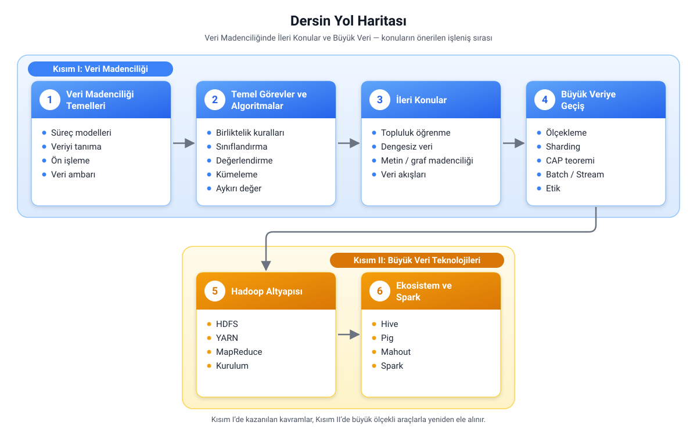

> **Okuma önerisi:** Her bölümde önce sezgiyi bir benzetmeyle kurmaya, ardından kavramı tanımlamaya ve en sonda küçük bir örnek ya da Python kodu ile somutlaştırmaya çalışacağız. Kod örnekleri `numpy`, `pandas` ve `scikit-learn` kütüphanelerini kullanır (`pip install numpy pandas scikit-learn`).

***

## 1. Veri Madenciliği Nedir?

### 1.1 Neden Veri Madenciliği?

Bir süpermarket zincirini düşünün. Her gün binlerce kasada milyonlarca ürün okutuluyor, her fiş bir veritabanına kaydediliyor. Yıllar içinde bu kayıtlar terabaytlara ulaşır. Peki bu veri yığını kendiliğinden bir şey söyler mi? Hayır. Veri, işlenmediği sürece sadece maliyettir: Depolanması, yedeklenmesi ve korunması gerekir. Değer, ancak verinin içine gömülü **örüntüler (patterns)** gün yüzüne çıkarıldığında ortaya çıkar: "Bebek bezi alan müşteriler sıklıkla ıslak mendil ve mama da alıyor", "Bu müşteri profili önümüzdeki üç ayda bizi terk etme eğiliminde" gibi.

Han ve arkadaşları bu durumu *"veri zengini ama bilgi fakiri" (data rich but information poor)* olarak özetler. Veri toplama kapasitemiz, veriyi anlama kapasitemizi çoktan geçmiştir. Veri madenciliği bu boşluğu doldurmak için doğmuştur.

### 1.2 Tanım ve Bilgi Keşfi (KDD)

**Veri madenciliği (data mining)**, büyük miktardaki veriden *ilginç*, *önceden bilinmeyen*, *potansiyel olarak yararlı* ve *anlaşılabilir* örüntülerin ve bilginin otomatik ya da yarı otomatik olarak çıkarılması sürecidir.

Tanımdaki sıfatların her biri önemlidir:

* **İlginç:** "Hamile müşteriler hamilelik vitamini alır" bir örüntüdür ama kimseyi şaşırtmaz.
* **Önceden bilinmeyen:** Uzmanın zaten bildiği bir kuralı yeniden bulmak keşif değildir.
* **Yararlı:** Örüntü bir karara, bir eyleme dönüşebilmelidir.
* **Anlaşılabilir:** Karar vericinin yorumlayabileceği biçimde sunulmalıdır.

"Madencilik" benzetmesi aslında biraz yanıltıcıdır. Altın madenciliğinde topraktan *altın* çıkarırız; buna "toprak madenciliği" demeyiz. Veri madenciliğinde de veriden *bilgi* çıkarırız. Bu yüzden literatürde daha doğru bir terim olarak **Veritabanlarında Bilgi Keşfi (Knowledge Discovery in Databases — KDD)** kullanılır. Dar anlamda "veri madenciliği", KDD sürecinin örüntülerin çıkarıldığı *tek bir adımıdır* (bkz. Bölüm 2). Geniş anlamda ise iki terim çoğunlukla eş anlamlı kullanılır.

### 1.3 Veri Madenciliği ve Komşu Disiplinler

Veri madenciliği tek bir disiplinin ürünü değildir. Birçok alanın kesişiminde durur:

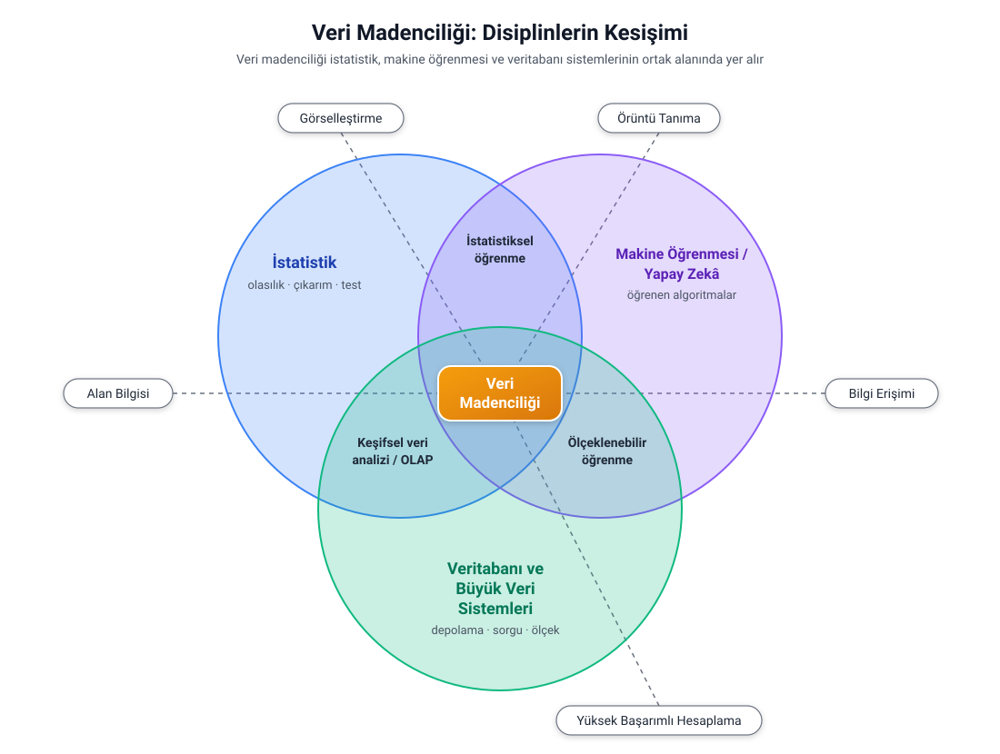

| Disiplin | Veri madenciliğine katkısı | Vurguladığı soru |
|---|---|---|
| **İstatistik** | Olasılık modelleri, hipotez testleri, örnekleme, güven aralıkları | "Bu sonuç tesadüf olabilir mi?" |
| **Makine Öğrenmesi / Yapay Zekâ** | Veriden öğrenen algoritmalar (karar ağaçları, sinir ağları, SVM…) | "Bilgisayar örneklerden nasıl genelleme yapar?" |
| **Veritabanı Sistemleri** | Verimli depolama, indeksleme, sorgulama, veri ambarları | "Milyarlarca kayda nasıl hızlı erişiriz?" |
| **Yüksek Başarımlı / Dağıtık Hesaplama** | Paralel algoritmalar, kümeler, Hadoop/Spark | "Hesabı nasıl ölçekleriz?" |
| **Görselleştirme** | Veriyi ve sonuçları insan gözünün anlayacağı biçimde sunma | "Örüntüyü nasıl gösteririz?" |
| **İş Zekâsı (BI)** | Raporlama, panolar, OLAP | "Ne oldu, nerede, ne kadar?" |

Witten ve arkadaşları istatistik ile makine öğrenmesi arasındaki farkın tarihsel olduğunu, bugün iki alanın büyük ölçüde iç içe geçtiğini vurgular. Pratik bir ayrım şöyle yapılabilir: İstatistik daha çok *hipotez doğrulamaya*, veri madenciliği ise *hipotez üretmeye* (keşfe) odaklanır.

### 1.4 Hangi Veriler, Hangi Örüntüler?

**Madenlenebilecek veri türleri.** En yaygın kaynak ilişkisel veritabanları ve veri ambarlarıdır, ama veri madenciliği bunlarla sınırlı değildir:

* **İşlem (transaction) verisi:** Market fişleri, banka hareketleri.
* **Zaman serileri ve sıralı veri:** Borsa fiyatları, sensör ölçümleri, tıklama dizileri.
* **Uzamsal veri:** Harita koordinatları, uydu görüntüleri.
* **Metin ve web verisi:** E-postalar, haberler, sosyal medya, web sayfaları ve aralarındaki bağlantılar.
* **Graf ve ağ verisi:** Sosyal ağlar, protein etkileşim ağları.
* **Çoklu ortam:** Görüntü, ses, video.
* **Veri akışları (data streams):** Sürekli ve hızla akan, tamamı saklanamayan veri.

**Madenlenebilecek örüntü türleri.** Veri madenciliği görevleri iki büyük gruba ayrılır:

1. **Tanımlayıcı (descriptive) görevler:** Verideki genel özellikleri ve ilişkileri betimler. Hedef bir değişken yoktur.
   * *Karakterizasyon ve ayrımlama:* "Sadık müşterilerin ortak özellikleri neler?"
   * *Sık örüntüler ve birliktelik kuralları:* "Ekmek alan süt de alıyor mu?"
   * *Kümeleme:* "Müşterilerimiz doğal olarak hangi gruplara ayrılıyor?"
   * *Aykırı değer analizi:* "Hangi kredi kartı işlemi diğerlerine hiç benzemiyor?"
2. **Tahmin edici (predictive) görevler:** Mevcut veriden bir model kurup bilinmeyen bir değeri tahmin eder.
   * *Sınıflandırma:* Kategorik bir etiketi tahmin etmek ("Bu e-posta spam mı?").
   * *Regresyon:* Sayısal bir değeri tahmin etmek ("Bu evin fiyatı ne olur?").

Makine öğrenmesi dilinde tahmin edici görevlere **denetimli öğrenme (supervised learning)**, etiket gerektirmeyen kümeleme gibi görevlere ise **denetimsiz öğrenme (unsupervised learning)** denir.

### 1.5 Uygulama Alanları

| Alan | Tipik uygulama | İlgili görev |
|---|---|---|
| Perakende | Pazar sepeti analizi, raf düzeni, öneri sistemleri | Birliktelik kuralları |
| Bankacılık / Finans | Kredi skorlama, sahtekârlık tespiti | Sınıflandırma, aykırı değer |
| Telekomünikasyon | Müşteri kaybı (churn) tahmini | Sınıflandırma |
| Pazarlama | Müşteri segmentasyonu, hedefli kampanya | Kümeleme |
| Sağlık | Hastalık teşhisi, ilaç etkileşimleri, genom analizi | Sınıflandırma, örüntü madenciliği |
| Üretim | Kestirimci bakım, kalite kontrol | Regresyon, aykırı değer |
| Siber güvenlik | Saldırı tespiti | Aykırı değer, sınıflandırma |
| Web | Arama motoru sıralaması, içerik önerisi | Web/graf madenciliği |

### 1.6 Veri Madenciliğinin Temel Sorunları

Han ve arkadaşları alanın başlıca zorluklarını şöyle gruplar. Bu başlıklar dersin geri kalanında karşımıza tekrar tekrar çıkacak:

* **Yöntemsel sorunlar:** Gürültülü veya eksik veriyle başa çıkmak, bulunan örüntülerin gerçekten ilginç olup olmadığını değerlendirmek, alan bilgisini sürece katmak.
* **Kullanıcı etkileşimi:** Sonuçların yorumlanabilir ve görselleştirilebilir olması.
* **Verimlilik ve ölçeklenebilirlik:** Algoritmaların veri büyüdükçe makul sürede çalışabilmesi. *Bu, Kısım II'deki büyük veri teknolojilerinin varlık sebebidir.*
* **Veri çeşitliliği:** Yapılandırılmamış, karmaşık ve dağıtık veri türleri.
* **Toplumsal etkiler:** Gizlilik, güvenlik ve algoritmik adalet (bkz. Bölüm 13).

***

## 2. Bilgi Keşfi Süreç Modelleri

Veri madenciliği "veriyi algoritmaya ver, sonucu al" kadar basit değildir. Başarılı projeler iyi tanımlanmış bir süreci izler. Bu bölümde üç yaygın süreç modelini inceleyeceğiz.

### 2.1 KDD Süreci

Fayyad, Piatetsky-Shapiro ve Smyth'in (1996) tanımladığı KDD süreci, ham veriden bilgiye uzanan adımları sıralar:

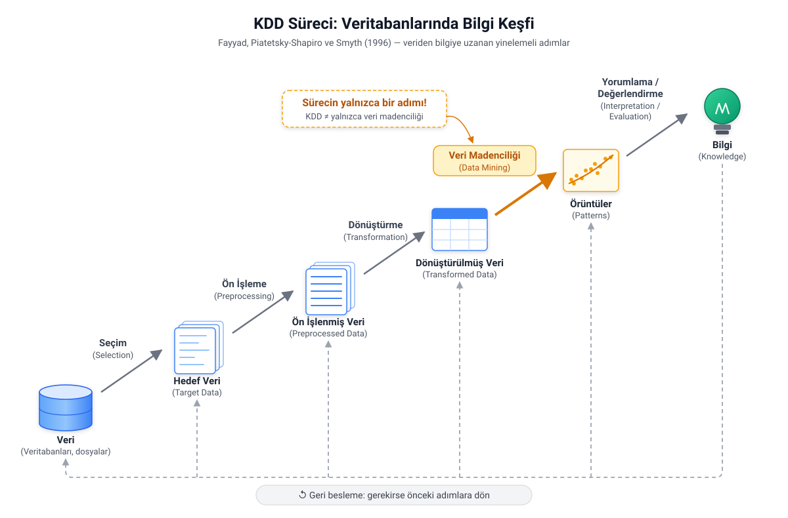

1. **Seçim (Selection):** Analiz hedefine uygun veri kaynakları ve değişkenler seçilir. Örneğin müşteri kaybı analizi için son iki yılın abonelik ve çağrı kayıtları.
2. **Ön işleme (Preprocessing):** Eksik, hatalı ve tutarsız kayıtlar temizlenir (bkz. Bölüm 4).
3. **Dönüştürme (Transformation):** Veri, madencilik algoritmasına uygun biçime getirilir: normalizasyon, yeni nitelik türetme, boyut indirgeme.
4. **Veri madenciliği (Data Mining):** Uygun algoritma (sınıflandırma, kümeleme vb.) uygulanarak örüntüler çıkarılır.
5. **Yorumlama / Değerlendirme (Interpretation / Evaluation):** Bulunan örüntülerin geçerliliği, ilginçliği ve yararlılığı değerlendirilir. Gerekirse önceki adımlara dönülür.

Şekildeki geri besleme oku önemlidir: KDD doğrusal değil **yinelemeli (iterative)** bir süreçtir. Model beklenen başarıyı vermezse çoğu zaman sorun algoritmada değil, verinin hazırlanışındadır.

### 2.2 CRISP-DM

**CRISP-DM (Cross-Industry Standard Process for Data Mining)**, 1990'ların sonunda bir sanayi konsorsiyumu tarafından geliştirilmiş, sektörden bağımsız bir süreç modelidir. KDD'ye göre daha *iş odaklıdır* ve bugün hâlâ en yaygın kullanılan metodolojidir.

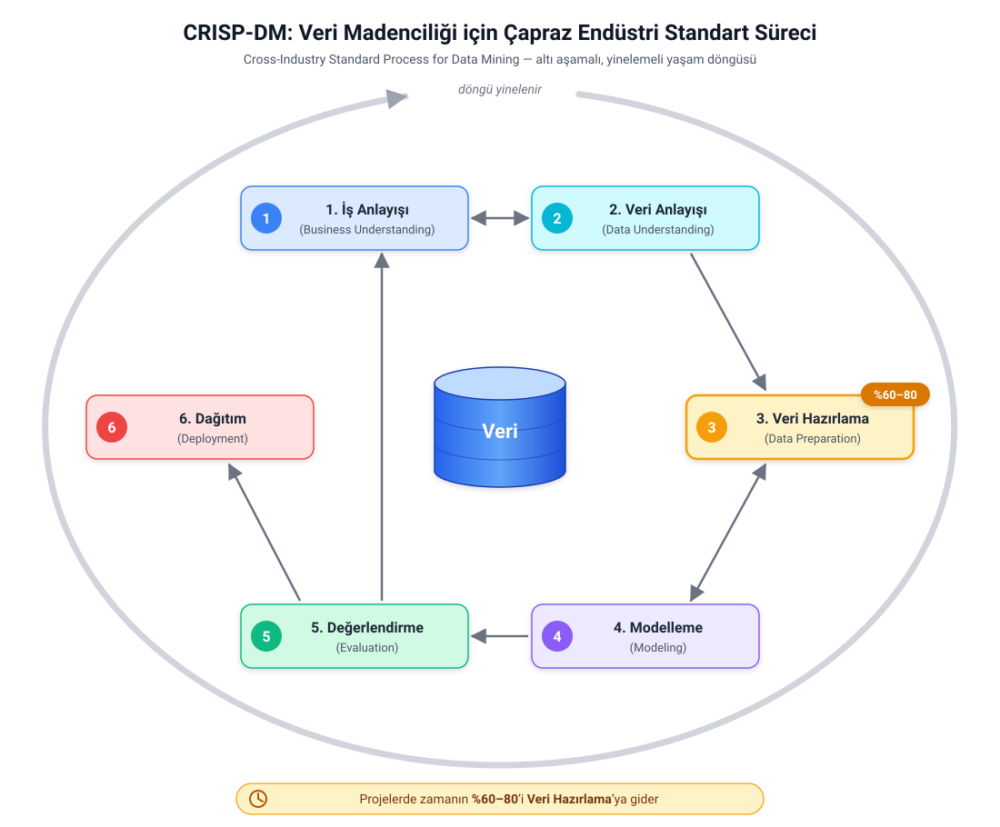

| Aşama | Temel soru | Örnek çıktılar |
|---|---|---|
| **1. İş Anlayışı** | İşletme neyi çözmek istiyor? Başarı nasıl ölçülecek? | Proje hedefi, başarı kriteri ("churn'ü %10 azalt") |
| **2. Veri Anlayışı** | Hangi veri var? Kalitesi nasıl? | Veri sözlüğü, keşifsel analiz raporu |
| **3. Veri Hazırlama** | Veri modellemeye nasıl hazırlanır? | Temizlenmiş, birleştirilmiş, dönüştürülmüş veri seti |
| **4. Modelleme** | Hangi algoritmalar denenecek? | Eğitilmiş modeller, parametre ayarları |
| **5. Değerlendirme** | Model iş hedefini karşılıyor mu? | Performans raporu, devam/dur kararı |
| **6. Dağıtım** | Model gerçek sisteme nasıl entegre edilecek? | Canlı servis, izleme planı, bakım süreci |

İki gözlem önemlidir:

* İş Anlayışı ile Veri Anlayışı ve Veri Hazırlama ile Modelleme arasındaki oklar **çift yönlüdür**. Veriyi tanıdıkça iş sorusu netleşir; modelleme sırasında verinin farklı hazırlanması gerektiği ortaya çıkar.
* Pratikte proje süresinin büyük bölümü (%60–80) **veri hazırlama** aşamasında geçer. Algoritma seçimi çoğu zaman işin en kısa kısmıdır.

### 2.3 Büyük Veri Analitiği Yaşam Döngüsü

Erl, Khattak ve Buhler, büyük veri projelerinin hacim, hız ve çeşitlilik nedeniyle klasik süreçlerden farklı ihtiyaçları olduğunu belirterek dokuz aşamalı bir **Büyük Veri Analitiği Yaşam Döngüsü** önerir:

1. **İş vakasının değerlendirilmesi (Business Case Evaluation):** Projenin gerekçesi, bütçesi ve başarı ölçütleri.
2. **Veri tanımlama (Data Identification):** İç ve dış veri kaynaklarının belirlenmesi.
3. **Veri edinme ve filtreleme (Data Acquisition & Filtering):** Bozuk ve gereksiz verinin ayıklanması.
4. **Veri çıkarma (Data Extraction):** Farklı formatlardaki verinin (JSON, XML, log) analiz edilebilir yapıya dönüştürülmesi.
5. **Veri doğrulama ve temizleme (Data Validation & Cleansing).**
6. **Veri birleştirme ve temsil (Data Aggregation & Representation):** Farklı kaynakların ortak bir şemada bütünleştirilmesi.
7. **Veri analizi (Data Analysis):** Veri madenciliği, istatistik, makine öğrenmesi.
8. **Veri görselleştirme (Data Visualization).**
9. **Analiz sonuçlarının kullanımı (Utilization of Analysis Results):** Sonuçların karar süreçlerine, panolara ve otomatik sistemlere aktarılması.

Bu döngü özünde CRISP-DM'in büyük veriye uyarlanmış hâlidir. Farkı, veri edinme ve çıkarma aşamalarına ayrı ağırlık vermesidir. Çünkü büyük veri projelerinde veri çoğunlukla yapılandırılmamış ve çok sayıda kaynaktan gelir.

***

## 3. Veriyi Tanımak

Bir doktor tedaviye başlamadan önce hastayı muayene eder. Veri madencisi de algoritmaya başlamadan önce veriyi "muayene etmelidir": Hangi tür değişkenler var, değerler nasıl dağılıyor, kayıtlar birbirine ne kadar benziyor?

### 3.1 Veri Nesneleri ve Nitelik Türleri

Bir veri seti **veri nesnelerinden (data objects)** oluşur. Bu nesnelere bağlama göre *örnek (instance)*, *kayıt*, *gözlem* ya da *satır* denir. Her nesne bir dizi **nitelikle (attribute)** tanımlanır; nitelik yerine *öznitelik*, *özellik (feature)*, *değişken* ya da *sütun* da denir. Bir müşteri tablosunda her müşteri bir nesne; yaş, şehir ve gelir ise niteliklerdir.

Niteliğin **türü**, onunla hangi işlemleri yapabileceğimizi belirler:

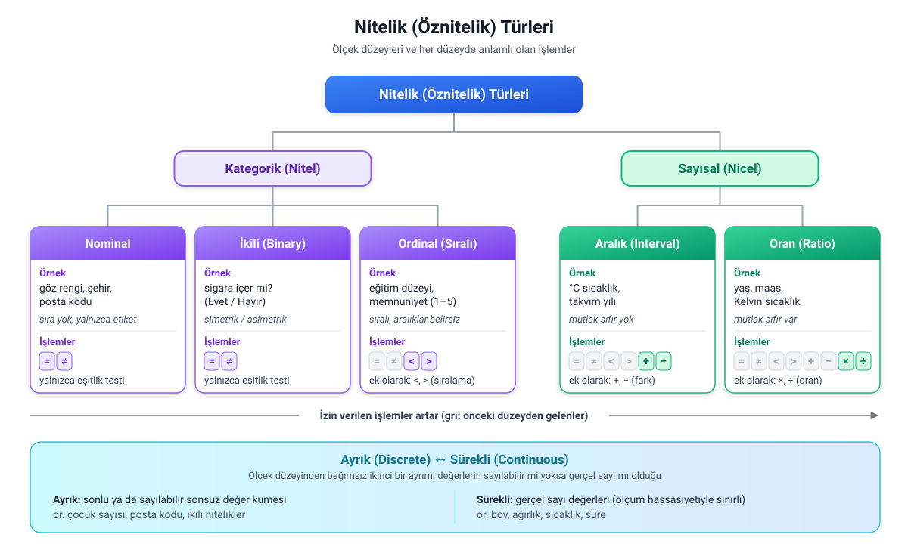

| Tür | Açıklama | Örnek | Anlamlı işlemler | Merkezi eğilim |
|---|---|---|---|---|
| **Nominal** | Sadece isim/etiket; sıra yok | Göz rengi, şehir, meslek | =, ≠ | Mod |
| **İkili (Binary)** | İki durumlu nominal | Sigara içiyor mu? (E/H) | =, ≠ | Mod |
| **Ordinal (Sıralı)** | Sıra anlamlı, aralıklar değil | Eğitim düzeyi, memnuniyet (1–5) | =, ≠, <, > | Medyan, mod |
| **Aralık (Interval)** | Farklar anlamlı, mutlak sıfır yok | °C sıcaklık, takvim yılı | + , − | Ortalama, medyan, mod |
| **Oran (Ratio)** | Mutlak sıfır var, oranlar anlamlı | Yaş, maaş, uzunluk, Kelvin | +, −, ×, ÷ | Tüm ölçüler |

Neden önemli? "20 °C, 10 °C'nin iki katı sıcaktır" demek **yanlıştır**, çünkü Celsius'ta sıfır noktası keyfidir (aralık ölçeği). Oysa "40 yaşındaki biri 20 yaşındakinin iki katı yaşlıdır" demek doğrudur (oran ölçeği). Benzer şekilde, şehirleri 1, 2, 3 diye kodlayıp ortalamasını almak anlamsızdır.

İkili nitelikler de kendi içinde ayrılır. **Simetrik** ikili nitelikte iki durum eşit önemdedir (cinsiyet). **Asimetrik** ikili nitelikte ise bir durum çok daha nadir ve önemlidir (bir hastalık testinin pozitif çıkması). Bu ayrım, aşağıda göreceğimiz benzerlik ölçülerini doğrudan etkiler.

Niteliklerin bir de **ayrık (discrete)** ya da **sürekli (continuous)** olup olmadığına bakılır. Ayrık nitelikler sonlu veya sayılabilir sayıda değer alır (çocuk sayısı, posta kodu). Sürekli nitelikler gerçel sayılarla ifade edilir (boy, sıcaklık).

### 3.2 Temel İstatistiksel Betimlemeler

Veriyi tanımanın ilk adımı birkaç özet istatistiğe bakmaktır.

> **Formülleri okuma rehberi.** Bu notta önemli formüllerin hemen altında aynı formülün **açıklamalı** bir kopyası vardır: Üst ve alt parantezler (︷ ︸), formülün hangi parçasının ne anlama geldiğini gösterir. **"Nasıl okunur?"** satırı ise formülün sesli okunuşudur. En sık karşılaşacağınız semboller:
>
> | Sembol | Nasıl okunur? | Anlamı |
> |---|---|---|
> | $\sum_{i=1}^{n} x_i$ | "i eşittir 1'den n'ye kadar x alt i'lerin toplamı" | $x_1 + x_2 + \dots + x_n$ |
> | $x_i$ | "x alt i" | i. değer (i yalnızca bir sıra numarasıdır) |
> | $\bar{x}$ | "x bar" | x değerlerinin ortalaması |
> | $\mu$, $\sigma$ | "mü", "sigma" | ortalama (merkez), standart sapma |
> | $\lvert a \rvert$ | "a'nın mutlak değeri" | işaretsiz büyüklük; bir küme için ($\lvert A \rvert$) **eleman sayısı** |
> | $\lVert x \rVert$ | "x'in normu" | vektörün uzunluğu |
> | $A \cap B$, $A \cup B$ | "A kesişim B", "A birleşim B" | iki kümenin ortak öğeleri; iki kümedeki tüm öğeler |
> | $x \in A$ | "x, A'nın elemanı" | x, A kümesinde yer alıyor |
> | $P(Y \mid X)$ | "X verildiğinde Y'nin olasılığı" | X'in gerçekleştiği bilinirken Y'nin olasılığı |
> | $\log_2 p$ | "log iki tabanında p" | 2'nin kaçıncı kuvveti p eder? |
> | $X \Rightarrow Y$ | "X ise Y" | kural: X varsa Y de vardır |

**Merkezi eğilim ölçüleri:**

* **Ortalama (mean):** $\bar{x} = \frac{1}{n}\sum_{i=1}^{n} x_i$. Aykırı değerlere çok duyarlıdır: Bir mahallede 9 kişi ayda 30 bin TL, 1 kişi 3 milyon TL kazanıyorsa ortalama gelir yaklaşık 327 bin TL çıkar. Bu rakam kimseyi temsil etmez.

```math
\underbrace{\bar{x}}_{\text{ortalama}} = \underbrace{\frac{1}{n}}_{\substack{\text{toplamı}\\\text{n'ye böl}}} \; \underbrace{\sum_{i=1}^{n}}_{\substack{\text{i = 1'den n'ye kadar}\\\text{hepsini topla}}} \overbrace{x_i}^{\text{i. değer}}
```

**Nasıl okunur?** "x bar eşittir, bir bölü n çarpı, i eşittir 1'den n'ye kadar x alt i'lerin toplamı." Yani: Bütün değerleri topla, değer sayısına böl.

* **Medyan (median):** Sıralanmış verinin ortasındaki değerdir. Aykırı değerlere dayanıklıdır; yukarıdaki örnekte medyan 30 bin TL'dir.
* **Mod (mode):** En sık görülen değerdir. Nominal veride kullanılabilen tek merkezi eğilim ölçüsüdür.

Dağılım simetrikse bu üç ölçü birbirine yakındır. Gelir gibi **sağa çarpık (pozitif çarpık)** dağılımlarda ise genellikle *mod < medyan < ortalama* olur.

**Yayılım ölçüleri:**

* **Değişim aralığı (range):** maks − min.
* **Çeyrekler (quartiles):** Q1 (%25), Q2 = medyan (%50), Q3 (%75).
* **Çeyrekler arası açıklık (IQR):** Q3 − Q1. Verinin ortadaki %50'sinin yayıldığı aralıktır.
* **Varyans ve standart sapma:** $\sigma^2 = \frac{1}{n}\sum_{i=1}^{n}(x_i - \bar{x})^2$, $\sigma = \sqrt{\sigma^2}$.

```math
\underbrace{\sigma^2}_{\text{varyans}} = \underbrace{\frac{1}{n}\sum_{i=1}^{n}}_{\substack{\text{n değerin}\\\text{ortalamasını al}}} \underbrace{\big(\overbrace{x_i - \bar{x}}^{\text{ortalamadan sapma}}\big)^2}_{\text{sapmanın karesi}} \qquad \underbrace{\sigma}_{\text{standart sapma}} = \sqrt{\sigma^2}
```

**Nasıl okunur?** "Sigma kare eşittir, bir bölü n çarpı, i eşittir 1'den n'ye kadar x alt i eksi x bar'ın karelerinin toplamı. Sigma eşittir karekök sigma kare." Yani: Her değerin ortalamadan ne kadar saptığını bul, karesini al (ortalamanın altındaki ve üstündeki sapmalar birbirini götürmesin diye), bu karelerin ortalamasını al. Karekök almak, birimi verinin birimine geri döndürür (TL² → TL).

**Beş sayı özeti ve kutu grafiği.** *Minimum, Q1, Medyan, Q3, Maksimum* değerlerine **beş sayı özeti** denir ve **kutu grafiği (box plot)** ile görselleştirilir. Kutu Q1'den Q3'e uzanır, içindeki çizgi medyandır. Bıyıklar (whiskers), aykırı sayılmayan en uç değerlere kadar uzanır. **Q1 − 1.5·IQR**'nin altında veya **Q3 + 1.5·IQR**'nin üstünde kalan noktalar aykırı değer adayı olarak tek tek işaretlenir.

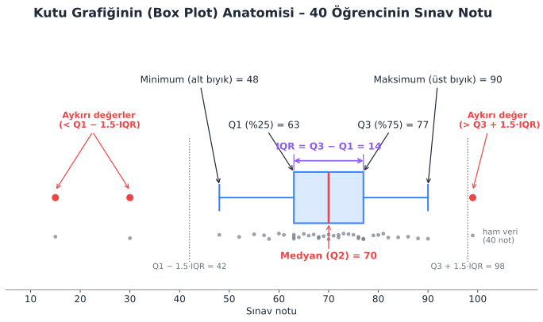

Şekildeki örnekte 40 öğrencinin sınav notları kullanılmıştır: Q1 = 63, medyan = 70, Q3 = 77, dolayısıyla IQR = 14'tür. Aykırı değer sınırları 63 − 1.5·14 = **42** ve 77 + 1.5·14 = **98** olarak hesaplanır. Bu nedenle 15, 30 ve 99 notları aykırı değer olarak işaretlenmiş, bıyıklar ise sınırlar içindeki en uç değerlere (48 ve 90) kadar uzanmıştır. Sınıf ortalaması (68.6) iki düşük aykırı değer yüzünden medyanın (70) altında kalmıştır.

### 3.3 Veri Görselleştirme

"Bir resim bin kelimeye bedeldir" sözü veri analizinde de geçerlidir. Keşifsel veri analizinde en çok kullanılan grafikler şunlardır:

| Grafik | Ne gösterir? | Ne zaman? |
|---|---|---|
| **Histogram** | Tek bir sayısal değişkenin dağılımı | Çarpıklık, çok tepelilik kontrolü |
| **Kutu grafiği** | Beş sayı özeti ve aykırı değerler | Grupları karşılaştırma |
| **Saçılım grafiği (scatter)** | İki sayısal değişken arasındaki ilişki | Korelasyon, kümelenme |
| **Saçılım matrisi (pair plot)** | Tüm değişken çiftleri | Çok değişkenli ilk bakış |
| **Isı haritası (heatmap)** | Korelasyon matrisi | Fazlalık (redundancy) tespiti |
| **Çubuk grafik** | Kategorik değişkenin frekansları | Sınıf dengesizliği kontrolü |
| **Paralel koordinatlar** | Yüksek boyutlu veride her nesne bir çizgi | Çok boyutlu örüntüler |

Anscombe dörtlüsü (Anscombe's quartet) görselleştirmenin neden vazgeçilmez olduğunu çarpıcı biçimde gösterir. Ortalaması, varyansı, korelasyonu ve regresyon doğrusu neredeyse aynı olan dört veri seti, grafiğe döküldüğünde tamamen farklı yapılar sergiler. *Özet istatistiklere bakmak yetmez; veriyi mutlaka çizin.*

### 3.4 Benzerlik ve Uzaklık Ölçüleri

Kümeleme, k-en yakın komşu ve aykırı değer tespiti gibi pek çok yöntem tek bir soruya dayanır: **"İki nesne birbirine ne kadar benziyor?"** Bu soruyu sayısallaştıran fonksiyonlara **uzaklık (distance)** veya **benzemezlik (dissimilarity)** ölçüleri denir. Bir uzaklık ölçüsü genellikle şu özellikleri sağlamalıdır: negatif olmama, simetri ($d(x,y)=d(y,x)$) ve üçgen eşitsizliği ($d(x,z) \le d(x,y)+d(y,z)$).

**Sayısal nitelikler için Minkowski ailesi.** $p$ boyutlu iki nokta $x$ ve $y$ için:

$$d(x, y) = \left( \sum_{i=1}^{p} |x_i - y_i|^h \right)^{1/h}$$

```math
\underbrace{d(x, y)}_{\substack{\text{x ile y arasındaki}\\\text{uzaklık}}} = \Bigg( \underbrace{\sum_{i=1}^{p}}_{\substack{\text{p boyutun}\\\text{hepsinde topla}}} \overbrace{|x_i - y_i|}^{\substack{\text{i. boyuttaki fark}\\\text{(işaretsiz)}}}{}^{\,h} \Bigg)^{1/h}
```

**Nasıl okunur?** "x ile y'nin uzaklığı eşittir, i eşittir 1'den p'ye kadar x alt i eksi y alt i'nin mutlak değerinin h'inci kuvvetlerinin toplamının h'inci dereceden kökü." $h = 2$ için: Her boyuttaki farkın karesini al, topla, karekök al. Bu, Pisagor teoreminin p boyuta genişletilmiş hâlidir.

* $h = 2$ → **Öklid uzaklığı (Euclidean):** Kuş uçuşu uzaklık.
* $h = 1$ → **Manhattan uzaklığı (City-block):** Izgara biçimli sokaklarda taksinin gideceği yol.
* $h \to \infty$ → **Supremum (Chebyshev) uzaklığı:** En büyük tek boyut farkı.

**Kosinüs benzerliği (Cosine similarity)** iki vektör arasındaki açının kosinüsüdür:

```math
\cos(x, y) = \frac{x \cdot y}{\|x\| \, \|y\|}
```

```math
\underbrace{\cos(x, y)}_{\substack{\text{x ile y'nin}\\\text{benzerliği}}} = \frac{\overbrace{x \cdot y}^{\substack{\text{iç çarpım: aynı boyuttaki}\\\text{değerleri çarp, topla}}}}{\underbrace{\|x\|}_{\text{x'in uzunluğu}} \, \underbrace{\|y\|}_{\text{y'nin uzunluğu}}}
```

**Nasıl okunur?** "x ile y'nin kosinüsü eşittir, x nokta y, bölü x'in normu çarpı y'nin normu." Vektörün uzunluğu $\lVert x \rVert = \sqrt{x_1^2 + \dots + x_p^2}$'dir. Paydaki iç çarpımı uzunluklara bölmek, vektörlerin büyüklüğünün etkisini siler; geriye yalnızca **yön** kalır.

Kosinüs benzerliği vektörlerin *büyüklüğüne değil yönüne* bakar. Bu yüzden metin madenciliğinde vazgeçilmezdir. Bir makale ile aynı makalenin iki kez arka arkaya yazılmış hâlinin kelime sayıları farklıdır, ama "konuları" aynıdır ve kosinüs benzerlikleri 1 çıkar.

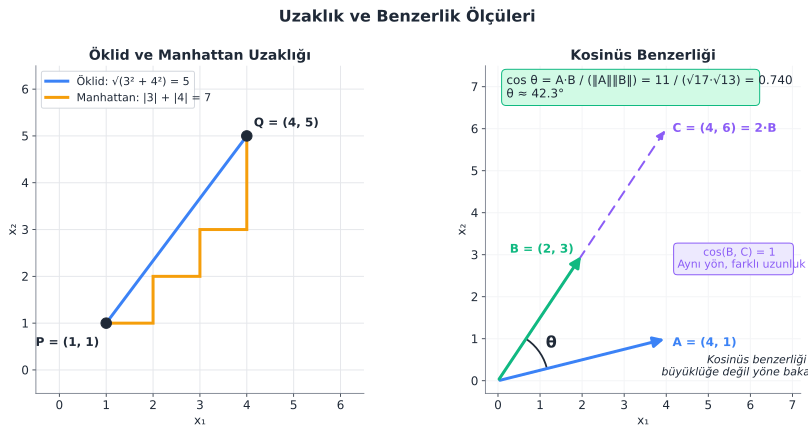

**İkili ve küme verisi için Jaccard katsayısı.** Asimetrik ikili verilerde (ör. iki müşterinin satın aldığı ürünler) "ikisinin de almadığı" ürünler bir benzerlik göstergesi değildir. Bir markette 10.000 ürün varsa, herhangi iki müşteri ürünlerin neredeyse tamamını almamıştır! Jaccard katsayısı bu yüzden yalnızca en az birinde bulunan öğelere bakar:

$$J(A, B) = \frac{|A \cap B|}{|A \cup B|}$$

```math
\underbrace{J(A, B)}_{\substack{\text{A ile B'nin}\\\text{benzerliği}}} = \frac{\overbrace{|A \cap B|}^{\substack{\text{ikisinde de olan}\\\text{öğe sayısı}}}}{\underbrace{|A \cup B|}_{\substack{\text{en az birinde olan}\\\text{öğe sayısı}}}}
```

**Nasıl okunur?** "A ile B'nin Jaccard katsayısı eşittir, A kesişim B'nin eleman sayısı bölü A birleşim B'nin eleman sayısı." Buradaki dikey çizgiler mutlak değer değil, **kümenin eleman sayısıdır**. Örnek: A = {ekmek, süt, peynir}, B = {süt, peynir, zeytin} ise ortak 2 öğe, toplam 4 farklı öğe vardır: J = 2/4 = 0.5.

> **Ölçeklendirme uyarısı:** Uzaklık tabanlı yöntemlerde nitelikler farklı ölçeklerdeyse (yaş: 18–80, gelir: 10.000–1.000.000) büyük ölçekli nitelik uzaklığı tek başına belirler. Bu yüzden uzaklık hesaplamadan önce veri mutlaka **normalize** edilmelidir (bkz. Bölüm 4.5).

**Python ile uzaklık ölçüleri:**

```python
import numpy as np
from scipy.spatial import distance

P = np.array([1, 1])
Q = np.array([4, 5])
print("Öklid    :", distance.euclidean(P, Q))         # 5.0
print("Manhattan:", distance.cityblock(P, Q))         # 7
print("Chebyshev:", distance.chebyshev(P, Q))         # 4

A = np.array([4, 1])
B = np.array([2, 3])
C = np.array([4, 6])                                  # B ile aynı yönde, 2 kat uzun
print("cos(A, B):", round(1 - distance.cosine(A, B), 3))
print("cos(B, C):", round(1 - distance.cosine(B, C), 3))   # 1.0 → yön aynı

# Jaccard: iki müşterinin sepetleri
sepet1 = {"ekmek", "süt", "yumurta"}
sepet2 = {"ekmek", "süt", "peynir", "zeytin"}
jaccard = len(sepet1 & sepet2) / len(sepet1 | sepet2)
print("Jaccard  :", round(jaccard, 3))                # 2 / 5 = 0.4
```

***

## 4. Veri Ön İşleme

### 4.1 Neden Ön İşleme?

Gerçek dünya verisi kirlidir. Han ve arkadaşları veri kalitesini belirleyen başlıca boyutları şöyle sıralar: **doğruluk, bütünlük (eksiksizlik), tutarlılık, güncellik, güvenilirlik ve yorumlanabilirlik.** Tipik sorunlar şunlardır:

* **Eksik değerler:** Müşteri gelirini girmemiş, sensör bir süre veri gönderememiş.
* **Gürültü ve hatalar:** Yaş = 250, maaş = −10.000, yazım hataları ("İstanbul", "istanbul", "Istanbul").
* **Tutarsızlıklar:** Bir sistemde doğum tarihi GG/AA/YYYY, diğerinde AA/GG/YYYY.
* **Fazlalık (redundancy):** Aynı bilginin iki farklı sütunda tutulması (yıllık ve aylık gelir).

"**Çöp girerse çöp çıkar (Garbage In, Garbage Out)**." En gelişmiş algoritma bile kötü veriden iyi sonuç üretemez. Ön işleme dört ana adımda ele alınır:

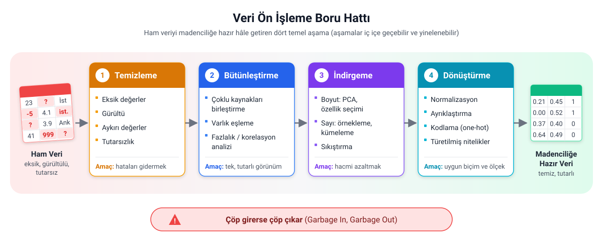

### 4.2 Veri Temizleme

**Eksik değerlerle başa çıkma yöntemleri:**

1. **Kaydı silmek:** Eksik oranı çok düşükse ve eksiklik rastgeleyse kabul edilebilir. Aksi hâlde ciddi bilgi kaybına ve yanlılığa yol açar.
2. **Elle doldurmak:** Küçük veride mümkündür, büyük veride pratik değildir.
3. **Sabit bir değerle doldurmak:** "Bilinmiyor" gibi. Algoritma bunu anlamlı bir kategori sanabilir.
4. **Merkezi eğilim ölçüsüyle doldurmak:** Sayısal nitelikte ortalama (çarpık dağılımda medyan), kategorik nitelikte mod.
5. **Sınıf bazında doldurmak:** Eksik gelir değerini, aynı kredi risk sınıfındaki müşterilerin ortalamasıyla doldurmak.
6. **Tahminle doldurmak:** Regresyon, k-NN veya karar ağacı ile eksik değeri diğer niteliklerden tahmin etmek. Genellikle en iyi sonucu verir.

**Gürültüyü azaltma:**

* **Kovalama (binning):** Değerler sıralanıp eşit frekanslı kovalara bölünür. Her kovadaki değerler kova ortalaması, medyanı veya sınırlarıyla değiştirilerek yumuşatılır.
* **Regresyon:** Veriye bir fonksiyon uydurup değerleri bu fonksiyonla düzeltmek.
* **Aykırı değer analizi:** Kümeleme veya istatistiksel yöntemlerle aykırı değerleri tespit edip incelemek (bkz. Bölüm 10).

### 4.3 Veri Bütünleştirme

Veri çoğunlukla birden fazla kaynaktan gelir: CRM sistemi, muhasebe yazılımı, web logları. Bunları birleştirirken üç tipik sorunla karşılaşılır:

* **Varlık tanımlama (entity identification):** Bir sistemdeki `musteri_no` ile diğerindeki `cust_id` aynı şeyi mi ifade ediyor? Aynı kişi iki sistemde farklı yazılmış olabilir.
* **Fazlalık ve korelasyon analizi:** İki nitelik birbirinden türetilebiliyorsa biri gereksizdir. Sayısal nitelikler için **Pearson korelasyon katsayısı**, kategorik nitelikler için **χ² (ki-kare) testi** ile tespit edilir.
* **Değer çakışmaları:** Bir sistemde fiyat KDV dahil, diğerinde hariç; bir sistemde mesafe km, diğerinde mil.

### 4.4 Veri İndirgeme

Veri çok büyükse analiz hem yavaşlar hem de zorlaşır. Veri indirgemenin amacı, *analiz sonuçlarını neredeyse aynı bırakacak* şekilde daha küçük bir temsil elde etmektir.

**1) Sayı indirgeme (numerosity reduction):** Satır sayısını azaltmak.

* **Basit rastgele örnekleme:** Yerine koymadan veya yerine koyarak.
* **Tabakalı örnekleme (stratified sampling):** Her sınıftan, popülasyondaki oranıyla örnek alınır. Dengesiz verilerde nadir sınıfın kaybolmaması için şarttır.
* Kümeleme veya histogram ile veriyi özet temsillere dönüştürmek.

**2) Boyut indirgeme (dimensionality reduction):** Sütun sayısını azaltmak.

* **Özellik seçimi (feature selection):** Mevcut niteliklerden en bilgilendirici alt küme seçilir. Üç yaklaşım vardır: **filtre (filter)** yöntemleri (korelasyon, bilgi kazancı, χ²), **sarmalayıcı (wrapper)** yöntemler (alt kümeleri bir modelle deneme) ve **gömülü (embedded)** yöntemler (Lasso, karar ağaçlarının önem skorları).
* **Özellik çıkarma (feature extraction):** Mevcut niteliklerin birleşiminden yeni, daha az sayıda nitelik üretilir. En bilineni **Temel Bileşenler Analizi (Principal Component Analysis — PCA)**'dir.

**PCA'nın sezgisi:** Bir el fenerinin önüne üç boyutlu bir nesne koyduğunuzu ve duvara düşen gölgesine baktığınızı düşünün. Bazı açılardan gölge nesneyi çok iyi anlatır, bazılarından hiçbir şey anlatmaz. PCA, veriyi en "bilgilendirici gölgeyi" verecek yönlere izdüşürür. Matematiksel olarak, verinin **en çok varyans gösterdiği** dik (ortogonal) yönleri bulur:

* **PC1 (1. temel bileşen):** Verinin en çok yayıldığı yön.
* **PC2:** PC1'e dik yönler arasında en çok varyansın olduğu yön, vb.

Bu yönler, verinin kovaryans matrisinin **özvektörleridir (eigenvectors)**. Her yönde açıklanan varyans ise ilgili **özdeğer (eigenvalue)** ile orantılıdır. Genellikle toplam varyansın %90–95'ini açıklayan ilk birkaç bileşen tutulur, gerisi atılır.

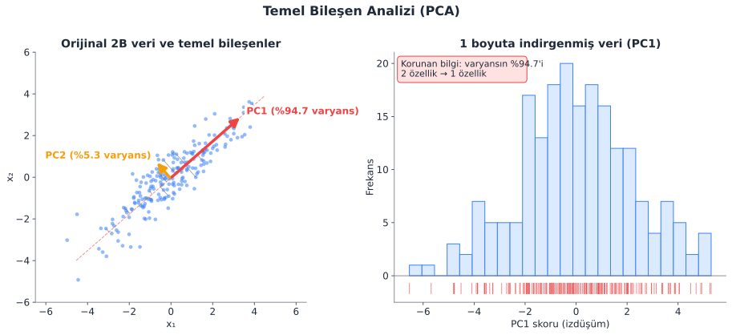

Şekildeki iki boyutlu, güçlü korelasyonlu veride PC1 tek başına toplam varyansın **%94.7**'sini açıklar. Veriyi yalnızca PC1'e izdüşürerek tek boyuta indirmek, bilginin yaklaşık %5'ini kaybetmek pahasına boyutu yarıya düşürür.

> **Dikkat:** PCA ölçeğe duyarlıdır; uygulamadan önce veri standartlaştırılmalıdır. Ayrıca yeni bileşenler orijinal niteliklerin karışımı olduğundan yorumlanabilirlik azalır.

### 4.5 Veri Dönüştürme ve Ayrıklaştırma

**Normalizasyon.** Nitelikleri ortak bir ölçeğe taşır:

* **Min-maks normalizasyonu:** $v' = \dfrac{v - \min_A}{\max_A - \min_A}$ → değerler [0, 1] aralığına taşınır. Aykırı değerlere duyarlıdır.

```math
\underbrace{v'}_{\text{yeni değer}} = \frac{\overbrace{v - \min_A}^{\substack{\text{değerin en küçük}\\\text{değerden uzaklığı}}}}{\underbrace{\max_A - \min_A}_{\substack{\text{A niteliğinin}\\\text{değişim aralığı}}}}
```

**Nasıl okunur?** "v üssü eşittir, v eksi A'nın minimumu, bölü A'nın maksimumu eksi A'nın minimumu." Yani: Değer, en küçükten en büyüğe giden yolun yüzde kaçında? Yaş 18–80 aralığındaysa 49 yaş, (49 − 18) / (80 − 18) = 0.5 olur.

* **Z-skor standardizasyonu:** $v' = \dfrac{v - \bar{A}}{\sigma_A}$ → ortalama 0, standart sapma 1 olur. Aykırı değer varsa min-maksa göre daha güvenlidir.

```math
\underbrace{v'}_{\text{z-skoru}} = \frac{\overbrace{v - \bar{A}}^{\text{ortalamadan sapma}}}{\underbrace{\sigma_A}_{\substack{\text{A'nın standart}\\\text{sapması}}}}
```

**Nasıl okunur?** "v üssü eşittir, v eksi A bar, bölü sigma alt A." Yani: Değer, ortalamadan kaç standart sapma uzakta? Sınav ortalaması 60, standart sapma 10 ise 80 alan öğrencinin z-skoru (80 − 60) / 10 = **2**'dir.

* **Ondalık ölçekleme:** $v' = v / 10^j$ (en büyük mutlak değer 1'in altına inecek şekilde).

**Ayrıklaştırma (discretization).** Sürekli bir niteliği aralıklara bölerek kategorik hâle getirir. Örneğin yaş → {genç, orta yaş, yaşlı}. Bazı algoritmalar (ör. klasik Apriori, bazı Naive Bayes sürümleri) yalnızca kategorik veriyle çalışır. Yaklaşımlar:

* **Eşit genişlikli (equal-width):** Aralıklar aynı genişlikte.
* **Eşit frekanslı (equal-frequency):** Her aralıkta yaklaşık aynı sayıda örnek.
* **Entropi tabanlı (denetimli):** Sınıf etiketini en iyi ayıracak kesim noktaları seçilir.

**Kategorik değişkenleri kodlama.** Çoğu algoritma sayısal girdi bekler:

* **One-hot kodlama:** "Şehir" niteliği {İstanbul, Ankara, İzmir} için üç ikili sütun üretir. Nominal veride doğru yöntemdir.
* **Ordinal (etiket) kodlama:** {düşük, orta, yüksek} → {0, 1, 2}. Yalnızca sıralı veride anlamlıdır.

**Python ile tipik bir ön işleme hattı:**

```python
import numpy as np
import pandas as pd
from sklearn.compose import ColumnTransformer
from sklearn.impute import SimpleImputer
from sklearn.pipeline import Pipeline
from sklearn.preprocessing import OneHotEncoder, StandardScaler

df = pd.DataFrame({
    "yas":   [25, 32, np.nan, 51, 46, 29],
    "gelir": [18000, 42000, 35000, np.nan, 120000, 27000],
    "sehir": ["İstanbul", "Ankara", "İzmir", "İstanbul", np.nan, "Ankara"],
})

sayisal = Pipeline([
    ("doldur", SimpleImputer(strategy="median")),        # eksikleri medyanla doldur
    ("olcekle", StandardScaler()),                       # z-skor standardizasyonu
])
kategorik = Pipeline([
    ("doldur", SimpleImputer(strategy="most_frequent")), # eksikleri modla doldur
    ("kodla", OneHotEncoder(handle_unknown="ignore")),   # one-hot kodlama
])

on_isleme = ColumnTransformer([
    ("sayisal", sayisal, ["yas", "gelir"]),
    ("kategorik", kategorik, ["sehir"]),
])

X = on_isleme.fit_transform(df)
pd.set_option("display.width", 120)
print(pd.DataFrame(X, columns=on_isleme.get_feature_names_out()).round(2))
```

`Pipeline` kullanmanın önemli bir faydası vardır: Doldurma ve ölçekleme parametreleri (medyan, ortalama, standart sapma) **yalnızca eğitim verisinden** öğrenilir ve test verisine aynen uygulanır. Böylece test verisinden eğitime bilgi sızması **(data leakage)** önlenir.

### 4.6 Uygulama: Kirli Bir Veri Setini Uçtan Uca Temizlemek

Bu bölümde anlatılan adımların hepsi, bilerek "kirletilmiş" bir müşteri veri seti üzerinde uygulamalı olarak gösterilmiştir. Veri setinde gizli eksik değerler, mükerrer kayıtlar, yazım tutarsızlıkları, imkânsız ve aykırı değerler, karışık tarih biçimleri, farklı para birimleri ve gereksiz sütunlar vardır. Aynı iş hem **Python (pandas)** hem de **R (tidyverse)** ile yapılır ve iki betik aynı temiz tabloyu üretir.

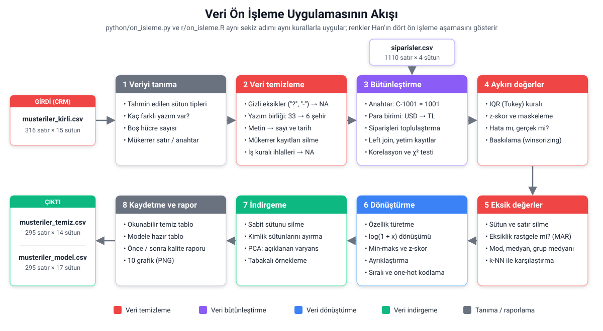

Kodlar, veri seti, grafikler ve adım adım açıklamalar için: **[uygulamalar/veri_on_isleme](uygulamalar/veri_on_isleme/README.md)**

***

## 5. Veri Ambarı ve OLAP

Kısım II'de Hive'ı "Hadoop üzerinde bir veri ambarı" olarak tanıyacağız. Bu bölümde veri ambarı kavramının kendisini ve analitik sorgulamanın temelini oluşturan OLAP'ı inceleyeceğiz.

### 5.1 OLTP ve OLAP

Bir bankanın veritabanı sistemlerini düşünün. Gün boyunca ATM'lerden, şubelerden ve mobil uygulamadan saniyede binlerce **para yatırma, çekme ve havale** işlemi gelir. Bu işlemler hızlı, küçük ve tutarlı olmalıdır. Öte yandan ay sonunda yönetim "Son üç yılda bölgelere göre kredi kartı harcamaları nasıl değişti?" diye sorar. Bu sorgu milyonlarca kaydı tarar ve dakikalar sürebilir. Bu iki iş yükü o kadar farklıdır ki ayrı sistemlerde çalıştırılır:

| Özellik | **OLTP** (Online Transaction Processing) | **OLAP** (Online Analytical Processing) |
|---|---|---|
| Amaç | Günlük operasyonlar | Analiz ve karar destek |
| Kullanıcı | Memur, müşteri, uygulama | Analist, yönetici |
| İşlem tipi | Kısa okuma/yazma (INSERT, UPDATE) | Uzun, karmaşık, salt okunur sorgular |
| Veri | Güncel, ayrıntılı | Tarihsel, özetlenmiş, bütünleştirilmiş |
| Tasarım | Normalize (3NF), ER modeli | Yıldız / kar tanesi şeması |
| Erişilen kayıt sayısı | Onlarca | Milyonlarca |
| Öncelik | Tutarlılık, eşzamanlılık, hız | Sorgu verimi, esneklik |

### 5.2 Veri Ambarı ve ETL

Bill Inmon'un klasik tanımıyla **veri ambarı (data warehouse)**, yönetimin karar verme süreçlerini desteklemek için tutulan **konu odaklı (subject-oriented)**, **bütünleşik (integrated)**, **zaman boyutlu (time-variant)** ve **kalıcı (nonvolatile)** bir veri koleksiyonudur:

* **Konu odaklı:** Uygulamalara değil müşteri, ürün, satış gibi iş konularına göre düzenlenir.
* **Bütünleşik:** Farklı kaynaklardan gelen veri ortak adlandırma, birim ve formatlara dönüştürülür.
* **Zaman boyutlu:** Geçmiş yılların verisini de içerir; her kayıt bir zaman bağlamına sahiptir.
* **Kalıcı:** Veri yüklendikten sonra genellikle güncellenmez veya silinmez; sadece yenisi eklenir.

Veri, ambara **ETL (Extract–Transform–Load)** süreciyle taşınır:

1. **Çek (Extract):** Kaynak sistemlerden veri alınır.
2. **Dönüştür (Transform):** Temizleme, birim dönüştürme, birleştirme, özetleme yapılır (Bölüm 4'teki adımların büyük kısmı).
3. **Yükle (Load):** Dönüştürülmüş veri ambara yazılır. Bu genellikle gece, toplu (batch) olarak yapılır.

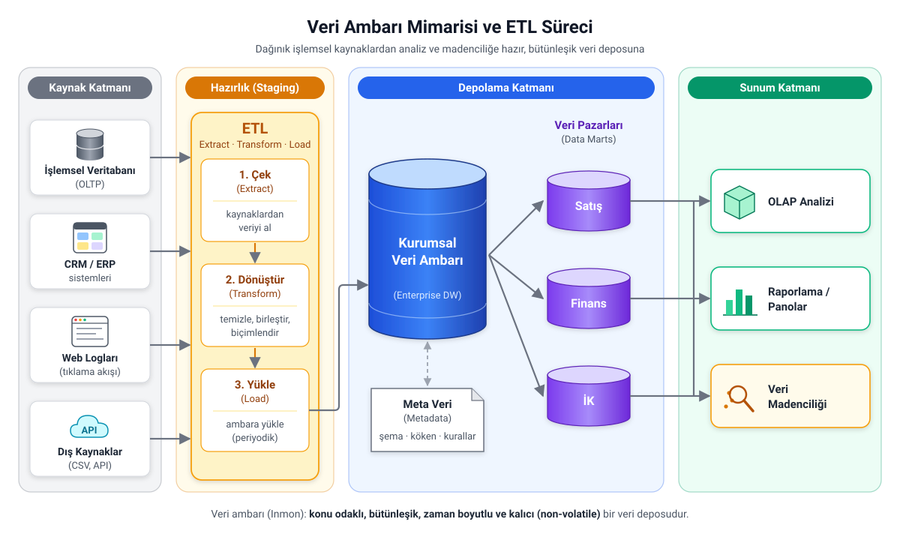

Kurumun tamamına hizmet eden ambarın yanında, tek bir departmana odaklanan daha küçük **veri pazarları (data marts)** da kurulabilir (satış veri pazarı, finans veri pazarı vb.).

### 5.3 Çok Boyutlu Model: Yıldız Şeması ve Veri Küpü

Analistler veriyi doğal olarak **boyutlar** üzerinden düşünür: "*Hangi ürün*, *hangi bölgede*, *hangi dönemde* ne kadar sattı?" Veri ambarları bu düşünce biçimine uygun olarak **çok boyutlu (multidimensional)** modellenir:

* **Olgu (fact) tablosu:** Ölçülen sayısal değerleri (satış tutarı, adet) ve boyut tablolarına işaret eden anahtarları içerir. Çok sayıda satırı vardır.
* **Boyut (dimension) tabloları:** Olguları bağlamlandıran tanımlayıcı bilgileri içerir: zaman, ürün, mağaza, müşteri.

Merkezde bir olgu tablosu ve ona bağlı boyut tablolarından oluşan bu yapıya **yıldız şeması (star schema)** denir:

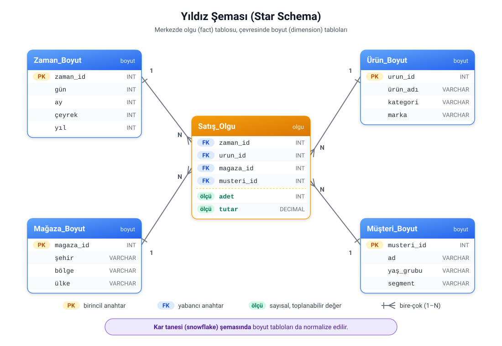

Boyut tabloları da normalize edilirse (ör. Mağaza → Şehir → Bölge ayrı tablolar) **kar tanesi şeması (snowflake schema)** elde edilir. Bu şema depolamadan tasarruf sağlar, ama sorgularda daha fazla JOIN gerektirir.

Çok boyutlu model kavramsal olarak bir **veri küpü (data cube)** ile görselleştirilir. Küpün her ekseni bir boyut, her hücresi ise ilgili boyut değerlerinin kesişimindeki ölçüdür. Örneğin (Telefon, İstanbul, Ç1) hücresi, İstanbul'da 1. çeyrekte satılan telefonların toplam tutarıdır. "Küp" adı üç boyuttan gelir, ama pratikte boyut sayısı çok daha fazla olabilir (*n-boyutlu küp*, hiperküp).

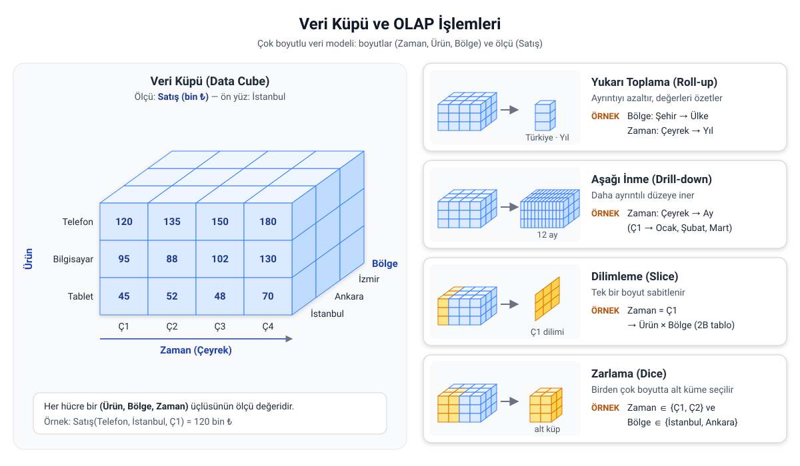

**Temel OLAP işlemleri:**

| İşlem | Ne yapar? | Örnek |
|---|---|---|
| **Yukarı toplama (Roll-up)** | Bir boyutta hiyerarşide yukarı çıkarak özetler | Şehir → Ülke; Çeyrek → Yıl |
| **Aşağı inme (Drill-down)** | Daha ayrıntılı seviyeye iner | Çeyrek → Ay → Gün |
| **Dilimleme (Slice)** | Bir boyutu tek değere sabitler, alt küp çıkarır | Zaman = Ç1 |
| **Zarlama (Dice)** | Birden fazla boyutta değer aralıkları seçer | Zaman ∈ {Ç1, Ç2} ve Bölge ∈ {İstanbul, Ankara} |
| **Döndürme (Pivot)** | Görünüm eksenlerini değiştirir | Satırlar ↔ sütunlar |

SQL'deki `GROUP BY` ile `ROLLUP` ve `CUBE` uzantıları bu işlemlerin doğrudan karşılığıdır. Örneğin `GROUP BY CUBE(urun, bolge, ceyrek)` sorgusu, üç boyutun tüm $2^3 = 8$ alt kümesi için toplamları tek seferde hesaplar.

### 5.4 Veri Ambarından Veri Gölüne

Klasik veri ambarları iki varsayıma dayanır: Veri **yapılandırılmıştır** ve şema **yazmadan önce (schema-on-write)** belirlenir. Büyük veri çağında ise bu varsayımlar zorlanır. Log dosyaları, JSON belgeleri, görüntüler ve sensör akışları önceden tanımlanmış tablolara kolayca sığmaz.

**Veri gölü (data lake)**, verinin ham hâliyle, düşük maliyetli ve ölçeklenebilir bir depoda (HDFS, Amazon S3 vb.) saklandığı yaklaşımdır. Şema veri **okunurken (schema-on-read)** uygulanır.

| | Veri Ambarı | Veri Gölü |
|---|---|---|
| Veri | Yapılandırılmış, işlenmiş | Her türlü, ham |
| Şema | Yazmadan önce | Okurken |
| Depolama maliyeti | Yüksek | Düşük |
| Kullanıcı | İş analistleri | Veri bilimciler, mühendisler |
| Risk | Esneklik eksikliği | Yönetilmezse **veri bataklığına (data swamp)** dönüşme |

Günümüzde iki yaklaşımı birleştiren **lakehouse** mimarileri (Delta Lake, Apache Iceberg vb.) de yaygınlaşmaktadır. Bu mimariler veri gölünün esnekliğini, ambarın işlem garantileri ve sorgu performansıyla birleştirir. Kısım II'de göreceğimiz **Apache Hive**, HDFS üzerindeki dosyalara tablo yapısı giydirerek SQL ile sorgulanmasını sağlar. Hive bu açıdan veri gölü üzerinde ambar deneyimi sunmanın ilk örneklerinden biridir.

***

## 6. Sık Örüntüler ve Birliktelik Kuralları

Bir market zincirinin kasa kayıtlarını incelediğini düşünün: Bebek bezi alan müşterilerin sepetinde çoğu zaman bebek maması ve ıslak mendil de var; makarna alanlar domates sosunu, çay alanlar şekeri de sepete koyuyor. Bu örüntülerin bir kısmı sezgiyle tahmin edilebilir, bir kısmı ise ancak veriye bakınca ortaya çıkar. **Birlikte satın alınan ürünleri bulmak**, raf düzeninden kampanya tasarımına, çapraz satıştan öneri sistemlerine kadar pek çok kararı besler. Bu analize **pazar sepeti analizi (market basket analysis)** denir.

### 6.1 Temel Kavramlar: Destek, Güven, Lift

Aşağıdaki beş alışveriş fişini (işlem) ele alalım (Tan ve ark.'ndan uyarlanmıştır):

| İşlem No | Ürünler |
|---|---|
| 1 | Ekmek, Süt |
| 2 | Ekmek, Bez, Mama, Yumurta |
| 3 | Süt, Bez, Mama, Kola |
| 4 | Ekmek, Süt, Bez, Mama |
| 5 | Ekmek, Süt, Bez, Kola |

* **Öğe (item):** Tek bir ürün, ör. *Mama*.
* **Öğe kümesi (itemset):** Bir veya daha fazla öğeden oluşan küme. *k* öğeli kümeye *k-öğe kümesi* denir, ör. {Bez, Mama} bir 2-öğe kümesidir.
* **Birliktelik kuralı (association rule):** $X \Rightarrow Y$ biçiminde bir çıkarım. $X$ ve $Y$ ayrık öğe kümeleridir, ör. {Bez} ⇒ {Mama}.

Bir kuralın gücü üç ölçüyle değerlendirilir:

**Destek (Support):** Kuraldaki öğelerin tamamının birlikte görüldüğü işlemlerin oranıdır. Kuralın *ne kadar sık* geçerli olduğunu gösterir.

$$\text{destek}(X \Rightarrow Y) = P(X \cup Y) = \frac{\text{X ve Y'yi birlikte içeren işlem sayısı}}{\text{toplam işlem sayısı}}$$

```math
\underbrace{\text{destek}(X \Rightarrow Y)}_{\text{kuralın desteği}} = \underbrace{P(X \cup Y)}_{\substack{\text{bir fişte X'in ve Y'nin}\\\text{birlikte bulunma olasılığı}}}
```

**Nasıl okunur?** "X ise Y kuralının desteği eşittir, P X birleşim Y." **Dikkat:** Buradaki $\cup$ "X veya Y" anlamına gelmez. $X \cup Y$, X'teki ve Y'deki öğelerin hepsinden oluşan öğe kümesidir. Fişin bu kümenin **tamamını**, yani X'i ve Y'yi **birlikte** içermesi gerekir.

**Güven (Confidence):** X'i içeren işlemlerin ne kadarının Y'yi de içerdiğini gösterir. Kuralın *ne kadar güvenilir* olduğunun ölçüsüdür.

$$\text{güven}(X \Rightarrow Y) = P(Y \mid X) = \frac{\text{destek}(X \cup Y)}{\text{destek}(X)}$$

```math
\underbrace{\text{güven}(X \Rightarrow Y)}_{\text{kuralın güveni}} = \underbrace{P(Y \mid X)}_{\substack{\text{X alındığı bilinirken}\\\text{Y'nin de alınma olasılığı}}} = \frac{\overbrace{\text{destek}(X \cup Y)}^{\text{X ve Y birlikte}}}{\underbrace{\text{destek}(X)}_{\substack{\text{yalnızca X'i içeren}\\\text{fişlere bakılır}}}}
```

**Nasıl okunur?** "X ise Y kuralının güveni eşittir, X verildiğinde Y'nin olasılığı; yani X birleşim Y'nin desteği bölü X'in desteği." Dikey çizgi ($\mid$) **"verildiğinde"** diye okunur: Bütün fişleri bırakıp yalnızca X'i içeren fişlere bakarız. Bu yüzden $P(Y \mid X)$ ile $P(X \mid Y)$ genellikle farklıdır.

**Lift:** Güvenin, Y'nin zaten ne kadar yaygın olduğuna göre düzeltilmiş hâlidir.

```math
\text{lift}(X \Rightarrow Y) = \frac{\text{güven}(X \Rightarrow Y)}{\text{destek}(Y)} = \frac{P(X \cup Y)}{P(X)\,P(Y)}
```

```math
\text{lift}(X \Rightarrow Y) = \frac{\overbrace{\text{güven}(X \Rightarrow Y)}^{\substack{\text{X alanlarda}\\\text{Y oranı}}}}{\underbrace{\text{destek}(Y)}_{\substack{\text{tüm fişlerde}\\\text{Y oranı}}}} = \frac{\overbrace{P(X \cup Y)}^{\substack{\text{gerçekte birlikte}\\\text{görülme}}}}{\underbrace{P(X)\,P(Y)}_{\substack{\text{bağımsız olsalardı beklenen}\\\text{birlikte görülme}}}}
```

**Nasıl okunur?** "X ise Y kuralının lift'i eşittir, güven bölü Y'nin desteği; ya da P X birleşim Y, bölü P X çarpı P Y." Yani: X alanlar Y'yi, genel müşteri kitlesine göre **kaç kat** daha sık alıyor?

* Lift > 1 → X ve Y **pozitif ilişkili**: Birlikte görülme beklenenden sık.
* Lift = 1 → X ve Y **bağımsız**.
* Lift < 1 → X ve Y **negatif ilişkili**: Biri diğerinin olasılığını düşürüyor.

**Örnek:** {Bez} ⇒ {Mama} kuralı için:

* Bez ve Mama'yı birlikte içeren işlemler: 2, 3, 4 → destek = 3/5 = **0.60**
* Bez içeren işlemler: 2, 3, 4, 5 → güven = 3/4 = **0.75**
* Mama'nın desteği 3/5 = 0.60 → lift = 0.75 / 0.60 = **1.25** (pozitif ilişki)

Ters yöndeki {Mama} ⇒ {Bez} kuralının güveni ise 3/3 = **1.00**'dır: Mama alan herkes bez de almış. Bu örnek, birliktelik kurallarının **yönlü** olduğunu ve iki yönün güven değerlerinin farklı olabileceğini gösterir.

> **Neden lift?** "Çay ⇒ Kahve" kuralının güveni %75 olsun. Kulağa güçlü gelir. Ama müşterilerin zaten %90'ı kahve alıyorsa, çay almak kahve alma olasılığını *düşürüyor* demektir (lift = 0.75/0.90 ≈ 0.83). Güven tek başına yanıltıcı olabilir.

**Birliktelik kuralı madenciliği problemi:** Kullanıcının belirlediği bir **minimum destek (min_sup)** ve **minimum güven (min_conf)** eşiğini geçen tüm kuralları bulmak. Bu problem iki adımda çözülür:

1. **Sık öğe kümelerini bulmak:** Desteği ≥ min_sup olan tüm öğe kümeleri. *Hesaplama açısından pahalı kısım budur.*
2. **Kural üretmek:** Her sık öğe kümesinden güveni ≥ min_conf olan kuralları türetmek.

### 6.2 Apriori Algoritması

**Kaba kuvvetin sorunu.** *d* farklı ürün varsa, olası öğe kümesi sayısı $2^d - 1$'dir. Sadece 100 ürünlük bir markette bu sayı yaklaşık $1.27 \times 10^{30}$'dur. Her birinin desteğini tek tek saymak imkânsızdır.

**Apriori ilkesi (Agrawal ve Srikant, 1994):** *Bir öğe kümesi sık ise, onun tüm alt kümeleri de sıktır.* Bunun mantıksal karşıtı daha da işe yarar: **Bir öğe kümesi sık değilse, onun hiçbir üst kümesi sık olamaz.** {Ekmek, Mama} nadiren birlikte alınıyorsa, {Ekmek, Mama, Süt} daha da nadir alınacaktır. Bu özelliğe desteğin **anti-monoton** olması denir. Algoritmanın arama uzayını budamasını (pruning) sağlayan da budur.

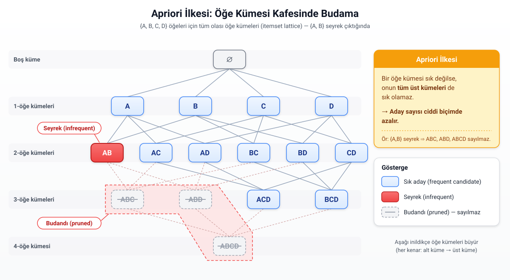

**Algoritma (seviye seviye arama):**

1. Tüm 1-öğe kümelerinin desteğini say; min_sup altında kalanları ele → $L_1$.
2. $k = 2$'den başlayarak:
   * **Aday üretme:** $L_{k-1}$'deki kümeleri birleştirerek $k$-öğeli aday kümeler $C_k$ üret.
   * **Budama:** Herhangi bir $(k-1)$-alt kümesi $L_{k-1}$'de olmayan adayları ele (Apriori ilkesi).
   * **Sayma:** Veritabanını bir kez tarayarak kalan adayların desteğini say; min_sup'u geçenler → $L_k$.
3. Yeni sık küme bulunamayana kadar devam et.

**Örnek uygulama** (yukarıdaki 5 işlem, min_sup = 3/5 = %60):

*1. tarama — 1-öğe kümeleri:*

| Öğe | Ekmek | Süt | Bez | Mama | Kola | Yumurta |
|---|---|---|---|---|---|---|
| Sayı | 4 | 4 | 4 | 3 | 2 ✗ | 1 ✗ |

$L_1$ = {Ekmek, Süt, Bez, Mama}

*2. tarama — 2-öğe kümeleri* (dört sık öğeden $\binom{4}{2} = 6$ aday; Kola ve Yumurta içeren 9 aday hiç üretilmedi):

| Aday | {Ekmek, Süt} | {Ekmek, Bez} | {Ekmek, Mama} | {Süt, Bez} | {Süt, Mama} | {Bez, Mama} |
|---|---|---|---|---|---|---|
| Sayı | 3 | 3 | 2 ✗ | 3 | 2 ✗ | 3 |

$L_2$ = {Ekmek, Süt}, {Ekmek, Bez}, {Süt, Bez}, {Bez, Mama}

*3. tarama — 3-öğe kümeleri:*

* {Ekmek, Süt, Bez}: Tüm 2-alt kümeleri sık → aday. Sayı = 2 (işlem 4 ve 5) → **sık değil**.
* {Ekmek, Bez, Mama}: {Ekmek, Mama} sık değil → **sayılmadan budandı**.
* {Süt, Bez, Mama}: {Süt, Mama} sık değil → **sayılmadan budandı**.

Sonuç olarak en büyük sık öğe kümeleri 2 öğelidir. Bunlardan güveni %70'i geçen kurallar:

| Kural | Destek | Güven | Lift |
|---|---|---|---|
| {Mama} ⇒ {Bez} | 0.60 | 1.00 | 1.25 |
| {Bez} ⇒ {Mama} | 0.60 | 0.75 | 1.25 |
| {Ekmek} ⇒ {Süt} | 0.60 | 0.75 | 0.94 |
| {Süt} ⇒ {Ekmek} | 0.60 | 0.75 | 0.94 |
| {Ekmek} ⇒ {Bez} | 0.60 | 0.75 | 0.94 |
| {Bez} ⇒ {Ekmek} | 0.60 | 0.75 | 0.94 |
| {Süt} ⇒ {Bez} | 0.60 | 0.75 | 0.94 |
| {Bez} ⇒ {Süt} | 0.60 | 0.75 | 0.94 |

Tablo öğreticidir: Güven değerleri neredeyse aynı olduğu hâlde yalnızca Bez–Mama ilişkisi *gerçekten* pozitiftir (lift > 1). Diğerleri bu ürünlerin zaten çok yaygın olmasından kaynaklanır.

**Python ile Apriori** (öğretici amaçlı, kütüphanesiz):

```python
from itertools import combinations

islemler = [
    {"Ekmek", "Süt"},
    {"Ekmek", "Bez", "Mama", "Yumurta"},
    {"Süt", "Bez", "Mama", "Kola"},
    {"Ekmek", "Süt", "Bez", "Mama"},
    {"Ekmek", "Süt", "Bez", "Kola"},
]
N = len(islemler)
MIN_SUP, MIN_CONF = 0.6, 0.7

def destek(kume):
    return sum(kume <= t for t in islemler) / N

# 1-öğe kümeleri
ogeler = sorted(set().union(*islemler))
L = [frozenset([o]) for o in ogeler if destek({o}) >= MIN_SUP]
sik_kumeler = list(L)

k = 2
while L:
    # Aday üretme: (k-1)-kümelerin birleşimi
    adaylar = {a | b for a in L for b in L if len(a | b) == k}
    # Apriori budaması: tüm (k-1)-alt kümeleri sık olmalı
    adaylar = [c for c in adaylar
               if all(frozenset(s) in L for s in combinations(c, k - 1))]
    L = [c for c in adaylar if destek(c) >= MIN_SUP]
    sik_kumeler += L
    k += 1

print("Sık öğe kümeleri:")
for s in sik_kumeler:
    print(f"  {set(s)}  destek={destek(s):.2f}")

print("\nKurallar:")
for s in (s for s in sik_kumeler if len(s) > 1):
    for r in range(1, len(s)):
        for X in map(frozenset, combinations(s, r)):
            Y = s - X
            guven = destek(s) / destek(X)
            if guven >= MIN_CONF:
                lift = guven / destek(Y)
                print(f"  {set(X)} => {set(Y)}  güven={guven:.2f}  lift={lift:.2f}")
```

Gerçek projelerde `mlxtend` kütüphanesinin `apriori`, `fpgrowth` ve `association_rules` fonksiyonları, büyük veride ise Spark MLlib'in **FP-Growth** uygulaması kullanılır. Weka'da da aynı iki algoritma hazır bulunur (bkz. Bölüm 6.4).

### 6.3 FP-Growth Algoritması

Apriori'nin iki zayıf noktası vardır: Çok sayıda **aday küme üretir** ve her seviye için **veritabanını baştan tarar**. Sık öğe kümeleri 10 öğeye kadar uzanıyorsa veri 10 kez okunur. **FP-Growth (Frequent Pattern Growth; Han, Pei ve Yin, 2000)** bu iki sorunu birden çözer: Aday üretmez ve veritabanını yalnızca **iki kez** tarar.

**Fikir.** Veriyi, ortak önekleri paylaşan sıkıştırılmış bir ağaçta, **FP-ağacında (FP-tree)** saklamak ve sık kümeleri bu ağaçtan "büyüterek" bulmak.

**Adım 1 — İlk tarama.** Her öğenin desteği sayılır, seyrek öğeler atılır. Kalan öğeler **destekleri azalan sırada** dizilir. Yukarıdaki 5 fişte (min_sup = 3 fiş): Bez 4, Ekmek 4, Süt 4, Mama 3. Kola ve Yumurta atılır. Eşit desteklerde sabit bir sıra seçilir (burada Bez, Ekmek, Süt).

**Adım 2 — İkinci tarama ve ağacın kurulması.** Her fişin sık öğeleri bu sıraya göre dizilir ve ağaca bir yol olarak eklenir. Aynı önekle başlayan fişler aynı düğümleri paylaşır, yalnızca sayaçları artar:

| Fiş | Sıralanmış sık öğeler |
|---|---|
| 1 | Ekmek, Süt |
| 2 | Bez, Ekmek, Mama |
| 3 | Bez, Süt, Mama |
| 4 | Bez, Ekmek, Süt, Mama |
| 5 | Bez, Ekmek, Süt |

```text
(kök)
├── Bez:4
│   ├── Ekmek:3
│   │   ├── Mama:1
│   │   └── Süt:2
│   │       └── Mama:1
│   └── Süt:1
│       └── Mama:1
└── Ekmek:1
    └── Süt:1
```

Beş fiş 9 düğüme sığdı. Gerçek market verisinde fişlerin büyük kısmı "ekmek, süt, …" gibi ortak öneklerle başladığı için sıkıştırma çok daha belirgindir. Ağacın yanında, her öğenin ağaçtaki tüm düğümlerine bağlantı tutan bir **başlık tablosu (header table)** bulunur. Böylece "Mama geçen bütün yollar" hızla gezilebilir.

**Adım 3 — Ağaçtan sık kümeleri çıkarma.** En seyrek öğeden başlanır. Her öğe için, o öğeye giden yolların öneklerinden oluşan **koşullu örüntü tabanı (conditional pattern base)** toplanır:

* **Mama:** Önekler {Bez, Ekmek}:1, {Bez, Ekmek, Süt}:1, {Bez, Süt}:1. Bu tabanda Bez 3, Ekmek 2, Süt 2 kez geçer. Yalnızca Bez eşiği geçer → **{Bez, Mama}: 3**.
* **Süt:** Önekler {Bez, Ekmek}:2, {Bez}:1, {Ekmek}:1. Bez 3, Ekmek 3 → **{Bez, Süt}: 3** ve **{Ekmek, Süt}: 3**. Üçlü {Bez, Ekmek, Süt} ise yalnızca 2 kez geçer → sık değil.
* **Ekmek:** Önekler {Bez}:3 ve boş önek:1 → **{Bez, Ekmek}: 3**.
* **Bez:** Kökün hemen altında olduğu için öneki yoktur.

Sonuç, Apriori'nin bulduğu $L_2$ ile aynıdır. Fark, buraya **aday üretmeden ve veriyi yalnızca iki kez okuyarak** ulaşılmasıdır. Daha büyük veride koşullu örüntü tabanından küçük bir **koşullu FP-ağacı** kurulur ve aynı işlem bu ağaç üzerinde özyinelemeli olarak tekrarlanır.

| | Apriori | FP-Growth |
|---|---|---|
| Aday üretimi | Var (seviye seviye) | Yok |
| Veritabanı taraması | Her seviye için bir kez | 2 |
| Bellek | Aday kümeler | FP-ağacı (veri sığmazsa sorun) |
| Güçlü olduğu durum | Az öğe, yüksek destek eşiği | Çok öğe, düşük destek eşiği, uzun örüntüler |

İki algoritma da **aynı sık öğe kümelerini** bulur. Değişen yalnızca hızdır; kurallar da aynı biçimde (güven eşiğiyle) üretilir.

### 6.4 Uygulama: Weka ve Python ile Pazar Sepeti Analizi

Bu bölümde anlatılanlar, 20 ürün ve 1000 alışveriş fişinden oluşan **sentetik bir market verisi** üzerinde uygulamalı olarak gösterilmiştir. Veriye bilerek gerçekçi örüntüler gömülmüştür: Bez–mama–ıslak mendil, makarna–domates sosu, çay–şeker, peynir–zeytin. Ekmek ise fişlerin %60'ından fazlasında *bağımsız olarak* bulunur, bu yüzden "… ⇒ {ekmek}" kurallarının güveni yüksek ama lift değeri 1'e yakın çıkar.

Aynı veri önce **Weka**'da (Explorer → Associate) **Apriori** ve **FPGrowth** ile, sonra **Python**'da (`mlxtend`) analiz edilir. min_sup = 0.10 ve min_conf = 0.60 ile üç yol da aynı 39 sık öğe kümesini ve aynı 27 kuralı bulur. Ayrıca yukarıdaki 5 fişlik örneğin ARFF dosyası da verilmiştir. Weka bu örnekte, Bölüm 6.2'de elle hesaplanan 8 kuralı aynen üretir.

Veri dosyaları, Weka'da adım adım kullanım, Python kodu ve çıktılar için: **[uygulamalar/birliktelik_kurallari](uygulamalar/birliktelik_kurallari/README.md)**

***

## 7. Sınıflandırma

### 7.1 Temel Kavramlar

**Sınıflandırma (classification)**, önceden etiketlenmiş örneklerden bir model öğrenip yeni örneklerin **kategorik** sınıf etiketini tahmin etme işidir. Bir bankanın geçmiş kredi başvurularını ve bu başvuruların "ödendi / ödenmedi" sonuçlarını kullanarak yeni bir başvurunun riskini tahmin etmesi tipik bir sınıflandırma problemidir.

Süreç iki adımlıdır:

1. **Öğrenme (eğitim) adımı:** Sınıf etiketi bilinen **eğitim verisi** ile bir model kurulur.
2. **Sınıflandırma (tahmin) adımı:** Model önce modelin hiç görmediği **test verisi** üzerinde değerlendirilir, başarılıysa yeni verilere uygulanır.

Model eğitim verisini ezberlerse yeni veride başarısız olur. Buna **aşırı öğrenme (overfitting)** denir. İyi bir modelin amacı eğitim verisini değil, **genellemeyi** öğrenmektir (bkz. Bölüm 8.4).

Bu bölümde algoritmaları açıklamak için Quinlan'ın klasik "tenis oynanır mı?" veri setini kullanacağız:

| Gün | Hava Durumu | Sıcaklık | Nem | Rüzgâr | Oyna? |
|---|---|---|---|---|---|
| 1 | Güneşli | Sıcak | Yüksek | Zayıf | Hayır |
| 2 | Güneşli | Sıcak | Yüksek | Güçlü | Hayır |
| 3 | Bulutlu | Sıcak | Yüksek | Zayıf | Evet |
| 4 | Yağmurlu | Ilık | Yüksek | Zayıf | Evet |
| 5 | Yağmurlu | Serin | Normal | Zayıf | Evet |
| 6 | Yağmurlu | Serin | Normal | Güçlü | Hayır |
| 7 | Bulutlu | Serin | Normal | Güçlü | Evet |
| 8 | Güneşli | Ilık | Yüksek | Zayıf | Hayır |
| 9 | Güneşli | Serin | Normal | Zayıf | Evet |
| 10 | Yağmurlu | Ilık | Normal | Zayıf | Evet |
| 11 | Güneşli | Ilık | Normal | Güçlü | Evet |
| 12 | Bulutlu | Ilık | Yüksek | Güçlü | Evet |
| 13 | Bulutlu | Sıcak | Normal | Zayıf | Evet |
| 14 | Yağmurlu | Ilık | Yüksek | Güçlü | Hayır |

### 7.2 Karar Ağaçları

**Karar ağacı (decision tree)**, "20 soru" oyununa benzer. Her iç düğümde bir nitelik sınanır, her dal sınamanın bir sonucunu temsil eder, her yaprak ise bir sınıf etiketidir. Karar ağaçlarının en büyük avantajı **yorumlanabilirliktir**: Kökten yaprağa her yol, insanın okuyabileceği bir EĞER–İSE kuralıdır.

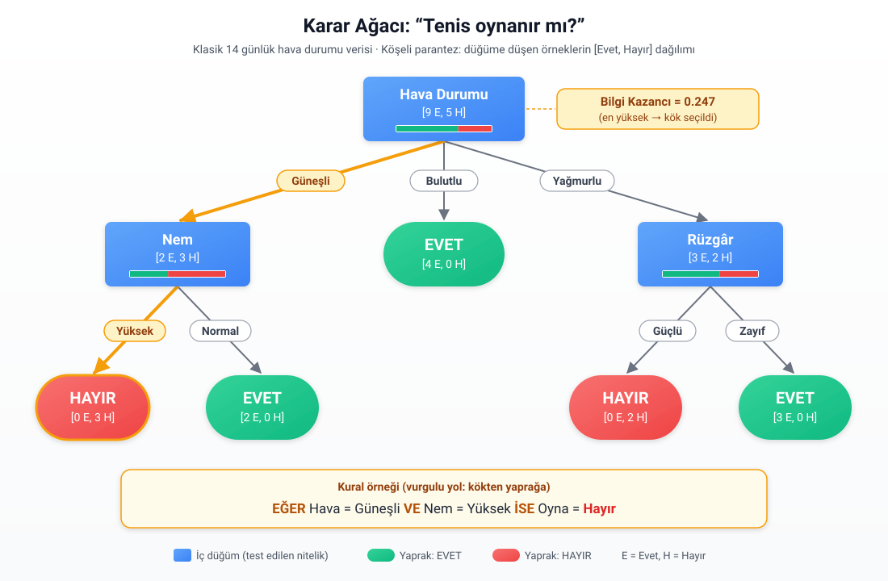

**Ağaç nasıl kurulur?** ID3, C4.5 ve CART gibi algoritmalar ağacı yukarıdan aşağıya, **açgözlü (greedy)** ve özyinelemeli olarak kurar. Her düğümde veriyi *en saf* alt gruplara ayıran nitelik seçilir. "Saflık" ise genellikle **entropi** ile ölçülür.

**Entropi**, bir kümedeki belirsizliğin (karışıklığın) ölçüsüdür. $m$ sınıflı bir $S$ kümesinde $p_i$, $i$. sınıfın oranı olmak üzere:

$$\text{Entropi}(S) = -\sum_{i=1}^{m} p_i \log_2 p_i$$

```math
\underbrace{\text{Entropi}(S)}_{\substack{\text{S kümesindeki}\\\text{belirsizlik (bit)}}} = \overbrace{-}^{\substack{\text{sonucu pozitif}\\\text{yapar}}} \underbrace{\sum_{i=1}^{m}}_{\substack{\text{m sınıfın}\\\text{hepsi için topla}}} \overbrace{p_i}^{\substack{\text{i. sınıfın oranı}\\\text{(ağırlık)}}} \; \underbrace{\log_2 p_i}_{\substack{\text{i. sınıfın}\\\text{"sürpriz" değeri}}}
```

**Nasıl okunur?** "S'nin entropisi eşittir eksi, i eşittir 1'den m'ye kadar p alt i çarpı log iki tabanında p alt i'lerin toplamı."

* $p_i$: S'deki örneklerin kaçta kaçının i. sınıfta olduğu. Tenis verisinde $p_{\text{Evet}} = 9/14$.
* $\log_2 p_i$: $p_i$ 1'den küçük olduğu için bu değer **negatiftir**. Sınıf ne kadar nadirse mutlak değeri o kadar büyüktür: Nadir bir sonuç gerçekleştiğinde daha çok "şaşırırız". Taban 2 olduğu için birim **bit**'tir.
* Baştaki eksi işareti: Negatif logaritmaları pozitife çevirir.
* $\sum p_i \cdot (\dots)$: Her sınıfın sürprizini o sınıfın oranıyla ağırlıklandırıp toplar. Entropi, **ortalama sürprizdir**.
* Hiç örneği olmayan sınıf ($p_i = 0$) için $0 \cdot \log_2 0 = 0$ kabul edilir.

Küme tamamen saf ise (tek sınıf) entropi **0**'dır. İki sınıf eşit dağılmışsa entropi **1** (en yüksek belirsizlik) olur.

**Bilgi kazancı (information gain)**, bir $A$ niteliğine göre bölmenin entropiyi ne kadar azalttığını ölçer:

```math
\text{Kazanç}(S, A) = \text{Entropi}(S) - \sum_{v \in \text{Değerler}(A)} \frac{|S_v|}{|S|}\,\text{Entropi}(S_v)
```

```math
\underbrace{\text{Kazanç}(S, A)}_{\substack{\text{A'ya göre bölmenin}\\\text{kazancı}}} = \underbrace{\text{Entropi}(S)}_{\text{bölmeden önce}} - \underbrace{\sum_{v \in \text{Değerler}(A)} \overbrace{\frac{|S_v|}{|S|}}^{\substack{\text{v dalına düşen}\\\text{örnek oranı}}}\,\overbrace{\text{Entropi}(S_v)}^{\text{v dalının entropisi}}}_{\text{bölmeden sonra: dalların ağırlıklı ortalama entropisi}}
```

**Nasıl okunur?** "S'nin A'ya göre kazancı eşittir, S'nin entropisi eksi, A'nın değerlerindeki her v için S alt v'nin eleman sayısı bölü S'nin eleman sayısı çarpı S alt v'nin entropisinin toplamı."

* $v \in \text{Değerler}(A)$: "v, A'nın değerlerinden biri". A = Hava Durumu ise v sırasıyla Güneşli, Bulutlu ve Yağmurlu olur.
* $S_v$: S'nin, A niteliği v değerini alan örnekleri; yani v dalına düşen örnekler. $\lvert S_v \rvert$ bunların sayısıdır.
* Kazanç, "bölmeden önceki belirsizlik eksi bölmeden sonraki belirsizlik"tir. Büyük dallar ortalamada daha çok ağırlık alır.

**Elle hesaplama.** Veri setinde 9 Evet, 5 Hayır var:

$$\text{Entropi}(S) = -\tfrac{9}{14}\log_2\tfrac{9}{14} - \tfrac{5}{14}\log_2\tfrac{5}{14} = 0.940$$

Formülün her parçası adım adım:

| Sınıf | $p_i$ | $\log_2 p_i$ (sürpriz, negatif) | $p_i \cdot \log_2 p_i$ |
|---|---|---|---|
| Evet | 9/14 = 0.6429 | −0.6374 | −0.4098 |
| Hayır | 5/14 = 0.3571 | −1.4854 | −0.5305 |
| **Toplam** | | | **−0.9403** |

Baştaki eksi işaretiyle entropi **0.940** olur. Hayır sınıfı daha nadir olduğu için sürprizi daha büyüktür (1.485 bit), ama ağırlığı (0.357) daha küçüktür.

*Hava Durumu* niteliğine göre bölersek:

| Değer | Evet | Hayır | Entropi |
|---|---|---|---|
| Güneşli (5) | 2 | 3 | 0.971 |
| Bulutlu (4) | 4 | 0 | 0.000 |
| Yağmurlu (5) | 3 | 2 | 0.971 |

$$\text{Kazanç}(S, \text{Hava}) = 0.940 - \left(\tfrac{5}{14}\cdot 0.971 + \tfrac{4}{14}\cdot 0 + \tfrac{5}{14}\cdot 0.971\right) = 0.940 - 0.694 = 0.247$$

Aynı hesap diğer nitelikler için yapıldığında: Kazanç(Nem) = 0.152, Kazanç(Rüzgâr) = 0.048, Kazanç(Sıcaklık) = 0.029. **En yüksek kazanç Hava Durumu'nda** olduğundan kök düğüm odur. "Bulutlu" dalı tamamen saftır (4 Evet) ve yaprak olur. Diğer dallarda aynı işlem kalan nitelikler için özyinelemeli olarak tekrarlanır. Sonuçta yukarıdaki ağaç elde edilir.

**Diğer bölme ölçütleri.** Bilgi kazancı çok değerli niteliklere (ör. müşteri numarası) yanlıdır; her müşteriye ayrı dal açan bir nitelik mükemmel(!) kazanç verir. C4.5 bu sorunu **kazanç oranı (gain ratio)** ile düzeltir. CART ise **Gini indeksi** kullanır: $\text{Gini}(S) = 1 - \sum_i p_i^2$. scikit-learn'ün karar ağaçları varsayılan olarak Gini ile çalışan, ikili bölmeler yapan CART algoritmasını kullanır.

**Budama (pruning).** Sınırsız büyüyen bir ağaç, gürültü dahil eğitim verisindeki her ayrıntıyı ezberler. **Ön budama (pre-pruning)**, ağacın büyümesini erken durdurur (maksimum derinlik, yapraktaki minimum örnek sayısı). **Son budama (post-pruning)** ise ağacı tam büyütüp sonra genellemeye katkı sağlamayan dalları keser.

**Python ile bilgi kazancı ve karar ağacı:**

```python
import numpy as np
import pandas as pd
from sklearn.datasets import load_wine
from sklearn.model_selection import train_test_split
from sklearn.tree import DecisionTreeClassifier, export_text

# --- 1) Tenis verisinde bilgi kazancını elle hesaplama ---
veri = pd.DataFrame({
    "Hava":     ["Güneşli","Güneşli","Bulutlu","Yağmurlu","Yağmurlu","Yağmurlu","Bulutlu",
                 "Güneşli","Güneşli","Yağmurlu","Güneşli","Bulutlu","Bulutlu","Yağmurlu"],
    "Sicaklik": ["Sıcak","Sıcak","Sıcak","Ilık","Serin","Serin","Serin",
                 "Ilık","Serin","Ilık","Ilık","Ilık","Sıcak","Ilık"],
    "Nem":      ["Yüksek","Yüksek","Yüksek","Yüksek","Normal","Normal","Normal",
                 "Yüksek","Normal","Normal","Normal","Yüksek","Normal","Yüksek"],
    "Ruzgar":   ["Zayıf","Güçlü","Zayıf","Zayıf","Zayıf","Güçlü","Güçlü",
                 "Zayıf","Zayıf","Zayıf","Güçlü","Güçlü","Zayıf","Güçlü"],
    "Oyna":     ["Hayır","Hayır","Evet","Evet","Evet","Hayır","Evet",
                 "Hayır","Evet","Evet","Evet","Evet","Evet","Hayır"],
})

def entropi(y):
    p = y.value_counts(normalize=True)
    return -(p * np.log2(p)).sum()

def bilgi_kazanci(df, nitelik, hedef="Oyna"):
    agirlikli = sum(len(g) / len(df) * entropi(g[hedef]) for _, g in df.groupby(nitelik))
    return entropi(df[hedef]) - agirlikli

for n in ["Hava", "Sicaklik", "Nem", "Ruzgar"]:
    print(f"Kazanç({n}) = {bilgi_kazanci(veri, n):.3f}")

# --- 2) scikit-learn ile gerçek bir veri setinde karar ağacı ---
X, y = load_wine(return_X_y=True, as_frame=True)
X_egt, X_test, y_egt, y_test = train_test_split(X, y, test_size=0.3,
                                                stratify=y, random_state=42)
agac = DecisionTreeClassifier(criterion="entropy", max_depth=3, random_state=42)
agac.fit(X_egt, y_egt)
print(f"\nTest doğruluğu: {agac.score(X_test, y_test):.3f}")
print(export_text(agac, feature_names=list(X.columns)))
```

### 7.3 Naive Bayes

**Naive Bayes**, olasılık teorisinin temel taşlarından **Bayes teoremine** dayanır. $X$ gözlenen nitelik değerleri, $C$ bir sınıf olmak üzere:

```math
P(C \mid X) = \frac{P(X \mid C)\, P(C)}{P(X)}
```

```math
\underbrace{P(C \mid X)}_{\substack{\text{sonsal: X'i gördükten}\\\text{sonra C'nin olasılığı}}} = \frac{\overbrace{P(X \mid C)}^{\text{olabilirlik}}\;\overbrace{P(C)}^{\text{önsel}}}{\underbrace{P(X)}_{\substack{\text{X'i görme olasılığı}\\\text{(tüm sınıflar için aynı)}}}}
```

**Nasıl okunur?** "X verildiğinde C'nin olasılığı eşittir, C verildiğinde X'in olasılığı çarpı C'nin olasılığı, bölü X'in olasılığı." Tenis örneğinde C = "Evet", X = (Güneşli, Serin, Yüksek, Güçlü) olur. Soru şudur: "Bu hava koşullarını gördükten sonra tenis oynanma olasılığı nedir?"

* $P(C)$: **Önsel (prior)** olasılık. Veriyi görmeden önce sınıfın olasılığı.
* $P(X \mid C)$: **Olabilirlik (likelihood)**. Sınıf $C$ iken $X$'i görme olasılığı.
* $P(C \mid X)$: **Sonsal (posterior)** olasılık. $X$'i gördükten sonra sınıfın olasılığı.

Sınıflandırıcı, sonsal olasılığı en yüksek sınıfı seçer. $P(X)$ tüm sınıflar için aynı olduğundan karşılaştırmada ihmal edilebilir.

**"Naif" varsayım:** $P(X \mid C)$'yi doğrudan tahmin etmek, nitelik sayısı arttıkça imkânsızlaşır. Naive Bayes, sınıf verildiğinde niteliklerin birbirinden **koşullu bağımsız** olduğunu varsayar:

$$P(X \mid C) = P(x_1 \mid C) \cdot P(x_2 \mid C) \cdots P(x_n \mid C)$$

```math
\underbrace{P(X \mid C)}_{\substack{\text{tüm niteliklerin birlikte}\\\text{görülme olasılığı}}} = \underbrace{P(x_1 \mid C)}_{\text{1. nitelik}} \cdot \underbrace{P(x_2 \mid C)}_{\text{2. nitelik}} \cdots \underbrace{P(x_n \mid C)}_{\text{n. nitelik}}
```

**Nasıl okunur?** "C verildiğinde X'in olasılığı eşittir, C verildiğinde x alt 1'in olasılığı çarpı C verildiğinde x alt 2'nin olasılığı, ..., çarpı C verildiğinde x alt n'nin olasılığı." Her çarpan tek bir nitelikten kolayca sayılır. Örneğin $P(\text{Güneşli} \mid \text{Evet}) = 2/9$ şu demektir: "Tenis oynanan 9 günün 2'si güneşli."

Bu varsayım gerçekte nadiren doğrudur. Yine de Naive Bayes pratikte şaşırtıcı derecede iyi çalışır, çok hızlıdır ve özellikle **metin sınıflandırmada** (spam filtreleme) standart bir başlangıç modelidir.

**Örnek:** Yeni gün: *Hava = Güneşli, Sıcaklık = Serin, Nem = Yüksek, Rüzgâr = Güçlü*. Tenis oynanır mı?

$$P(\text{Evet}) \cdot P(\text{Güneşli}|\text{Evet}) \cdot P(\text{Serin}|\text{Evet}) \cdot P(\text{Yüksek}|\text{Evet}) \cdot P(\text{Güçlü}|\text{Evet}) = \tfrac{9}{14}\cdot\tfrac{2}{9}\cdot\tfrac{3}{9}\cdot\tfrac{3}{9}\cdot\tfrac{3}{9} \approx 0.0053$$

$$P(\text{Hayır}) \cdot P(\text{Güneşli}|\text{Hayır}) \cdot P(\text{Serin}|\text{Hayır}) \cdot P(\text{Yüksek}|\text{Hayır}) \cdot P(\text{Güçlü}|\text{Hayır}) = \tfrac{5}{14}\cdot\tfrac{3}{5}\cdot\tfrac{1}{5}\cdot\tfrac{4}{5}\cdot\tfrac{3}{5} \approx 0.0206$$

Normalize edersek $P(\text{Hayır} \mid X) = 0.0206 / (0.0206 + 0.0053) \approx 0.795$, yani %79.5 olur. Tahmin: **Hayır**.

> **Sıfır olasılık sorunu:** Bir nitelik değeri eğitimde belirli bir sınıfla hiç görülmemişse (ör. "Bulutlu" ve "Hayır" hiç birlikte yok), ilgili olasılık 0 olur ve tüm çarpımı sıfırlar. Bunu önlemek için her sayıma 1 eklenir. Bu yönteme **Laplace düzeltmesi** denir.

### 7.4 k-En Yakın Komşu (k-NN)

**k-NN**, "bana arkadaşını söyle, sana kim olduğunu söyleyeyim" atasözünün algoritmasıdır. Yeni bir örneği sınıflandırmak için eğitim verisinde ona **en yakın k örneği** bulur ve bu komşuların **çoğunluk oyuna** göre karar verir. Yakınlık, Bölüm 3.4'teki uzaklık ölçüleriyle (genellikle Öklid) hesaplanır.

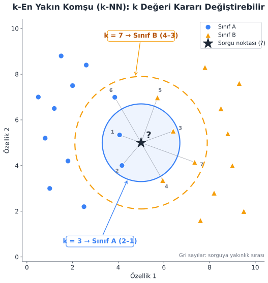

Şekil k seçiminin ne kadar kritik olduğunu gösteriyor: Aynı sorgu noktası **k = 3** için Sınıf A'ya (2'ye 1), **k = 7** için ise Sınıf B'ye (4'e 3) atanıyor.

* **Küçük k:** Gürültüye duyarlıdır; karar sınırı girintili çıkıntılıdır (aşırı öğrenme riski).
* **Büyük k:** Daha pürüzsüz bir karar sınırı oluşur, ama yerel yapılar kaybolur. k = n olursa model her zaman çoğunluk sınıfını söyler.
* İkili sınıflandırmada beraberliği önlemek için **tek sayılı k** tercih edilir. En iyi k genellikle çapraz doğrulama ile seçilir.

k-NN bir **tembel öğrenicidir (lazy learner)**: Eğitim aşamasında hiçbir şey öğrenmez, sadece veriyi saklar. Bütün iş tahmin anında yapılır. Her yeni örnek için tüm eğitim verisine uzaklık hesaplanır. n örnek ve p nitelik için tek bir tahminin maliyeti $O(n \cdot p)$'dir. Bu durum, milyarlarca kayıtta k-NN'i doğrudan uygulanamaz kılar ve bizi yaklaşık en yakın komşu yöntemlerine ve dağıtık hesaplamaya götürür (bkz. Bölüm 12).

### 7.5 SVM ve Yapay Sinir Ağlarına Kısa Bakış

**Destek Vektör Makineleri (Support Vector Machines — SVM)** iki sınıfı ayıran hiper düzlemler arasından, iki sınıfa da **en uzak** olanı (en geniş marjlı olanı) seçer. Marjı belirleyen, sınıra en yakın örneklere **destek vektörleri** denir. Doğrusal olarak ayrılamayan veriler için **çekirdek hilesi (kernel trick)** kullanılır. Veri, açıkça hesaplanmadan daha yüksek boyutlu bir uzaya taşınır ve orada doğrusal olarak ayrılır (RBF ve polinom çekirdekleri). SVM'ler orta büyüklükteki, yüksek boyutlu verilerde (ör. metin) çok başarılıdır. Ancak eğitim maliyeti örnek sayısıyla hızla arttığı için çok büyük verilerde zorlanır.

**Yapay Sinir Ağları (YSA)** birbirine bağlı yapay nöron katmanlarından oluşur. Her nöron girdilerinin ağırlıklı toplamını alır ve doğrusal olmayan bir **aktivasyon fonksiyonundan** (sigmoid, ReLU) geçirir. Ağırlıklar, tahmin hatasının katmanlar boyunca geriye doğru yayılmasıyla (**geri yayılım — backpropagation**) güncellenir. Çok katmanlı (derin) ağlar, Bölüm 11.7'de ele alacağımız **derin öğrenmenin** temelidir.

| Algoritma | Güçlü yön | Zayıf yön | Yorumlanabilirlik |
|---|---|---|---|
| Karar ağacı | Hızlı, ön işleme gerektirmez | Kararsız, aşırı öğrenmeye yatkın | Yüksek |
| Naive Bayes | Çok hızlı, az veriyle çalışır | Bağımsızlık varsayımı | Orta |
| k-NN | Basit, eğitim yok | Tahmin yavaş, ölçeğe duyarlı | Orta |
| SVM | Yüksek boyutta güçlü | Büyük veride yavaş, parametre seçimi | Düşük |
| YSA | Çok esnek, karmaşık örüntüler | Çok veri ve hesap gücü ister | Düşük |

***

## 8. Model Değerlendirme

Bir model kurduk. Peki ne kadar iyi? Bu sorunun cevabı göründüğünden zordur. Yanlış bir değerlendirme, gerçekte işe yaramayan bir modeli üretime almamıza yol açabilir.

### 8.1 Holdout ve k-Katlı Çapraz Doğrulama

**Altın kural:** Model, eğitildiği veriyle değerlendirilmez. Öğrenciye sınavdan önce soruları ve cevapları verirseniz, sınav notu öğrenmeyi değil ezberi ölçer.

**Holdout yöntemi.** Veri rastgele iki parçaya ayrılır. Genellikle %70–80'i **eğitim**, %20–30'u **test** için kullanılır. Basit ve hızlıdır, ama iki zayıflığı vardır: (1) Verinin bir kısmı eğitimde hiç kullanılmaz. (2) Sonuç, bölmenin şansına bağlıdır; başka bir rastgele bölme farklı bir sonuç verebilir.

**k-katlı çapraz doğrulama (k-fold cross-validation).** Veri *k* eşit parçaya (kata) bölünür. Model *k* kez eğitilir; her seferinde bir kat test, kalan *k−1* kat eğitim için kullanılır. Sonuçların ortalaması modelin başarım tahminidir. Her örnek tam bir kez test kümesinde yer alır. Pratikte en sık **k = 10** veya **k = 5** kullanılır.

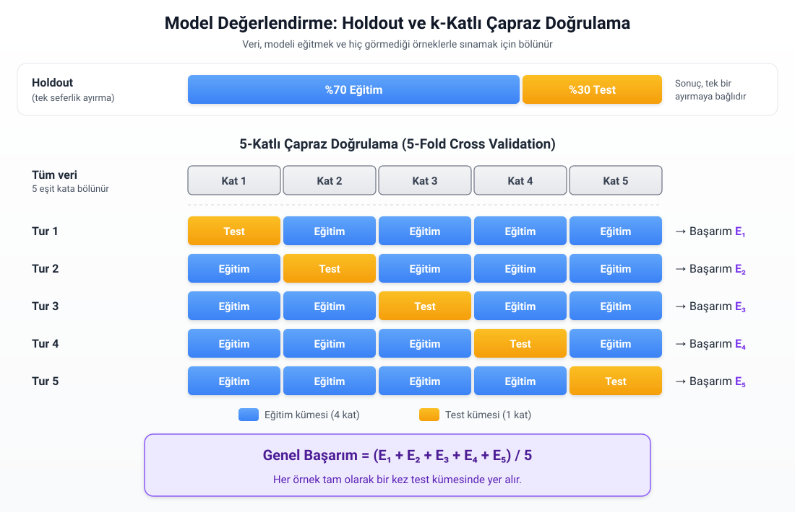

* **Tabakalı (stratified) çapraz doğrulama:** Her katta sınıf oranları korunur. Dengesiz verilerde varsayılan tercih olmalıdır.
* **Birini dışarıda bırak (leave-one-out):** k = n. Çok küçük veri setlerinde kullanılır, büyük veride çok pahalıdır.
* **Model seçimi için üçlü bölme:** Hiperparametre ayarlanacaksa veri *eğitim / doğrulama / test* olarak üçe bölünür. Test kümesi yalnızca **en sonda, bir kez** kullanılır. Aksi hâlde test kümesine de "aşırı uyum" sağlanmış olur.

### 8.2 Karmaşıklık Matrisi ve Temel Metrikler

İkili sınıflandırmada modelin tüm tahminleri dört kutuya ayrılabilir. Bu tabloya **karmaşıklık matrisi (confusion matrix)** denir:

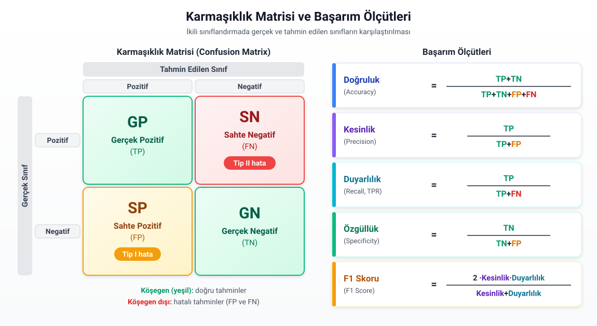

**Örnek: Hastalık taraması.** 1000 kişi taranıyor, bunlardan 50'si gerçekten hasta. Modelimizin sonuçları:

| | Tahmin: Hasta | Tahmin: Sağlıklı | Toplam |
|---|---|---|---|
| **Gerçek: Hasta** | TP = 40 | FN = 10 | 50 |
| **Gerçek: Sağlıklı** | FP = 60 | TN = 890 | 950 |

* **Doğruluk (Accuracy)** = (40 + 890) / 1000 = **0.930**
* **Kesinlik (Precision)** = 40 / (40 + 60) = **0.400**. "Hasta" dediklerimizin sadece %40'ı gerçekten hasta.
* **Duyarlılık (Recall)** = 40 / (40 + 10) = **0.800**. Gerçek hastaların %80'ini yakaladık.
* **Özgüllük (Specificity)** = 890 / (890 + 60) = **0.937**
* **F1 skoru** = 2 · 0.40 · 0.80 / (0.40 + 0.80) = **0.533**

**Doğruluk paradoksu.** Herkese "sağlıklı" diyen, hiçbir şey öğrenmemiş bir model ne kadar doğru olur? 950/1000 = **%95**! Bu "model", bizim modelimizden daha yüksek doğruluk alır, ama tek bir hastayı bile yakalayamaz (duyarlılık = 0). **Dengesiz veri setlerinde doğruluk tek başına yanıltıcıdır.**

**Hangi metrik ne zaman?** Bu sorunun cevabı, hataların *maliyetine* bağlıdır:

* **Duyarlılık öncelikli:** Kanser taraması, sahtekârlık tespiti. Bir hastayı/dolandırıcıyı kaçırmak (FN) çok pahalıdır.
* **Kesinlik öncelikli:** Spam filtresi. Önemli bir e-postayı spam'e atmak (FP) kullanıcıyı çok rahatsız eder.
* **F1 skoru:** Kesinlik ve duyarlılığın harmonik ortalamasıdır. İkisini dengelemek istendiğinde kullanılır.

Sınıflandırıcıların çoğu aslında bir **olasılık** üretir. "Pozitif" kararı, bu olasılığın bir **eşik** değerini (varsayılan 0.5) geçip geçmemesine göre verilir. Eşiği düşürmek duyarlılığı artırır ama kesinliği düşürür; yükseltmek ise tersini yapar. Bu ödünleşimi (trade-off) bütünüyle görmenin yolu ROC eğrisidir.

### 8.3 ROC Eğrisi ve AUC

**ROC (Receiver Operating Characteristic) eğrisi**, eşik değeri 1'den 0'a kaydırılırken her eşik için **Doğru Pozitif Oranı** (TPR = duyarlılık) ile **Yanlış Pozitif Oranı** (FPR = 1 − özgüllük) değerlerini çizer.

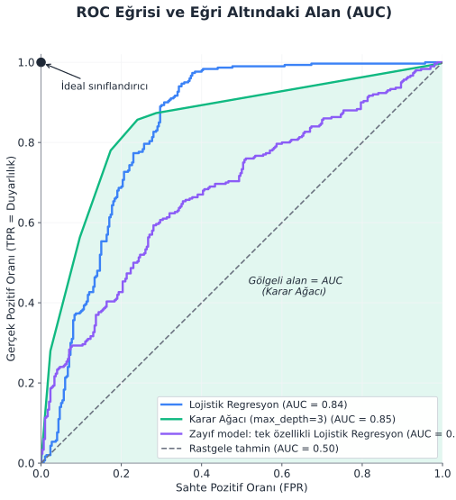

* **Sol üst köşe (0, 1):** Mükemmel sınıflandırıcı. Tüm pozitifler yakalanmış, hiç yanlış alarm yok.
* **Köşegen:** Yazı-tura atan rastgele bir sınıflandırıcı.
* **Eğri sol üste ne kadar yakınsa** model o kadar iyidir.

**AUC (Area Under the Curve)**, ROC eğrisinin altında kalan alandır ve modeli tek bir sayıyla özetler: 1.0 mükemmel, 0.5 rastgele tahmindir. AUC'nin sezgisel bir yorumu da vardır: *Rastgele seçilen bir pozitif örneğin, rastgele seçilen bir negatif örnekten daha yüksek skor alma olasılığı.* AUC eşikten bağımsızdır, bu yüzden modelleri karşılaştırmak için çok kullanışlıdır.

> Sınıf dengesizliği çok şiddetliyse (ör. %0.1 sahtekârlık), ROC eğrisi iyimser bir tablo çizebilir. Bu durumda **Kesinlik–Duyarlılık (Precision–Recall) eğrisi** daha bilgilendiricidir.

### 8.4 Aşırı Öğrenme ve Yanlılık–Varyans Dengesi

Bir modelin hatası kabaca üç bileşene ayrılabilir:

$$\text{Beklenen hata} = \text{Yanlılık}^2 + \text{Varyans} + \text{İndirgenemez gürültü}$$

```math
\underbrace{\text{Beklenen hata}}_{\substack{\text{yeni veride}\\\text{ortalama hata}}} = \underbrace{\text{Yanlılık}^2}_{\substack{\text{model ortalamada}\\\text{ne kadar ıskalıyor?}}} + \underbrace{\text{Varyans}}_{\substack{\text{eğitim verisi değişince}\\\text{model ne kadar oynuyor?}}} + \underbrace{\text{İndirgenemez gürültü}}_{\substack{\text{verinin kendi rastgeleliği;}\\\text{hiçbir model gideremez}}}
```

**Nasıl okunur?** "Beklenen hata eşittir yanlılığın karesi artı varyans artı indirgenemez gürültü."

* **Yanlılık (bias):** Modelin aşırı basit varsayımlar yüzünden gerçek ilişkiyi yakalayamamasından kaynaklanan hata. Yüksek yanlılık **eksik öğrenmeye (underfitting)** yol açar. Eğri bir ilişkiye düz bir çizgi uydurmak buna örnektir.
* **Varyans (variance):** Modelin eğitim verisindeki küçük değişikliklere aşırı duyarlı olmasından kaynaklanan hata. Yüksek varyans **aşırı öğrenmeye (overfitting)** yol açar; model gürültüyü de ezberler.

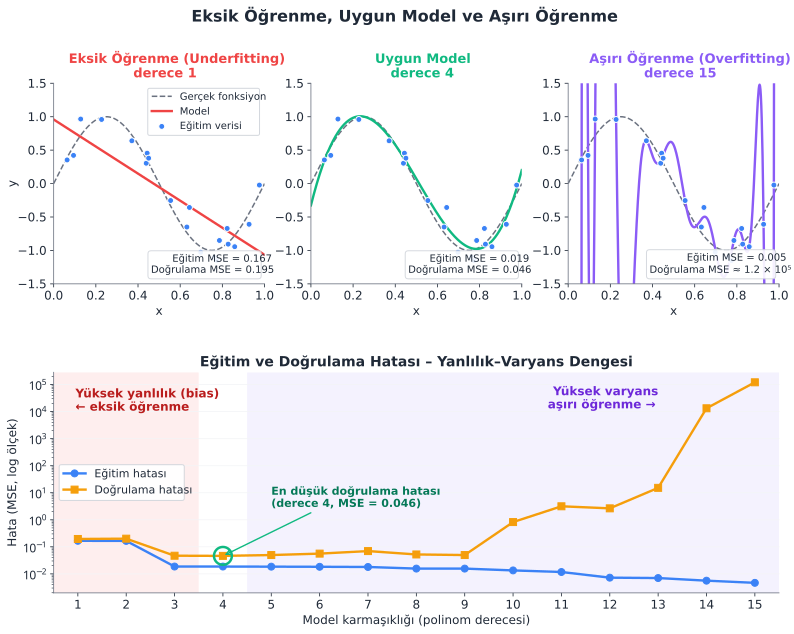

Model karmaşıklığı arttıkça **eğitim hatası sürekli azalır**. **Doğrulama hatası** ise önce azalır, bir noktadan sonra yeniden artmaya başlar. İdeal model, doğrulama hatasının en düşük olduğu noktadaki karmaşıklığa sahip olandır.

**Aşırı öğrenmeyle mücadele:** daha fazla veri toplamak, modeli basitleştirmek (budama, derinlik sınırı), **düzenlileştirme (regularization)** (L1/L2 cezaları), erken durdurma, çapraz doğrulama ile model seçimi ve topluluk yöntemleri (Bölüm 11.1).

**Python ile çapraz doğrulama ve aşırı öğrenmenin gözlenmesi:**

```python
from sklearn.datasets import load_breast_cancer
from sklearn.model_selection import StratifiedKFold, cross_validate
from sklearn.tree import DecisionTreeClassifier

X, y = load_breast_cancer(return_X_y=True)
cv = StratifiedKFold(n_splits=5, shuffle=True, random_state=42)

print(f"{'derinlik':>8} {'eğitim':>8} {'doğrulama':>10}")
for derinlik in [1, 2, 3, 5, 8, None]:
    model = DecisionTreeClassifier(max_depth=derinlik, random_state=42)
    sonuc = cross_validate(model, X, y, cv=cv, scoring="accuracy",
                           return_train_score=True)
    print(f"{str(derinlik):>8} {sonuc['train_score'].mean():8.3f} "
          f"{sonuc['test_score'].mean():10.3f}")
```

Derinlik sınırı kaldırıldığında (`None`) eğitim başarımı 1.000'e ulaşır: Ağaç eğitim verisini ezberlemiştir. Doğrulama başarımı ise bu artışı izlemez. Eğitim ile doğrulama arasındaki açılan fark, aşırı öğrenmenin klasik işaretidir.

***

## 9. Kümeleme

### 9.1 Kümeleme Nedir?

Bir kütüphaneye binlerce kitap bağışlandığını, ama hiçbirinin üzerinde konu etiketi olmadığını düşünün. Kitapları karıştırıp benzer olanları aynı rafa koyarsınız: Bir rafta yemek kitapları, birinde tarih, birinde bilim kurgu toplanır. Kimse size "doğru" rafları söylemedi; gruplamayı verinin kendisinden çıkardınız. İşte **kümeleme (clustering)** budur.

Kümeleme, nesneleri **küme içi benzerlik yüksek**, **kümeler arası benzerlik düşük** olacak şekilde gruplara ayırma işidir. Sınıflandırmanın aksine önceden tanımlı etiketler yoktur. Bu yüzden kümeleme bir **denetimsiz öğrenme** yöntemidir.

Uygulama alanlarına örnekler: müşteri segmentasyonu, belge gruplama, görüntü bölütleme, gen ifadesi analizi, anomali tespiti için "normal" davranışın modellenmesi.

Başlıca yaklaşımlar:

| Yaklaşım | Fikir | Örnek algoritma |
|---|---|---|
| **Bölümleme (partitioning)** | Veriyi k gruba böl, iteratif iyileştir | k-Means, k-Medoids |
| **Hiyerarşik** | İç içe kümelerden ağaç oluştur | AGNES (birleştirici), DIANA (bölücü) |
| **Yoğunluk tabanlı** | Yoğun bölgeleri küme, seyrek bölgeleri gürültü say | DBSCAN, OPTICS |
| **Izgara tabanlı** | Uzayı hücrelere böl, hücreler üzerinde çalış | STING, CLIQUE |
| **Model tabanlı** | Verinin olasılık dağılımlarının karışımından geldiğini varsay | Gauss Karışım Modeli (EM) |

### 9.2 k-Means

**k-Means**, en yaygın kullanılan kümeleme algoritmasıdır. Her küme bir **merkez (centroid)**, yani kümedeki noktaların ortalaması ile temsil edilir.

**Algoritma:**

1. Küme sayısı **k**'yı belirle ve k başlangıç merkezini (genellikle rastgele) seç.
2. **Atama adımı:** Her noktayı en yakın merkezin kümesine ata.
3. **Güncelleme adımı:** Her kümenin merkezini, kümeye atanan noktaların ortalaması olarak yeniden hesapla.
4. Atamalar değişmeyene (veya merkezler sabitlenene) kadar 2. ve 3. adımları tekrarla.

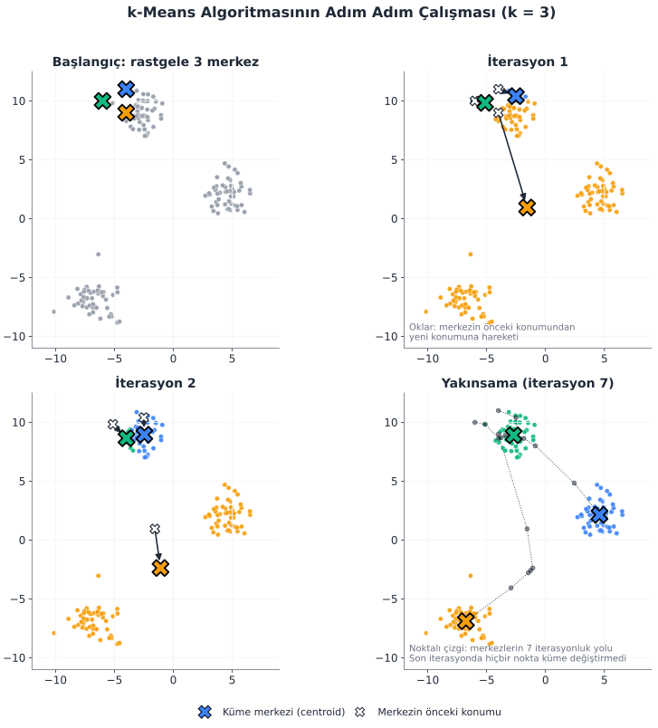

Şekilde başlangıç merkezleri kasıtlı olarak kötü seçilmiş, üçü de sol üst köşeye yerleştirilmiştir. Buna rağmen merkezler her iterasyonda kendi kümelerinin ortasına doğru kayar ve algoritma **7. iterasyonda** hiçbir noktanın küme değiştirmediği duruma, yani yakınsamaya ulaşır.

k-Means aslında **küme içi kareler toplamını (Within-Cluster Sum of Squares — WCSS, sklearn'de `inertia_`)** en aza indirmeye çalışır:

```math
\text{WCSS} = \sum_{j=1}^{k} \sum_{x \in C_j} \|x - \mu_j\|^2
```

```math
\text{WCSS} = \underbrace{\sum_{j=1}^{k}}_{\substack{\text{k kümenin}\\\text{hepsi için}}} \; \underbrace{\sum_{x \in C_j}}_{\substack{\text{j. kümedeki}\\\text{her x noktası için}}} \overbrace{\|x - \mu_j\|^2}^{\substack{\text{noktanın kendi merkezine}\\\text{uzaklığının karesi}}}
```

**Nasıl okunur?** "WCSS eşittir, j eşittir 1'den k'ya kadar, C alt j'deki her x için, x eksi mü alt j'nin normunun karesinin toplamı." $\mu_j$ ("mü alt j") j. kümenin merkezidir. İç içe iki toplam vardır: İçteki toplam bir kümenin içini, dıştaki toplam ise bütün kümeleri toplar.

**Güçlü yönleri:** Basittir, anlaşılırdır ve hızlıdır. Her iterasyonun maliyeti $O(n \cdot k \cdot p)$'dir ve büyük veriye iyi ölçeklenir. Spark MLlib'de dağıtık bir sürümü vardır.

**Zayıf yönleri:**

* **k önceden bilinmelidir.** Seçmek için **dirsek yöntemi (elbow method)** veya **siluet skoru** (Bölüm 9.5) kullanılır.
* **Başlangıca duyarlıdır** ve yerel minimumda takılabilir. Çözüm olarak **k-Means++** başlatması kullanılır (merkezleri birbirinden uzak seçer) ve algoritma farklı başlangıçlarla birkaç kez çalıştırılır (`n_init`).
* **Küresel ve benzer büyüklükte kümeler varsayar.** Uzun, hilal biçimli veya iç içe geçmiş kümeleri ayıramaz.
* **Aykırı değerlere duyarlıdır,** çünkü ortalama aykırı değerlerden etkilenir. Merkez yerine gerçek bir veri noktasını (medoid) kullanan **k-Medoids (PAM)** daha dayanıklıdır.

**Python ile k-Means ve dirsek yöntemi:**

```python
from sklearn.cluster import KMeans
from sklearn.datasets import make_blobs

X, _ = make_blobs(n_samples=500, centers=4, cluster_std=0.9, random_state=42)

print(" k   WCSS (inertia)")
for k in range(1, 9):
    km = KMeans(n_clusters=k, n_init=10, random_state=42).fit(X)
    print(f"{k:2d}   {km.inertia_:10.1f}")
# WCSS'teki düşüş k=4'ten sonra belirgin biçimde yavaşlar → "dirsek" k=4

km = KMeans(n_clusters=4, n_init=10, random_state=42).fit(X)
print("Merkezler:\n", km.cluster_centers_.round(2))
```

### 9.3 Hiyerarşik Kümeleme

Hiyerarşik kümeleme, tek bir bölümleme yerine iç içe geçmiş kümelerden oluşan bir **ağaç** üretir. Bu ağaca **dendrogram** denir.

* **Birleştirici (agglomerative, aşağıdan yukarı):** Her nokta başlangıçta kendi kümesidir. Her adımda **en yakın iki küme birleştirilir.** Tek küme kalana kadar devam edilir. En yaygın yaklaşım budur.
* **Bölücü (divisive, yukarıdan aşağı):** Tüm noktalar tek kümede başlar ve kümeler adım adım bölünür.

İki *küme* arasındaki uzaklık farklı şekillerde tanımlanabilir. Buna **bağlantı (linkage)** ölçütü denir:

| Bağlantı | Küme uzaklığı | Etkisi |
|---|---|---|
| **Tekli (single)** | En yakın iki nokta arası | Zincirleme etki; uzun, ince kümeler |
| **Tam (complete)** | En uzak iki nokta arası | Sıkı, küresel kümeler |
| **Ortalama (average)** | Tüm nokta çiftlerinin ortalaması | Dengeli bir orta yol |
| **Ward** | Birleşmenin varyansta yaptığı artış | k-Means'e benzer, kompakt kümeler |

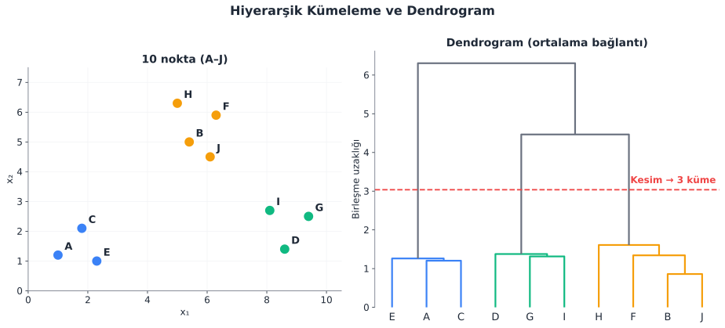

Dendrogramın en büyük avantajı **k'nın önceden belirlenmesine gerek olmamasıdır.** Ağaç istenen yükseklikten yatay olarak "kesilir"; kesim çizgisinin kestiği dikey çizgi sayısı küme sayısını verir. Dezavantajı ise maliyettir. Tüm nokta çiftleri arasındaki uzaklık matrisi $O(n^2)$ bellek, klasik algoritma ise $O(n^2)$ ile $O(n^3)$ arası zaman gerektirir. 100.000 nokta için uzaklık matrisinin yalnızca üst üçgeni bile yaklaşık 40 GB yer tutar (float64). Bu yüzden klasik hiyerarşik kümeleme büyük veriye doğrudan uygulanamaz.

### 9.4 DBSCAN: Yoğunluk Tabanlı Kümeleme

**DBSCAN (Density-Based Spatial Clustering of Applications with Noise)** kümeleri, **seyrek bölgelerle birbirinden ayrılmış yoğun bölgeler** olarak tanımlar. İki parametresi vardır: komşuluk yarıçapı **ε (eps)** ve bir noktanın çekirdek sayılması için gereken minimum komşu sayısı **minPts**.

Noktalar üç türe ayrılır:

* **Çekirdek nokta (core):** ε yarıçapında en az minPts nokta (kendisi dahil) bulunan nokta.
* **Sınır noktası (border):** Çekirdek değildir, ama bir çekirdek noktanın ε komşuluğundadır.
* **Gürültü (noise):** Ne çekirdek ne sınır olan nokta. Bunlar aykırı değer olarak etiketlenir.

Birbirinin ε komşuluğundaki çekirdek noktalar zincirleme olarak aynı kümeye bağlanır; sınır noktaları da bu kümelere katılır.

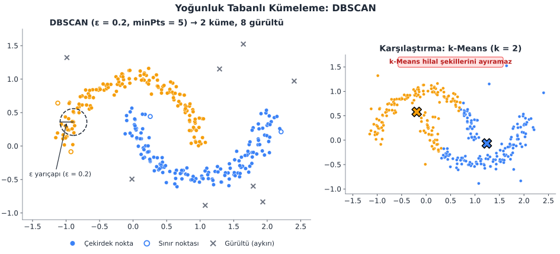

Şekildeki veri iki hilal ve bunlara eklenmiş 15 rastgele noktadan oluşur (toplam 315 nokta). DBSCAN (ε = 0.2, minPts = 5) iki hilali **2 ayrı küme** olarak doğru biçimde bulur ve **8 noktayı gürültü** olarak ayırır. Rastgele noktaların diğer 7'si hilallerin içine düştüğü için kümelere katılmıştır. Yandaki panelde aynı veriye uygulanan k-Means (k = 2) ise hilalleri ortadan düz bir çizgiyle böler.

**Güçlü yönleri:** k'yı önceden bilmek gerekmez. **Keyfi şekilli** kümeleri bulabilir (k-Means'in ayıramadığı hilal biçimli kümeler gibi). Gürültüyü doğal olarak ayıklar.

**Zayıf yönleri:** ε ve minPts seçimi hassastır. **Yoğunluğu farklı** kümeleri aynı anda bulmakta zorlanır (OPTICS bu sorunu hafifletir). Yüksek boyutta uzaklıklar anlamını yitirdiğinden başarımı düşer.

### 9.5 Kümeleme Değerlendirmesi: Siluet Skoru

Etiket olmadığı için kümelemeyi değerlendirmek sınıflandırmadan daha zordur. Yaygın bir **iç (intrinsic)** ölçüt, her nokta için hesaplanan **siluet katsayısıdır (silhouette coefficient)**:

```math
s(i) = \frac{b(i) - a(i)}{\max\{a(i),\, b(i)\}}
```

```math
\underbrace{s(i)}_{\substack{\text{i. noktanın}\\\text{siluet değeri}}} = \frac{\overbrace{b(i)}^{\substack{\text{en yakın diğer}\\\text{kümeye uzaklık}}} - \overbrace{a(i)}^{\substack{\text{kendi kümesine}\\\text{uzaklık}}}}{\underbrace{\max\{a(i),\, b(i)\}}_{\substack{\text{ikisinden büyüğü: sonucu}\\\text{-1 ile +1 arasına sıkıştırır}}}}
```

**Nasıl okunur?** "s i eşittir, b i eksi a i, bölü a i ile b i'nin büyüğü." Örnek: a(i) = 2 ve b(i) = 8 ise s = (8 − 2) / 8 = **0.75**; nokta doğru kümededir. Tersine a(i) = 8 ve b(i) = 2 ise s = (2 − 8) / 8 = **−0.75**; nokta komşu kümeye daha yakındır.

* $a(i)$: Noktanın **kendi kümesindeki** diğer noktalara ortalama uzaklığı (ne kadar sıkı?).
* $b(i)$: Noktanın **en yakın diğer kümedeki** noktalara ortalama uzaklığı (ne kadar ayrık?).

$s(i)$, −1 ile +1 arasında değer alır. +1'e yakın değer, noktanın doğru kümede ve diğer kümelerden uzak olduğunu gösterir. 0 civarı, iki kümenin sınırında olduğunu; negatif değer ise muhtemelen yanlış kümeye atandığını gösterir. Tüm noktaların ortalama siluet değeri, kümelemenin genel kalitesini özetler ve **en uygun k'yı seçmek** için kullanılabilir.

Gerçek etiketler biliniyorsa (ör. algoritma karşılaştırması yaparken), **Düzeltilmiş Rand İndeksi (ARI)** ve **Normalleştirilmiş Karşılıklı Bilgi (NMI)** gibi **dış (extrinsic)** ölçütler de kullanılabilir.

**Python ile siluet skoru ve DBSCAN / k-Means karşılaştırması:**

```python
from sklearn.cluster import DBSCAN, KMeans
from sklearn.datasets import make_blobs, make_moons
from sklearn.metrics import adjusted_rand_score, silhouette_score

# 1) En uygun k'yı siluet skoru ile seçme
X, _ = make_blobs(n_samples=500, centers=4, cluster_std=0.9, random_state=42)
for k in range(2, 8):
    etiket = KMeans(n_clusters=k, n_init=10, random_state=42).fit_predict(X)
    print(f"k={k}  siluet={silhouette_score(X, etiket):.3f}")

# 2) Hilal biçimli kümeler: k-Means ve DBSCAN
X, y = make_moons(n_samples=300, noise=0.07, random_state=42)
km = KMeans(n_clusters=2, n_init=10, random_state=42).fit_predict(X)
db = DBSCAN(eps=0.2, min_samples=5).fit_predict(X)
print(f"\nk-Means: siluet = {silhouette_score(X, km):.3f}   ARI = {adjusted_rand_score(y, km):.3f}")
print(f"DBSCAN : siluet = {silhouette_score(X, db):.3f}   ARI = {adjusted_rand_score(y, db):.3f}")
print("DBSCAN küme sayısı:", len(set(db)) - (1 if -1 in db else 0),
      "| gürültü noktası:", (db == -1).sum())
```

İlk döngüde siluet skoru en yüksek değerini (0.812) gerçek küme sayısı olan **k = 4**'te alır. İkinci kısım ise önemli bir dersi gösterir: Siluet skoru küresel kümeleri ödüllendirir. Bu yüzden hilal biçimli veride k-Means'e (0.485) DBSCAN'den (0.329) *daha yüksek* siluet skoru verir. Oysa gerçek etiketlere göre DBSCAN kusursuzdur (ARI = 1.000), k-Means ise hilalleri ayıramaz (ARI = 0.254). **Hiçbir değerlendirme ölçütü her duruma uygun değildir.**

***

## 10. Aykırı Değer Tespiti

### 10.1 Aykırı Değer Nedir?

Hawkins'in klasik tanımıyla **aykırı değer (outlier)**, *"diğer gözlemlerden o kadar farklıdır ki, farklı bir mekanizma tarafından üretildiği şüphesini uyandırır."* Aykırı değerler iki farklı gözle görülebilir:

* **Temizlenmesi gereken gürültü:** Ölçüm veya veri girişi hatası (yaş = 250). Bölüm 4'te bu açıdan ele aldık.
* **Asıl aranan bilgi:** Kredi kartı sahtekârlığı, ağ saldırısı, makine arızasının erken belirtisi, yeni bir hastalık türü. Bu durumda "aykırı değer" madenciliğin *hedefidir*. Buna **anomali tespiti (anomaly detection)** de denir.

Han ve arkadaşları aykırı değerleri üç türe ayırır:

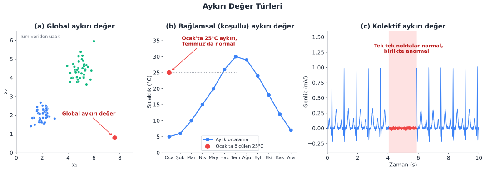

1. **Global (nokta) aykırı değer:** Verinin geri kalanından açıkça sapan tek bir gözlem. Ortalama harcaması 500 TL olan bir müşterinin kartından 80.000 TL'lik işlem yapılması buna örnektir.
2. **Bağlamsal (koşullu) aykırı değer:** Değer kendi başına olağan, ama **bağlamına** göre anormaldir. 25 °C Temmuz'da sıradan, Ocak'ta ise aykırıdır. Bağlam genellikle zaman veya konumdur.
3. **Kolektif aykırı değer:** Tek tek bakıldığında normal olan gözlemlerin **bir arada** anormal bir örüntü oluşturması. Bir EKG sinyalinde kısa bir süreliğine düz çizgi görülmesi, ya da bir ağda çok sayıda bilgisayarın aynı anda aynı sunucuya bağlanması (DDoS saldırısı) buna örnektir.

### 10.2 Tespit Yöntemleri

Etiketli veri varsa aykırı değer tespiti bir sınıflandırma problemine dönüşür. Ancak aykırı değerler doğası gereği nadirdir ve etiketli örnek bulmak zordur. Bu yüzden çoğunlukla **denetimsiz** yöntemler kullanılır:

**İstatistiksel (model tabanlı) yöntemler.** Normal verinin bir olasılık dağılımına uyduğu varsayılır. Bu modele göre olasılığı çok düşük kalan noktalar aykırıdır.

* **Z-skor kuralı:** $|z| = |x - \mu| / \sigma > 3$ olan noktalar aykırıdır (normal dağılımda verinin %99.7'si ±3σ içindedir).
* **IQR kuralı (Tukey):** Kutu grafiğindeki bıyıkların dışı. Dağılım varsayımı yapmaz, aykırı değerlere dayanıklıdır (bkz. Bölüm 3.2).
* **Çok değişkenli:** Mahalanobis uzaklığı, Gauss karışım modelleri.

**Yakınlık tabanlı yöntemler.** Bir noktanın komşularından ne kadar uzak olduğuna bakılır.

* **Uzaklık tabanlı:** k. en yakın komşusuna uzaklığı çok büyük olan noktalar aykırıdır.
* **Yoğunluk tabanlı — LOF (Local Outlier Factor):** Bir noktanın yerel yoğunluğu, komşularının yoğunluğuyla karşılaştırılır. Böylece farklı yoğunluktaki kümelerin bulunduğu verilerde de doğru sonuç verir. LOF ≈ 1 normal, LOF ≫ 1 aykırı demektir.

**Kümeleme tabanlı yöntemler.** Hiçbir kümeye ait olmayan (DBSCAN'in gürültü noktaları) veya çok küçük/seyrek kümelerde kalan noktalar aykırı kabul edilir.

**Ağaç tabanlı yöntemler — Isolation Forest.** Fikir zekicedir: Aykırı değerler "az ve farklı" olduğu için rastgele bölmelerle **çok daha çabuk izole edilir.** Rastgele ağaçlarda köke yakın (kısa yolda) izole edilen noktalar aykırı sayılır. Hızlıdır ve büyük, yüksek boyutlu veriye iyi ölçeklenir.

> **Yüksek boyut sorunu:** Boyut sayısı arttıkça tüm noktalar arasındaki uzaklıklar birbirine benzemeye başlar ve "en yakın" ile "en uzak" komşu arasındaki fark kaybolur. Bu durum uzaklık tabanlı aykırı değer tespitini zorlaştırır (bkz. Bölüm 11.3).

***

## 11. Veri Madenciliğinde İleri Konular

Önceki bölümlerde temel görevleri ve algoritmaları gördük. Bu bölümde, gerçek dünya problemlerinde karşılaşılan ve dersin "ileri konular" kısmını oluşturan yaklaşımları ele alacağız.

### 11.1 Topluluk Öğrenme (Ensemble Learning)

Bir televizyon yarışmasında "seyirciye sorma" jokeri çoğu zaman tek bir uzmana sormaktan daha isabetlidir. Birbirinden bağımsız hata yapan çok sayıda "orta karar" kişinin oy çokluğu, çoğu zaman tek bir kişiden daha doğrudur. Buna **kalabalığın bilgeliği** denir. **Topluluk öğrenme**, aynı fikri modellere uygular: Birden fazla modelin tahminleri birleştirilerek tek bir modelden daha doğru ve daha kararlı bir tahmin elde edilir.

Topluluğun işe yaraması için iki koşul gerekir: Temel modeller **rastgele tahminden daha iyi** olmalı ve **birbirinden farklı (çeşitli)** hatalar yapmalıdır. Aynı hatayı yapan 100 modeli oylatmak hiçbir şey kazandırmaz.

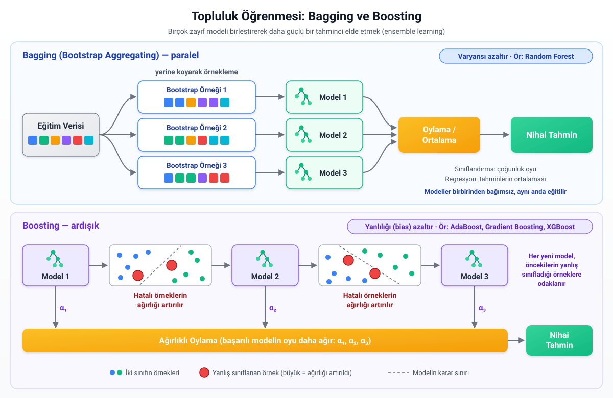

**Bagging (Bootstrap Aggregating).** Eğitim verisinden **yerine koyarak** örnekleme (bootstrap) ile çok sayıda farklı eğitim kümesi üretilir. Her biriyle ayrı bir model eğitilir; sınıflandırmada oylama, regresyonda ortalama ile sonuç birleştirilir. Modeller birbirinden bağımsızdır, bu yüzden **paralel** eğitilebilir. Bagging özellikle **varyansı** yüksek, kararsız modellerde (derin karar ağaçları) büyük iyileşme sağlar.

**Random Forest (Rastgele Orman).** Bagging'in karar ağaçlarına özel, güçlendirilmiş hâlidir. Her ağaç bir bootstrap örneğiyle eğitilir. Ek olarak, her düğümde bölme için niteliklerin yalnızca **rastgele bir alt kümesi** değerlendirilir (genellikle $\sqrt{p}$ tanesi). Bu ek rastgelelik ağaçlar arasındaki korelasyonu azaltır ve topluluğun çeşitliliğini artırır. Random Forest az ayar gerektirir, aşırı öğrenmeye dayanıklıdır ve nitelik önem skorları üretir. Bu yüzden tablo verilerinde en güvenilir "ilk deneme" modellerinden biridir.

**Boosting.** Modeller **ardışık** olarak eğitilir. Her yeni model, öncekilerin **hata yaptığı örneklere** odaklanır. Zayıf öğrenicilerden (ör. tek bölmeli karar kütükleri) güçlü bir öğrenici inşa edilir ve öncelikle **yanlılık** azaltılır.

* **AdaBoost:** Yanlış sınıflanan örneklerin ağırlığını artırır. Son karar, başarılı modellere daha çok söz hakkı veren ağırlıklı oylamayla alınır.
* **Gradient Boosting:** Her yeni model, önceki topluluğun **artıklarını (residuals)**, yani hata fonksiyonunun gradyanını tahmin etmeye çalışır.
* **XGBoost, LightGBM, CatBoost:** Gradient boosting'in düzenlileştirilmiş, paralelleştirilmiş, büyük veriye optimize edilmiş uygulamalarıdır. Yapılandırılmış (tablo) veri yarışmalarında uzun yıllardır en başarılı yöntemler arasındadır.

**Stacking (Yığınlama).** Farklı türdeki modellerin (ör. ağaç, SVM, k-NN) tahminleri, bir **üst model (meta-learner)** için girdi olarak kullanılır. Üst model, hangi temel modele ne zaman güveneceğini öğrenir.

| | Bagging / Random Forest | Boosting |
|---|---|---|
| Eğitim | Paralel, bağımsız | Ardışık, bağımlı |
| Öncelikle azalttığı | Varyans | Yanlılık |
| Temel model | Güçlü, kararsız (derin ağaç) | Zayıf (sığ ağaç) |
| Aşırı öğrenme riski | Düşük | Daha yüksek (öğrenme oranı ve iterasyon ayarı gerekir) |
| Dağıtık ortam | Çok uygun (her ağaç ayrı düğümde) | Daha zor (ama XGBoost/LightGBM dağıtık çalışabilir) |

**Python ile tek ağaç ve topluluk yöntemlerinin karşılaştırılması:**

```python
from sklearn.datasets import load_breast_cancer
from sklearn.ensemble import (AdaBoostClassifier, GradientBoostingClassifier,
                              RandomForestClassifier)
from sklearn.model_selection import StratifiedKFold, cross_val_score
from sklearn.tree import DecisionTreeClassifier

X, y = load_breast_cancer(return_X_y=True)
cv = StratifiedKFold(n_splits=5, shuffle=True, random_state=42)

modeller = {
    "Tek karar ağacı":   DecisionTreeClassifier(random_state=42),
    "Random Forest":     RandomForestClassifier(n_estimators=300, random_state=42),
    "AdaBoost":          AdaBoostClassifier(n_estimators=300, random_state=42),
    "Gradient Boosting": GradientBoostingClassifier(random_state=42),
}
for ad, model in modeller.items():
    skor = cross_val_score(model, X, y, cv=cv, scoring="roc_auc")
    print(f"{ad:18s} AUC = {skor.mean():.3f} ± {skor.std():.3f}")
```

Çıktıda topluluk yöntemlerinin tek ağaca göre hem daha yüksek ortalama başarım hem de daha düşük standart sapma (daha kararlı sonuç) verdiği görülür.

### 11.2 Dengesiz Veri Setleri

Gerçek hayatta ilginç olan sınıf çoğunlukla **nadirdir**: Sahtekârlık işlemlerin %0.1'i, arızalı ürünler üretimin %0.5'i, nadir hastalıklar popülasyonun binde biri olabilir. Bölüm 8.2'deki *doğruluk paradoksu* burada ciddi bir sorun hâline gelir. Model, çoğunluk sınıfını tahmin ederek yüksek doğruluk elde eder ve azınlık sınıfını öğrenmez.

**Çözüm yaklaşımları:**

1. **Doğru metriği kullanmak:** Doğruluk yerine duyarlılık, F1, Kesinlik–Duyarlılık eğrisi, PR-AUC.
2. **Veri düzeyi (yeniden örnekleme):**
   * **Alt örnekleme (undersampling):** Çoğunluk sınıfından örnek atılır. Hızlıdır ama bilgi kaybına yol açar.
   * **Üst örnekleme (oversampling):** Azınlık sınıfı çoğaltılır. Basit kopyalama aşırı öğrenmeye yol açabilir.
   * **SMOTE (Synthetic Minority Over-sampling Technique):** Azınlık örneklerini kopyalamak yerine, bir azınlık örneği ile onun azınlık sınıfındaki komşuları arasındaki doğru parçası üzerinde **yapay yeni örnekler** üretir.
3. **Algoritma düzeyi:**
   * **Maliyet duyarlı öğrenme:** Azınlık sınıfındaki hataya daha yüksek ceza verilir (sklearn'de `class_weight="balanced"`).
   * **Eşik ayarı:** Karar eşiği 0.5 yerine iş ihtiyacına göre seçilir.
   * Dengeli örneklerle eğitilen topluluk yöntemleri (Balanced Random Forest, EasyEnsemble).

> **Kritik uyarı:** Yeniden örnekleme **yalnızca eğitim verisine**, çapraz doğrulamada **her katın içinde ayrı ayrı** uygulanmalıdır. Örnekleme bölmeden önce yapılırsa, test kümesine eğitimdeki örneklerin yapay kopyaları sızar ve sonuçlar gerçekdışı derecede iyi çıkar. `imbalanced-learn` kütüphanesinin `Pipeline` sınıfı bunu otomatik olarak doğru yapar.

```python
from imblearn.over_sampling import SMOTE
from imblearn.pipeline import Pipeline
from sklearn.datasets import make_classification
from sklearn.ensemble import RandomForestClassifier
from sklearn.model_selection import StratifiedKFold, cross_val_score

# %2 azınlık sınıfı içeren yapay veri
X, y = make_classification(n_samples=5000, n_features=20, weights=[0.98],
                           flip_y=0, random_state=42)
cv = StratifiedKFold(n_splits=5, shuffle=True, random_state=42)

duz   = RandomForestClassifier(random_state=42)
smote = Pipeline([("smote", SMOTE(random_state=42)),
                  ("rf", RandomForestClassifier(random_state=42))])

for ad, model in [("Düz RF", duz), ("SMOTE + RF", smote)]:
    f1 = cross_val_score(model, X, y, cv=cv, scoring="f1").mean()
    rec = cross_val_score(model, X, y, cv=cv, scoring="recall").mean()
    print(f"{ad:11s} F1 = {f1:.3f}   Duyarlılık = {rec:.3f}")
```

Bu örnekte SMOTE, azınlık sınıfını yakalama oranını (duyarlılık) belirgin biçimde artırır (yaklaşık 0.29 → 0.44). Buna karşılık daha fazla yanlış alarm ürettiği için F1 skoru biraz düşer. SMOTE sihirli bir değnek değildir; asıl yaptığı, kesinlik–duyarlılık dengesini azınlık sınıfı lehine kaydırmaktır. Hangi dengenin doğru olduğuna, Bölüm 8.2'de tartıştığımız gibi, hataların iş maliyeti karar verir.

### 11.3 Yüksek Boyutlu Veri ve Boyutun Laneti

Metin (on binlerce kelime), gen ifadesi (on binlerce gen) ya da tıklama verisi gibi alanlarda nitelik sayısı yüzlerle on binler arasındadır. Boyut arttıkça sezgilerimiz bozulur. Bellman'ın deyişiyle bu duruma **boyutun laneti (curse of dimensionality)** denir:

* **Veri seyrekleşir:** Bir birim küpün her kenarını 10 parçaya bölersek, 2 boyutta 100, 10 boyutta $10^{10}$ hücre elde ederiz. Aynı yoğunluğu korumak için gereken veri miktarı boyutla **üstel** olarak artar.
* **Uzaklıklar anlamını yitirir:** Yüksek boyutta bir noktanın en yakın ve en uzak komşusuna olan uzaklıkları birbirine yaklaşır. "En yakın komşu" kavramı ayırt ediciliğini kaybeder. k-NN, k-Means, DBSCAN ve uzaklık tabanlı aykırı değer yöntemlerinin hepsi bundan etkilenir.
* **Aşırı öğrenme riski artar:** Nitelik sayısı örnek sayısına yaklaştıkça model, tesadüfi korelasyonları gerçek örüntü sanabilir.

**Çözümler:** özellik seçimi, PCA gibi boyut indirgeme (Bölüm 4.4), seyrek veriye uygun modeller (doğrusal modeller, Naive Bayes), düzenlileştirme ve **alt uzay kümeleme (subspace clustering)**. Alt uzay kümelemede kümeler tüm boyutlarda değil, boyutların bir alt kümesinde aranır (CLIQUE, PROCLUS).

### 11.4 Yarı Denetimli Öğrenme

Etiketli veri pahalıdır. Bir radyoloğun binlerce röntgeni tek tek etiketlemesi haftalar sürer. Oysa etiketsiz veri bol ve ucuzdur. **Yarı denetimli öğrenme (semi-supervised learning)**, az sayıda etiketli örneği çok sayıda etiketsiz örnekle birlikte kullanarak modeli iyileştirir:

* **Kendi kendine eğitim (self-training):** Model etiketli veriyle eğitilir. Etiketsiz veride **en emin olduğu** tahminleri "sözde etiket (pseudo-label)" olarak eğitim kümesine ekler ve tekrar eğitilir.
* **Ortak eğitim (co-training):** Veri iki farklı "görünümle" temsil edilir (ör. bir web sayfasının metni ve ona gelen bağlantıların metni). Her görünümde eğitilen model, diğeri için etiket üretir.
* **Etiket yayılımı (label propagation):** Benzer örneklerin aynı etikete sahip olması gerektiği varsayımıyla etiketler bir benzerlik grafı üzerinde yayılır.

İlgili bir yaklaşım da **aktif öğrenmedir (active learning)**. Model, insan uzmandan **en çok bilgi kazandıracak** örnekleri, yani genellikle en emin olmadığı örnekleri etiketlemesini ister. Böylece etiketleme bütçesi en verimli şekilde kullanılır.

### 11.5 Metin, Web ve Graf Madenciliği

Kurumsal verinin büyük çoğunluğu (sıkça %80 olarak dile getirilir) **yapılandırılmamış** verilerdir: e-postalar, raporlar, müşteri yorumları, sosyal medya. Bu tür veriler, Bölüm 1.4'te saydığımız "karmaşık veri türleri" içinde en yaygın olanlardır.

**Metin madenciliği (text mining).** Metni algoritmaların işleyebileceği sayısal bir temsile dönüştürmekle başlar:

1. **Ön işleme:** Küçük harfe çevirme, noktalama temizliği, **belirteçleme (tokenization)**, **durak kelimelerin** (ve, ile, bu…) çıkarılması, **kök/gövde bulma (stemming / lemmatization)**. Türkçe gibi eklemeli dillerde gövde bulma özellikle önemlidir ("kitaplarımızdan" → "kitap"); bunun için Zemberek gibi araçlar kullanılır.
2. **Temsil — kelime torbası (bag of words):** Her belge, kelime frekanslarından oluşan (çok seyrek) bir vektör olur. Kelime sırası kaybolur.
3. **TF-IDF ağırlıklandırma:** Her kelimenin ağırlığı, belgedeki sıklığı (TF) ile tüm koleksiyondaki nadirliğinin (IDF) çarpımıdır. Her belgede geçen "ve" kelimesi düşük, yalnızca birkaç belgede sık geçen "Hadoop" kelimesi yüksek ağırlık alır.

$$\text{tf-idf}(t, d) = \text{tf}(t, d) \times \log \frac{N}{\text{df}(t)}$$

```math
\underbrace{\text{tf-idf}(t, d)}_{\substack{\text{t kelimesinin}\\\text{d belgesindeki ağırlığı}}} = \underbrace{\text{tf}(t, d)}_{\substack{\text{t, d'de kaç kez}\\\text{geçiyor?}}} \times \underbrace{\log \frac{\overbrace{N}^{\text{toplam belge sayısı}}}{\text{df}(t)}}_{\substack{\text{idf: t ne kadar nadir?}\\\text{df(t): t'yi içeren belge sayısı}}}
```

**Nasıl okunur?** "t'nin d'deki tf-idf değeri eşittir, t'nin d'deki terim frekansı çarpı log N bölü t'nin belge frekansı." 1000 belgelik bir koleksiyonda (10 tabanında logaritma ile) her belgede geçen "ve" için idf = log(1000/1000) = **0**, yalnızca 10 belgede geçen "Hadoop" için idf = log(1000/10) = **2** olur.

4. **Madencilik:** Belge sınıflandırma (spam, duygu analizi), belge kümeleme, konu modelleme (LDA), varlık ismi tanıma. Belgeler arası benzerlikte **kosinüs benzerliği** kullanılır (Bölüm 3.4).

Günümüzde kelime torbasının yerini büyük ölçüde **kelime gömmeleri (word embeddings — Word2Vec, GloVe)** ve **dönüştürücü (transformer)** tabanlı dil modelleri (BERT vb.) almıştır. Bu temsiller kelimelerin anlamını ve bağlamını yoğun vektörlerle yakalar.

**Web madenciliği** üç alt alana ayrılır:

* **Web içerik madenciliği:** Sayfa metinlerinin ve çoklu ortam içeriğinin analizi (metin madenciliğinin web'e uygulanması).
* **Web yapı madenciliği:** Sayfalar arası bağlantıların analizi. Google'ın **PageRank** algoritması bunun en ünlü örneğidir: *Önemli sayfalardan bağlantı alan sayfa önemlidir.* PageRank, MapReduce'un ilk "öldürücü uygulamalarından" biridir.
* **Web kullanım madenciliği:** Sunucu loglarından ve tıklama akışlarından kullanıcı davranışının analizi (oturum analizi, öneri sistemleri).

**Graf ve sosyal ağ madenciliği.** Sosyal ağlar, protein etkileşimleri, ulaşım ağları ve bilgi grafları gibi veriler **düğümler** ve **kenarlar** ile temsil edilir. Başlıca görevler:

* **Merkezilik analizi:** En etkili kişiyi bulmak (derece, arasındalık ve PageRank merkeziliği).
* **Topluluk tespiti (community detection):** Ağ içinde birbirine yoğun bağlı grupları bulmak; grafların kümelemesi.
* **Bağlantı tahmini (link prediction):** "Tanıyor olabileceğiniz kişiler" önerisi.
* **Sık alt graf madenciliği:** Kimyasal bileşiklerde tekrarlayan yapısal motifler.

Milyarlarca düğümlü graflar tek makineye sığmaz. Bu ölçekte Spark'ın **GraphX** kütüphanesi gibi dağıtık graf işleme sistemleri kullanılır.

### 11.6 Veri Akışı Madenciliği ve Kavram Kayması

Klasik veri madenciliği, verinin tamamının diskte durduğunu ve istediğimiz kadar tekrar okunabileceğini varsayar. **Veri akışlarında (data streams)** ise durum farklıdır. Sensörler, borsa işlemleri, ağ trafiği ve tıklama akışları **sürekli, hızlı ve potansiyel olarak sonsuzdur.** Bu, Büyük Veri'nin **Hız (Velocity)** boyutudur.

Witten ve arkadaşlarına göre akış madenciliği algoritmaları şu kısıtlara uymalıdır:

* Her örneği **en fazla bir kez** görebilir (tek geçiş). Veri saklanamayacak kadar hızlı ve büyüktür.
* **Sınırlı bellek** kullanmalıdır; veri büyüse de bellek sabit kalmalıdır.
* Örnek başına **sınırlı zaman** harcamalıdır. Akıştan geri kalmamalıdır.
* **Her an kullanılabilir** bir model sunmalıdır (anytime).

Bu kısıtlar altında **artımlı (incremental / online)** algoritmalar kullanılır. Örneğin **Hoeffding ağacı (VFDT)**, bir düğümde bölme kararı vermek için yeterli sayıda örnek görüp görmediğini Hoeffding sınırıyla istatistiksel olarak belirler ve ağacı akış üzerinde büyütür. Akış üzerinde yaklaşık sayma ve özetleme için **kayan pencereler (sliding windows)**, **rezervuar örnekleme**, **Bloom filtresi** ve **Count-Min Sketch** gibi veri yapıları kullanılır.

**Kavram kayması (concept drift).** Akış verisinin en sinsi sorunu, verinin altındaki ilişkinin **zamanla değişmesidir.** Pandemi döneminde alışveriş alışkanlıkları bir gecede değişti; dolandırıcılar yakalandıkça yöntem değiştirir; bir sensör yaşlandıkça ölçümleri kayar. Dün mükemmel çalışan bir model bugün sessizce başarısız olabilir.

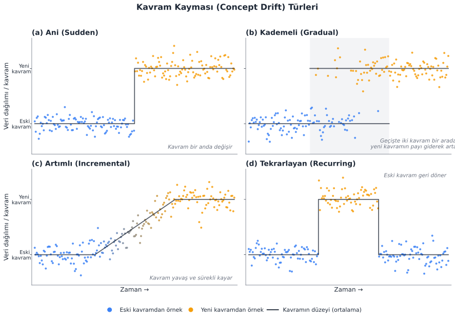

| Tür | Açıklama | Örnek |
|---|---|---|
| **Ani (sudden)** | Kavram bir anda değişir | Yeni bir yasal düzenleme, pandemi |
| **Kademeli (gradual)** | Eski ve yeni kavram bir süre karışık görülür, yeni kavram giderek baskın olur | Kullanıcıların yeni bir ürüne geçişi |
| **Artımlı (incremental)** | Kavram yavaş ve sürekli kayar | Sensör aşınması, enflasyon |
| **Tekrarlayan (recurring)** | Eski kavram periyodik olarak geri döner | Mevsimsel alışveriş örüntüleri |

**Kayma ile başa çıkma:** Modelin hata oranını izleyen **kayma dedektörleri** (DDM, ADWIN), yalnızca son verilerle eğitim (kayan pencere), eski örneklere azalan ağırlık verme ve farklı dönemlerde eğitilmiş modellerden oluşan **uyarlanabilir topluluklar** kullanılır. Üretimdeki her model için bu izleme **MLOps** süreçlerinin ayrılmaz bir parçasıdır. CRISP-DM'in "Dağıtım" aşaması (Bölüm 2.2) bu yüzden bir son değil, sürekli bir döngüdür.

### 11.7 Derin Öğrenmeye Köprü

**Derin öğrenme (deep learning)**, çok sayıda gizli katmana sahip yapay sinir ağlarıyla öğrenmedir. Klasik veri madenciliğinden en önemli farkı **temsil öğrenmesidir (representation learning)**. Klasik yaklaşımda iyi nitelikleri (feature) uzmanlar elle tasarlar: kenar dedektörleri, TF-IDF ağırlıkları, istatistiksel özetler. Derin ağlar ise uygun temsilleri doğrudan ham veriden, katman katman öğrenir. Örneğin bir görüntü ağında ilk katmanlar kenarları, orta katmanlar dokuları ve parçaları, son katmanlar nesneleri temsil eder.

| Mimari | Uygun veri | Tipik görev |
|---|---|---|
| **İleri beslemeli ağ (MLP)** | Tablo verisi | Sınıflandırma, regresyon |
| **Evrişimli sinir ağı (CNN)** | Görüntü, uzamsal veri | Nesne tanıma, tıbbi görüntü analizi |
| **Tekrarlayan ağ (RNN, LSTM)** | Diziler, zaman serileri | Zaman serisi tahmini, konuşma |
| **Dönüştürücü (Transformer)** | Metin, diziler, artık görüntü de | Dil modelleri, çeviri, özetleme |
| **Otokodlayıcı (Autoencoder)** | Her tür | Boyut indirgeme, anomali tespiti |

Derin öğrenmenin son on yıldaki yükselişinin üç temel nedeni vardır: **büyük veri** (milyonlarca etiketli görüntü, internet ölçeğinde metin), **paralel donanım** (GPU/TPU) ve **algoritmik ilerlemeler** (ReLU, dropout, batch normalization, dikkat mekanizması). Bu üçlü, derin öğrenmeyi büyük veri altyapılarıyla doğrudan ilişkilendirir.

**Ne zaman klasik veri madenciliği, ne zaman derin öğrenme?** Yapılandırılmış tablo verisinde ve orta büyüklükteki veri setlerinde Random Forest ve XGBoost gibi topluluk yöntemleri genellikle derin ağlar kadar iyi, hatta daha iyi sonuç verir. Üstelik daha hızlı, daha ucuz ve daha yorumlanabilirdirler. Derin öğrenme ise görüntü, ses ve metin gibi **yapılandırılmamış ve çok büyük** verilerde açık ara üstündür.

> **Açıklanabilirlik (XAI):** Model karmaşıklaştıkça "Model neden bu kararı verdi?" sorusu önem kazanır. Kredi reddi veya tıbbi teşhis gibi kararlar için yasal düzenlemeler de açıklama talep eder. **SHAP** ve **LIME** gibi yöntemler, karmaşık modellerin tekil tahminlerini niteliklerin katkıları üzerinden açıklamaya çalışır.

***

## 12. Klasik Veri Madenciliğinden Büyük Veriye

Şimdiye kadar gördüğümüz algoritmalar, verinin **tek bir bilgisayarın belleğine sığdığını** zımnen varsayıyordu. Bu bölüm, bu varsayım çöktüğünde ne olduğunu ve Kısım II'deki teknolojilerin bu soruna nasıl cevap verdiğini tartışarak iki kısım arasında köprü kurar.

### 12.1 Algoritmalar Tek Makinede Neden Tıkanır?

**1) Bellek duvarı.** scikit-learn, pandas ve R'nin klasik veri çerçeveleri veriyi **RAM'e** yükler. 16 GB belleği olan bir dizüstü bilgisayar, 50 GB'lık bir CSV dosyasını açamaz. Bazı algoritmaların bellek ihtiyacı veriden bile hızlı büyür: Hiyerarşik kümeleme için uzaklık matrisi $O(n^2)$'dir; 100.000 nokta için yalnızca matrisin üst üçgeni bile yaklaşık 40 GB tutar (Bölüm 9.3).

**2) Disk G/Ç duvarı.** Veri belleğe sığmasa bile diskten okunabilir, ama disk yavaştır. Yaklaşık 200 MB/s okuma hızındaki bir disk düşünelim. **1 TB** veriyi baştan sona *sadece okumak* yaklaşık 5.000 saniye, yani **~83 dakika** sürer. Apriori gibi veriyi defalarca tarayan bir algoritma için bu süre tarama sayısıyla çarpılır. Aynı veriyi **100 diske** bölüp paralel okursak süre **~50 saniyeye** iner. Hadoop'un temel fikri tam olarak budur.

**3) Hesaplama karmaşıklığı.** Algoritmaların zaman maliyeti veri boyutuyla doğrusal artsa bile büyük veride sorun yaratır; doğrusalın üzerinde artanlar ise hızla imkânsız hâle gelir:

| Algoritma | Yaklaşık maliyet | Büyük veride sorun |
|---|---|---|
| k-NN (tek tahmin) | $O(n \cdot p)$ | Her tahminde tüm veri taranır |
| Hiyerarşik kümeleme | $O(n^2)$ bellek, $O(n^2)$–$O(n^3)$ zaman | 10⁶ noktada pratikte imkânsız |
| Apriori | Her seviyede bir tam tarama + aday patlaması | Çok sayıda disk taraması |
| SVM (çekirdekli) | $O(n^2)$–$O(n^3)$ | Milyonlarca örnekte çok yavaş |
| k-Means (iterasyon başına) | $O(n \cdot k \cdot p)$ | Ölçeklenebilir, paralelleştirilebilir |

**Witten ve arkadaşlarına göre büyük veri setlerinden öğrenmenin yolları:**

1. **Örnekleme:** Verinin temsilî bir alt kümesiyle çalışmak. Çoğu zaman yeterlidir, ama nadir örüntüler kaybolabilir.
2. **Artımlı (çevrimiçi) öğrenme:** Veriyi parça parça okuyup modeli güncellemek (Bölüm 11.6; sklearn'de `partial_fit`).
3. **Paralelleştirme ve dağıtık hesaplama:** İşi birçok işlemciye veya makineye bölmek. *Kısım II'nin konusu budur.*

### 12.2 Paralel ve Dağıtık İşleme; Dikey ve Yatay Ölçekleme

Erl ve arkadaşları iki kavramı birbirinden ayırır:

* **Paralel veri işleme:** Büyük bir görev alt görevlere bölünür ve **tek bir makinenin** birden fazla işlemci çekirdeğinde eş zamanlı çalıştırılır. Çekirdekler belleği paylaşır.
* **Dağıtık veri işleme:** Alt görevler, ağ ile birbirine bağlı **birden fazla makinede** çalıştırılır. Her makinenin kendi belleği ve diski vardır; aralarında iletişim ağ üzerinden olur. Bu yaklaşım her zaman böl ve yönet (divide and conquer) ilkesine dayanır.

Bir sistemi büyütmenin iki yolu vardır:

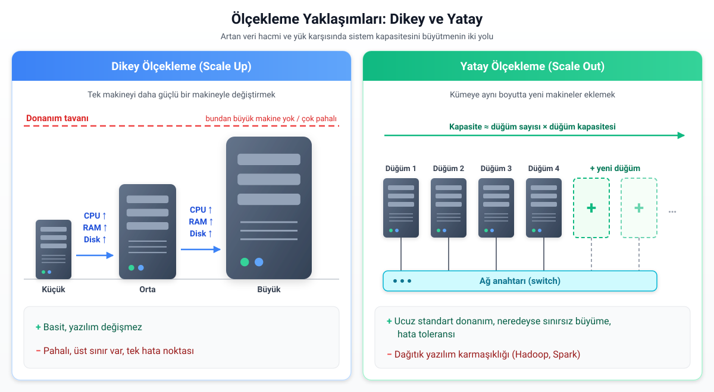

| | Dikey Ölçekleme (Scale Up) | Yatay Ölçekleme (Scale Out) |
|---|---|---|
| Yöntem | Mevcut makineye daha güçlü CPU, daha fazla RAM/disk | Kümeye yeni (standart) makineler eklemek |
| Maliyet | Üst segmentte üstel artar | Yaklaşık doğrusal artar |
| Sınır | Tek makinenin fiziksel sınırı | Pratikte binlerce düğüm |
| Hata toleransı | Tek hata noktası | Bir düğüm çökse de sistem çalışır |
| Yazılım | Değişiklik gerekmez | Dağıtık yazılım gerekir (Hadoop, Spark) |

Büyük veri teknolojileri **yatay ölçeklemeyi** esas alır. Google'ın 2000'lerin başındaki yaklaşımı, pahalı süper bilgisayarlar yerine binlerce ucuz **standart (commodity)** sunucu kullanmak ve donanım arızalarını *istisna değil olağan durum* kabul edip yazılımla tolere etmekti. Bu yaklaşım GFS ve MapReduce makalelerine, onlar da Hadoop'a ilham verdi.

**Hesaplamayı veriye götürmek (data locality).** Dağıtık sistemlerde en pahalı işlem, veriyi ağ üzerinden taşımaktır. 1 TB veriyi işlem sunucusuna taşımak yerine, birkaç kilobaytlık programı verinin bulunduğu düğümlere göndermek çok daha verimlidir. Bu ilke, Kısım II'de göreceğimiz HDFS ve YARN tasarımının merkezindedir.

> **Amdahl Yasası:** Paralelleştirmenin de bir sınırı vardır. Bir programın paralelleştirilemeyen (seri) kısmının oranı $s$ ise, $N$ işlemciyle elde edilebilecek en yüksek hızlanma $\frac{1}{s + (1-s)/N}$ olur. Programın %10'u seri ise, sonsuz işlemciyle bile en fazla **10 kat** hızlanma elde edilir. Bu yüzden MapReduce ve Spark gibi çerçeveler işi, birbirinden bağımsız ve **utanç verici derecede paralel (embarrassingly parallel)** parçalara bölmeye çalışır.

### 12.3 Sharding ve Replikasyon

Veri tek bir makineye sığmıyorsa onu **bölmek**, makineler arızalanabiliyorsa onu **çoğaltmak** gerekir.

**Sharding (yatay bölümleme).** Büyük bir veri seti, satırlar bazında daha küçük parçalara (**shard**) bölünür ve her parça farklı bir düğümde saklanır. Örneğin bir müşteri tablosu soyadının baş harfine göre A–H, I–P ve R–Z diye üç düğüme dağıtılabilir. Böylece hem depolama kapasitesi hem de okuma/yazma yükü düğümlere dağılır. Bölme anahtarının iyi seçilmesi önemlidir; aksi hâlde bazı düğümler aşırı yüklenir (*sıcak nokta — hotspot*). Bu yüzden pratikte çoğunlukla **özet (hash) tabanlı** bölümleme kullanılır.

**Replikasyon (çoğaltma).** Her veri parçasının birden fazla kopyası farklı düğümlerde tutulur. Bir düğüm çöktüğünde veri kopyalardan okunmaya devam eder. Replikasyon ayrıca okuma yükünü kopyalar arasında dağıtarak performansı artırır. İki temel modeli vardır:

* **Ana–yardımcı (master–slave):** Yazmalar ana düğüme yapılır, kopyalara aktarılır. Okumalar her düğümden yapılabilir.
* **Eşler arası (peer-to-peer):** Tüm düğümler eşittir; her biri okuma ve yazma kabul eder. Daha erişilebilirdir, ama tutarlılık sorunları doğurabilir.

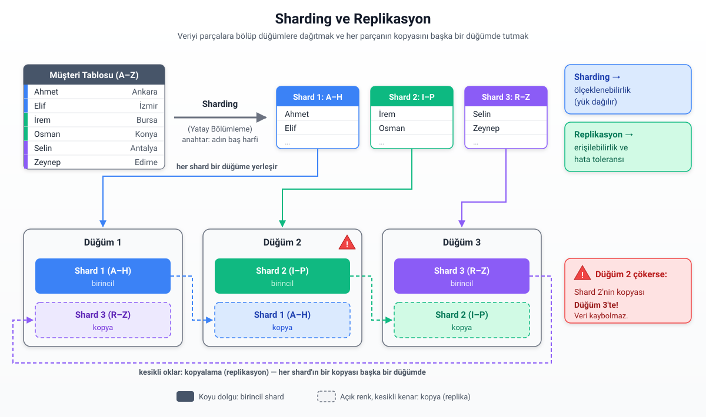

Gerçek sistemler ikisini birlikte kullanır: Veri önce shard'lara bölünür, sonra her shard çoğaltılır. **HDFS** de dosyaları 128 MB'lık bloklara böler (bir tür sharding) ve her bloğu varsayılan olarak **3 kopya** hâlinde farklı düğümlerde saklar (replikasyon). Kısım II'de bu yapıyı ayrıntılı göreceğiz.

### 12.4 CAP Teoremi; ACID ve BASE

Veriyi birden fazla düğümde tutmanın bedava olmayan bir sonucu vardır. Eric Brewer'ın **CAP teoremine** göre dağıtık bir veri sistemi aşağıdaki üç özellikten **en fazla ikisini aynı anda** garanti edebilir:

* **C — Tutarlılık (Consistency):** Her okuma, en son yapılan yazmayı görür. Tüm düğümler aynı anda aynı veriyi gösterir.
* **A — Erişilebilirlik (Availability):** Çalışan her düğüme gelen her istek (hata değil) bir yanıt alır.
* **P — Bölünme toleransı (Partition tolerance):** Düğümler arasındaki ağ bağlantısı koptuğunda (bölünme) sistem çalışmaya devam eder.

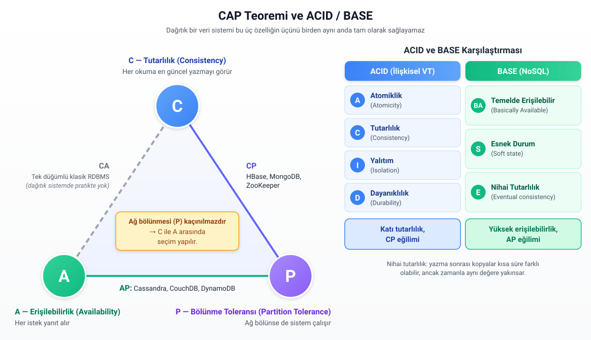

Dağıtık bir sistemde ağ arızaları kaçınılmazdır, bu yüzden **P'den vazgeçilemez.** Asıl seçim, bir bölünme anında **tutarlılık ile erişilebilirlik arasındadır**:

* **CP sistemler** (HBase, MongoDB, ZooKeeper): Bölünme sırasında tutarsız veri döndürmektense bazı isteklere yanıt vermemeyi tercih eder. *Bankacılık bakiyesi* gibi verilerde uygundur.
* **AP sistemler** (Cassandra, CouchDB, DynamoDB): Her isteğe yanıt verir, ama bazı düğümler geçici olarak eski veri döndürebilir. *Sosyal medya beğeni sayısı* gibi verilerde uygundur.

**ACID ve BASE.** Bu seçim, iki farklı veritabanı felsefesine karşılık gelir:

| ACID (ilişkisel veritabanları) | BASE (çoğu NoSQL sistemi) |
|---|---|
| **A**tomiklik: İşlem ya tamamen yapılır ya hiç yapılmaz | **B**asically **A**vailable: Sistem temelde her zaman yanıt verir |
| **C**onsistency: Her işlem veritabanını geçerli bir durumdan geçerli bir duruma taşır | **S**oft state: Durum, yeni yazma olmasa da (kopyalar eşitlenirken) değişebilir |
| **I**solation: Eşzamanlı işlemler birbirini etkilemez | **E**ventual consistency: Yeni yazma gelmezse tüm kopyalar *sonunda* tutarlı hâle gelir |
| **D**urability: Onaylanan işlem kalıcıdır | |
| Katı tutarlılık → **CP** eğilimi | Yüksek erişilebilirlik → **AP** eğilimi |

### 12.5 NoSQL Veritabanı Türleri

Büyük verinin hacmi ve çeşitliliği, sabit şemalı ilişkisel veritabanlarının sınırlarını zorlayınca **NoSQL ("Not only SQL")** veritabanları ortaya çıktı. Ortak özellikleri şunlardır: esnek veya şemasız yapı, yatay ölçeklenebilirlik, sharding ve replikasyon desteği, çoğunlukla BASE modeli. Dört ana türe ayrılırlar:

| Tür | Veri modeli | Güçlü olduğu yer | Örnekler |
|---|---|---|---|
| **Anahtar–değer** | Anahtar → opak değer (sözlük) | Oturum bilgisi, önbellek, alışveriş sepeti | Redis, Amazon DynamoDB, Riak |
| **Belge** | Anahtar → JSON/BSON belge | İçerik yönetimi, katalog, esnek şemalı kayıtlar | MongoDB, CouchDB |
| **Geniş sütun (column-family)** | Satır anahtarı → değişken sütun aileleri | Çok büyük, seyrek tablolar, zaman serisi | Apache HBase, Cassandra |
| **Graf** | Düğümler, kenarlar, özellikler | İlişkilerin kendisinin önemli olduğu veri | Neo4j, JanusGraph |

Kısım II'de göreceğimiz **HBase**, Google'ın Bigtable'ından esinlenmiş, HDFS üzerinde çalışan geniş sütunlu bir NoSQL veritabanıdır.

NoSQL, ilişkisel veritabanlarının yerini almaz, onları tamamlar. Modern sistemler çoğunlukla **çok dilli kalıcılık (polyglot persistence)** ilkesini izler: Her veri türü için en uygun depolama kullanılır.

### 12.6 Toplu (Batch) ve Gerçek Zamanlı (Stream) İşleme

Erl ve arkadaşları büyük veri işleme iş yüklerini ikiye ayırır:

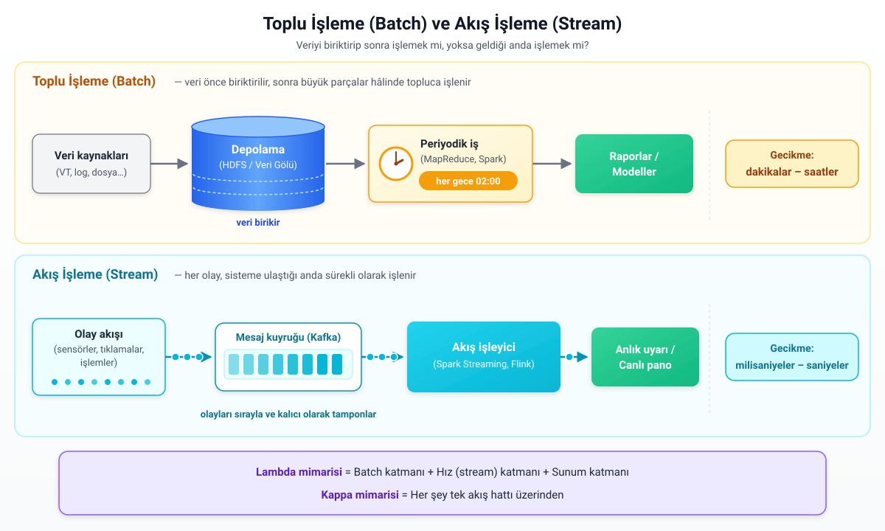

* **Toplu işleme (batch):** Veri bir süre biriktirilir, sonra büyük bloklar hâlinde işlenir. Örnekler: gece çalışan raporlar, haftalık model eğitimi, aylık faturalama. Gecikme dakikalar ile saatler arasındadır, ama çok büyük hacimler verimli şekilde işlenir. **Hadoop MapReduce** bu modelin klasik temsilcisidir. Spark da toplu işlemede yaygın olarak kullanılır.
* **Akış / gerçek zamanlı işleme (stream):** Veri geldiği anda, olay olay ya da küçük mikro-yığınlar hâlinde işlenir. Örnekler: anlık sahtekârlık tespiti, canlı panolar, IoT alarmları. Gecikme milisaniyeler ile saniyeler arasındadır. Tipik araçlar: **Apache Kafka** (mesaj kuyruğu), **Spark Structured Streaming**, **Apache Flink**, **Apache Storm**. Bu işlemenin bir türü olan **karmaşık olay işleme (Complex Event Processing — CEP)**, birden fazla akıştaki olaylar arasındaki örüntüleri gerçek zamanlı yakalar.

İki ihtiyacı birlikte karşılamak için iki referans mimari önerilmiştir:

* **Lambda mimarisi:** Doğru ama yavaş bir **toplu katman** ile hızlı ama yaklaşık bir **hız (akış) katmanı** paralel çalışır; bir **sunum katmanı** iki sonucu birleştirir. Dezavantajı, aynı mantığın iki ayrı sistemde kodlanmasıdır.
* **Kappa mimarisi:** Her şey tek bir akış hattı üzerinden işlenir. Yeniden hesaplama gerektiğinde akış baştan "yeniden oynatılır" (replay).

### 12.7 Vaka: 1 Milyar Satır Yarışması (1BRC)

2024'ün başında Java topluluğunda başlayan **One Billion Row Challenge (1BRC)**, ölçeklenme sorununu somutlaştıran mükemmel bir örnektir. Görev basittir: Her satırında `istasyon_adı;sıcaklık` bulunan **1 milyar satırlık (~13.8 GB)** bir metin dosyasını okuyup, her istasyon için **minimum, ortalama ve maksimum** sıcaklığı hesaplamak. SQL'de bir `GROUP BY` sorgusundan ibaret olan bu iş, ölçek büyüyünce bambaşka bir probleme dönüşür.

Appsilon'un R ile yaptığı deneyde (12 çekirdekli, 36 GB RAM'li bir dizüstü bilgisayar) şu sonuçlar alınmıştır:

| Yaklaşım | Ortalama süre | Not |
|---|---|---|
| Saf R, tek iş parçacığı (satır satır okuma) | **~50 dakika** | En basit, en yavaş |
| Saf R, 11 çekirdekte paralel (`doParallel`) | **~17 dakika** | Dosya parçalara bölünüp çekirdeklere dağıtıldı |
| R `aggregate()` (tüm veriyi belleğe yükleme) | **Bellek yetmedi** | 13.8 GB metin, bellekte çok daha fazla yer tutar |
| **DuckDB** (SQL, sütunlu ve paralel motor) | **< 10 saniye** | Tek iş parçacıklı R'den **~335 kat**, paralel R'den **~115 kat** hızlı |

Karşılaştırma için Java'daki en hızlı çözüm yaklaşık **1.5 saniyede** tamamlanmıştır.

**Bu vakadan çıkan dersler:**

1. **Paralelleştirme işe yarar, ama tek başına yetmez:** 11 çekirdek ~3 kat hızlanma getirdi, 11 kat değil. Dosya okuma, parçaların birleştirilmesi ve dilin ek yükü gibi seri kısımlar hızlanmayı sınırladı (Amdahl Yasası).
2. **Bellek duvarı gerçektir:** "Hepsini belleğe yükle, sonra işle" yaklaşımı ilk aşamada çöktü.
3. **Doğru araç ve veri yapısı her şeyi değiştirir:** DuckDB'nin sütunlu (columnar) işleme, vektörleştirilmiş yürütme ve otomatik paralellik kullanması, aynı donanımda iki-üç mertebe fark yarattı.
4. **Dosya formatı önemlidir:** Sıkıştırılmamış düz metin yerine **Parquet** gibi sütunlu ve sıkıştırılmış bir format kullanılsaydı, dosya boyutu yaklaşık 5 kat küçülecek ve süre daha da kısalacaktı. Parquet, Hadoop ve Spark dünyasının standart formatlarındandır.
5. **Sınırın ötesi:** 1 milyar satır (~14 GB), iyi bir araçla hâlâ tek makinede işlenebilir. Peki veri 14 **TB** olsaydı? Ya da her gün o kadar veri gelseydi? İşte bu noktada tek makinenin bittiği ve **dağıtık sistemlerin** (Hadoop, Spark) başladığı yere geliriz.

**Python ile küçük ölçekte 1BRC denemesi.** Aşağıdaki kod 10 milyon satırlık bir test dosyası üretir ve aynı hesabı üç farklı yolla yapar. Kendi bilgisayarınızda süreleri karşılaştırın. Satır sayısını artırdıkça farkın nasıl büyüdüğünü gözlemleyin.

```python
import multiprocessing as mp
import os
import time

import numpy as np
import pandas as pd

DOSYA = "olcumler.txt"
N = 10_000_000          # 10 milyon satır (~130 MB); 1BRC'de 1 milyar

def veri_uret():
    rng = np.random.default_rng(42)
    istasyonlar = np.array(["İstanbul", "Ankara", "İzmir", "Erzurum", "Antalya",
                            "Trabzon", "Van", "Edirne", "Konya", "Muğla"])
    ortalama = np.array([15, 12, 18, 6, 19, 15, 9, 14, 12, 17])
    idx = rng.integers(0, len(istasyonlar), N)
    sicaklik = np.round(ortalama[idx] + rng.normal(0, 8, N), 1)
    pd.DataFrame({"i": istasyonlar[idx], "t": sicaklik}).to_csv(
        DOSYA, sep=";", header=False, index=False)

# 1) Saf Python: satır satır, tek iş parçacığı
def saf_python(yol=DOSYA, bas=0, son=None):
    ist = {}
    with open(yol, "rb") as f:
        if bas:                       # parça, başlangıcı [bas, son] içinde olan satırları işler
            f.seek(bas - 1)
            f.readline()              # önceki parçaya ait (yarım) satırı atla
        while son is None or f.tell() <= son:
            satir = f.readline()
            if not satir:
                break
            ad, deger = satir.rstrip(b"\n").split(b";")
            t = float(deger)
            s = ist.get(ad)
            if s is None:
                ist[ad] = [t, t, t, 1]
            else:
                s[0] = min(s[0], t); s[1] = max(s[1], t); s[2] += t; s[3] += 1
    return ist

# 2) Paralel Python: dosyayı çekirdek sayısı kadar parçaya böl
def paralel_python():
    boyut = os.path.getsize(DOSYA)
    n = mp.cpu_count()
    sinirlar = [(i * boyut // n, (i + 1) * boyut // n - 1) for i in range(n)]
    with mp.Pool(n) as havuz:
        parcalar = havuz.starmap(saf_python, [(DOSYA, b, s) for b, s in sinirlar])
    sonuc = {}
    for p in parcalar:                # parça sonuçlarını birleştir ("reduce")
        for ad, (mn, mx, top, say) in p.items():
            r = sonuc.setdefault(ad, [mn, mx, 0.0, 0])
            r[0] = min(r[0], mn); r[1] = max(r[1], mx); r[2] += top; r[3] += say
    return sonuc

# 3) pandas: vektörleştirilmiş, C ile yazılmış okuyucu ve groupby
def pandas_ile():
    df = pd.read_csv(DOSYA, sep=";", header=None, names=["istasyon", "sicaklik"])
    return df.groupby("istasyon")["sicaklik"].agg(["min", "mean", "max"])

if __name__ == "__main__":
    if not os.path.exists(DOSYA):
        veri_uret()
    for ad, f in [("Saf Python", saf_python), ("Paralel Python", paralel_python),
                  ("pandas", pandas_ile)]:
        t0 = time.perf_counter()
        f()
        print(f"{ad:15s}: {time.perf_counter() - t0:6.2f} sn")
    print(pandas_ile().round(1))
```

Örnek bir çalıştırmada (10 milyon satır, standart bir masaüstü bilgisayar) saf Python yaklaşık 11 saniye, paralel Python yaklaşık 7 saniye, pandas ise yaklaşık 3 saniye sürmüştür. Paralel sürüm, çekirdek sayısı kadar değil yalnızca ~1.6 kat hızlanmıştır. Süreç başlatma ve sonuçların birleştirilmesi gibi seri işler hızlanmayı sınırlar (Amdahl Yasası). Vektörleştirilmiş, C ile yazılmış pandas ise tek çekirdekte bile en hızlısıdır. 1BRC'deki R deneyiyle aynı ders!

DuckDB kuruluysa (`pip install duckdb`), aynı iş tek bir SQL sorgusuyla, dosya belleğe tamamen yüklenmeden ve tüm çekirdekler kullanılarak yapılır:

```python
import duckdb

print(duckdb.sql("""
    SELECT istasyon, MIN(sicaklik) AS en_dusuk,
           ROUND(AVG(sicaklik), 1) AS ortalama, MAX(sicaklik) AS en_yuksek
    FROM read_csv('olcumler.txt', delim=';', header=false,
                  columns={'istasyon': 'VARCHAR', 'sicaklik': 'DOUBLE'})
    GROUP BY istasyon ORDER BY istasyon
"""))
```

> **Spark ile devamı:** Aynı problem 100 milyon satırla laboratuvar kümesinde Spark ile çözülmüştür: [spark_ders_notu.md, 8. bölüm](spark_ders_notu.md#8-uygulama-2-1brcyi-spark-ile-çözmek).

> **Kısım II'ye köprü:** Paralel Python çözümündeki yapıya dikkat edin. Önce veri parçalara bölünüyor, her parça bağımsız olarak işlenip ara sonuçlar (istasyon → min/maks/toplam/sayı) üretiliyor, sonra bu ara sonuçlar birleştiriliyor. Bu, **MapReduce** programlama modelinin ta kendisidir: Bölme ve parçaları işleme adımı **Map**, birleştirme adımı **Reduce**'tur. Hadoop bu fikri tek makinenin çekirdeklerinden binlerce makineye, dosya sisteminden hata toleransına kadar her şeyiyle ölçekler.

***

## 13. Etik, Gizlilik ve Veri Yönetişimi

Veri madenciliği güçlü bir araçtır. Her güçlü araç gibi yanlış kullanıldığında ciddi zararlara yol açabilir. Witten ve arkadaşları, Han ve arkadaşları ve Erl ve arkadaşları, kitaplarında bu konuya ayrı bölümler ayırır. Bu da konunun teknik konular kadar önemli olduğunu gösterir.

**Gizlilik ve yasal çerçeve.** Kişisel verilerin işlenmesi Türkiye'de **6698 sayılı Kişisel Verilerin Korunması Kanunu (KVKK)**, Avrupa Birliği'nde **Genel Veri Koruma Tüzüğü (GDPR)** ile düzenlenir. Temel ilkeler şunlardır:

* **Amaçla sınırlılık:** Veri yalnızca toplandığı belirli ve meşru amaç için işlenebilir.
* **Veri minimizasyonu:** Amaç için gerekenden fazla veri toplanmamalıdır. Bu ilke, "her şeyi topla, belki ileride lazım olur" büyük veri yaklaşımıyla doğrudan çatışır.
* **Açık rıza ve aydınlatma:** İlgili kişi, verisinin nasıl işleneceği konusunda bilgilendirilmelidir.
* **Unutulma hakkı:** Kişi, verisinin silinmesini talep edebilir.
* **Otomatik karar verme:** GDPR, yalnızca otomatik işlemeye dayanan ve kişiyi önemli ölçüde etkileyen kararlara (ör. kredi reddi) itiraz ve açıklama hakkı tanır.

**Anonimleştirme yeterli mi?** Kimlik numarası ve isim gibi doğrudan tanımlayıcıları silmek çoğu zaman yetmez. Latanya Sweeney'in ünlü çalışmasına göre ABD nüfusunun yaklaşık **%87'si** yalnızca *posta kodu, doğum tarihi ve cinsiyet* üçlüsüyle tekil olarak tanımlanabilir. Netflix'in 2006'da bir yarışma için yayımladığı "anonim" film puanlama verisi de 2008'de araştırmacılar tarafından IMDb'deki herkese açık puanlarla eşleştirilmiş ve bazı kullanıcıların kimlikleri ortaya çıkarılmıştır. Bu tür **yeniden tanımlama (re-identification)** saldırılarına karşı geliştirilen yöntemler şunlardır:

* **k-anonimlik:** Her kaydın, tanımlayıcı niteliklerde en az *k−1* başka kayıtla aynı olması (genelleştirme ve bastırma ile).
* **Diferansiyel gizlilik (differential privacy):** Sorgu sonuçlarına kontrollü gürültü eklenerek, tek bir kişinin veri setinde bulunup bulunmamasının sonucu fark edilir biçimde değiştirmemesi sağlanır.
* **Gizliliği koruyan veri madenciliği (privacy-preserving data mining)** ve verinin merkeze taşınmadan cihazlarda model eğitildiği **federe öğrenme (federated learning)**.

**Algoritmik önyargı ve adalet.** Modeller geçmiş veriden öğrenir; geçmiş veri ise toplumdaki önyargıları yansıtabilir. Sık anılan bir örnek, büyük bir teknoloji şirketinin işe alım modelidir. Geçmişte çoğunlukla erkeklerin işe alındığı verilerle eğitilen model, "kadın" kelimesi geçen özgeçmişleri sistematik olarak düşük puanlamıştır. Hassas bir niteliği (cinsiyet, etnik köken) modelden çıkarmak da yetmez, çünkü posta kodu veya okul gibi **vekil (proxy)** değişkenler aynı bilgiyi taşıyabilir. Adil modeller için veri setleri temsil açısından denetlenmeli, model performansı alt gruplar bazında ayrı ayrı raporlanmalı ve karar süreçlerinde insan denetimi korunmalıdır.

**Veri yönetişimi (data governance).** Erl ve arkadaşları büyük veri projelerinde şu konuların baştan planlanması gerektiğini vurgular:

* **Veri kökeni (provenance / lineage):** Verinin nereden geldiği, hangi dönüşümlerden geçtiği ve hangi analiz sonucunu ürettiği izlenebilmelidir. Bu hem tekrarlanabilirlik hem de denetim için şarttır.
* **Güvenlik:** Kimlik doğrulama, yetkilendirme, şifreleme. Hadoop ekosisteminde bu iş için Kerberos, Apache Ranger ve Apache Knox kullanılır.
* **Veri kalitesi ve meta veri yönetimi:** Veri gölünün "veri bataklığına" dönüşmemesi için (Bölüm 5.4).
* **Saklama ve imha politikaları:** Verinin ne kadar süre tutulacağı ve nasıl güvenle silineceği.

> Bir veri madenciliği projesine başlarken teknik soruların yanında şu soruları da sormak gerekir: *Bu veriyi kullanmaya hakkımız var mı? Sonuçlar kimin aleyhine kullanılabilir? Model bir hata yaptığında bedelini kim öder?*

***

## Kısım I Kaynakları

1. Han, J., Kamber, M., & Pei, J. (2012). *Data Mining: Concepts and Techniques* (3rd ed.). Morgan Kaufmann.
2. Tan, P.-N., Steinbach, M., & Kumar, V. (2013). *Introduction to Data Mining*. Pearson.
3. Witten, I. H., Frank, E., Hall, M. A., & Pal, C. J. (2017). *Data Mining: Practical Machine Learning Tools and Techniques* (4th ed.). Morgan Kaufmann.
4. Erl, T., Khattak, W., & Buhler, P. (2016). *Big Data Fundamentals: Concepts, Drivers & Techniques*. Prentice Hall.
5. Hurwitz, J., Nugent, A., Halper, F., & Kaufman, M. (2013). *Big Data For Dummies*. Wiley.
6. Raheem, N. (2019). *Big Data: A Tutorial-Based Approach*. CRC Press.
7. Radečić, D. (2024). *R One Billion Row Challenge: Is R a Viable Option for Analyzing Huge Datasets?* Appsilon Blog.
8. Fayyad, U., Piatetsky-Shapiro, G., & Smyth, P. (1996). From Data Mining to Knowledge Discovery in Databases. *AI Magazine*, 17(3), 37–54.
9. Agrawal, R., & Srikant, R. (1994). Fast Algorithms for Mining Association Rules. *Proc. VLDB*, 487–499.

> Bu bölümdeki tüm şekiller ders notu için özgün olarak hazırlanmıştır. Veriye dayalı şekiller [scripts/sekil_uret.py](scripts/sekil_uret.py) betiği ile yeniden üretilebilir.

***

# Kısım II — Büyük Veri Teknolojileri

## Büyük Veri Nedir?

En basit haliyle başlayalım. Elinizde tek bir kitaptan oluşan bir bilgi olduğunu düşünün. İçindeki bilgileri bulmak, analiz etmek oldukça kolaydır. Şimdi, o tek kitap yerine dünyanın en büyük kütüphanesindeki tüm kitapların, dergilerin, ses kayıtlarının ve videoların bir anda önünüze yığıldığını hayal edin. Üstelik bu kütüphaneye her saniye binlerce yeni materyal ekleniyor. İşte bu devasa, karmaşık ve sürekli büyüyen bilgi yığınına **Büyük Veri** diyoruz.

Geleneksel yöntemlerimiz, yani standart bir bilgisayar ve basit programlar, bu kütüphaneyi anlamlandırmak için yetersiz kalır. Bir soru sorduğunuzda cevabı saatler, hatta günler sürebilir. Büyük Veri alanı, tam da bu sorunu çözmek için var. Yani, birbirinden farklı kaynaklardan gelen (sosyal medya, sensörler, web siteleri, banka işlemleri vb.) devasa veri koleksiyonlarını;

*   Analiz etmeye,
*   İşlemeye,
*   ve Depolamaya adanmış bir alandır.

Büyük Veri'nin temel amacı, bu veri yığınının içindeki **değeri**, yani **anlamı** ortaya çıkarmaktır. Tıpkı bir madencinin tonlarca toprağı eleyerek değerli madenleri bulması gibi, biz de Büyük Veri'yi işleyerek değerli bilgilere ve öngörülere ulaşırız.

## Büyük Veri'nin Getirdiği Kazanımlar

Peki, bu devasa veriyi işlediğimizde elimize ne geçiyor? Elde ettiğimiz sonuçlar, kurumlar için çok çeşitli öngörülere ve kazanımlara yol açabilir. Örneğin:

*   **Operasyonel Optimizasyon:** Bir fabrikanın üretim hattındaki sensör verilerini analiz ederek arızaları önceden tespit edebilir ve üretimi daha verimli hale getirebiliriz.
*   **Eyleme Geçirilebilir Bilgi:** Müşteri davranışlarını analiz ederek onlara en uygun ürünleri, doğru zamanda sunabiliriz.
*   **Yeni Pazarların Tanımlanması:** Toplumdaki yeni eğilimleri ve ihtiyaçları herkesten önce fark ederek yeni iş fırsatları yaratabiliriz.
*   **Doğru Tahminler:** Hava durumu tahminlerinden borsa hareketlerine kadar, geçmiş verileri analiz ederek geleceğe dair daha isabetli öngörülerde bulunabiliriz.
*   **Hata ve Sahtekarlık Tespiti:** Bankacılıkta, anormal işlem desenlerini anında tespit ederek sahtekarlığı önleyebiliriz.
*   **Geliştirilmiş Karar Verme:** Sezgilere veya sınırlı bilgilere dayanmak yerine, somut verilere dayalı daha sağlam ve doğru kararlar alabiliriz.
*   **Bilimsel Keşifler:** Genom verilerinin analizinden uzay araştırmalarına kadar, bilim dünyasında çığır açan keşiflere imkan tanır.

## Veri Analitiği: Veriyi Anlamlandırma Sanatı

Büyük Veri'yi topladık, peki onu nasıl anlamlı hale getireceğiz? İşte burada **Veri Analitiği (Data Analytics)** devreye giriyor. Veri analitiği, ham veriden anlamlı sonuçlar çıkarmak için kullandığımız yöntemlerin, tekniklerin ve araçların tümünü kapsayan geniş bir disiplindir.

Bu analiz sürecini dört ana kategoriye ayırabiliriz. Bunu bir doktorun hasta teşhisi gibi düşünebilirsiniz:

1.  **Açıklayıcı Analitik (Descriptive Analytics): "Ne Oldu?"**
    Bu en temel analiz türüdür. Geçmişte ne olduğunu özetler.
    *   *Doktorun teşhisi:* "Hastanın ateşi 39 derece."
    *   *İş dünyasından örnekler:* "Geçen ay ne kadar satış yaptık?", "Hangi bölgeden daha çok destek talebi geldi?"

2.  **Tanısal Analitik (Diagnostic Analytics): "Neden Oldu?"**
    Olayların arkasındaki nedenleri bulmaya odaklanır.
    *   *Doktorun teşhisi:* "Kan tahlili sonuçlarına göre bu yüksek ateşin sebebi bakteriyel bir enfeksiyon."
    *   *İş dünyasından örnekler:* "Neden ikinci çeyrek satışları ilk çeyrekten daha düşüktü?", "Doğu bölgesindeki destek çağrıları neden Batı'dan fazlaydı?"

3.  **Tahmine Dayalı Analitik (Predictive Analytics): "Ne Olacak?"**
    Geçmiş verilerdeki desenleri kullanarak gelecekte ne olabileceğini tahmin eder.
    *   *Doktorun teşhisi:* "Bu enfeksiyon türü genellikle 3 gün içinde ilaç tedavisiyle kontrol altına alınır."
    *   *İş dünyasından örnekler:* "Bir müşterinin kredi borcunu ödememe olasılığı nedir?", "Bu reklam kampanyası yürütülürse satışlar ne kadar artar?"

4.  **Yönetsel (Normatif) Analitik (Prescriptive Analytics): "Ne Yapmalıyız?"**
    En gelişmiş analiz türüdür. Sadece ne olacağını söylemekle kalmaz, en iyi sonuca ulaşmak için ne yapılması gerektiğini de önerir.
    *   *Doktorun teşhisi:* "En iyi sonuç için bu antibiyotiği günde iki kez almalısınız."
    *   *İş dünyasından örnekler:* "Talebi karşılamak için hangi depodan hangi mağazaya ne kadar ürün göndermeliyiz?", "Kârı maksimize etmek için hangi ürünlere indirim yapmalıyız?"

## Büyük Veri'nin 5 Temel Özelliği (5V)

Bir veri setinin "Büyük Veri" olarak adlandırılabilmesi için genellikle "V" harfiyle başlayan beş temel özelliğe sahip olması beklenir.

1.  **Hacim (Volume):** Veri miktarının çok büyük olmasıdır. Gigabaytlar, terabaytlar, hatta petabaytlar seviyesinde veri söz konusudur. Örneğin, Facebook her gün yüz milyonlarca fotoğraf ve video yüklüyor.

2.  **Hız (Velocity):** Verinin ne kadar hızlı üretildiğini ve işlenmesi gerektiğini belirtir. Bir yangın musluğundan akan su gibi düşünebilirsiniz. Örneğin, borsadaki anlık işlemler, bir jet motorundan gelen sensör verileri veya saniyede atılan binlerce tweet.

3.  **Çeşitlilik (Variety):** Verinin farklı türlerde ve formatlarda olmasını ifade eder. Sadece sayılardan oluşan düzenli tablolar (yapılandırılmış veri) değil, aynı zamanda metinler, e-postalar, videolar, ses kayıtları, fotoğraflar (yapılandırılmamış veri) ve XML/JSON dosyaları (yarı yapılandırılmış veri) gibi çok çeşitli formatları içerir.

4.  **Doğruluk (Veracity):** Verinin kalitesini ve güvenilirliğini temsil eder. İnternetteki her bilgi doğru değildir, değil mi? Veri setleri de "gürültü" içerebilir; yani eksik, hatalı veya tutarsız bilgiler barındırabilir. Analizden önce bu veriyi temizlemek ve doğruluğundan emin olmak çok önemlidir.

5.  **Değer (Value):** En önemli özellik budur. Eğer işlediğimiz veri, bize bir fayda sağlamıyor, bir sorunu çözmüyor veya bir karar almamıza yardımcı olmuyorsa, o veriyi toplamanın ve işlemenin bir anlamı yoktur. Verinin değeri, ne kadar doğru olduğu ve ne kadar hızlı işlenip anlamlı bir sonuca dönüştürüldüğü ile doğrudan ilişkilidir.

## Büyük Veri Depolama ve İşleme: Hadoop'a Giriş

Peki, bu devasa ve karmaşık veriyi nerede ve nasıl işleyeceğiz? Tek bir süper bilgisayar bile bu yükün altından kalkamaz. Çözüm, gücü bölmek ve dağıtmaktır. İşte burada **kümeler (clusters)** ve **dağıtılmış sistemler** devreye giriyor.

*   **Küme (Cluster):** Birbirine hızlı bir ağ ile bağlı çok sayıda standart bilgisayarın (bunlara *düğüm* veya *node* denir) tek bir sistem gibi çalışmasıdır. Görev, küçük parçalara bölünür ve her bir bilgisayar görevin bir parçasını üstlenir.
*   **Dağıtılmış Dosya Sistemi:** Büyük bir dosyayı tek bir bilgisayarda saklamak yerine, onu küçük parçalara (*bloklara*) bölerek kümedeki farklı bilgisayarlara dağıtan bir sistemdir. Böylece hem depolama kapasitesi artar hem de veriye aynı anda birden çok bilgisayar erişebilir.

Peki Hadoop tam olarak nedir? Şöyle düşünelim: Çok büyük bir yapbozu tek başınıza tamamlamanız haftalar sürebilir. Ama aynı yapbozu 100 arkadaşınıza dağıtırsanız, her biri kendi küçük parçasını yapar ve sonra bu parçaları birleştirerek yapbozu çok daha hızlı tamamlarsınız. Hadoop, tam olarak bu mantıkla çalışır; devasa bir veri işleme görevini, standart donanımlara sahip yüzlerce, hatta binlerce bilgisayardan oluşan bir kümeye dağıtır ve paralel olarak çözmelerini sağlar.

Daha yapısal bir bakışla, Hadoop'u dört ana bileşenden oluşan bir çerçeve olarak tanımlayabiliriz, bunlar:


1.  **HDFS (Hadoop Distributed File System):** Hadoop'un dağıtılmış depolama birimidir. Büyük dosyaları *blok* adı verilen parçalara ayırır ve kümedeki farklı makinelere dağıtır. Veri kaybını önlemek için her bloğun kopyalarını oluşturur ve farklı makinelere yedekler. Bu işleme *replikasyon* denir ve sistemin hataya karşı dayanıklı olmasını sağlar.

    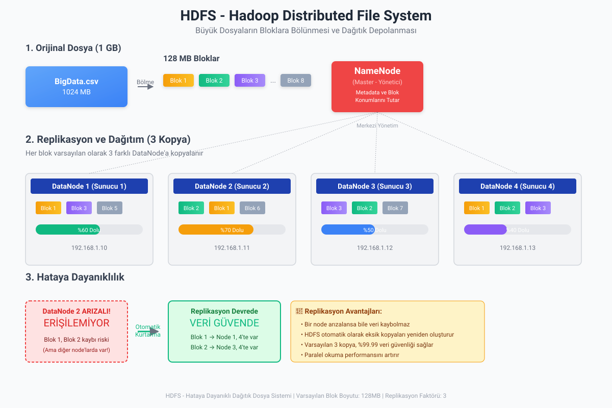

2.  **YARN (Yet Another Resource Negotiator):** Kümenin kaynak yöneticisidir. Hangi işin hangi makinede çalışacağını planlar, işlem gücü (CPU) ve bellek (RAM) gibi kaynakları işler arasında adil bir şekilde dağıtır. Kısacası kümenin işletim sistemi gibi davranır. Detaylarına birazdan değineceğiz.

3.  **MapReduce:** Büyük veri işleme için kullanılan bir programlama modelidir. Temelde iki adımdan oluşur:
    *   **Map:** Büyük bir görevi alır ve onu kümedeki tüm makinelere dağıtılacak küçük, paralel görevlere böler. (Örneğin, milyonlarca belgedeki kelimeleri sayma görevini, her makinenin kendi üzerindeki birkaç belgeyi sayması şeklinde bölmek).
    *   **Reduce:** Map aşamasından gelen tüm kısmi sonuçları toplar ve tek bir nihai sonuçta birleştirir. (Örneğin, tüm makinelerden gelen kelime sayılarını toplayarak genel toplamı bulmak).

4.  **Hadoop Common:** Diğer Hadoop modüllerinin çalışması için gerekli olan ortak kütüphaneleri ve yardımcı programları içerir.

Bu yapı sayesinde Hadoop, hem çok büyük verileri uygun maliyetli bir şekilde depolayabilir hem de bu veriyi paralel olarak çok hızlı bir şekilde işleyebilir. Önce tek bir makine üzerinde Hadoop'u nasıl çalıştıracağımızı, ardından da bunu küçük bir kümeye nasıl dönüştüreceğimizi göreceğiz.

## Hadoop: Dağıtık Sistemlere Giriş

### Büyük Veri Nedir ve Neden Dağıtık Sistemlere İhtiyaç Duyarız?

Gençler tekrar hatırlayalım, düşünün ki elinizde 1 TB boyutunda bir metin dosyası var ve bu dosyadaki her kelimenin kaç kez geçtiğini saymak istiyorsunuz. Normal bir bilgisayarda bu işlem saatler, belki de günler sürebilir. Peki ya 100 bilgisayar aynı anda bu dosyanın farklı parçaları üzerinde çalışsa? İşte dağıtık sistemlerin temel mantığı budur: büyük bir problemi küçük parçalara böl, her parçayı farklı bir makinede işle, sonuçları birleştir.

Hadoop, bu fikri gerçeğe dönüştüren bir yazılım çerçevesidir. İki temel bileşenden oluşur:

1.  **HDFS (Hadoop Distributed File System):** Verileri birden fazla makineye dağıtarak saklar
2.  **YARN (Yet Another Resource Negotiator):** İşlem kaynaklarını yönetir ve görevleri dağıtır

### Hadoop Mimarisi: Kim Ne Yapar?

Bir Hadoop kümesi, tıpkı bir şirketteki organizasyon yapısı gibi çalışır. Bir yönetici (Master) ve birden fazla çalışan (Worker) vardır.

#### Master Düğümde Çalışan Servisler

*   **NameNode:** HDFS'in beynidir. Hangi dosyanın hangi parçalarının (blok) nerede saklandığını bilir. Dosya sistemi ağacını, blok konumlarını ve metadata bilgilerini tutar. Ancak verilerin kendisini saklamaz; sadece "haritayı" tutar.
*   **ResourceManager:** YARN'ın merkezidir. Kümedeki tüm hesaplama kaynaklarını (CPU, bellek) yönetir. Bir iş geldiğinde, bu işi hangi makinelerde çalıştıracağına karar verir ve kaynakları tahsis eder.
*   **SecondaryNameNode:** Adına aldanmayın, bu bir yedek NameNode değildir. NameNode'un edit log dosyalarını periyodik olarak birleştirerek checkpoint oluşturur. Bu sayede NameNode'un başlangıç süresi kısalır ve kurtarma işlemleri kolaylaşır.

#### Worker Düğümlerde Çalışan Servisler

*   **DataNode:** Gerçek verileri saklayan servisdir. Büyük dosyalar 128 MB'lık bloklara bölünür ve bu bloklar farklı DataNode'lara dağıtılır. Her DataNode, sakladığı blokların listesini periyodik olarak NameNode'a bildirir (heartbeat).
*   **NodeManager:** Her worker makinedeki kaynak yöneticisidir. ResourceManager'dan gelen taleplere göre container'lar oluşturur ve bu container'larda Map veya Reduce görevlerini çalıştırır.

### Pseudo-Distributed Mod: Tek Makinede Tam Deneyim

Gerçek bir küme kurmadan önce, tüm bu servisleri tek bir makine üzerinde çalıştırarak sistemi öğrenebiliriz. Bu moda "Pseudo-Distributed" (sözde-dağıtık) denir. Tüm servisler aynı makinede çalışır, ancak gerçek bir küme gibi davranır.

#### Gereksinimler

Hadoop, Java Virtual Machine üzerinde çalışır. Bu nedenle önce Java'yı kurmamız gerekir. Ayrıca Hadoop, düğümler arası iletişim için SSH protokolünü kullanır.

```bash
# Sistem güncellemesi
sudo apt update && sudo apt upgrade -y

# Java kurulumu
sudo apt install openjdk-11-jdk -y

# SSH kurulumu
sudo apt install ssh openssh-server -y

# Yüklü Linux'ü görme
lsb_release -a

# Java Versionu Görme
java -version

# Javanın yüklendiği yeri görme
readlink -f $(which java)

# Hangi javalar yüklü hangisi aktif ve nerede
update-java-alternatives -l

# İstenilen Java Sürümünü Aktif Etme
sudo update-alternatives --config java
```

Java kurulumunu doğrulamak için `java -version` komutunu çalıştırabilirsiniz.

#### Hadoop Kullanıcısı Oluşturma

Sistem servislerini ayrı bir kullanıcı altında çalıştırmak, güvenlik ve yönetim açısından iyi bir uygulamadır.

```bash
# Grup ve kullanıcı oluşturma
sudo addgroup hadoop
sudo adduser --ingroup hadoop hduser

# Yeni kullanıcıya geçiş
su - hduser
```

#### SSH Yapılandırması

Hadoop servisleri başlatıldığında, script'ler SSH üzerinden ilgili düğümlere bağlanır. Tek makinede bile olsak, `hduser` kullanıcısının kendi kendine parola sormadan SSH yapabilmesi gerekir.

```bash
# Anahtar çifti oluşturma
ssh-keygen -t rsa -P '' -f ~/.ssh/id_rsa

# Açık anahtarı yetkili anahtarlara ekleme
cat ~/.ssh/id_rsa.pub >> ~/.ssh/authorized_keys
chmod 0600 ~/.ssh/authorized_keys
```

Test için `ssh localhost` komutunu çalıştırdığınızda parola sorulmamalıdır.

#### Hadoop İndirme ve Kurulum

Apache Hadoop'un resmi dağıtımını indirip uygun bir konuma yerleştireceğiz.

```bash
# İndirme
wget https://dlcdn.apache.org/hadoop/common/hadoop-3.3.6/hadoop-3.3.6.tar.gz

# Arşivi açma ve taşıma
tar xzf hadoop-3.3.6.tar.gz
sudo mv hadoop-3.3.6 /usr/local/hadoop

# Sahiplik ayarı
sudo chown -R hduser:hadoop /usr/local/hadoop
```

#### Ortam Değişkenleri

Hadoop komutlarının sistemde her yerden çalışabilmesi için PATH değişkenini ve Hadoop'un ihtiyaç duyduğu ortam değişkenlerini tanımlamamız gerekir. `~/.bashrc` dosyasının sonuna şu satırları ekleyin:

```bash
export JAVA_HOME=/usr/lib/jvm/java-11-openjdk-amd64
export HADOOP_HOME=/usr/local/hadoop
export PATH=$PATH:$HADOOP_HOME/bin:$HADOOP_HOME/sbin
```

Değişiklikleri aktif etmek için `source ~/.bashrc` komutunu çalıştırın.

### Yapılandırma Dosyaları

Hadoop'un davranışını belirleyen yapılandırma dosyaları `$HADOOP_HOME/etc/hadoop` dizinindedir. Her dosya belirli bir bileşeni yapılandırır.

#### hadoop-env.sh

Bu dosya, Hadoop'un hangi Java kurulumunu kullanacağını belirtir.

```bash
export JAVA_HOME=/usr/lib/jvm/java-11-openjdk-amd64
```

#### core-site.xml

HDFS için varsayılan dosya sistemini tanımlar. `fs.defaultFS` özelliği, NameNode'un adresini belirtir.

```xml
<configuration>
    <property>
        <name>fs.defaultFS</name>
        <value>hdfs://localhost:9000</value>
    </property>
</configuration>
```

#### hdfs-site.xml

HDFS'e özgü ayarları içerir. Önce veri dizinlerini oluşturun:

```bash
mkdir -p ~/hadoop_data/hdfs/namenode
mkdir -p ~/hadoop_data/hdfs/datanode
```

Yapılandırma:

```xml
<configuration>
    <property>
        <name>dfs.replication</name>
        <value>1</value>
    </property>
    <property>
        <name>dfs.namenode.name.dir</name>
        <value>file:///home/hduser/hadoop_data/hdfs/namenode</value>
    </property>
    <property>
        <name>dfs.datanode.data.dir</name>
        <value>file:///home/hduser/hadoop_data/hdfs/datanode</value>
    </property>
</configuration>
```

`dfs.replication` değeri, her veri bloğunun kaç kopyasının tutulacağını belirtir. Tek makinede olduğumuz için bu değer 1'dir. Gerçek kümelerde genellikle 3 kullanılır.

#### mapred-site.xml

MapReduce işlerinin hangi çerçeve üzerinde çalışacağını belirtir.

```xml
<configuration>
    <property>
        <name>mapreduce.framework.name</name>
        <value>yarn</value>
    </property>
</configuration>
```

#### yarn-site.xml

YARN için temel ayarları içerir.

```xml
<configuration>
    <property>
        <name>yarn.nodemanager.aux-services</name>
        <value>mapreduce_shuffle</value>
    </property>
</configuration>
```

`mapreduce_shuffle` ayarı, Map ve Reduce aşamaları arasındaki veri transferini (shuffle) etkinleştirir.

### HDFS Formatlama ve Servisleri Başlatma

HDFS'i ilk kez kullanmadan önce formatlanması gerekir. Bu işlem, NameNode için gerekli metadata yapısını oluşturur.

```bash
hdfs namenode -format
```

Bu komutu yalnızca ilk kurulumda çalıştırın. Çalışan bir kümede bu komutu çalıştırmak tüm verileri siler.

Servisleri başlatmak için:

```bash
start-dfs.sh
start-yarn.sh
```

Çalışan Java süreçlerini görmek için `jps` komutunu kullanın. Çıktıda şunları görmelisiniz: NameNode, DataNode, SecondaryNameNode, ResourceManager, NodeManager.

#### Web Arayüzleri

Hadoop, kümenin durumunu izlemek için web arayüzleri sunar:

*   **HDFS NameNode:** http://localhost:9870
*   **YARN ResourceManager:** http://localhost:8088

Bu arayüzlerde "Live Nodes" sayısının 1 olduğunu görüyorsanız kurulum başarılıdır.

### Çok Düğümlü Kümeye Geçiş

Tek düğümlü kurulumun mantığını kavradıktan sonra, gerçek dağıtık ortama geçiş yapmak oldukça kolaydır. İki makinelik minimal bir küme için yapılması gereken değişiklikler şunlardır:

#### Master-Worker İletişimi

Master ve Worker makineler arasında `hduser` kullanıcısı için parolasız SSH yapılandırması gerekir. Master makineden `ssh worker-node` komutu parola sormadan çalışmalıdır.

#### Yapılandırma Değişiklikleri

**core-site.xml:** `localhost` yerine Master düğümün IP adresi veya hostname'i yazılır.

```xml
<property>
    <name>fs.defaultFS</name>
    <value>hdfs://master-node:9000</value>
</property>
```

**yarn-site.xml:** ResourceManager'ın adresini ekleyin.

```xml
<property>
    <name>yarn.resourcemanager.hostname</name>
    <value>master-node</value>
</property>
```

**workers dosyası:** Worker düğümlerin listesini içerir. `localhost` satırını silip worker hostname'lerini ekleyin.

```text
worker-node
```

#### Yapılandırmayı Dağıtma

Master'daki yapılandırmayı tüm worker'lara kopyalamanız gerekir:

```bash
# Worker'da dizin oluşturma
ssh hduser@worker-node 'mkdir -p ~/hadoop_data/hdfs/datanode'

# Yapılandırma dosyalarını kopyalama
scp -r $HADOOP_HOME/etc/hadoop hduser@worker-node:$HADOOP_HOME/etc/
```

Artık `start-dfs.sh` ve `start-yarn.sh` komutları, workers dosyasındaki tüm makinelere SSH ile bağlanarak ilgili servisleri başlatacaktır.

### MapReduce: İlk İş

Kurulumu test etmek için Hadoop ile gelen WordCount örneğini çalıştıralım.

```bash
# HDFS'te girdi dizini oluşturma
hdfs dfs -mkdir /input

# Test dosyası hazırlama ve yükleme
echo "merhaba dunya hosgeldin dunya" > test.txt
hdfs dfs -put test.txt /input

# MapReduce işini çalıştırma
hadoop jar $HADOOP_HOME/share/hadoop/mapreduce/hadoop-mapreduce-examples-*.jar \
    wordcount /input /output

# Sonuçları görüntüleme
hdfs dfs -cat /output/part-r-00000
```

Beklenen çıktı:

```text
dunya       2
hosgeldin   1
merhaba     1
```

### Kümeyi Durdurma

İşiniz bittiğinde servisleri düzgün bir şekilde kapatın:

```bash
stop-yarn.sh
stop-dfs.sh
```

### Sorun Giderme İpuçları

Log dosyaları `$HADOOP_HOME/logs` dizininde bulunur. Bir servis başlamıyorsa, ilgili log dosyasını inceleyerek hatanın kaynağını tespit edebilirsiniz.

Sık karşılaşılan sorunlar:

*   **SSH bağlantı hatası:** Parolasız SSH yapılandırmasını kontrol edin
*   **NameNode formatlanamıyor:** Daha önceki veri dizinlerini temizleyin
*   **DataNode bağlanamıyor:** Firewall ayarlarını ve port erişimlerini kontrol edin
    *   **Firewall Ayarları ve Yönetimi**
        ```bash
        # Firewall'ı açma
        sudo ufw enable
        # Port Açma
        sudo ufw allow 8080
        # Protokol Bazlı Port Açma
        sudo ufw allow 8080/tcp
        sudo ufw allow 8080/udp
        # Firewall'ın Durumunu (Açıkmı-Kapalımı?) Görme
        sudo ufw status
        ```
*   **Java bulunamıyor:** JAVA_HOME değişkeninin doğru tanımlandığından emin olun

Hata mesajlarını dikkatlice okumak, dağıtık sistemlerde sorun çözme becerinizi geliştirecek en önemli alışkanlıktır.

---

## Apache Spark, Hive, Pig ve Mahout: Hadoop Ekosisteminin Diğer Oyuncuları

Hadoop’un temel yapısını, yani veriyi nasıl depoladığını (HDFS) ve bu veriyi nasıl işlediğini (MapReduce) geçen haftalarda konuştuk. Ancak Hadoop saf haliyle, yani sadece Java kodları yazarak veri işlemek, özellikle büyük ölçekli projelerde zaman alıcı ve zahmetli olabilir. Bu sebeple ekosistemde işlerimizi kolaylaştıran, veriye erişimi hızlandıran ve analiz yeteneklerimizi artıran başka araçlar geliştirilmiştir.

Bugün, bu ekosistemin diğer önemli oyuncularını; Spark, Hive, Pig ve Mahout’u konuşacağız. Ayrıca veri akışını sağlayan Sqoop ve Flume gibi araçlara da kısaca değinmekte fayda var.

Gençler, bu araçları anlamak için öncelikle neden var olduklarını kavramamız gerekiyor. Hadoop’u devasa bir kütüphane deposu gibi düşünün. Milyonlarca kitap var ama aradığınızı bulmak veya bu kitaplardan bir özet çıkarmak için her seferinde depoya girip tek tek rafları gezmeniz, kitapları indirmeniz ve not almanız gerekiyor. Bu, MapReduce’un çalışma mantığıdır; güçlüdür ama yavaştır.

**Apache Hive**, bu depoda çalışan ve sizin dilinizden anlayan bir kütüphane memuru gibidir. Siz ona "Bana tarihi romanların listesini getir" dersiniz (ki buna SQL benzeri bir dil diyoruz), o arka planda gidip o zorlu rafları tarar ve sonucu size getirir. Sizi karmaşık Java kodları yazmaktan kurtarır, sanki standart bir veritabanı kullanıyormuşsunuz gibi hissettirir.

**Apache Pig** ise daha çok veri üzerinde temizlik ve düzenleme yapan bir mutfak şefi gibidir. Veri çok dağınık, düzensiz veya kirli olabilir. Pig, bu veriyi alır, parçalar, filtreler ve istediğiniz formata sokar. Karmaşık bir iş akışını adım adım planlamanızı sağlar. "Önce domatesleri yıka, sonra doğra, en son pişir" gibi prosedürel bir dille veriyi işlersiniz.

**Apache Spark**’a gelince, işin rengi burada biraz değişiyor. Hadoop veriyi işlerken sürekli diske yazar ve diskten okur. Bu da vakit kaybıdır. Spark ise hafızası (RAM) çok kuvvetli bir matematikçi gibidir. İşlemleri sürekli kağıda yazmak (disk) yerine aklında (bellek) tutarak yapar. Bu yüzden Hadoop’un kendi işlem motoruna göre çok daha hızlıdır.

**Apache Mahout** da bu sistemin istatistikçisidir. Elinizdeki veriden geleceğe dair tahminler yapmak veya veriyi sınıflandırmak istiyorsanız (örneğin; bu müşteri ürünü alır mı almaz mı?), Mahout içindeki hazır matematiksel algoritmaları kullanırsınız.

---

Şimdi bu araçların mimari yapılarına ve teknik detaylarına biraz daha yakından bakalım.

### Apache Hive ve Veri Ambarı Yaklaşımı

Hive, Facebook tarafından geliştirilmiş ve sonrasında açık kaynak haline getirilmiş bir veri ambarı altyapısıdır. Temel amacı, SQL bilen analistlerin Hadoop üzerinde rahatça çalışabilmesini sağlamaktır. Hive, yazdığınız HQL (Hive Query Language) sorgularını alır ve arka planda bunları MapReduce veya Tez işlerine dönüştürür.
Burada dikkat etmeniz gereken nokta şudur: Hive, gerçek zamanlı bir veritabanı değildir. OLTP (Online Transaction Processing) işlemlerinden ziyade OLAP (Online Analytical Processing) için tasarlanmıştır. Yani "bir satır sileyim, hemen güncelleyeyim"den ziyade, "son 10 yılın satış verilerini analiz edeyim" senaryoları için uygundur. Verinin şeması, veri yazılırken değil okunurken kontrol edilir (Schema on Read), bu da esneklik sağlar.

### Apache Pig ve Veri Akışı (Data Flow)

Yahoo tarafından geliştirilen Pig, "Pig Latin" adı verilen bir betik dili kullanır. SQL bildirimseldir (ne istediğinizi söylersiniz), Pig Latin ise prosedüreldir (nasıl yapılacağını adım adım söylersiniz). Bu, özellikle yapılandırılmamış veya yarı yapılandırılmış veriler üzerinde ETL (Extract, Transform, Load) işlemleri yaparken büyük avantaj sağlar. Karmaşık MapReduce zincirlerini (Join, Group, Filter) çok daha az satır kodla yazmanıza olanak tanır.

### Apache Spark ve Bellek İçi İşleme (In-Memory Processing)

Spark, Hadoop ekosistemindeki en önemli kırılma noktalarından biridir. MapReduce modelindeki disk I/O (girdi/çıktı) darboğazını aşmak için RDD (Resilient Distributed Datasets) yapısını kullanır. Veriyi belleğe yükler ve iş bitene kadar orada tutar. Bu, iteratif algoritmalar (örneğin makine öğrenmesi) için performansı 100 kata kadar artırabilir.
Spark sadece hızlı değildir; aynı zamanda Spark SQL, Spark Streaming, MLlib (Makine Öğrenmesi) ve GraphX (Çizge İşleme) gibi modülleri tek bir çatı altında toplar. Yani hem veriyi işleyip hem de üzerinde makine öğrenmesi modelini aynı platformda koşturabilirsiniz.

> **Uygulamalı devam:** Spark'ın mimarisi, YARN üzerinde çalışması ve laboratuvardaki üç makineli kümede yapılan ölçümler ayrı bir notta anlatılmıştır: [Spark ve YARN ile Dağıtık Veri Madenciliği](spark_ders_notu.md).

### Apache Mahout ve Makine Öğrenmesi

Mahout, ölçeklenebilir makine öğrenmesi kütüphanesidir. Öneri sistemleri (Recommendation), Kümeleme (Clustering) ve Sınıflandırma (Classification) algoritmalarını içerir. Gençler, burada bir parantez açmak gerekir; Mahout ilk çıktığında MapReduce üzerinde çalışıyordu ancak MapReduce'un yavaşlığı makine öğrenmesi eğitim süreçlerini hantallaştırdığı için, günümüzde Mahout daha çok Spark veya Flink gibi motorlar üzerinde çalışacak şekilde evrilmiştir veya yerini Spark'ın kendi kütüphanesi olan MLlib'e bırakmaktadır. Ancak tarihsel gelişimi ve temel algoritmaları anlamak adına bilinmesi gerekir.

### Tamamlayıcı Araçlar: Zookeeper, Sqoop ve Flume

Bu ekosistemi ayakta tutan gizli kahramanlar da vardır:

*   **Zookeeper:** Dağıtık sistemlerde koordinasyonu sağlar. Hangi sunucu ayakta, hangisi lider, konfigürasyonlar nerede tutuluyor gibi soruların cevabı Zookeeper'dadır. Bir nevi sistemin trafik polisidir.
*   **Sqoop:** İlişkisel veritabanları (MySQL, Oracle vb.) ile Hadoop arasında veri transferi sağlar. Yapısal veriyi Hadoop'a aktarmak için kullanılır.
*   **Flume:** Log dosyaları, sosyal medya akışları gibi akan (streaming) verileri toplayıp HDFS'e aktarmak için tasarlanmıştır.

Özetle, Hadoop bir temeldir. Hive ve Pig bu temel üzerinde veri analizini kolaylaştırır, Spark hızı ve yetenekleri artırır, Mahout ise veriden anlamlı modeller çıkarmanızı sağlar.

---

Gençler, geçen dersimizde Hadoop ekosisteminin teorik çerçevesini ve bu ekosistemi oluşturan temel oyuncuları konuştuk. Bugün, bu araçların "kaputunun altına" bakacağız. Çünkü bir sistemi sadece tanımak yetmez; onun nasıl yapılandırıldığını ve bileşenlerin birbirleriyle nasıl konuştuğunu anlamanız gerekir.

Gençler, kurulumu tamamlanmış bir Hadoop kümesinin önünde oturduğunuzda, işletim sisteminin bu araçları tanıması için yapmanız gereken ilk iş, ortam değişkenlerini (Environment Variables) tanıtmaktır. Bir bilgisayara "Hadoop çalıştır" veya "Spark'ı başlat" dediğinizde, bilgisayarın bu komutların hangi klasörde durduğunu bilmesi gerekir. Linux tabanlı sistemlerde `.bashrc` dosyasını düzenleyerek `JAVA_HOME`, `HADOOP_HOME`, `SPARK_HOME` ve `HIVE_HOME` gibi yolları tanımlamamızın sebebi budur. Bu tanımları yapmazsanız, sistem her seferinde size "Ben bu komutu tanımıyorum" cevabını verecektir. Bu, işin alfabesidir.

### Konfigürasyon Dosyalarının Mantığı

Hadoop ve üzerine kurulu araçların beyni, `conf` veya `etc` klasörleri altındaki XML dosyalarıdır. Kurulum aşamasında sıkça karşılaşacağınız `core-site.xml`, `hdfs-site.xml`, `yarn-site.xml` ve `mapred-site.xml` dosyaları, sistemin anayasasıdır.

Örneğin, `core-site.xml` içinde NameNode'un hangi adreste çalıştığını belirtirsiniz. Eğer Hive veya Spark kullanacaksanız, bu araçlar veriyi nereden okuyacaklarını bilmek zorundadır. İşte bu XML dosyaları, Spark ve Hive'a "Veri HDFS üzerinde şu adreste duruyor, git oradan oku" talimatını veren yerdir. Bu dosyaları doğru yapılandırmadan hiçbir analiz aracı veriye ulaşamaz.

### Hive Metastore Yapısı

Hive özelinde konuşacak olursak, en kritik kavram "Metastore"dur. Geçen hafta Hive'ın veriyi SQL benzeri dille sorguladığını söyledim. Peki, Hive tabloların isimlerini, sütun tiplerini veya verinin HDFS'teki yerini nerede tutuyor?

Verinin kendisi HDFS'tedir, evet. Ancak verinin "kimliği" (metadata) dediğimiz şema bilgisi, ilişkisel bir veritabanında tutulmak zorundadır. Varsayılan kurulumda Hive, bu iş için Derby adında küçük bir veritabanı kullanır. Ancak Derby tek kullanıcılıdır; yani aynı anda sadece bir kişi sorgu atabilir. Gerçek dünyada biz `hive-site.xml` dosyasını düzenleyerek Hive'ı MySQL veya PostgreSQL gibi daha güçlü bir veritabanına bağlarız. Buna "Remote Metastore" kurulumu diyoruz. Böylece siz veriyi sorgularken Hive önce MySQL'e gidip "Bu tablo nerede?" diye sorar, aldığı cevaba göre HDFS'ten veriyi çeker. Bu ayrımı iyi anlamanız gerekiyor: Veri HDFS'te, verinin bilgisi Metastore'da saklanır.

### Spark ve YARN İlişkisi

Spark'a geçtiğimizde ise kaynak yönetimi devreye girer. Spark kendi başına bir "Standalone" modda çalışabilir ancak kurumsal bir yapıda Spark işlerini genellikle YARN (Yet Another Resource Negotiator) üzerinden yönetiriz.

Buradaki işleyiş şöyledir: Siz bir Spark kodu yazdınız ve `spark-submit` komutuyla bunu çalıştırdınız. Bu komut, YARN'ın kapısını çalar ve "Bana bu işlemi yapmak için 10 tane işlemci ve 50 GB RAM lazım" der. YARN, kümedeki müsait bilgisayarları (Node'ları) kontrol eder ve Spark'a gerekli kaynağı tahsis eder.

Spark mimarisinde iki temel bileşen göreceksiniz: **Driver** ve **Executors**.
Driver, yazdığınız kodun ana komuta merkezidir; işi planlar. Executor'lar ise işi fiilen yapan işçilerdir. Konfigürasyon dosyalarında (`spark-defaults.conf`) veya komut satırında belirlediğiniz `--num-executors`, `--executor-memory` gibi parametreler, işinizin ne kadar hızlı biteceğini doğrudan etkiler. Eğer kümenizin kapasitesinden fazla kaynak isterseniz işiniz kuyrukta bekler; az isterseniz de sistem kaynakları boşa harcanmış olur.

### Entegrasyon Noktaları

Son olarak, bu araçların birbirine nasıl bağlandığına değinelim. Spark, Hive tablolarını doğrudan okuyabilir. Ancak bunun için Spark'ın, Hive'ın konfigürasyon dosyalarına (`hive-site.xml`) erişimi olması gerekir. Genellikle bu dosyayı Spark'ın konfigürasyon klasörüne kopyalayarak bu sorunu çözürüz. Böylece Spark SQL kullanarak, sanki Hive içindeymiş gibi sorgular atabilir ancak Spark'ın bellek içi (in-memory) hızından faydalanabilirsiniz.

Özetle gençler; bugünkü teknik altyapı anlatımımızda şunu görmenizi istedim: Bu araçlar birbirinden bağımsız adalar değildir. Hepsi aynı dosya sistemini (HDFS) ve aynı kaynak yöneticisini (YARN) paylaşan, birbirlerinin konfigürasyon dosyalarını okuyarak haberleşen entegre bir yapıdır. Bir sonraki dersimizde artık terminali açıp bu konfigürasyonların pratikte nasıl işlediğini ve ilk sorgularımızı nasıl çalıştıracağımızı göreceğiz.

---

## VirtualBox ve Hadoop, Spark vd. Araçların Kurulumu

Gençler, bugün büyük veri ekosistemini üzerine inşa edeceğimiz temeli atıyoruz. Geçen derslerde bahsettiğimiz o karmaşık mimarilerin, NameNode’ların, Spark Executor’ların çalışacağı "evi" inşa edeceğiz.

Mühendislikte bir sistemi öğrenmenin en güvenli yolu, onu izole edilmiş bir ortamda test etmektir. Kendi ana bilgisayarınızı bozmadan, hata yapmaktan korkmayacağınız bir alan yaratmak zorundasınız. İşte bu yüzden bugün **Sanallaştırma (Virtualization)** yapacağız.

Elinizdeki bilgisayarın işletim sistemi Windows, macOS veya halihazırda Linux olabilir. Bizim amacımız, bu işletim sisteminin içinde, sanal bir bilgisayar oluşturmak ve oraya **Ubuntu Linux** kurmaktır. Neden Ubuntu? Çünkü topluluk desteği en geniş, dokümantasyonu en bol ve Hadoop ekosistemiyle en uyumlu dağıtımlardan biridir.

Süreci iki ana başlıkta ele alacağız: Hazırlık ve Kurulum Mantığı.

---

### 1. Hazırlık Aşaması: Gerekli Malzemeler

İşe başlamadan önce "mutfağımızda" olması gereken iki temel dosya var. Bunları indirmelisiniz:

1.  **Sanallaştırma Yazılımı (Hypervisor):** Bilgisayarınızın donanımını (RAM, İşlemci, Disk) paylaştıracak olan yazılımdır. Biz **Oracle VirtualBox** kullanacağız. Ücretsizdir, stabildir ve eğitim için idealdir. Kendi işletim sisteminize uygun olan sürümü indirip kurun.
2.  **İşletim Sistemi İmajı (ISO Dosyası):** Sanal makineye takacağımız "sanal DVD"dir. Ubuntu’nun web sitesinden "Desktop" sürümünü indireceğiz. Burada dikkat: **LTS (Long Term Support)** ibaresi olan sürümü indirin (örneğin 20.04 LTS veya 22.04 LTS). Ara sürümler (örneğin 23.10) daha yeni özellikler barındırsa da, kararlılık bizim için yenilikten daha önemlidir.

#### Kritik Uyarı: BIOS/UEFI Ayarları

Özellikle Windows kullanan arkadaşlar; VirtualBox’ı kurup "Başlat"a bastığınızda hata alırsanız, %90 ihtimalle bilgisayarınızın BIOS ayarlarında **Sanallaştırma Teknolojisi (Intel VT-x veya AMD-V)** kapalıdır. Bilgisayarınızı yeniden başlatıp BIOS ekranına girerek bu özelliği "Enabled" (Aktif) duruma getirmeniz gerekir. Bu ayar açık olmadan 64-bit sanal makine çalıştıramazsınız.

---

### 2. Sanal Makinenin Oluşturulması

VirtualBox’ı açtığınızda "Yeni" butonuna basarak süreci başlatıyoruz. Burada rastgele "İleri" tuşuna basmak yerine, ne yaptığımızı anlayarak ilerleyelim:

*   **Kaynak Tahsisi (RAM ve İşlemci):** Hadoop ve Spark bellek sever. Ancak ana makinenizi de nefessiz bırakmamalısınız. Eğer bilgisayarınızda 16 GB RAM varsa, sanal makineye 4 GB veya 6 GB verebilirsiniz. 8 GB RAM’iniz varsa, 4 GB sınırını zorlamayın, sisteminiz donar. İşlemci çekirdeği olarak ise en az 2 çekirdek vermeye çalışın.
*   **Sanal Disk:** "VDI" formatını seçin ve diski "Değişken Olarak Ayrılan" (Dynamically Allocated) olarak ayarlayın. Bu şu demektir: Siz 50 GB alan ayırsanız bile, Ubuntu sadece kullandığı kadar yer kaplar (örneğin ilk başta 10 GB), ihtiyaç oldukça 50 GB'a kadar genişler. Disk boyutunu en az 40-50 GB yapın; büyük veri araçları yer kaplar.

### 3. Ubuntu Kurulumu

Sanal makineyi oluşturduktan sonra "Ayarlar > Depolama" kısmından indirdiğimiz ISO dosyasını sanal CD sürücüsüne takıyoruz ve makineyi başlatıyoruz.

Karşınıza klasik bir kurulum ekranı gelecek. Burada dikkat etmeniz gerekenler:

*   **Dil Seçimi:** İngilizce kurmanızı tavsiye ederim. Hata aldığınızda internette yapacağınız aramalarda İngilizce hata mesajları size çok daha doğru sonuçlar verecektir.
*   **Updates and Other Software:** "Minimal Installation" yerine "Normal Installation" seçebilirsiniz, ancak disk alanınız kısıtlıysa minimal de iş görür. "Download updates while installing Ubuntu" seçeneğini işaretleyin, güncel başlayalım.
*   **Disk Yapılandırması:** Sanal makine içinde olduğumuz için "Erase disk and install Ubuntu" seçeneğinden korkmayın. Bu işlem Windows'taki dosyalarınızı silmez; sadece sanal makineye ayırdığınız o sanal diski formatlar.
*   **Kullanıcı Adı:** Basit, hatırlaması kolay ve Türkçe karakter içermeyen bir kullanıcı adı belirleyin (örneğin: `hduser` veya kendi isminiz). Şifreniz de eğitim süresince pratik olması açısından kısa olabilir ancak üretim ortamlarında güçlü şifreler kullanmanız gerektiğini unutmayın.

---

### Mevcut Linux Kullanıcıları İçin Not

Halihazırda bilgisayarında Ubuntu veya başka bir Linux dağıtımı kurulu olan arkadaşlar; sizler bir adım öndesiniz. Ancak size tavsiyem, yine de VirtualBox üzerine temiz bir kurulum yapmanızdır. Hadoop konfigürasyonları sırasında sistem dosyalarında değişiklikler yapacağız (`/etc/hosts`, `.bashrc` gibi). Kendi ana sisteminizi kirletmek veya yanlışlıkla bozmak istemezsiniz. "Sandbox" (Kum havuzu) mantığıyla, izole bir ortamda çalışmak her zaman daha güvenlidir.

### Kurulum Sonrası: İlk Temas ve "Snapshot"

Kurulum bitti, sanal makine yeniden başladı ve karşınızda Ubuntu masaüstü duruyor. Yapacağınız ilk iş şu olmalı:

1.  Sol üstteki "Activities"e tıklayın ve `Terminal` yazıp o siyah pencereyi açın.
2.  `sudo apt update` yazıp enter'a basın ve şifrenizi girin. Bu komut, sistemin paket listesini günceller.
3.  **Hayat Kurtaran Hamle: Snapshot (Anlık Görüntü)**
    İşlemleri yapmadan önce VirtualBox ana menüsüne dönün. Makineniz çalışır durumdayken veya kapalıyken bir "Snapshot" alın ve ismine "Temiz Kurulum" deyin.
    Bunun anlamı şudur: İlerleyen derslerde bir konfigürasyonu yanlış yaparsanız, sistemi komple bozarasanız; tek bir tuşla bu "Temiz Kurulum" anına, yani bugüne geri dönebilirsiniz. Bu özellik, öğrenme sürecindeki en büyük sigortanızdır.

Gençler, önümüzdeki derste bu terminal penceresini sıkça kullanacağız. Siyah ekrandan korkmayın; o ekran sizin sisteme hükmettiğiniz yerdir. Bir sonraki derste Java kurulumu ve SSH ayarlarıyla devam edeceğiz. Hazırlıklarınızı tamamlayın.

---

## Sistem Gereksinimleri ve Temel Kurulum (Java, SSH)

Gençler, sanal makinelerinizin hazır olduğunu varsayarak derse başlıyorum. Önünüzde temiz bir Ubuntu masaüstü ve açılmayı bekleyen bir terminal penceresi var.

Bugün yapacağımız işlem, boş bir odayı (işletim sistemi) bir atölyeye (geliştirme ortamı) dönüştürmektir. Hadoop ve diğer büyük veri araçlarının çalışabilmesi için işletim sistemine iki temel yetenek kazandırmamız gerekiyor:

1.  **Java Dili:** Hadoop’un ana dili.
2.  **Parolasız Erişim (SSH):** Hadoop’un kendi bileşenleri arasında engelsiz konuşabilmesi.

Terminalinizi açın ve adımları mantığını kavrayarak takip edin.

### 1. Sistemin Güncellenmesi

Bir inşaata başlamadan önce zemini temizlemek gerekir. Linux dünyasında "repo" dediğimiz paket listelerini güncelleyerek işe başlarız. Bu, bilgisayarınızın en son yazılım sürümlerinin nerede olduğunu öğrenmesini sağlar.

```bash
sudo apt update
sudo apt install pdsh
```

*(Not: `pdsh` yani Parallel Distributed Shell, Hadoop'un birden çok makineye aynı anda komut göndermesi için gereklidir, şimdiden kuralım.)*

### 2. Java Kurulumu (Motoru Takmak)

Daha önce de bahsettim, Hadoop Java ile yazılmıştır. Ancak her Java sürümüyle anlaşamaz. Endüstride ve eğitim materyallerinde en kararlı çalışan sürüm genellikle **Java 8**'dir. Daha yeni sürümler (Java 11, 17 vb.) bazı uyumluluk sorunları çıkarabilir. Bu derste risk almayacağız ve Java 8 (OpenJDK 8) kuracağız.

Terminale şu komutu girin:

```bash
sudo apt install openjdk-8-jdk -y
```

Kurulum bittiğinde, sistemin Java'yı gerçekten tanıyıp tanımadığını şu komutla kontrol ederiz:

```bash
java -version
```

Çıktıda `openjdk version "1.8.0_..."` görüyorsanız, motoru başarıyla taktınız demektir.

### 3. SSH Kurulumu ve Parolasız Geçiş (Anahtarları Teslim Etmek)

Geldik en çok hata yapılan yere. Burayı dikkatli dinleyin.

Hadoop çalıştığında, **NameNode** (Yönetici), **DataNode** (İşçi) ile iletişim kurmak ister. Biz şu an tek bir bilgisayar kullanıyor olsak da (Pseudo-Distributed), Hadoop bunu bilmez; ağ üzerinden başka bir makineye bağlanıyormuş gibi davranır. Bu bağlantı sırasında sürekli "Parola nedir?" diye sormaması gerekir.

Bunun için **SSH (Secure Shell)** protokolünü yapılandıracağız.

#### Adım 3.1: SSH Sunucusunu Kurun

Ubuntu'nun masaüstü sürümünde SSH sunucusu varsayılan olarak gelmeyebilir. Önce onu kuralım:

```bash
sudo apt install openssh-server -y
```

#### Adım 3.2: Anahtar Çifti Oluşturma (Key Generation)

Şimdi dijital bir kimlik kartı oluşturacağız. Bu karta sahip olan kişi (yani yine siz), sisteme parolasız girebilecek.

Şu komutu yazın:

```bash
ssh-keygen -t rsa -P ""
```

*   Bize "Dosyayı nereye kaydedeyim?" diye soracak, **Enter**'a basıp geçin (varsayılan yer iyidir).
*   `-P ""` parametresi, parolasız bir anahtar istediğimizi belirtir. Eğer burayı boş bırakmazsanız, Hadoop her çalıştığında sizden bu parolayı ister, amacımıza ulaşamayız.

#### Adım 3.3: Anahtarı Tanıtma

Oluşturduğumuz bu anahtarı (kimlik kartını), bilgisayarın "Güvenilir Kişiler Listesi"ne (authorized_keys) eklememiz lazım.

```bash
cat ~/.ssh/id_rsa.pub >> ~/.ssh/authorized_keys
```

#### Adım 3.4: Test Etme

Burası "turnusol kağıdı"dır. Eğer bu adım çalışmazsa Hadoop çalışmaz.
Terminale şu komutu yazın:

```bash
ssh localhost
```

İlk defa bağlantı kurduğunuz için size "Bu adrese güveniyor musun? (yes/no)" diye sorabilir. `yes` yazıp Enter'a basın.

Eğer sistem sizden **parola istemeden** bir alt satıra geçip yeni bir giriş yaptıysa tebrikler, SSH tünelini açtınız. Eğer hala parola istiyorsa, yukarıdaki adımları (özellikle `authorized_keys` kısmını) tekrar etmeniz gerekir. Bağlantıdan çıkmak için `exit` yazın.

### 4. Ortam Değişkenleri (Environment Variables)

Son olarak, Linux'a Java'nın nerede kurulu olduğunu "resmi olarak" bildirmemiz gerekiyor. Bunu `.bashrc` dosyasına yazacağız. Bu dosya, terminal her açıldığında çalışan ayar dosyasıdır.

Dosyayı düzenlemek için `nano` editörünü kullanalım:

```bash
nano ~/.bashrc
```

Dosyanın en altına inin (yön tuşlarıyla) ve şu satırı ekleyin:

```bash
export JAVA_HOME=/usr/lib/jvm/java-8-openjdk-amd64
```

*(Not: Genellikle Java yolu budur, ama farklıysa kontrol etmek gerekir. Şimdilik standart kurulumda bu yol geçerlidir.)*

Dosyayı kaydetmek için `CTRL + O`, sonra `Enter`, çıkmak için `CTRL + X` tuşlarına basın.

Yaptığımız değişikliğin hemen aktif olması için şu komutu çalıştırın:

```bash
source ~/.bashrc
```

Kontrol etmek için:

```bash
echo $JAVA_HOME
```

Ekrana az önce yazdığımız dosya yolunu basıyorsa işlem tamamdır.

---

## Apache Hadoop Kurulumu ve Yapılandırması

Gençler, mutfağı hazırladık, ocağı yaktık. Şimdi sıra ana yemeği yapmaya geldi. Bugün Apache Hadoop’u indirip, sistemin beyni olan konfigürasyon dosyalarını düzenleyeceğiz.

Bu ders, sürecin en dikkat gerektiren kısmıdır. Bir XML dosyasında unutulan küçücük bir kapatma etiketi `</property>` veya yanlış yazılan bir dosya yolu, sistemin başlamamasına neden olur. O yüzden "kopyala-yapıştır" yaparken bile neyi, nereye ve neden yapıştırdığınızı sorgulayın.

### 1. Hadoop’un İndirilmesi ve Yerleşimi

Hadoop, "açık kaynak" dünyasında bir `.tar.gz` dosyası olarak dağıtılır. Bu, Windows’taki `.zip` veya `.rar` dosyalarının Linux dünyasındaki karşılığıdır.

Terminali açın. Önce dosyayı indirelim, ardından sıkıştırılmış paketi açalım. Biz bu derste Hadoop’un 3.x sürümünü (örneğin 3.3.6) kullanacağız.

```bash
# Dosyayı indirme (Link zamanla değişebilir, güncel mirror'dan aldığımızı varsayalım)
wget https://dlcdn.apache.org/hadoop/common/hadoop-3.3.6/hadoop-3.3.6.tar.gz

# Paketi açma (tar: tape archive, x: extract, z: gzip, v: verbose/göster, f: file)
tar -xzvf hadoop-3.3.6.tar.gz
```

Dosyalar çıktıktan sonra, klasör ismi çok uzun olacağı için (hadoop-3.3.6), bunu daha sade bir hale getirelim ve çalışma dizinimizi belirleyelim.

```bash
mv hadoop-3.3.6 hadoop
```

Artık ev dizininizde (`/home/hduser/hadoop`) Hadoop dosyaları duruyor.

### 2. Ortam Değişkenlerinin Güncellenmesi

Linux'un bu yeni klasörden haberdar olması lazım. Geçen ders `JAVA_HOME` eklediğimiz `.bashrc` dosyasına şimdi Hadoop yollarını ekleyeceğiz.

```bash
nano ~/.bashrc
```

Dosyanın en altına şu satırları ekleyin:

```bash
export HADOOP_HOME=~/hadoop
export PATH=$PATH:$HADOOP_HOME/bin:$HADOOP_HOME/sbin
export HADOOP_CONF_DIR=$HADOOP_HOME/etc/hadoop
export HADOOP_HDFS_HOME=$HADOOP_HOME
export HADOOP_MAPRED_HOME=$HADOOP_HOME
export HADOOP_YARN_HOME=$HADOOP_HOME
```

Kaydedip çıkın (`Ctrl+O`, `Enter`, `Ctrl+X`) ve ayarları aktif edin:

```bash
source ~/.bashrc
```

### 3. Konfigürasyon Dosyalarının Düzenlenmesi

Hadoop’un ayar dosyaları `~/hadoop/etc/hadoop` klasörü altındadır. Buradaki 4 temel dosyayı düzenleyeceğiz.

#### 3.1. hadoop-env.sh (Java Tanıtımı)

Hadoop bazen sistemdeki global Java yolunu bulmakta zorlanabilir. İşi garantiye almak için bu dosyanın içine Java yolunu elle yazacağız.

```bash
nano $HADOOP_HOME/etc/hadoop/hadoop-env.sh
```

Dosya içinde `export JAVA_HOME=` satırını bulun ve geçen ders öğrendiğimiz yolu yapıştırın:
`export JAVA_HOME=/usr/lib/jvm/java-8-openjdk-amd64`

#### 3.2. core-site.xml (Adres Beyanı)

Bu dosya, Hadoop dosya sisteminin (HDFS) hangi adreste çalışacağını belirtir.

```bash
nano $HADOOP_HOME/etc/hadoop/core-site.xml
```

`<configuration>` ve `</configuration>` etiketleri arasına şunu yazın:

```xml
<configuration>
    <property>
        <name>fs.defaultFS</name>
        <value>hdfs://localhost:9000</value>
    </property>
</configuration>
```

*Anlamı: NameNode, localhost üzerinde 9000 portunu dinleyecek.*

#### 3.3. hdfs-site.xml (Replikasyon Ayarı)

Burası kritik. Hadoop varsayılan olarak her veriyi 3 farklı makineye kopyalar (Replication Factor: 3). Ancak bizim sadece 1 makinemiz var. Eğer bunu 1'e düşürmezsek, Hadoop sürekli "Diğer 2 makine nerede?" diye hata arar.

Ayrıca NameNode ve DataNode verilerinin fiziksel olarak diskinizde nereye kaydedileceğini de burada belirtmeliyiz. Önce bu klasörleri oluşturalım:

```bash
mkdir -p ~/hadoop_data/namenode
mkdir -p ~/hadoop_data/datanode
```

Şimdi dosyayı düzenleyelim:

```bash
nano $HADOOP_HOME/etc/hadoop/hdfs-site.xml
```

```xml
<configuration>
    <property>
        <name>dfs.replication</name>
        <value>1</value>
    </property>
    <property>
        <name>dfs.namenode.name.dir</name>
        <value>file:///home/hduser/hadoop_data/namenode</value>
    </property>
    <property>
        <name>dfs.datanode.data.dir</name>
        <value>file:///home/hduser/hadoop_data/datanode</value>
    </property>
</configuration>
```

*(Not: `hduser` kısmını kendi kullanıcı adınızla değiştirmeyi unutmayın.)*

#### 3.4. mapred-site.xml ve yarn-site.xml (İşlem Gücü)

Hadoop sadece depolama değil, işlemedir. YARN ayarlarını yaparak MapReduce işlerinin yönetilmesini sağlarız.

`mapred-site.xml`:

```xml
<configuration>
    <property>
        <name>mapreduce.framework.name</name>
        <value>yarn</value>
    </property>
</configuration>
```

`yarn-site.xml`:

```xml
<configuration>
    <property>
        <name>yarn.nodemanager.aux-services</name>
        <value>mapreduce_shuffle</value>
    </property>
</configuration>
```

### 4. NameNode Formatlama (İlk Kurulum)

Tüm ayarlar bitti. Şimdi HDFS dosya sistemini, tıpkı yeni alınmış bir USB belleği formatlar gibi formatlamamız gerekiyor.
**Dikkat:** Bu işlemi **sadece bir kez**, ilk kurulumda yaparsınız. Eğer sistem doluyken yaparsanız tüm veriniz silinir.

```bash
hdfs namenode -format
```

Ekranda akan yazılar arasında "Storage directory has been successfully formatted" ifadesini görüyorsanız işlem başarılıdır. Eğer "Error" veya "Exception" görüyorsanız, XML dosyalarında yazım hatası yapmışsınızdır.

### 5. Sistemi Başlatma ve Kontrol (JPS)

Artık marşa basabiliriz.

HDFS'i başlatmak için:

```bash
start-dfs.sh
```

YARN'ı başlatmak için:

```bash
start-yarn.sh
```

Sistemin çalışıp çalışmadığını anlamanın en kesin yolu `jps` (Java Process Status) komutudur. Terminale `jps` yazın. Görmeniz gereken liste şudur:

*   NameNode
*   DataNode
*   ResourceManager
*   NodeManager
*   SecondaryNameNode
*   Jps

Eğer bunlardan biri (örneğin DataNode) eksikse, o servisin log dosyasına bakarak neden başlamadığını araştırmamız gerekir.

Gençler, eğer `jps` çıktınız tam ise, tarayıcınızı açıp `http://localhost:9870` adresine gidin. Karşınızda Hadoop’un yönetim paneli (Dashboard) belirecektir. Bu ekranı görebiliyorsanız, tebrikler; artık çalışan bir Büyük Veri kümeniz var. Bir sonraki derste bu boş kümeye ilk verimizi yükleyip analiz edeceğiz.

---

## Uygulama: İlk Hadoop İşimiz - WordCount

Gençler, geçen hafta zorlu bir kurulum sürecini atlattınız. `jps` komutunu yazdığınızda o listeyi görmek, sistemin kalbinin attığını gösterir. Ancak şu an elinizde boş bir fabrika var. Makineler çalışıyor ama bantların üzerinde işlenecek hammadde yok.

Bugün fabrikayı üretime geçireceğiz. HDFS (Hadoop Distributed File System) ile konuşmayı öğrenecek, ilk verimizi sisteme yükleyecek ve büyük veri dünyasının "Merhaba Dünya"sı (Hello World) kabul edilen **WordCount** (Kelime Sayma) uygulamasını çalıştıracağız.

Terminal pencerelerinizi açın, başlıyoruz.

### 1. Dosya Sistemi Ayrımı: Linux vs. HDFS

Önce bir kavram kargaşasını önleyelim. Şu an karşınızdaki Ubuntu'nun bir dosya sistemi var (Ext4). Bir de Hadoop'un kendi içindeki sanal dosya sistemi (HDFS) var.

Masaüstünde duran bir dosyayı Hadoop doğrudan göremez. Tıpkı bilgisayarınızdaki bir fotoğrafı Instagram'a yüklemeden arkadaşlarınızın görememesi gibi. Önce veriyi "Local" ortamdan "HDFS" ortamına taşımanız (upload) gerekir.

Komutlarımız Linux komutlarına çok benzer, sadece başına `hdfs dfs` ekini getiririz.

### 2. HDFS Üzerinde Klasör Açma

Hadoop'ta çalışırken düzenli olmak esastır. Önce HDFS içinde kendimize bir çalışma alanı yaratalım.

```bash
hdfs dfs -mkdir /user
hdfs dfs -mkdir /user/hduser
hdfs dfs -mkdir /user/hduser/giris_verisi
```

Bu komutlarla HDFS'in kök dizininde hiyerarşik bir yapı oluşturduk. Linux'taki `mkdir` komutunun aynısıdır, sadece HDFS üzerinde çalışır.

### 3. Veri Hazırlığı ve Yükleme (Upload)

Şimdi analiz edeceğimiz veriyi oluşturalım. Henüz elimizde terabaytlık veriler yok, o yüzden kendi "küçük" büyük verimizi yapacağız.

Linux ortamında (HDFS'te değil) bir metin dosyası oluşturalım:

```bash
nano deneme.txt
```

İçine rastgele İngilizce cümleler yazın. Kelime sayma yapacağımız için tekrar eden kelimeler olsun:
*Hadoop is powerful. Hadoop is open source. Big Data is future. Hadoop and Spark are friends.*

Kaydedip çıkın (`Ctrl+O`, `Enter`, `Ctrl+X`).

Şimdi bu dosyayı Linux'tan alıp HDFS'teki fabrikaya sokalım:

```bash
hdfs dfs -put deneme.txt /user/hduser/giris_verisi/
```

Dosyanın gidip gidmediğini kontrol edelim:

```bash
hdfs dfs -ls /user/hduser/giris_verisi/
```

Listede `deneme.txt` dosyasını görüyorsanız, veri artık işlenmeye hazırdır.

### 4. İlk MapReduce İşini Çalıştırma: WordCount

Hadoop kurulduğunda içinde örnek uygulamaların olduğu bazı `.jar` dosyalarıyla gelir. Biz Java kodu yazmadan önce bu hazır kodu kullanacağız.

Bu komut biraz uzundur, mantığını anlatayım:
`hadoop jar [Jar Dosyasının Yeri] [Programın Adı] [Girdi Yeri] [Çıktı Yeri]`

Komutu dikkatlice yazın:

```bash
hadoop jar $HADOOP_HOME/share/hadoop/mapreduce/hadoop-mapreduce-examples-3.3.6.jar wordcount /user/hduser/giris_verisi /user/hduser/sonuc_cikti
```

*(Not: Sürüm numaranız 3.3.6'dan farklıysa `hadoop-mapreduce-examples-*.jar` yazarak tab tuşuna basıp tamamlayabilirsiniz.)*

**Çok Kritik Bir Kural:**
Gençler, komutun sonundaki `/user/hduser/sonuc_cikti` klasörü **HDFS'te var olmamalıdır**. Hadoop, yanlışlıkla mevcut bir verinin üzerine yazmamak için, çıktı klasörünü kendisi oluşturmak ister. Eğer bu klasör zaten varsa "Output directory already exists" hatası alırsınız ve program çalışmaz.

**Terminalde Neler Oluyor?**
Enter'a bastığınızda terminal akmaya başlayacak.
*   `Connecting to ResourceManager...`: İş YARN'a teslim ediliyor.
*   `map 0% reduce 0%`: İşlem başlıyor.
*   `map 100% reduce 0%`: Veriler parçalandı ve sayıldı (Mapping).
*   `map 100% reduce 100%`: Sayımlar birleştirildi (Reducing).

"Completed successfully" yazısını gördüyseniz, ilk büyük veri operasyonunuzu başarıyla tamamladınız.

### 5. Sonuçları Okuma

Hadoop sonuçları ekrana basmaz, HDFS'e dosyalar halinde yazar. Bakalım sonuç klasöründe neler var:

```bash
hdfs dfs -ls /user/hduser/sonuc_cikti
```

Burada `_SUCCESS` (işin başarılı olduğunu gösteren boş dosya) ve `part-r-00000` (asıl sonuç dosyası) göreceksiniz.

Sonucu okumak için:

```bash
hdfs dfs -cat /user/hduser/sonuc_cikti/part-r-00000
```

Ekranda şuna benzer bir çıktı göreceksiniz:

```text
Big     1
Data    1
Hadoop  2
Spark   1
is      3
...
```

### Özetle Ne Yaptık?

Arka planda inanılmaz bir işbirliği gerçekleşti.
1.  Siz veriyi HDFS'e attınız, **NameNode** bu verinin hangi bloklarda saklanacağını kaydetti.
2.  İşi başlattığınızda **YARN (ResourceManager)**, kümedeki kaynakları (CPU/RAM) ayarladı.
3.  Jar dosyası **NodeManager**'lara dağıtıldı.
4.  Kod verinin olduğu yere gitti (Data Locality), işlemi yaptı ve sonucu tekrar HDFS'e yazdı.

Bugünlük bu kadar. Ham veriyi yüklemeyi ve işlemeyi gördük. Ancak fark ettiyseniz `wordcount` gibi basit bir iş için bile çok uzun komutlar yazdık. Gelecek derste, bu karmaşık komutlar yerine SQL benzeri bir dil kullanarak aynı işlemleri **Apache Hive** ile nasıl çok daha kolay yapacağımızı göreceğiz. Makinelerinizi kapatabilirsiniz.

---

## 6. Hadoop Ekosistemi: Alet Çantamızı Genişletiyoruz

Gençler, geçen hafta terminalin o siyah ekranında, uzun Java komutları arasında biraz bunaldığınızı biliyorum. "WordCount" yapmak için bile o kadar satır kodla uğraşmak, bir çivi çakmak için balyoz kullanmaya benzer. Hadoop'un çekirdeği (HDFS ve MapReduce) çok güçlüdür ama ham haliyle kullanımı zordur.

Bugün size güzel bir haberim var: "Ameleliği" azaltıyoruz. Açık kaynak topluluğu da sizin gibi düşünmüş ve bu zorlu motorun üzerine, kullanımı daha kolay "kaportalar" ve "direksiyonlar" eklemiş.

Hadoop sadece bir depolama alanı değil, devasa bir ekosistemdir. Bugün bu ekosistemin en popüler üç silahşorunu tanıyacağız: **Hive**, **Pig** ve emektar **Mahout**.

### 6.1. Apache Hive: Veri Ambarının SQL Kapısı

Bir veri analisti veya mühendisiyseniz, SQL (Structured Query Language) sizin ana dilinizdir. Hive, Facebook mühendisleri tarafından geliştirilmiştir. Dertleri şuydu: "Bizim elimizde petabaytlarca veri var ama herkes Java bilmiyor. Herkes SQL biliyor. Öyle bir şey yapalım ki, biz SQL yazalım, o arka planda gidip bunu MapReduce işine çevirsin."

İşte Hive tam olarak budur. HDFS üzerinde tutulan yapılandırılmış verileri, sanki bir veritabanındaymış gibi sorgulamanızı sağlar.

#### Uygulama: Hive ile Sınav Analizi

Diyelim ki elimizde milyonlarca satırlık bir öğrenci not listesi var. HDFS üzerinde duruyor. Biz ortalamayı bulmak istiyoruz.

**Adım 1: Veriyi Hazırlama**
Önce basit bir `notlar.txt` oluşturalım (Linux tarafında):

```bash
nano notlar.txt
```

İçine şunu yazın (Format: ÖğrenciID, Ders, Not):

```text
101,Matematik,80
102,Matematik,90
101,Fizik,45
103,Matematik,60
102,Fizik,70
```

Bu dosyayı HDFS'e atmanıza gerek yok, Hive yüklemeyi kendi yapacak.

**Adım 2: Hive Kabuğuna Giriş**
Terminalde sadece `hive` yazın ve enter'a basın. Karşınıza `hive>` komut satırı gelecektir.

**Adım 3: Tabloyu Oluşturma**
Tıpkı MySQL veya Oracle'da olduğu gibi:

```sql
CREATE TABLE sinav_sonuclari (
    ogrenci_id INT,
    ders STRING,
    puan INT
)
ROW FORMAT DELIMITED
FIELDS TERMINATED BY ',';
```

*Anlamı: Virgülle ayrılmış bir dosya okuyacağım, sütunlar bunlardır.*

**Adım 4: Veriyi Yükleme**
Şimdi yerel diskimizdeki dosyayı bu tabloya basalım:

```sql
LOAD DATA LOCAL INPATH '/home/hduser/notlar.txt' INTO TABLE sinav_sonuclari;
```

**Adım 5: Ve Büyülü An (Sorgulama)**
Artık Java yazmadan, MapReduce bilmeden analiz yapabiliriz.

```sql
SELECT ders, AVG(puan) FROM sinav_sonuclari GROUP BY ders;
```

Enter'a bastığınızda ekrana dikkatlice bakın. Hive size şunu diyecek: *"Launching Job 1 out of 1"*. Arka planda sizin SQL cümlenizi Java MapReduce koduna çeviriyor, YARN'a gönderiyor, hesaplatıyor ve sonucu size getiriyor.

### 6.2. Apache Pig: Veri Mutfağının Şefi

Gençler, Hive yapısal veriler (tablolar) için harikadır. Ama gerçek hayatta veri her zaman sütun sütun gelmez. Bazen veri kirlidir, karışıktır, log dosyası halindedir.

Yahoo! mühendisleri de bu dertten muzdarip olup **Pig**'i geliştirdiler. Pig, bir veri akış (data flow) dilidir. "Pig Latin" denen kendine has, senaryo tabanlı bir dili vardır. Mantığı şudur: "Veriyi al -> Şuradan süz -> Bunu dönüştür -> Şuraya kaydet."

#### Uygulama: Pig ile Filtreleme

Az önceki not dosyasını düşünün. Sadece 50'den yüksek alan öğrencileri ayıklamak istiyoruz ama bunu adım adım (prosedürel) yapmak istiyoruz.

**Adım 1: Pig Kabuğuna Giriş**
Terminalde `pig` yazın. `grunt>` ibaresini göreceksiniz.

**Adım 2: Veriyi Yükleme ve İşleme**
Burada kodları satır satır yazacağız ama Pig "Lazy Execution" (Tembel Çalışma) prensibini kullanır. Siz "Sonucu Göster" diyene kadar hiçbir işlem yapmaz, sadece plan yapar.

```pig
-- 1. Veriyi yükle
notlar = LOAD 'notlar.txt' USING PigStorage(',') AS (id:int, ders:chararray, puan:int);

-- 2. Filtrele (Puanı 50'den büyük olanlar)
gecenler = FILTER notlar BY puan > 50;

-- 3. Sonucu Ekrana Bas (İşte şimdi çalışır!)
DUMP gecenler;
```

Komutu verdiğinizde yine arka planda bir MapReduce işi dönecek ve ekrana sadece 50'den yüksek notlar dökülecektir. Pig, özellikle ETL (Extract-Transform-Load) dediğimiz veri temizleme işlerinde İsviçre çakısı gibidir.

### 6.3. Apache Mahout: Yapay Zekanın Dedesi

Geldik işin en havalı kısmına ama burada dürüst bir akademisyen uyarısı yapmam lazım. **Apache Mahout**, Hadoop üzerinde çalışan ilk makine öğrenmesi kütüphanesidir. "Büyük veri ile yapay zeka" kavramını o başlattı.

Ancak gençler, Mahout şu an biraz yaşlandı. Artık sektörde makine öğrenmesi için **Spark MLlib** kullanıyoruz (bunu ileride anlatacağım). Ama Mahout'u bilmek, bu işin tarihini ve mantığını anlamak için şarttır. Hala bazı eski sistemlerde karşınıza çıkabilir.

Mahout'un en meşhur olduğu konu **Öneri Sistemleri**dir (Recommendation Engines). Hani Netflix'te "Bunu izleyen şunu da izledi" veya Amazon'da "Bunu alan şunu da aldı" var ya, işte o.

#### Uygulama Mantığı: Basit Bir Öneri Sistemi

Mahout'u çalıştırmak için verinin çok özel bir formatta olması gerekir: KullanıcıID, ÜrünID, Puan.

Örnek bir veri seti hayal edin (film_puanlari.txt):

```text
1,101,5.0  (1 nolu kullanıcı 101 nolu filme 5 vermiş)
1,102,3.0
2,101,5.0
2,103,4.5
```

Mahout ile terminalden şu komutu verdiğinizde (komut örnektir, parametreler değişebilir):

```bash
mahout recommenditembased \
--input film_puanlari.txt \
--output oneriler \
--similarityClassname SIMILARITY_PEARSON_CORRELATION
```

Mahout arka planda şunu yapar:

1.  **Benzerlik Matrisi Çıkarır:** "1 nolu kullanıcı ile 2 nolu kullanıcı birbirine benziyor mu?" (İkisi de 101 filmine 5 vermiş, demek ki zevkleri aynı).
2.  **Tahmin Yürütür:** "2 nolu kullanıcı 103 filmini sevmiş. 1 nolu kullanıcı ile zevkleri aynı olduğuna göre, 1 nolu kullanıcıya 103 filmini öner."

Mahout bu işlemleri matematiksel matris çarpımları ile yapar ve bunu binlerce bilgisayara yayarak MapReduce üzerinden çözer. Yavaştır ama devasa verilerde çökmeden çalışır.

### Özet ve Gelecek Hafta

Gençler, toparlayalım:

*   **Hadoop (HDFS+MapReduce):** Fabrikanın temeli ve motoru.
*   **Hive:** Fabrikanın muhasebecisi, SQL ile konuşur, rapor çeker.
*   **Pig:** Fabrikanın tesisatçısı, veri boru hatlarını döşer, temizlik yapar.
*   **Mahout:** Fabrikanın eski ama bilge kahini, veriden geleceği tahmin eder.

Bu araçların hepsi veriyi diskten okur, işler ve diske yazar. Bu yüzden biraz hantaldırlar. Gelecek hafta, bu hantallığı ortadan kaldıran, veriyi diskte değil RAM'de (bellekte) işleyerek 100 kat daha hızlı çalışan, günümüzün rock starı **Apache Spark**'a giriş yapacağız.

O zamana kadar terminaliniz açık, hatanız bol (ki öğrenesiniz) olsun!

---

## 7. Büyük Verinin Hız Canavarı: Apache Spark Kurulumu ve Giriş

Bu serinin başından beri "MapReduce" dedik, disk okuma/yazma dedik. Geçen ders Hive ve Pig ile işleri biraz kolaylaştırdık ama hala bir hantallık hissediyorsunuz, değil mi? Bir sorgu attığınızda sonucun gelmesi için çay demleyip içebiliyorsunuz.

Bunun sebebi şuydu: Hadoop (MapReduce), her işlemde veriyi diske yazar ve diskten okur. Sabit disk, bilgisayarın en yavaş parçasıdır.

Bugün sahneye **Apache Spark** çıkıyor. Spark'ın olayı şudur: "Ben veriyi mecbur kalmadıkça diske indirmem, her şeyi RAM'de (Bellek) yaparım." Bu sayede MapReduce'a göre 100 kata kadar daha hızlı çalışabilir. Kamyonla yük taşımaktan (Hadoop), Ferrari ile pistte turlamaya (Spark) geçiyoruz.

Kemerlerinizi bağlayın, Ubuntu üzerine Spark kuruyoruz ve Python (PySpark) ile konuşuyoruz.

---

### 1. Hazırlık ve İndirme

Spark'ın çalışması için Java ve Python gereklidir.
1.  **Java:** Zaten Hadoop kurarken kurduk.
2.  **Python:** Ubuntu ile kurulu gelir ama kontrol edelim.
3.  **Hadoop:** Arkada çalışır durumda olmalı (HDFS'ten veri okuyacağız).

Önce terminali açıp Hadoop'u uyandıralım (Eğer kapalıysa):

```bash
start-dfs.sh
start-yarn.sh
```

Şimdi Spark'ı indirelim. Hadoop sürümümüzle uyumlu "Pre-built for Apache Hadoop" paketini seçeceğiz.

```bash
# Ev dizinine dönelim
cd ~

# Spark 3.5.0 sürümünü indirelim (Link örnektir, güncel sürümler değişebilir)
wget https://dlcdn.apache.org/spark/spark-3.5.0/spark-3.5.0-bin-hadoop3.tgz

# Paketi açalım
tar -xzvf spark-3.5.0-bin-hadoop3.tgz

# Klasör ismini sadeleştirelim
mv spark-3.5.0-bin-hadoop3 spark
```

### 2. Ortam Değişkenlerinin Ayarlanması (.bashrc)

Linux'a "Spark burada, Python da şurada" dememiz lazım. `.bashrc` dosyamızı tekrar açıyoruz.

```bash
nano ~/.bashrc
```

Dosyanın en altına, daha önce eklediğimiz Hadoop ayarlarının altına şunları ekleyin:

```bash
# SPARK AYARLARI
export SPARK_HOME=~/spark
export PATH=$PATH:$SPARK_HOME/bin:$SPARK_HOME/sbin

# Spark'ın Python 3 kullanmasını zorunlu kılıyoruz (Önemli!)
export PYSPARK_PYTHON=python3
```

Kaydedip çıkın (Ctrl+O, Enter, Ctrl+X) ve ayarları aktif edin:

```bash
source ~/.bashrc
```

### 3. Spark ile Hadoop'u Tanıştırmak (Opsiyonel ama Önerilen)

Spark bazen Hadoop kütüphanelerini bulamazsa hata verebilir. Garanti olsun diye Spark'ın konfigürasyon dosyasına Hadoop'un yerini fısıldayalım.

```bash
cd $SPARK_HOME/conf
cp spark-env.sh.template spark-env.sh
nano spark-env.sh
```

Dosyanın en altına şu satırı ekleyin:

```bash
export HADOOP_CONF_DIR=$HADOOP_HOME/etc/hadoop
```

Bu sayede Spark, HDFS'in nerede olduğunu (hdfs-site.xml) otomatik olarak Hadoop ayarlarından okuyacaktır.

---

### 4. Uygulama: PySpark Shell ile İlk Temas

Kurulum bitti! Evet, Hadoop kadar zor değildi çünkü zemin hazırdı. Şimdi Spark'ın Python arayüzü olan **PySpark**'ı çalıştıralım.

Terminalde şu komutu verin:

```bash
pyspark
```

Biraz bekleyin... Ekranda kocaman, havalı bir Spark logosu (ASCII art) belirmeli.
Komut satırı `>>>` şekline dönüştüyse, şu an Spark'ın içindesiniz ve Python konuşuyorsunuz.

#### İlk Alıştırma: RDD Oluşturma

Gençler, Spark'ta veriler **RDD** (Resilient Distributed Dataset) denilen yapılarda tutulur. Bunlar RAM'de yaşayan, bozulursa kendini tamir edebilen veri listeleridir.

Basit bir liste yapalım ve üzerinde işlem yapalım:

```python
# 1'den 5'e kadar bir liste oluşturup bunu RDD yapalım
rakamlar = sc.parallelize([1, 2, 3, 4, 5])

# Veriyi dönüştürelim: Her sayının karesini alalım
kareler = rakamlar.map(lambda x: x * x)

# Sonucu görelim (Action)
kareler.collect()
```

Çıktı olarak `[1, 4, 9, 16, 25]` görmelisiniz.

Buradaki sihir şu: `map` dediğinizde işlem yapılmadı. Spark "tamam planladım" dedi. `collect()` (yani sonucu getir) dediğiniz anda işlemi milisaniyeler içinde yapıp getirdi. Buna **Lazy Evaluation** (Tembel Çalışma) denir.

Çıkmak için: `exit()` veya `Ctrl+D`.

### 5. Gerçek Hayat Senaryosu: WordCount (Tekrar) ama Spark ile!

Hatırlayın, Hadoop ile WordCount yapmak için Java'da sayfalarca kod derlemiş, jar yapmış, uzun komutlar yazmıştık. Bakalım aynı işi Spark ile kaç satırda yapacağız?

Önce HDFS'te geçen ders yüklediğimiz `deneme.txt` duruyor mu emin olun.

Tekrar `pyspark` yazıp girelim ve şu 3 satır kodu yazalım:

```python
# 1. HDFS'teki dosyayı oku
text_file = sc.textFile("hdfs://localhost:9000/user/hduser/giris_verisi/deneme.txt")

# 2. Sayma işlemini yap (Burası işin beyni)
# flatMap: Satırları kelimelere böl
# map: Her kelimeye (kelime, 1) değeri ver
# reduceByKey: Aynı kelimelerin 1'lerini topla
counts = text_file.flatMap(lambda line: line.split(" ")) \
             .map(lambda word: (word, 1)) \
             .reduceByKey(lambda a, b: a + b)

# 3. Sonuçları ekrana bas
output = counts.collect()
for (word, count) in output:
    print("%s: %i" % (word, count))
```

Enter'a bastığınızda ekranda kelime sayılarını göreceksiniz.
Farkı gördünüz mü? Derleme yok, jar dosyası yok, bekleme yok. Sanki yerel bilgisayarda Python kodu yazar gibi HDFS üzerindeki veriyi analiz ettik.

### 6. Büyük Resim: Ne Öğrendik?

Gençler, bu ders notlarıyla birlikte sıfırdan bir "Big Data Mühendisi"nin başlangıç yolculuğunu tamamladınız.

Şu an bilgisayarınızda (veya sanal makinenizde):

1.  **Linux (Ubuntu):** İşletim sistemi temeli.
2.  **Hadoop (HDFS):** Veri depolama ambarınız.
3.  **YARN:** Kaynak yöneticiniz.
4.  **Hive/Pig:** Veri analizi araçlarınız.
5.  **Spark:** Gerçek zamanlı ve hızlı işlem motorunuz çalışıyor.

Bu kurduklarınız, Facebook, Twitter, Amazon gibi devlerin kullandığı altyapının minyatür bir kopyasıdır.

Hocanızdan Son Tavsiye:
Teknoloji çok hızlı değişir. Bugün Spark popüler, yarın başka bir şey çıkar. Ama "Dağıtık Mimari" mantığı değişmez. Bir işi tek makinede değil, binlerce makinede nasıl böleceğinizi (MapReduce mantığını) kavradıysanız, hangi araç gelirse gelsin kullanırsınız.
Hata yapmaktan korkmayın. O siyah ekrandaki "Error" yazıları sizin en iyi öğretmeninizdir.