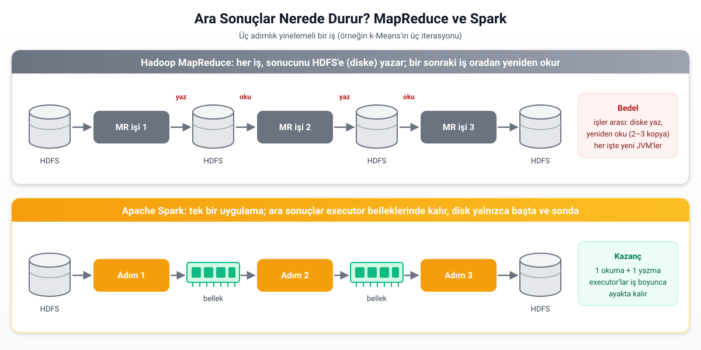
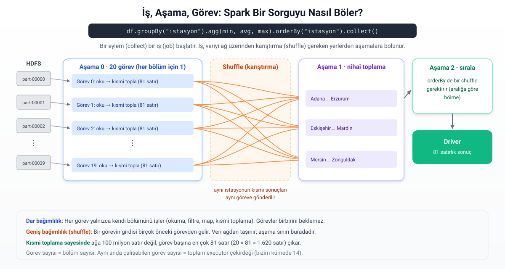
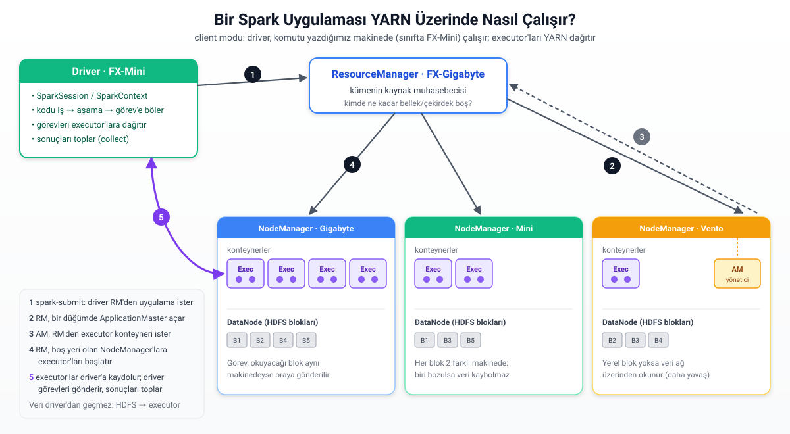
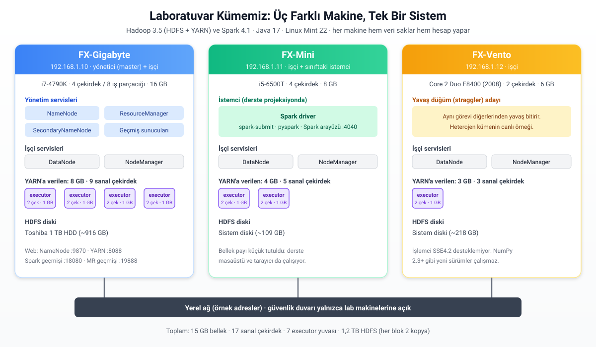
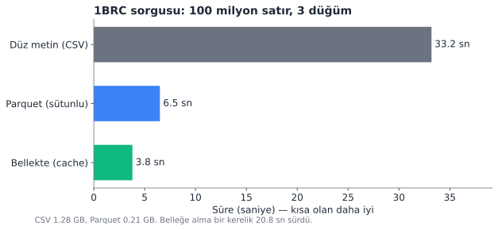
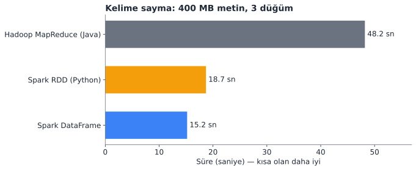
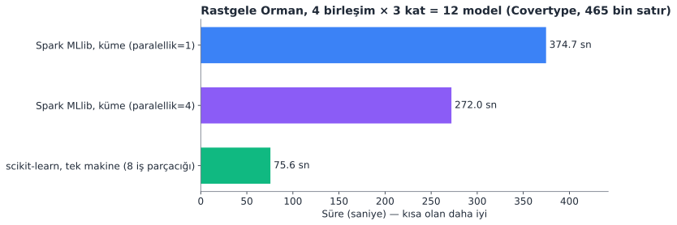
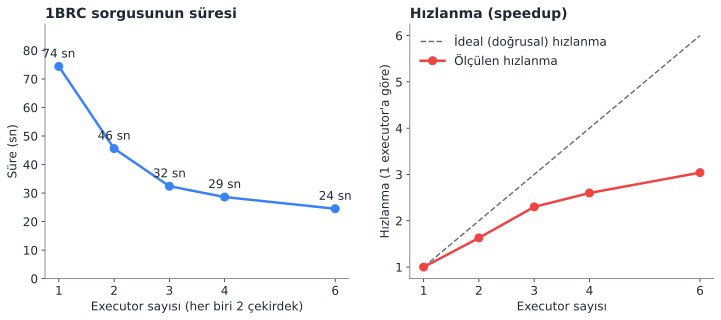
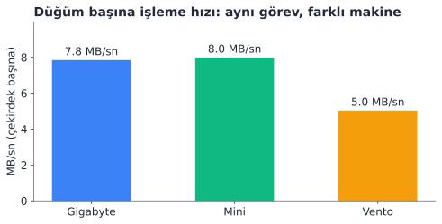

# Spark ve YARN ile Dağıtık Veri Madenciliği: Laboratuvar Kümesi Uygulaması

*Veri Madenciliğinde İleri Konular ve Büyük Veri — ek ders notu*

Ana ders notunun ([ders_notu.md](ders_notu.md)) Kısım I'inde veri madenciliği algoritmalarını tek bir bilgisayarda çalıştırdık. 12. bölümde de bu algoritmaların veri büyüdükçe neden tıkandığını gördük. Kısım II'de Hadoop'un iki temel bileşeni olan HDFS'i ve YARN'ı tanıdık. Ardından MapReduce ile ilk işimizi çalıştırdık ve Spark'ın adını andık. Bu ek not, iki kısmı birleştiren köprüdür. Laboratuvardaki üç bilgisayarı gerçek bir **Hadoop + Spark kümesine** dönüştürüyor, 12.7'deki "1 Milyar Satır" problemini ve bir makine öğrenmesi modelinin hiperparametre aramasını bu küme üzerinde çalıştırıyoruz.

Notun amacı yalnızca komutları sıralamak değildir. Her adımda üç soruya cevap arayacağız: **Ne yapıyoruz? Neden böyle yapıyoruz? Sonuç bize ne öğretiyor?** Bu yüzden notta verilen bütün süreler ve sayılar, laboratuvardaki kümede gerçekten ölçülmüş değerlerdir. Uygulama dosyaları [uygulamalar/spark_yarn_kumesi](uygulamalar/spark_yarn_kumesi/) klasöründedir.

## İçindekiler

1. [Neden Spark? MapReduce'tan Bellek İçi İşlemeye](#1-neden-spark-mapreducetan-bellek-içi-işlemeye)
2. [Spark'ın Temel Kavramları](#2-sparkın-temel-kavramları)
3. [Spark, YARN Üzerinde Nasıl Çalışır?](#3-spark-yarn-üzerinde-nasıl-çalışır)
4. [Laboratuvar Kümemiz](#4-laboratuvar-kümemiz)
5. [Kurulum: Adım Adım](#5-kurulum-adım-adım)
6. [Uygulama 0: Küme Ayakta mı?](#6-uygulama-0-küme-ayakta-mı)
7. [Uygulama 1: Veriyi Dağıtık Üretmek ve HDFS'i Tanımak](#7-uygulama-1-veriyi-dağıtık-üretmek-ve-hdfsi-tanımak)
8. [Uygulama 2: 1BRC'yi Spark ile Çözmek](#8-uygulama-2-1brcyi-spark-ile-çözmek)
9. [Uygulama 3: Kelime Sayma — MapReduce ve Spark Yarışıyor](#9-uygulama-3-kelime-sayma--mapreduce-ve-spark-yarışıyor)
10. [Uygulama 4: MLlib ile Dağıtık Hiperparametre Araması](#10-uygulama-4-mllib-ile-dağıtık-hiperparametre-araması)
11. [Uygulama 5: Ölçekleme Deneyi ve Yavaş Düğüm](#11-uygulama-5-ölçekleme-deneyi-ve-yavaş-düğüm)
12. [Kümenin Pencereleri: Web Arayüzlerini Okumak](#12-kümenin-pencereleri-web-arayüzlerini-okumak)
13. [Özet: Ne Öğrendik?](#13-özet-ne-öğrendik)
14. [Alıştırmalar](#14-alıştırmalar)
15. [Kaynaklar](#15-kaynaklar)

---

## 1. Neden Spark? MapReduce'tan Bellek İçi İşlemeye

### 1.1 MapReduce'un İki Sınırı

Ana notta MapReduce'u bir yapboz benzetmesiyle anlattık: İş parçalara bölünür (**Map**), parçaların sonuçları birleştirilir (**Reduce**). Bu model, 2000'lerin başında binlerce ucuz bilgisayarla terabaytlarca veriyi işlemeyi mümkün kıldı. Ancak modelin tasarımındaki iki tercih, zamanla bir sınıra dönüştü.

**Birinci sınır: Her iş sonucunu diske yazar.** Bir MapReduce işi bittiğinde çıktısını HDFS'e yazar. HDFS her bloğu birden fazla makinede sakladığı için bu yazma işlemi ağ üzerinden kopyalamayı da içerir. Bir sonraki iş, girdisini yine HDFS'ten okur. Tek adımlık bir iş için bu sorun değildir. Ancak veri madenciliği algoritmalarının çoğu **yinelemelidir (iterative)**. k-Means her iterasyonda merkezleri günceller, lojistik regresyon her adımda ağırlıkları biraz daha iyileştirir, PageRank sayfa skorlarını defalarca yeniden hesaplar. MapReduce'ta her iterasyon ayrı bir iştir. Yirmi iterasyon, yirmi kez diske yazıp yeniden okumak demektir.

**İkinci sınır: Her iş sıfırdan başlar.** Her MapReduce işi kendi Java sanal makinelerini (JVM) başlatır, işini bitirir ve kapatır. Bir sonraki iş, aynı makinelerde yeni JVM'ler açar. Saniyeler süren bu hazırlık, kısa işlerin süresinin önemli bir kısmını oluşturur.

### 1.2 Spark'ın Cevabı

Apache Spark, 2009'da UC Berkeley'de tam olarak bu iki soruna cevap olarak geliştirildi. Temel fikri şudur: **Bir uygulamanın bütün adımları tek bir program içinde planlanır ve ara sonuçlar mümkün olduğunca işçi makinelerin belleğinde tutulur.** Disk yalnızca başta (girdiyi okumak) ve sonda (sonucu yazmak) kullanılır.



Spark'ın işçi süreçlerine **executor** denir. Executor'lar uygulama başladığında bir kez açılır ve uygulama bitene kadar ayakta kalır. Her adımda yeniden başlatılmazlar. Bu iki fark, özellikle yinelemeli algoritmalarda MapReduce'a göre on kat ile yüz kat arasında hızlanma sağlar. Bu notun 9. bölümünde aynı işi iki sistemde yarıştırıp farkı kendi kümemizde ölçeceğiz.

### 1.3 Spark, Hadoop'un Yerini mi Aldı?

Sıkça yapılan bir yanlış, "Spark çıktı, Hadoop öldü" demektir. Doğrusu şudur: Spark, Hadoop'un yalnızca **hesaplama motorunun (MapReduce)** yerini almıştır. Spark'ın kendi dosya sistemi yoktur. Veriyi HDFS'ten, Amazon S3'ten veya yerel diskten okur. Kendi başına bir küme kaynak yöneticisi olarak da kullanılabilir. Kurumsal ortamlarda ise kaynakları genellikle **YARN** yönetir. Bu yüzden bugün tipik bir büyük veri platformu şöyle katmanlanır:

| Katman | Görev | Bizim kümede |
|---|---|---|
| Depolama | Veriyi bloklara bölüp makinelere dağıtmak, kopyalarını tutmak | **HDFS** |
| Kaynak yönetimi | Hangi işin hangi makinede ne kadar bellek ve çekirdek kullanacağına karar vermek | **YARN** |
| Hesaplama | Veriyi işlemek: SQL, makine öğrenmesi, akış işleme | **Spark** (ve karşılaştırma için MapReduce) |

Ana notta Apache Mahout'u "yapay zekânın dedesi" olarak anmıştık. Mahout'un MapReduce üzerindeki algoritmaları, yinelemeli makine öğrenmesinin diske yazma maliyeti yüzünden zamanla terk edildi. Bugün aynı işi Spark'ın kendi makine öğrenmesi kütüphanesi **MLlib** yapar. 10. bölümde MLlib ile bir sınıflandırma modelini küme üzerinde eğiteceğiz.

---

## 2. Spark'ın Temel Kavramları

### 2.1 RDD ve DataFrame

Spark'ın ilk ve en temel veri yapısı **RDD**'dir (*Resilient Distributed Dataset*, dayanıklı dağıtık veri kümesi). RDD, kümedeki makinelere bölünmüş, değiştirilemez bir kayıt koleksiyonudur. "Dayanıklı" sözcüğü önemlidir: Bir makine çökerse, RDD'nin kaybolan parçası diskteki bir yedekten değil, **nasıl üretildiğinin kaydından (soy ağacı, lineage)** yeniden hesaplanır. Spark her RDD için "bu veri, şu dosyanın şu satırlarına şu fonksiyonlar uygulanarak elde edildi" bilgisini tutar.

RDD esnektir ama Spark, RDD'nin içindeki verinin yapısını bilmez. Ona verdiğimiz Python fonksiyonları onun için kara kutudur. **DataFrame** ise sütunları ve tipleri belli olan bir tablodur. Tıpkı pandas'taki veya bir veritabanındaki tablo gibi. Spark DataFrame üzerinde ne yapmak istediğimizi (gruplama, filtreleme, birleştirme) bildiği için iki şey kazanır:

* **Catalyst sorgu iyileştiricisi** sorguyu yeniden düzenler. Örneğin filtreleri olabildiğince erken uygular ve gereksiz sütunları hiç okumaz.
* **Tungsten yürütme motoru** veriyi bellekte sıkıştırılmış ikili biçimde tutar ve sorgu için özel Java kodu üretir. Python'da yazdığımız DataFrame kodu bile aslında JVM içinde çalışır.

Bu yüzden günümüzde Spark ile çalışırken **DataFrame (veya Spark SQL) birincil tercihtir**. RDD ise DataFrame'in ifade edemediği özel işler ve kavramları öğrenmek için kullanılır. 9. bölümde aynı kelime sayma işini iki API ile yazıp farkı ölçeceğiz.

### 2.2 Dönüşümler, Eylemler ve Tembel Değerlendirme

Spark'ta veri üzerindeki işlemler iki türlüdür:

* **Dönüşüm (transformation):** Yeni bir RDD/DataFrame tanımlar. `select`, `where`, `groupBy`, `join`, `map`, `filter` gibi. Dönüşüm yazıldığı anda **hiçbir hesaplama yapılmaz.**
* **Eylem (action):** Bir sonuç ister. `count`, `collect`, `show`, `write` gibi. Spark ancak bir eylem geldiğinde o ana kadar biriken dönüşümlerin tamamını planlar ve çalıştırır.

Bu davranışa **tembel değerlendirme (lazy evaluation)** denir. İlk bakışta tuhaf görünse de büyük bir avantaj sağlar. Spark, bütün zinciri görmeden işe başlamadığı için zinciri bir bütün olarak iyileştirebilir. Örneğin hemen ardından bir filtre geldiğini bildiği bir okuma işleminde, filtreye uymayan satırları baştan hiç belleğe almaz.

### 2.3 Bölüm, Görev, Aşama, İş

Spark'ın bir sorguyu nasıl paralelleştirdiğini anlamak için dört kavramı birbirinden ayırmak gerekir:

* **Bölüm (partition):** Verinin, bir çekirdeğin tek seferde işleyeceği parçası. HDFS'teki bir dosya tipik olarak 128 MB'lık parçalara bölünür.
* **Görev (task):** Bir bölüm üzerinde yapılan iş. **Görev sayısı = bölüm sayısı.**
* **Aşama (stage):** Veriyi ağ üzerinden yeniden dağıtmaya gerek kalmadan art arda yapılabilen işlemler zinciri.
* **İş (job):** Bir eylemin tetiklediği aşamaların tamamı.

Aşamaların nerede bölündüğünü belirleyen, **karıştırma (shuffle)** ihtiyacıdır. `where` veya `select` gibi işlemlerde her görev yalnızca kendi bölümüne bakar. Bunlara **dar bağımlılık (narrow dependency)** denir. `groupBy` gibi işlemlerde ise aynı anahtara (örneğin aynı istasyona) ait satırlar farklı bölümlere dağılmıştır. Hepsinin aynı yerde toplanması gerekir. Bu, verinin ağ üzerinden yeniden dağıtılması, yani shuffle demektir. Bunlara **geniş bağımlılık (wide dependency)** denir. Her shuffle, iş akışını yeni bir aşamaya böler.



Şekildeki örnek, 8. bölümde çalıştıracağımız 1BRC sorgusudur. Dikkat edilmesi gereken en önemli ayrıntı **kısmi toplamadır (partial aggregation)**. Spark, ağa 100 milyon satırı göndermek yerine her görevde önce kendi bölümündeki istasyonların en küçük, en büyük, toplam ve sayı değerlerini hesaplar. Ağa her görevden en fazla 81 satır (il sayısı) çıkar. Ana notun 12.7 bölümünde paralel Python ile elle yaptığımız "parçala, ara sonuç üret, birleştir" stratejisinin aynısını, Spark bizim yerimize otomatik olarak uygular.

### 2.4 Driver, Executor ve Küme Yöneticisi

Her Spark uygulamasında iki tür süreç vardır:

* **Driver (sürücü):** Bizim yazdığımız programın ana süreci. Kodu okur, işleri aşamalara ve görevlere böler, görevleri executor'lara dağıtır ve sonuçları toplar. Bir orkestra şefi gibidir: Kendisi çalgı çalmaz, kimin ne zaman çalacağını söyler.
* **Executor (yürütücü):** İşçi makinelerde çalışan süreçler. Görevleri yürütür ve gerektiğinde veriyi belleklerinde tutar. Her executor'ın belli sayıda çekirdeği ve belli miktarda belleği vardır.

Executor'ları hangi makinede, kaç tane ve ne büyüklükte açacağına **küme yöneticisi (cluster manager)** karar verir. Spark üç küme yöneticisiyle çalışabilir: kendi basit yöneticisi (*Standalone*), **YARN** ve **Kubernetes**. Biz, ana notta tanıdığımız Hadoop altyapısıyla bütünleşmek için YARN'ı kullanıyoruz.

### 2.5 Hata Toleransı: İki Ayrı Mekanizma

Kümemizde hatalara karşı iki farklı koruma vardır ve ikisini karıştırmamak gerekir:

* **HDFS replikasyonu veriyi korur.** Her blok birden fazla makinede saklanır (bizim kümede 2 kopya). Bir disk bozulursa veri diğer kopyadan okunur.
* **Spark'ın soy ağacı (lineage) hesaplamayı korur.** Bir executor çökerse, kaybolan ara sonuçlar diske yedeklenmiş kopyalardan değil, soy ağacındaki adımlar yeniden çalıştırılarak üretilir. Spark yalnızca kaybolan bölümleri yeniden hesaplar, işin tamamını değil.

---

## 3. Spark, YARN Üzerinde Nasıl Çalışır?

Bir Spark uygulamasını `spark-submit` ile başlattığımızda arka planda şekildeki diyalog gerçekleşir:



1. **Driver, ResourceManager'a başvurur.** Bizim kümede driver, komutu yazdığımız makinede (derste FX-Mini) çalışır. Buna **client modu** denir. Driver'ın da kümenin içindeki bir konteynerde çalıştığı **cluster modu**, uzun süren ve kimsenin başında beklemediği işler için tercih edilir.
2. **ResourceManager bir ApplicationMaster (AM) başlatır.** YARN'da her uygulamanın, kendi kaynak pazarlığını yapan küçük bir yöneticisi vardır. RM, boş yeri olan bir düğümdeki NodeManager'a bu AM konteynerini başlatmasını söyler.
3. **AM, executor konteynerleri ister.** "2 çekirdek ve 1 GB bellekli 7 konteyner" gibi.
4. **RM, uygun NodeManager'larda executor'ları başlatır.** YARN her düğümün ne kadar bellek ve çekirdek sunduğunu bilir ve konteynerleri bu kapasiteye göre yerleştirir.
5. **Executor'lar driver'a kaydolur.** Bu andan itibaren YARN aradan çekilir. Driver görevleri doğrudan executor'lara gönderir.

İki ayrıntının altını çizelim:

* **Veri driver'dan geçmez.** Her executor kendi görevinin verisini doğrudan HDFS'ten okur. Spark görevleri mümkün olduğunca, okunacak bloğun bulunduğu makinedeki executor'a gönderir. Ana notta "hesaplamayı veriye götürmek (data locality)" dediğimiz ilke budur.
* **YARN, istenen bellekten fazlasını ayırır.** 1 GB'lık bir executor için Spark, JVM'in kendi ihtiyaçları için en az 384 MB **ek bellek (overhead)** ister: 1024 + 384 = 1408 MB. YARN da her isteği, en küçük ayırma biriminin (bizde 512 MB) katına yukarı yuvarlar: **1536 MB**. Kümenin kapasitesini planlarken hesap bu gerçek değerle yapılmalıdır.

---

## 4. Laboratuvar Kümemiz

### 4.1 Makineler ve Rolleri

Kümemiz, laboratuvarda zaten bulunan üç bilgisayardan oluşur. Hiçbiri sunucu değildir. Biri 2008 yılından kalma bir masaüstüdür.



| Makine | IP | İşlemci | Bellek | Rol | YARN'a verilen |
|---|---|---|---|---|---|
| FX-Gigabyte | 192.168.1.10 | i7-4790K, 4 çekirdek / 8 iş parçacığı | 16 GB | **Yönetici (master)** + işçi | 8 GB, 9 sanal çekirdek |
| FX-Mini | 192.168.1.11 | i5-6500T, 4 çekirdek | 8 GB | İşçi + sınıftaki **istemci** | 4 GB, 5 sanal çekirdek |
| FX-Vento | 192.168.1.12 | Core 2 Duo E8400, 2 çekirdek | 6 GB | İşçi | 3 GB, 3 sanal çekirdek |

*Not: Bu notta ve yapılandırma dosyalarında geçen IP adresleri ve kullanıcı adı örnektir; laboratuvardaki gerçek değerler güvenlik nedeniyle paylaşılmamıştır.*

Yönetici makinede HDFS'in **NameNode**'u (dosya sisteminin haritası), YARN'ın **ResourceManager**'ı (kaynak muhasebecisi) ve biten işlerin kayıtlarını gösteren **geçmiş sunucuları** çalışır. Üç makinenin üçünde de bir **DataNode** (veri bloklarını saklar) ve bir **NodeManager** (konteynerleri çalıştırır) vardır. Yani her makine hem veri saklar hem de hesap yapar.

### 4.2 Tasarım Kararları ve Gerekçeleri

**Neden YARN + HDFS?** Spark'ın kendi Standalone yöneticisi daha kolay kurulur. Ancak bu derste Hadoop ekosisteminin bileşenlerinin (HDFS, YARN, MapReduce, Spark) aynı kaynakları paylaşarak nasıl birlikte çalıştığını görmek istiyoruz. YARN üzerinde hem MapReduce hem Spark işleri aynı kümede, aynı kurallarla çalışır. 9. bölümdeki yarış bu sayede adil olur.

**Neden heterojen kaynak payları?** Üç makinenin gücü çok farklıdır. Her düğüm YARN'a kendi kapasitesine uygun miktarda kaynak bildirir. Mini'nin payı bilerek küçük tutuldu, çünkü derste aynı makinede masaüstü, tarayıcı ve driver da çalışır. Vento ise eski ve yavaş bir makine olarak kümede bilerek tutuldu. 11. bölümde göreceğimiz "yavaş düğüm (straggler)" olgusunu canlı olarak gösterir.

**Neden sanal çekirdek sayıları fiziksel çekirdekten bir fazla?** YARN'ın varsayılan hesaplayıcısı (`DefaultResourceCalculator`) yalnızca belleğe bakar, çekirdekleri saymaz. Biz `DominantResourceCalculator`'ı seçerek çekirdekleri de hesaba kattık. Ancak bu durumda Spark'ın küçük ApplicationMaster konteyneri de 1 çekirdek ister. AM hangi makineye düşerse o makinede bir executor'lık yer kalmıyor ve kümeye 7 yerine 6 executor sığıyordu. Her düğüme "AM payı" olarak 1 sanal çekirdek eklemek bu sorunu çözdü. **Sanal çekirdek (vcore), YARN'ın muhasebe birimidir. Fiziksel çekirdekle bire bir aynı olmak zorunda değildir.**

**Neden makine adları yerine IP adresleri?** Kampüs DNS'i lab makinelerinin adlarını çözmüyor. Linux Mint de her makinenin kendi adını `127.0.1.1` (geri döngü) adresine bağlıyor. Hadoop dünyasındaki en yaygın kurulum hatası tam olarak budur: Bir servis kendini "FX-Mini" adıyla tanıtır, diğer makineler bu adı ya çözemez ya da yanlış adrese çözer. Biz her servisi doğrudan IP adresiyle tanıttık (5.4 bölümü).

---

## 5. Kurulum: Adım Adım

Bu bölüm, kümemizi nasıl kurduğumuzu tekrarlanabilir biçimde anlatır. Kendi bilgisayarlarınızda veya sanal makinelerde aynı adımları izleyebilirsiniz. Değiştirmeniz gerekenler IP adresleri, kullanıcı adı ve düğüm başına bellek/çekirdek değerleridir. Bütün dosyaların son hâli [uygulamalar/spark_yarn_kumesi/yapilandirma](uygulamalar/spark_yarn_kumesi/yapilandirma/) klasöründedir.

### 5.1 Ön Koşullar

* **Aynı kullanıcı adı ve aynı dizin yapısı:** Bütün makinelerde `hduser` kullanıcısı ve `~/bigdata` klasörü. Hadoop'un başlatma betikleri diğer makinelerde aynı yolları arar.
* **Java 17:** Hadoop 3.5, sunucu tarafında Java 17 ister. Spark 4.x de Java 17 veya 21 ile çalışır. Linux Mint 22'de `openjdk-17` paketi hazır geliyordu.
* **Parolasız SSH:** Yönetici makine, diğer makinelerdeki servisleri SSH ile başlatır. Bunun için yöneticinin açık anahtarı, kendisi dahil bütün makinelerin `~/.ssh/authorized_keys` dosyasında olmalıdır.
* **Aynı Python sürümü:** PySpark, driver'daki Python ile executor'lardaki Python'un küçük sürümünün (3.12 gibi) aynı olmasını şart koşar. Üç makinede de Python 3.12.3 vardı.

Kurulumun hiçbir adımı yönetici (`sudo`) yetkisi gerektirmez. Bütün yazılımlar kullanıcının ev dizinine kurulur ve 1024'ün üzerindeki portları kullanır. Tek istisna güvenlik duvarıdır (5.7).

### 5.2 İndirme ve Yerleştirme

Yazılımlar yönetici makineye bir kez indirilir:

```bash
mkdir -p ~/bigdata/indirilen && cd ~/bigdata/indirilen
wget https://dlcdn.apache.org/hadoop/common/hadoop-3.5.0/hadoop-3.5.0.tar.gz
wget https://dlcdn.apache.org/spark/spark-4.1.3/spark-4.1.3-bin-hadoop3.tgz
# İndirilen dosyanın bozulmadığını SHA-512 özetiyle doğrulamak iyi bir alışkanlıktır
wget https://dlcdn.apache.org/hadoop/common/hadoop-3.5.0/hadoop-3.5.0.tar.gz.sha512
sha512sum -c hadoop-3.5.0.tar.gz.sha512

cd ~/bigdata
tar xzf indirilen/hadoop-3.5.0.tar.gz
tar xzf indirilen/spark-4.1.3-bin-hadoop3.tgz
ln -s hadoop-3.5.0 hadoop                    # sürümden bağımsız kısa yol
ln -s spark-4.1.3-bin-hadoop3 spark
```

Kısa yollar (`hadoop`, `spark`) sayesinde ileride yeni bir sürüme geçmek, yalnızca bağlantıyı değiştirmekten ibaret olur.

### 5.3 Ortam Değişkenleri

`~/bigdata/ortam.sh` dosyası bütün değişkenleri tek yerde toplar ve `~/.bashrc` içinden okunur:

```bash
export JAVA_HOME=/usr/lib/jvm/java-17-openjdk-amd64
export HADOOP_HOME=$HOME/bigdata/hadoop
export HADOOP_CONF_DIR=$HADOOP_HOME/etc/hadoop
export SPARK_HOME=$HOME/bigdata/spark
export PYSPARK_PYTHON=$HOME/bigdata/venv/bin/python
export PATH=$HOME/bigdata:$HADOOP_HOME/bin:$HADOOP_HOME/sbin:$SPARK_HOME/bin:$PATH
```

`HADOOP_CONF_DIR` özellikle önemlidir: Spark, HDFS'in ve YARN'ın nerede olduğunu bu klasördeki dosyalardan öğrenir.

### 5.4 Hadoop Yapılandırması

Hadoop'un yapılandırma dosyaları `$HADOOP_HOME/etc/hadoop` altındadır. Her dosya bir bileşenin "anayasası"dır.

**`hadoop-env.sh` (sonuna eklenenler).** Bütün Hadoop servisleri başlarken bu dosyayı okur. Burada iki zekice kısayol kullandık. Birincisi, her düğüm kendi IP adresini kendisi bulur. İkincisi, kendi kaynak payını IP'sine göre seçer. Böylece **tek bir yapılandırma bütün düğümlere aynen kopyalanabilir.**

```bash
export JAVA_HOME=/usr/lib/jvm/java-17-openjdk-amd64
export HADOOP_SSH_OPTS="-i $HOME/.ssh/id_lab -o BatchMode=yes"
# Her düğüm kendini yerel ağ IP'siyle tanıtır
export FX_IP=$(ip -4 -o addr show | grep -oE '192\.168\.1\.[0-9]+' | head -1)
case "$FX_IP" in
  192.168.1.10) export FX_NM_MB=8192 FX_NM_CORES=9 ;;   # Gigabyte
  192.168.1.11) export FX_NM_MB=4096 FX_NM_CORES=5 ;;   # Mini
  192.168.1.12) export FX_NM_MB=3072 FX_NM_CORES=3 ;;   # Vento
esac
```

**`core-site.xml`: HDFS'in adresi.** Bütün istemciler `hdfs:///veri/...` gibi kısa yolları bu adrese göre çözer.

```xml
<property><name>fs.defaultFS</name><value>hdfs://192.168.1.10:9000</value></property>
<property><name>hadoop.tmp.dir</name><value>/home/hduser/bigdata/veri/tmp</value></property>
```

**`hdfs-site.xml`: Kopya sayısı ve veri klasörleri.**

```xml
<property><name>dfs.replication</name><value>2</value></property>
<property><name>dfs.namenode.name.dir</name><value>file:///home/hduser/bigdata/veri/namenode</value></property>
<property><name>dfs.datanode.data.dir</name><value>file:///home/hduser/bigdata/veri/datanode</value></property>
<!-- DNS lab makinelerinin adlarını çözmediği için IP ile kayda izin ver -->
<property><name>dfs.namenode.datanode.registration.ip-hostname-check</name><value>false</value></property>
```

Kopya sayısını 3 yerine 2 seçtik. Üç düğümlü bir kümede 3 kopya, her bloğun her makinede olması demektir. Bu hem disk israfıdır hem de replikasyonun "veriyi farklı makinelere dağıtma" fikrini görünmez kılar. Yönetici makinede `~/bigdata/veri`, 1 TB'lık ayrı bir diske bağlantıdır. Diğer makinelerde sistem diskindedir.

**`yarn-site.xml`: Kaynak yöneticisi.** `${env.FX_IP}` gibi ifadeler, değeri `hadoop-env.sh`'ta tanımlanan ortam değişkeninden alır.

```xml
<property><name>yarn.resourcemanager.hostname</name><value>192.168.1.10</value></property>
<property><name>yarn.nodemanager.hostname</name><value>${env.FX_IP}</value></property>
<property><name>yarn.nodemanager.resource.memory-mb</name><value>${env.FX_NM_MB}</value></property>
<property><name>yarn.nodemanager.resource.cpu-vcores</name><value>${env.FX_NM_CORES}</value></property>
<property><name>yarn.scheduler.minimum-allocation-mb</name><value>512</value></property>
<property><name>yarn.nodemanager.vmem-check-enabled</name><value>false</value></property>
<property><name>yarn.nodemanager.aux-services</name><value>mapreduce_shuffle</value></property>
<property><name>yarn.log-aggregation-enable</name><value>true</value></property>
```

`vmem-check-enabled=false` satırı, Java'nın sanal bellek kullanımını gerçek kullanımından çok yüksek göstermesi yüzünden YARN'ın konteynerleri haksız yere öldürmesini önler. Bu, Hadoop kurulumlarının bilinen bir tuzağıdır.

**`capacity-scheduler.xml`.** Yalnızca bir satır değişti: Çekirdekleri de saymak için `DominantResourceCalculator` (4.2'deki gerekçe).

**`mapred-site.xml`** MapReduce işlerinin YARN üzerinde çalışacağını söyler. **`workers`** ise işçi düğümlerin listesidir (üç IP adresi).

### 5.5 Spark Yapılandırması

Spark'ı YARN'a bağlamak için ayrı bir sunucu kurmak gerekmez. Spark, `HADOOP_CONF_DIR`'deki dosyalardan ResourceManager'ın yerini öğrenir. `$SPARK_HOME/conf/spark-defaults.conf`:

```properties
spark.master                      yarn
spark.submit.deployMode           client
spark.yarn.archive                hdfs:///spark/spark-jars.zip
spark.executor.cores              2
spark.executor.memory             1g
spark.executor.instances          7
spark.eventLog.enabled            true
spark.eventLog.dir                hdfs:///spark-logs
spark.history.fs.logDirectory     hdfs:///spark-logs
spark.yarn.historyServer.address  192.168.1.10:18080
```

* `spark.yarn.archive`: Spark'ın ~400 MB'lık kütüphaneleri her uygulamada yeniden yüklenmesin diye bir kez HDFS'e konur: `cd $SPARK_HOME/jars && zip -q -0 /tmp/spark-jars.zip *.jar && hdfs dfs -put /tmp/spark-jars.zip /spark/`.
* `executor.instances 7`: 3.'teki hesapla her executor YARN'da 1536 MB tutar. Gigabyte'a 4, Mini'ye 2, Vento'ya 1 executor sığar. Varsayılan ayar "kümenin tamamını kullan" demektir.
* `eventLog`: Biten uygulamaların kaydı HDFS'e yazılır. Böylece uygulama bittikten sonra da Spark arayüzündeki ayrıntılar History Server'dan incelenebilir.

`spark-env.sh` dosyasında Spark'a hangi ağ adresini kullanacağını da söyledik (`SPARK_LOCAL_IP`). Bir makinede VPN gibi başka ağ arabirimleri de olabilir. Spark yanlış arabirimi seçerse executor'lar driver'a ulaşamaz.

### 5.6 Diğer Düğümlere Dağıtma ve Python Ortamı

Yönetici makinede hazırlanan klasör, diğer makinelere `rsync` ile aynen kopyalanır:

```bash
for h in 192.168.1.11 192.168.1.12; do
    rsync -a --exclude veri --exclude indirilen --exclude venv ~/bigdata/ $h:bigdata/
done
```

Her makinede aynı yolda bir Python sanal ortamı kurulur (`~/bigdata/venv`, NumPy ve pandas). Executor'lar Python kodunu bu ortamla çalıştırır. Vento'nun işlemcisi SSE4.2 komut setini desteklemediği için NumPy'ın 2.3 ve sonraki sürümleri orada çalışmaz. **Kümedeki bütün makinelerde aynı sürümleri kullanmak gerektiğinden en zayıf makine sürüm sınırını belirler:** `numpy<2.3`, `pandas<2.3`.

### 5.7 Güvenlik Duvarı

Hadoop ve Spark servisleri birbirleriyle onlarca farklı porttan konuşur. Bunların bir kısmı her çalıştırmada rastgele seçilir. Makinelerimizde `ufw` güvenlik duvarı açık ve gelen bağlantıları varsayılan olarak reddediyordu. Her makinede **yalnızca küme üyelerinden** gelen bağlantılara izin verdik:

```bash
sudo ufw allow from 192.168.1.10 comment "lab kumesi"   # her makinede, diğer küme üyeleri için
```

Bu adımı atlarsanız küme "kurulmuş gibi" görünür, ama ilk veri yazma işleminde şu hatayı alırsınız: `Exception in createBlockOutputStream ... firstBadLink as 192.168.1.11:9866`. Bizim kümede yaşanan da tam olarak buydu (5.9).

### 5.8 Biçimlendirme, Başlatma ve Doğrulama

HDFS, ilk kullanımdan önce **bir kez** biçimlendirilir. Bu komut NameNode'un boş haritasını oluşturur. Çalışan bir kümede tekrarlanırsa bütün veri erişilemez hâle gelir!

```bash
hdfs namenode -format -nonInteractive -clusterId lab-kumesi
```

Kümeyi başlatmak, durdurmak ve durumunu görmek için tek bir `kume` betiği yazdık. Betik hangi lab makinesinden çalıştırılırsa çalıştırılsın işi yönetici makinede yapar:

```bash
kume baslat     # start-dfs.sh + start-yarn.sh + geçmiş sunucuları
kume durum      # canlı DataNode'lar ve NodeManager'lar
kume durdur
```

Doğrulama için üç komut yeterlidir:

```text
$ jps                                   # bu makinede hangi Java servisleri çalışıyor?
NameNode  DataNode  SecondaryNameNode  ResourceManager  NodeManager  HistoryServer  JobHistoryServer

$ hdfs dfsadmin -report | grep -E "Live|Name:"
Live datanodes (3):
Name: 192.168.1.10:9866 (192.168.1.10)
Name: 192.168.1.11:9866 (192.168.1.11)
Name: 192.168.1.12:9866 (192.168.1.12)

$ yarn node -list
192.168.1.10:42977   RUNNING   192.168.1.10:8042
192.168.1.11:45579   RUNNING   192.168.1.11:8042
192.168.1.12:46429   RUNNING   192.168.1.12:8042
```

### 5.9 Karşılaştığımız Sorunlar ve Çözümleri

Gerçek bir kurulum nadiren ilk denemede sorunsuz biter. Bizim kurulumumuzda karşılaştığımız sorunlar, sizin de karşılaşma olasılığınız en yüksek olanlardır:

| Belirti | Sebep | Çözüm |
|---|---|---|
| Makineler birbirinin adını çözemiyor; servisler `127.0.1.1`'e bağlanıyor | Kampüs DNS'i lab adlarını bilmiyor; Mint kendi adını geri döngü adresine bağlıyor | Bütün adreslerde IP kullanmak; NodeManager ve Spark için IP'yi ortam değişkeniyle vermek |
| HDFS'e yazarken `firstBadLink as 192.168.1.11:9866` | Mini'nin güvenlik duvarı DataNode portunu engelliyor | Küme üyelerine `ufw allow from ...` |
| Vento'da `ensurepip is not available` | `python3-venv` paketi kurulu değil (kurmak `sudo` ister) | Sanal ortamı `uv` aracıyla oluşturmak |
| 7 executor istendiği hâlde bazen 6 executor açılıyor, Vento'ya iş düşmüyor | ApplicationMaster'ın 1 çekirdeği, düştüğü makinede bir executor'ın yerini alıyor | Her düğüme +1 sanal çekirdek "AM payı" (4.2) |
| Spark çıktısı yüzlerce `INFO` satırında kayboluyor | Varsayılan günlük seviyesi | `conf/log4j2.properties` içinde `rootLogger.level = warn` |

---

## 6. Uygulama 0: Küme Ayakta mı?

İlk uygulama yalnızca bir sağlık kontrolüdür. 600 küçük görevi 60 bölüme dağıtır ve her görevin hangi makinede çalıştığını sayar:

```python
def gorev_bilgisi(_):
    # Bu fonksiyon sürücüde değil, executor'larda (worker makinelerde) çalışır
    import platform, socket
    return (socket.gethostname(), platform.python_version())

sayac = Counter(sc.parallelize(range(600), 60).map(gorev_bilgisi).collect())
```

```text
$ spark-submit python/00_kume_testi.py
Görevlerin çalıştığı makineler:
  FX-Gigabyte  Python 3.12.3  → 390 görev
  FX-Mini      Python 3.12.3  → 170 görev
  FX-Vento     Python 3.12.3  → 40 görev
```

Bu küçük çıktı üç şey söyler. Birincisi, `gorev_bilgisi` fonksiyonu driver'da değil **üç farklı makinede** çalıştı. Spark fonksiyonu serileştirip (pickle) executor'lara gönderdi. İkincisi, üç makinedeki Python sürümleri aynı. Üçüncüsü, görevler eşit dağılmadı: 4 executor'lık Gigabyte en çok, tek executor'lık Vento en az görevi aldı. Spark görevleri önceden paylaştırmaz. **Boşalan çekirdeğe sıradaki görevi verir.** Hızlı makine daha çok görev bitirir. Bu basit kural, 11. bölümde göreceğimiz yavaş düğüm sorununu büyük ölçüde kendiliğinden hafifletir.

---

## 7. Uygulama 1: Veriyi Dağıtık Üretmek ve HDFS'i Tanımak

Ana notun 12.7 bölümünde 10 milyon satırlık sıcaklık ölçümü dosyasını tek bilgisayarda NumPy ile üretmiştik. Bu kez **100 milyon satırı** küme üzerinde üretiyoruz. Üretimin kendisi de dağıtıktır: Her executor kendi bölümündeki satırları üretir ve HDFS'e kendi parça dosyasını yazar. Hiçbir makine verinin tamamını görmez.

```python
olcumler = (
    spark.range(N, numPartitions=BOLUM)                                 # 0..N-1, BOLUM parçaya bölünmüş
    .withColumn("no", (F.rand(42) * len(ISTASYONLAR)).cast("int"))      # rastgele bir istasyon seç
    .join(F.broadcast(istasyon), "no")                                  # küçük tablo her executor'a kopyalanır
    .select("istasyon", F.round(F.col("ort") + F.randn(7) * 8, 1).alias("sicaklik"))
)
olcumler.write.mode("overwrite").option("sep", ";").csv("hdfs:///veri/olcumler_csv")
```

İki ayrıntıya dikkat edelim:

* **`broadcast` birleştirme:** 81 satırlık il tablosu, 100 milyon satırlık tabloyla birleştiriliyor. Büyük tabloyu shuffle etmek yerine küçük tablo her executor'a bir kez kopyalanır. Böylece birleştirme shuffle'sız, dar bağımlılıkla yapılır.
* **`write` bir eylemdir.** Kodun ilk dört satırı hiçbir şey hesaplamaz (tembel değerlendirme). Bütün üretim `write` çağrıldığında başlar.

```text
[süre] 100,000,000 satır üret + HDFS'e yaz: 60.1 sn
HDFS'e yazıldı: hdfs:///veri/olcumler_csv  (1.28 GB, 40 parça dosya)
   Gümüşhane;8.7
   Ardahan;-3.8
   Eskişehir;29.2
```

**HDFS'te ne oldu?** Klasörün içine bakalım:

```bash
hdfs dfs -ls /veri/olcumler_csv | head -3     # part-00000-....csv, part-00001-....csv, ...
hdfs dfs -du -h /veri                          # birinci sütun: veri; ikinci sütun: kopyalarla birlikte
hdfs fsck /veri/olcumler_csv -files -blocks -locations | grep -c Datanode
```

`du` çıktısındaki iki sütun, replikasyonu sayıyla gösterir: 1,2 GB veri, HDFS'te 2,4 GB yer kaplar. `fsck` komutu her bloğun hangi iki makinede saklandığını listeler. Kümeyi test ederken 300 MB'lık bir dosyanın 3 bloğunun 6 kopyasının makinelere 3 (Gigabyte), 2 (Mini), 1 (Vento) olarak dağıldığını gördük. NameNode blokları yerleştirirken makinelerin boş disk alanını ve yazan istemcinin konumunu dikkate alır.

> **Neden 40 dosya?** Spark her bölümü ayrı bir dosyaya yazar. Bu, paralel yazmanın doğal sonucudur: 40 görev aynı dosyaya sırayla yazmak yerine aynı anda 40 ayrı dosyaya yazar. Okurken klasörün tamamı tek bir tablo gibi okunur. Yine de çok sayıda küçük dosya NameNode'u yorar ("küçük dosya sorunu"). Bu yüzden bölüm boyutunu 30-130 MB aralığında tutmak iyi bir alışkanlıktır.

---

## 8. Uygulama 2: 1BRC'yi Spark ile Çözmek

### 8.1 Soru ve Kod

Ana notta R ve Python ile çözdüğümüz soruyu şimdi küme üzerinde soruyoruz: **Her istasyonun en düşük, ortalama ve en yüksek sıcaklığı nedir?**

```python
SEMA = "istasyon STRING, sicaklik DOUBLE"   # şemayı vermek, Spark'ın veriyi baştan taramasını önler

def istasyon_ozeti(df):
    return (df.groupBy("istasyon")
              .agg(F.min("sicaklik").alias("en_dusuk"),
                   F.round(F.avg("sicaklik"), 1).alias("ortalama"),
                   F.max("sicaklik").alias("en_yuksek"),
                   F.count("*").alias("olcum_sayisi"))
              .orderBy("istasyon"))

csv = spark.read.schema(SEMA).option("sep", ";").csv("hdfs:///veri/olcumler_csv")
sonuc = istasyon_ozeti(csv).collect()
```

Kod, pandas veya SQL ile yazacağımız koddan pek farklı değildir. Aradaki fark kodda değil, **kodun nerede çalıştığındadır.**

### 8.2 Spark'ın Planını Okumak

`explain()` metodu, Spark'ın sorguyu nasıl çalıştıracağını gösterir. Plan aşağıdan yukarıya okunur:

```text
AdaptiveSparkPlan
+- Sort [istasyon ASC]
   +- Exchange rangepartitioning(istasyon ASC, 200)                       ← shuffle 2 (sıralama için)
      +- HashAggregate(keys=[istasyon], functions=[min, avg, max, count])  ← nihai toplama
         +- Exchange hashpartitioning(istasyon, 200)                       ← shuffle 1
            +- HashAggregate(keys=[istasyon], functions=[partial_min, partial_avg, partial_max, partial_count])
               +- FileScan csv [istasyon, sicaklik]                        ← HDFS'ten okuma
```

Planda 2.3 bölümünde anlattığımız her şey görünür. `FileScan` ve ilk `HashAggregate` aynı aşamadadır. Her görev okuduğu satırları hemen kısmen toplar (`partial_...`). `Exchange` satırları shuffle noktalarıdır ve iş üç aşamaya bölünür. `AdaptiveSparkPlan` ise Spark'ın **uyarlamalı sorgu yürütme (AQE)** özelliğidir. Planda görünen 200 shuffle bölümü, çalışma anında gerçek veri boyutuna bakılarak birkaç bölüme indirilir. Toplam 81 satır için 200 görev açmak israf olurdu.

### 8.3 Üç Yol, Üç Süre

Aynı sorguyu üç farklı biçimde çalıştırdık:

1. **Düz metin (CSV):** Her sorguda 1,28 GB metin okunur ve her satır ayrıştırılır (metinden sayıya çevrilir).
2. **Bellekte (cache):** Veri bir kez okunup executor'ların belleğine alınır. Sonraki sorgular bellekten çalışır.
3. **Parquet:** Veri bir kez sütunlu ve sıkıştırılmış Parquet biçimine dönüştürülür. Sorgular bu dosyadan çalışır.

```python
onbellek = csv.cache()          # bir dönüşümdür: henüz hiçbir şey olmaz
onbellek.count()                # ilk eylem: veri okunur ve belleğe yerleşir
istasyon_ozeti(onbellek).collect()

csv.write.parquet("hdfs:///veri/olcumler_parquet")     # bir kerelik dönüşüm
istasyon_ozeti(spark.read.parquet("hdfs:///veri/olcumler_parquet")).collect()
```



| Yöntem | Süre | Not |
|---|---|---|
| Düz metin (CSV) | **33,2 sn** | 20 bölüm, 14 çekirdek; her satır ayrıştırılıyor |
| Belleğe alma (bir kerelik) | 20,8 sn | `cache()` + `count()` |
| Bellekteki veriden sorgu | **3,8 sn** | ~9 kat hızlı |
| CSV → Parquet dönüşümü (bir kerelik) | 37,2 sn | |
| Parquet'ten sorgu | **6,5 sn** | ~5 kat hızlı |
| Dosya boyutu | CSV 1,28 GB → Parquet 0,21 GB | **6 kat küçük** |

### 8.4 Sonuçlar Ne Öğretiyor?

**Bellek gerçekten hızlıdır, ama bedava değildir.** Bellekteki veriyle sorgu 3,8 saniyeye indi. Ancak veriyi belleğe almak 20,8 saniye sürdü ve bu bellek başka işlerden alındı. `cache()`, aynı veri üzerinde **birden çok kez** çalışılacaksa kârlıdır. Yinelemeli makine öğrenmesi algoritmaları tam olarak böyledir. Bir kez kullanılacak veri için `cache()` zararlıdır.

**Dosya biçimi, donanım kadar önemlidir.** Parquet iki sebeple hızlıdır. Birincisi, **sütunlu** olduğu için yalnızca sorgunun istediği sütunlar okunur. İkincisi, aynı sütundaki benzer değerler (81 farklı il adı gibi) **sözlük kodlaması ve sıkıştırma** ile çok az yer kaplar. 1,28 GB'lık metin 0,21 GB'a indi. Ana notta 1BRC dersleri arasında saydığımız "dosya formatı önemlidir" maddesini burada kendi ölçümümüzle doğruladık. Kümemize hiçbir donanım eklemeden, yalnızca biçimi değiştirerek 5 kat hız kazandık.

**İlk sorgu her zaman daha yavaştır.** İlk sorgu, Java'nın kodu derleyip hızlandırması (JIT ısınması) ve executor'ların veriyle ilk kez karşılaşması nedeniyle daha uzun sürer. Bu yüzden 11. bölümdeki deneyde her ölçümü iki kez yapıp kısa olanı aldık.

---

## 9. Uygulama 3: Kelime Sayma — MapReduce ve Spark Yarışıyor

### 9.1 Aynı İş, Üç Yol

Kelime sayma (WordCount), büyük veri dünyasının "Merhaba Dünya"sıdır. Ana notta Hadoop'un hazır WordCount programını çalıştırmıştık. Bu kez aynı işi aynı veri üzerinde üç yolla yapıyoruz. Veri, Project Gutenberg'den 20 klasik eserin 25 kopyasından oluşan **400 MB'lık** bir metin derlemidir.

**1) Hadoop MapReduce (Java):** Hadoop'la gelen hazır program.

```bash
hadoop jar $HADOOP_HOME/share/hadoop/mapreduce/hadoop-mapreduce-examples-3.5.0.jar \
       wordcount /veri/kitaplar /cikti/kelime_sayma_mapreduce
```

**2) Spark RDD API'si (Python):** MapReduce'un adımlarını bire bir kendimiz yazarız.

```python
sayimlar = (
    sc.textFile("hdfs:///veri/kitaplar")
    .flatMap(lambda satir: KELIME.findall(satir.lower()))    # map: satır → kelimeler
    .map(lambda kelime: (kelime, 1))                          # map: kelime → (kelime, 1)
    .reduceByKey(lambda a, b: a + b)                          # reduce: aynı kelimeleri topla
)
en_sik = sayimlar.takeOrdered(15, key=lambda kv: -kv[1])
```

Bu kod, MapReduce modelinin Spark'taki birebir karşılığıdır. `flatMap` ve `map` adımları Map aşamasıdır. `reduceByKey` hem Combiner (her görevde kısmi toplama) hem de Reduce aşamasını yapar.

**3) Spark DataFrame API'si:** Ne istediğimizi söyleriz, nasıl yapılacağını Spark planlar.

```python
en_sik = (
    spark.read.text("hdfs:///veri/kitaplar")
    .select(F.explode(F.split(F.lower("value"), r"[^\p{L}]+")).alias("kelime"))
    .where(F.col("kelime") != "")
    .groupBy("kelime").count()
    .orderBy(F.desc("count"))
    .limit(15)
)
```

### 9.2 Sonuçlar



| Yöntem | Süre |
|---|---|
| Hadoop MapReduce (Java) | **48,2 sn** |
| Spark RDD (Python) | **18,7 sn** |
| Spark DataFrame | **15,2 sn** |

```text
En sık 15 kelime (RDD ↔ DataFrame):
  the         3,689,350    the         3,689,350
  and         2,460,850    and         2,460,850
  to          1,847,175    to          1,847,175
  ...
```

### 9.3 Yorum

**Spark, MapReduce'tan 2,5-3 kat hızlı.** Tek adımlık bir işte bile fark büyüktür. Bunun sebepleri 1. bölümde anlattıklarımızdır: MapReduce her görev için ayrı bir JVM başlatır ve Map ile Reduce aşamaları arasındaki ara sonuçları diske yazar. Spark'ın executor'ları ise iş boyunca ayaktadır. Yinelemeli bir işte (örneğin 10 iterasyonlu k-Means) fark çok daha büyük olurdu.

**Python RDD, Java MapReduce'u geçti, ama DataFrame'in gerisinde kaldı.** RDD sürümünde her satır JVM'den Python sürecine aktarılır, Python fonksiyonlarıyla işlenir ve sonuç tekrar JVM'e döner. Bu gidiş-dönüşün bir bedeli vardır. DataFrame sürümünde ise Python yalnızca planı tarif eder. Bütün hesaplama JVM içinde, Spark'ın ürettiği hızlı kodla yapılır. **Kural: Python ile Spark kullanırken mümkün olan her yerde DataFrame fonksiyonlarını kullanın. Kendi Python fonksiyonlarınızı (`map`, `udf`) yalnızca başka yol yoksa yazın.**

**Sonuçlar aynı mı?** RDD ve DataFrame sürümlerinin sonuçları birebir aynıdır, çünkü ikisi de kelimeyi "harflerden oluşan dizi" olarak tanımlar. Hadoop'un hazır programı ise kelimeleri yalnızca boşluklardan böler ve büyük-küçük harfi ayırır. Onun çıktısında "the", "The" ve "the," üç ayrı kelimedir. Farklı araçları karşılaştırırken **aynı işi yaptıklarından emin olmak** da deneyin bir parçasıdır.

---

## 10. Uygulama 4: MLlib ile Dağıtık Hiperparametre Araması

### 10.1 Problem ve Veri

Kısım I'in 7. ve 8. bölümlerinde karar ağaçlarını, topluluk öğrenmeyi (11.1) ve k-katlı çapraz doğrulamayı öğrendik. Şimdi bu bilgileri birleştirip bir **Rastgele Orman (Random Forest)** modelinin hiperparametrelerini küme üzerinde arıyoruz.

Veri seti **UCI Covertype**'tır: ABD'nin Colorado eyaletindeki 581.012 orman alanı. Her alan için 54 nitelik vardır: rakım, bakı, eğim, su kaynaklarına, yollara ve yangın noktalarına uzaklık, gölgelenme, 4 koruma alanı ve 40 toprak türü göstergesi. Amaç, alanın **7 orman örtüsü türünden** hangisine ait olduğunu tahmin etmektir. Veri 72 MB'tır, yani gerçek anlamda "büyük" değildir. Ancak hiperparametre araması onu çok kez işlediği için hesaplama yükü büyüktür.

### 10.2 Spark ML İş Hattı

Spark MLlib, scikit-learn'e çok benzeyen bir **iş hattı (Pipeline)** yapısı kullanır:

```python
birlestir = VectorAssembler(inputCols=NITELIKLER, outputCol="ozellikler")   # 54 sütun → tek vektör
orman = RandomForestClassifier(labelCol="etiket", featuresCol="ozellikler", seed=42, maxBins=64)
hat = Pipeline(stages=[birlestir, orman])

izgara = (ParamGridBuilder()
          .addGrid(orman.numTrees, [20, 40])
          .addGrid(orman.maxDepth, [10, 15])
          .build())                                       # 2 × 2 = 4 birleşim

cv = CrossValidator(estimator=hat, estimatorParamMaps=izgara,
                    evaluator=MulticlassClassificationEvaluator(labelCol="etiket", metricName="accuracy"),
                    numFolds=3, parallelism=PARALELLIK, seed=42)
model = cv.fit(egitim)                                    # 4 birleşim × 3 kat = 12 model + 1 son model
```

Spark MLlib'in scikit-learn'den bir farkı, bütün niteliklerin tek bir **vektör sütununda** toplanmasını istemesidir. `VectorAssembler` bu işi yapar.

### 10.3 İki Katmanlı Paralellik

Hiperparametre aramasında iki tür paralellik vardır:

* **Modelin içinde:** Tek bir Rastgele Orman eğitilirken veri bölümleri executor'lara dağıtılır. Her executor kendi bölümündeki satırlar için ağaç düğümlerinin bölünme istatistiklerini hesaplar. Driver bu istatistikleri birleştirip en iyi bölünmeyi seçer. Spark, ağacın her seviyesi için veriyi bir kez tarar.
* **Modeller arasında:** `parallelism` parametresi, kaç hiperparametre birleşiminin **aynı anda** eğitileceğini belirler. `parallelism=1` iken modeller sırayla eğitilir. `parallelism=4` iken dört model kümenin kaynaklarını paylaşarak aynı anda eğitilir.

Eğitim verisini `repartition(12).cache()` ile 12 bölüme ayırıp belleğe aldık. Çapraz doğrulama aynı veriyi 13 kez kullanacağı için `cache()` burada kesinlikle kârlıdır (8.4).

### 10.4 Sonuçlar

| Ağaç sayısı | Derinlik | Ortalama doğruluk (3 kat) |
|---|---|---|
| 20 | 10 | 0,7401 |
| 20 | 15 | 0,7915 |
| 40 | 10 | 0,7375 |
| 40 | 15 | **0,7916** |

En iyi model (40 ağaç, derinlik 15) **test verisinde %79,2 doğruluk** verdi. En önemli nitelik açık farkla **rakım** oldu (önem payı 0,37). Onu 4 numaralı koruma alanı, yollara uzaklık ve yangın noktalarına uzaklık izledi. Orman türlerinin büyük ölçüde yüksekliğe göre değiştiğini bilen bir ormancı için şaşırtıcı olmayan bir sonuç. Model, alan bilgisiyle tutarlı bir şey öğrenmiş.

Tablo, hiperparametre seçimi hakkında da bir şey söylüyor: **Derinlik, ağaç sayısından çok daha önemlidir.** Derinliği 10'dan 15'e çıkarmak doğruluğu 5 puan artırırken, ağaç sayısını iki katına çıkarmak neredeyse hiç fark yaratmadı. Hesaplama bütçesi kısıtlıysa onu derinliğe harcamak daha akıllıcadır.

**Süreler:**

| Yöntem | Süre |
|---|---|
| Spark MLlib, küme, `parallelism=1` | **374,7 sn** |
| Spark MLlib, küme, `parallelism=4` | **272,0 sn** |
| scikit-learn, tek makine (Gigabyte, 8 iş parçacığı) | **75,6 sn** (test doğruluğu %83,0) |



### 10.5 Yorum: Spark Ne Zaman Kazanır?

**Modeller arası paralellik işe yaradı, ama 4 kat değil.** `parallelism=4` aramayı 375 saniyeden 272 saniyeye, yani yaklaşık 1,4 kat hızlandırdı. Sebebi, tek bir model eğitilirken kümenin zaten büyük ölçüde meşgul olmasıdır. Dört model aynı anda eğitilince aynı 14 çekirdeği paylaşırlar. Kazanç, tek modelin kümeyi tam dolduramadığı anlardan (driver'ın bölünme kararı verdiği sıradaki boşluklar, son ağaç seviyelerindeki az sayıda görev) gelir.

**Tek makine, kümeyi yendi: Dürüst bir sonuç.** Aynı arama, kümenin en güçlü makinesinde scikit-learn ile **75,6 saniyede** bitti. Bu, Spark'ın en iyi süresinden 3,6 kat kısa. Üstelik scikit-learn'ün test doğruluğu daha yüksek (%83,0'a karşı %79,2). Bu sonuç Spark'ın kötü olduğunu göstermez. **Bir aracın hangi ölçekte anlamlı olduğunu** gösterir:

* **Dağıtık hesaplamanın sabit bir maliyeti vardır.** Spark her ağaç seviyesi için görevleri planlar, executor'lara gönderir, bölünme istatistiklerini ağ üzerinden toplar ve driver'da birleştirir. 72 MB'lık bir veri setinde bu koordinasyon maliyeti, hesaplamanın kendisinden büyüktür. Covertype, Gigabyte'ın 16 GB belleğine rahatça sığar. scikit-learn ise veriyi tek bir bellek alanında, ağ trafiği olmadan işler.
* **Doğruluk farkı algoritmik bir tercihten gelir.** Spark MLlib, sürekli nitelikleri önce en fazla `maxBins` (bizde 64) aralığa böler ve bölünme noktalarını yalnızca bu aralık sınırlarında arar. Bu yaklaşık yöntem, verinin tamamını tek bir makinede sıralamayı gerektirmediği için dağıtık ortamda zorunludur. scikit-learn ise her olası eşik değerini dener. Rakım gibi çok değerli ve çok önemli bir nitelikte bu fark doğruluğa yansır. `maxBins` artırılarak fark kapatılabilir, ama süre de artar.
* **Spark ne zaman kazanır?** Veri tek makinenin belleğine sığmadığında (onlarca, yüzlerce GB), veri zaten HDFS'te durduğu ve onu tek makineye taşımak başlı başına bir iş olduğunda veya aynı altyapı üzerinde veri hazırlama, SQL ve makine öğrenmesi tek bir iş akışında birleştirilmek istendiğinde. Ana notun 12.1 bölümündeki "bellek duvarı" ve "disk G/Ç duvarı" aşılmadıkça tek güçlü makine çoğu zaman daha hızlı ve daha basittir.

> **Mühendislik dersi:** "Büyük veri aracı kullanmak" bir amaç değildir. Önce verinizin boyutunu ve işin türünü ölçün. Veri belleğe sığıyorsa tek makinede pandas, scikit-learn veya DuckDB ile başlayın. Sınıra yaklaştığınızda Spark'a geçin.

**Tekrarlanabilirlik: Neden iki çalıştırmanın doğrulukları biraz farklı?** `parallelism=1` ve `parallelism=4` çalıştırmalarında ortalama doğruluklar binde birkaç farklı çıktı (örneğin 0,7401 ve 0,7321). Bunun sebebi paralellik değil, `repartition(12)` adımıdır. Bu adım satırları bölümlere rastgele dağıtır. Rastgele Orman da her ağacın örneklemini bölüm bölüm çektiği için, aynı `seed` değeriyle bile bölümlerin içeriği değişince sonuç biraz değişir. **Dağıtık sistemlerde tam tekrarlanabilirlik için yalnızca rastgele tohumu sabitlemek yetmez, verinin bölümlenmesi de sabit olmalıdır.** Bilimsel bir çalışmada bu ayrıntı raporlanmalıdır.

---

## 11. Uygulama 5: Ölçekleme Deneyi ve Yavaş Düğüm

### 11.1 Deneyin Tasarımı

Ana notta (12.2) yatay ölçeklemeyi ve Amdahl Yasasını teorik olarak tartıştık. Şimdi soruyu kendi kümemizde soruyoruz: **Executor sayısını artırdıkça iş ne kadar hızlanır?**

1BRC sorgusunu (CSV'den, 100 milyon satır) 1, 2, 3, 4 ve 6 executor ile ayrı ayrı çalıştırdık. Her executor 2 çekirdeklidir. Ölçüme tüm executor'lar hazır olduğunda başladık ve her ayarı iki kez ölçüp kısa olanı aldık. Her çalıştırmadan sonra Spark'ın REST arayüzünden hangi makinenin kaç görev yaptığını ve görevlerin ne kadar sürdüğünü okuduk:

```python
spark = (SparkSession.builder
         .config("spark.executor.instances", n)
         .config("spark.scheduler.minRegisteredResourcesRatio", "1.0")   # tüm executor'ları bekle
         .getOrCreate())
...
for e in rest(spark, "executors"):          # http://<driver>:4040/api/v1/applications/<id>/executors
    makine = e["hostPort"]; e["totalTasks"]; e["totalDuration"]; e["totalInputBytes"]
```

### 11.2 Sonuçlar

| Executor | Çekirdek | Süre | Hızlanma | İdeal | Executor'ların yeri |
|---|---|---|---|---|---|
| 1 | 2 | 74,4 sn | 1,00 | 1 | Mini |
| 2 | 4 | 45,6 sn | 1,63 | 2 | Gigabyte, Vento |
| 3 | 6 | 32,4 sn | 2,30 | 3 | Gigabyte, Mini, Vento |
| 4 | 8 | 28,6 sn | 2,60 | 4 | Gigabyte, Mini ×2, Vento |
| 6 | 12 | 24,5 sn | 3,04 | 6 | Gigabyte ×3, Mini ×2, Vento |

Aynı ölçümlerde **çekirdek başına işleme hızı** (bir çekirdeğin saniyede işlediği veri):

| Makine | Makinede tek executor varken | Makinede 2-3 executor varken |
|---|---|---|
| Gigabyte (i7-4790K) | 9,4-10,1 MB/sn | 5,4 MB/sn (3 executor) |
| Mini (i5-6500T) | 9,3-9,4 MB/sn | 6,2-6,7 MB/sn (2 executor) |
| Vento (Core 2 Duo) | 4,5-5,4 MB/sn | (tek executor) |





### 11.3 Yorum

**Hızlanma gerçek, ama doğrusal değil.** Çekirdek sayısını 6 katına çıkarmak işi 3 kat hızlandırdı. 2 executor'dan 3'e geçiş hâlâ verimliyken, 4'ten 6'ya geçiş yalnızca 4 saniye kazandırdı. Bu eğri, ana notta tartıştığımız Amdahl Yasasının ölçülmüş hâlidir. Sabit kalan kısımlar şunlardır: Driver'ın planlama ve görev dağıtma süresi, shuffle sonrasındaki nihai toplama aşaması ve son görevlerin bitmesinin beklenmesi.

**Görev dalgaları (waves).** CSV dosyası 20 bölüm olarak okunuyor, yani aşama 0'da 20 görev var. 12 çekirdekle bu görevler iki dalgada (12 + 8) biter. İkinci dalgada 4 çekirdek boş bekler. 8 çekirdekle üç dalga (8 + 8 + 4) gerekir. Çekirdek sayısını artırmak, dalga sayısını azaltmadıkça kazanç getirmez. **Bölüm sayısının çekirdek sayısının birkaç katı olması** (örneğin 2-4 katı), dalgaların son kısmındaki boşluğu küçültür. Alıştırma 2 bu konuyu inceler.

**Aynı makineye executor eklemek, yeni makine eklemekle aynı şey değildir.** İkinci tablo deneyin belki de en öğretici sonucudur. Gigabyte'ta tek executor varken bir çekirdek saniyede ~9,5 MB işliyordu. Aynı makinede 3 executor (6 çekirdek) çalışınca bu değer 5,4 MB'a düştü. Executor'lar aynı diski, aynı bellek yolunu ve aynı ağ kartını paylaşır. Gigabyte'ın 8 "çekirdeğinin" 4'ü ise aslında fiziksel çekirdeklerin hiper iş parçacığı (hyper-threading) kardeşleridir. **Yatay ölçeklemenin gücü, darboğaz olan kaynakları (disk, bellek bant genişliği) da çoğaltmasından gelir.** Aynı makineye işçi eklemek bunu yapmaz.

**Yavaş düğüm (straggler) ve kendiliğinden dengelenme.** Vento'nun bir çekirdeği, diğer makinelerin bir çekirdeğinin yaklaşık yarısı kadar iş yapıyor. Bu farkın iş süresine etkisi beklenenden küçük kaldı. Sebebi 6. bölümde gördüğümüz kuraldır: Spark görevleri önceden paylaştırmaz, boşalan çekirdeğe verir. 2 executor'lu çalıştırmada Gigabyte 17, Vento 13 görev yaptı. 6 executor'lu çalıştırmada Vento yalnızca 4 görev aldı. Yavaş düğüm daha az görev alarak kendiliğinden dengelendi. Asıl tehlike **son dalgadadır**: Bir aşamanın son görevi Vento'ya düşerse, diğer bütün çekirdekler o görevin bitmesini bekler. Spark'ın **spekülatif yürütme** özelliği (`spark.speculation=true`) bu durumda yavaş görevin bir kopyasını hızlı bir makinede başlatır ve önce biteni kullanır (Alıştırma 7).

**Bir deney tasarımı tuzağı: Atlanan aşamalar.** Bu deneyin ilk sürümünde aynı DataFrame nesnesini iki kez `collect()` ettik ve kısa olan süreyi aldık. Sonuçlar 0,2-0,4 saniye çıktı: 1,28 GB'lık bir dosyayı okumak için imkânsız bir süre. Sebep, Spark'ın aynı sorgu planını ikinci kez çalıştırırken ilk çalıştırmadan kalan **shuffle dosyalarını yeniden kullanmasıydı**. Okuma ve kısmi toplama aşaması hiç çalışmadı (Spark arayüzünde "skipped stage" olarak görünür). Düzeltilmiş betik her tekrarda sorguyu sıfırdan kurar. Hatalı çıktı da ders malzemesi olarak [ciktilar/05_olcekleme_HATALI_atlanan_asama.txt](uygulamalar/spark_yarn_kumesi/ciktilar/05_olcekleme_HATALI_atlanan_asama.txt) dosyasında saklandı. **Ders: Ölçüm yaparken ne ölçtüğünüzü doğrulayın. Beklenmedik derecede iyi bir sonuç, çoğu zaman bir ölçüm hatasıdır.**

---

## 12. Kümenin Pencereleri: Web Arayüzlerini Okumak

Dağıtık bir sistemde neler olduğunu terminal çıktısından anlamak zordur. Hadoop ve Spark, kümeyi tarayıcıdan izlemek için beş arayüz sunar. Derste projeksiyonda bu arayüzleri açık tutmak, "arka planda ne oluyor?" sorusunu görünür kılar.

| Arayüz | Adres | Ne gösterir? |
|---|---|---|
| HDFS NameNode | http://192.168.1.10:9870 | Canlı DataNode'lar, disk doluluğu. *Utilities → Browse the file system* ile dosyalar ve blokların hangi makinede olduğu |
| YARN ResourceManager | http://192.168.1.10:8088 | Çalışan ve biten uygulamalar, her düğümün bellek ve çekirdek kullanımı (*Nodes*) |
| Spark uygulaması | http://&lt;driver&gt;:4040 | **Yalnızca uygulama çalışırken.** İşler, aşamalar, görevler, executor'lar, SQL planları |
| Spark History Server | http://192.168.1.10:18080 | Biten Spark uygulamalarının aynı ayrıntıları |
| MapReduce JobHistory | http://192.168.1.10:19888 | Biten MapReduce işleri |

Spark arayüzünde özellikle şu sekmelere bakmayı öneririz:

* **Jobs → bir iş → DAG Visualization:** 2.3'teki aşama şeklinin, gerçek sorgunuz için Spark tarafından çizilmiş hâli.
* **Stages → bir aşama → Event Timeline:** Her görevin hangi executor'da, ne zaman başlayıp bittiği. Yavaş düğümün görevleri burada uzun çubuklar olarak görünür.
* **Stages → Summary Metrics:** Görev sürelerinin en küçük, medyan ve en büyük değerleri. Medyan ile en büyük arasındaki fark büyükse ya veri dengesiz bölünmüştür (*data skew*) ya da bir düğüm yavaştır.
* **Executors:** Her executor'ın yaptığı görev sayısı, okuduğu veri ve shuffle miktarı. 11. bölümdeki deneyde kullandığımız sayılar buradan gelir.
* **SQL / DataFrame:** DataFrame sorgularının fiziksel planı, her adımda kaç satırın geçtiğiyle birlikte. 8.2'deki planın "canlı" hâli.

---

## 13. Özet: Ne Öğrendik?

1. **Spark, MapReduce'un iki sınırını aşar.** Ara sonuçları bellekte tutar ve executor'ları iş boyunca ayakta tutar. Kendi kümemizde aynı kelime sayma işinde 2,5-3 kat fark ölçtük.
2. **Spark, Hadoop'un rakibi değil, parçasıdır.** Veriyi HDFS saklar, kaynakları YARN dağıtır, hesabı Spark yapar.
3. **Spark bir sorguyu iş, aşama ve görevlere böler.** Aşama sınırları shuffle noktalarıdır. Kısmi toplama, ağdan taşınan veriyi milyonlarca satırdan birkaç bin satıra indirir.
4. **Dosya biçimi ve önbellek, donanım kadar önemlidir.** Parquet sorguyu 5 kat, bellekteki veri 9 kat hızlandırdı. Parquet dosyası CSV'den 6 kat küçüktü.
5. **DataFrame, RDD'den hızlıdır.** Python'da yazılan DataFrame kodu JVM içinde çalışır. Kendi Python fonksiyonlarımız ise her satırda dil sınırını geçmek zorundadır.
6. **Dağıtık hesaplamanın sabit bir maliyeti vardır.** 72 MB'lık Covertype verisinde aynı hiperparametre aramasını tek makinede scikit-learn, kümedeki Spark'tan 3,6 kat hızlı bitirdi. Küme, veri tek makinenin belleğine ya da süresine sığmadığında kazanır.
7. **Ölçekleme doğrusal değildir.** Seri kısımlar (Amdahl), başlangıç maliyetleri ve yavaş düğümler, makine eklemenin getirisini sınırlar.
8. **Gerçek kurulum, belgelerde yazmayan sorunlarla doludur.** Ad çözümleme, güvenlik duvarı, Python sürümleri ve kaynak muhasebesi. Bir kümeyi kurabilmek, onu kullanabilmek kadar değerli bir beceridir.

---

## 14. Alıştırmalar

1. **Plan okuma.** 1BRC sorgusundan `orderBy("istasyon")` satırını çıkarıp `explain()` çıktısını yeniden inceleyin. Kaç `Exchange` kaldı? İş kaç aşamaya bölündü? Spark arayüzündeki DAG ile karşılaştırın.
2. **Bölüm sayısı.** `spark.sql.files.maxPartitionBytes` ayarını 32 MB ve 256 MB yaparak CSV sorgusunu tekrarlayın (`--conf spark.sql.files.maxPartitionBytes=32m`). Bölüm sayısı ve süre nasıl değişti? Neden çok az bölüm de, çok fazla bölüm de kötüdür?
3. **Önbelleğin bedeli.** 8.3'teki deneyi `cache()` yerine `persist(StorageLevel.DISK_ONLY)` ile tekrarlayın. Spark arayüzünün *Storage* sekmesinde verinin ne kadar yer kapladığına bakın.
4. **Yinelemeli bir algoritma.** Ana notun 9.2 bölümündeki k-Means'i Spark MLlib'deki `KMeans` ile 1BRC verisinde değil, Covertype'ın sayısal nitelikleri üzerinde çalıştırın. Eğitim verisini önbelleğe alarak ve almayarak süreleri karşılaştırın. Fark neden kelime saymadakinden büyük?
5. **Dengesiz veri (data skew).** 01 numaralı betiği, satırların %50'si "İstanbul" olacak şekilde değiştirip yeni bir veri üretin. `groupBy` sorgusunda Summary Metrics'teki görev sürelerine bakın. Ne gözlemliyorsunuz? Kısmi toplama bu sorunu neden büyük ölçüde gideriyor?
6. **Hata toleransı.** Uzun süren 04 numaralı betik çalışırken Vento'daki executor sürecini durdurun (`kill`, öğretim elemanı gözetiminde). Spark'ın ne yaptığını Event Timeline'da izleyin. İş başarıyla bitti mi? 2.5'teki iki mekanizmadan hangisi devreye girdi?
7. **Spekülatif yürütme.** 05 numaralı deneyi `--conf spark.speculation=true` ile tekrarlayın. Bu ayar, yavaş kalan görevlerin bir kopyasını başka bir executor'da başlatır ve önce biteni kullanır. Vento'nun etkisi azaldı mı? Hangi durumlarda bu ayar zararlı olabilir?
8. **Tartışma.** Kendi araştırma veya bitirme projenizdeki veri için Spark gerekli mi? Veri boyutunu, işlemlerin türünü (tek geçişli mi, yinelemeli mi) ve elinizdeki donanımı düşünerek gerekçeli bir cevap yazın.

---

## 15. Kaynaklar

* Zaharia, M. ve ark. (2012). *Resilient Distributed Datasets: A Fault-Tolerant Abstraction for In-Memory Cluster Computing.* NSDI'12. Spark'ın temelini oluşturan RDD makalesi.
* Dean, J. ve Ghemawat, S. (2004). *MapReduce: Simplified Data Processing on Large Clusters.* OSDI'04.
* Vavilapalli, V. K. ve ark. (2013). *Apache Hadoop YARN: Yet Another Resource Negotiator.* SoCC'13.
* Armbrust, M. ve ark. (2015). *Spark SQL: Relational Data Processing in Spark.* SIGMOD'15. Catalyst iyileştiricisi ve DataFrame.
* Chambers, B. ve Zaharia, M. (2018). *Spark: The Definitive Guide.* O'Reilly.
* Damji, J. S., Wenig, B., Das, T. ve Lee, D. (2020). *Learning Spark* (2. baskı). O'Reilly.
* Apache Spark belgeleri: *Running Spark on YARN*, *Tuning Spark*, *MLlib Guide* — https://spark.apache.org/docs/latest/
* Apache Hadoop belgeleri: *Hadoop Cluster Setup* — https://hadoop.apache.org/docs/stable/
* Blackard, J. A. ve Dean, D. J. (1999). *Comparative accuracies of artificial neural networks and discriminant analysis in predicting forest cover types from cartographic variables.* Computers and Electronics in Agriculture, 24(3), 131-151. (Covertype veri seti; UCI Machine Learning Repository.)
