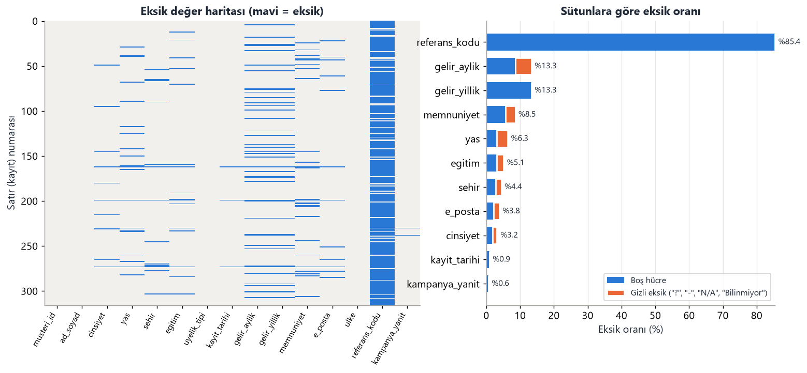
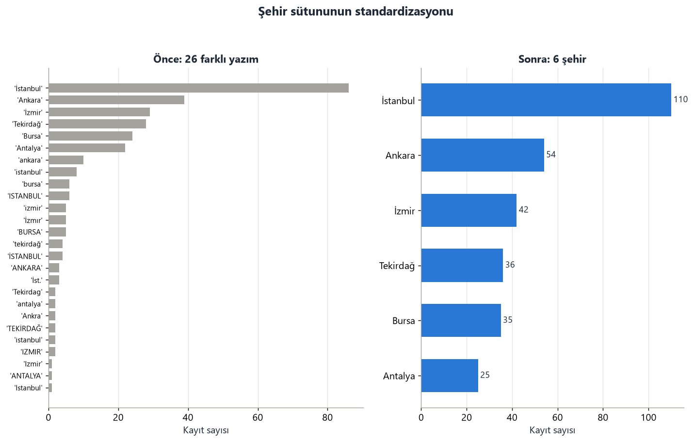
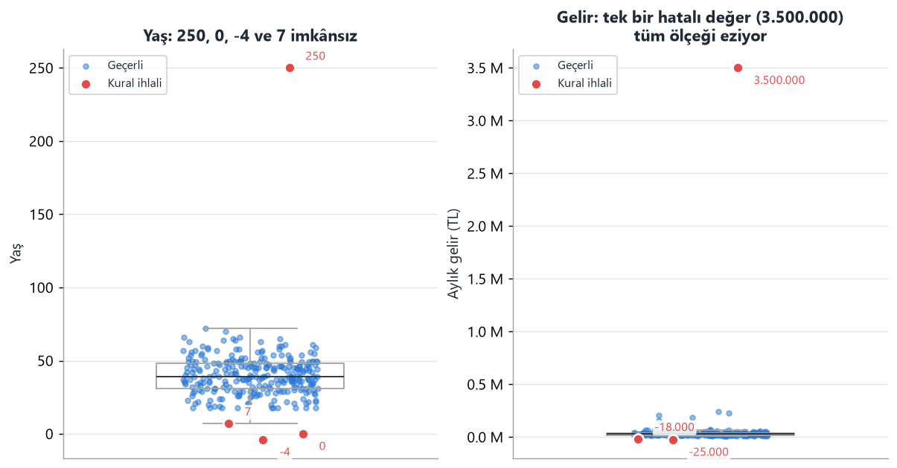
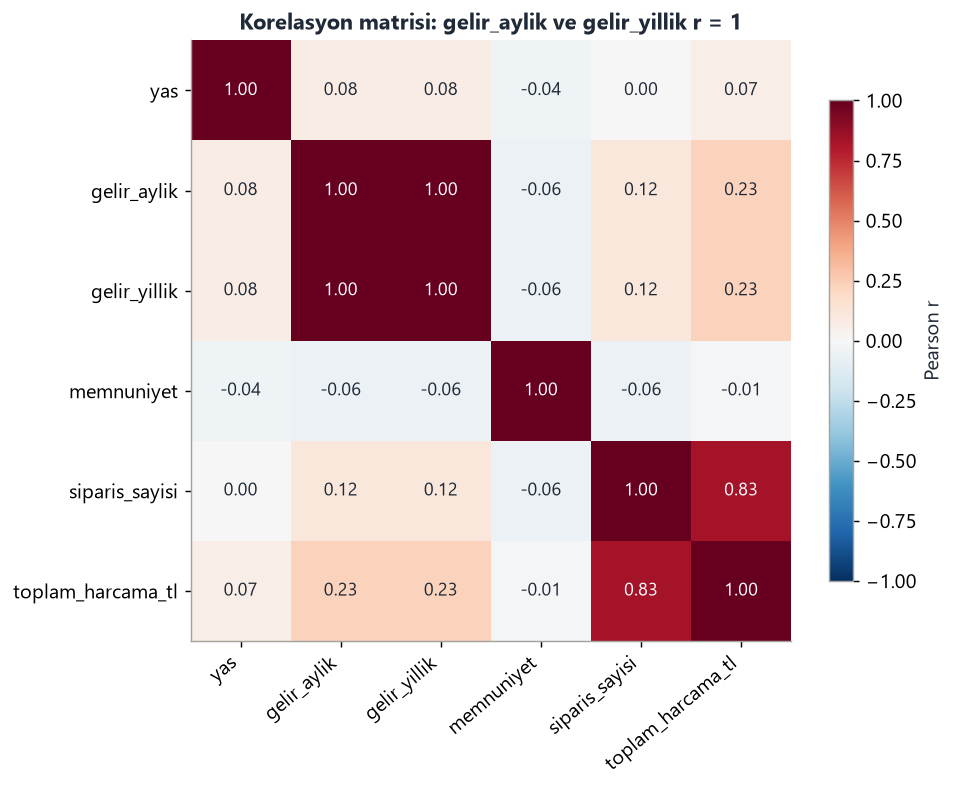
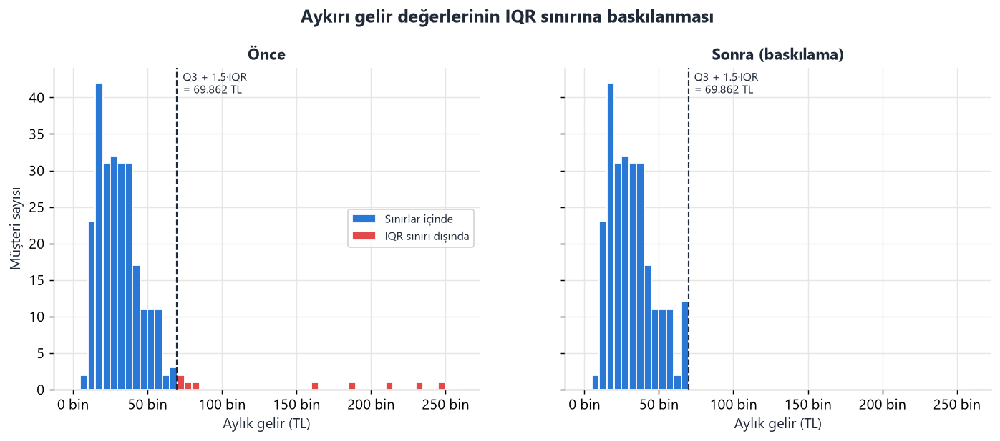
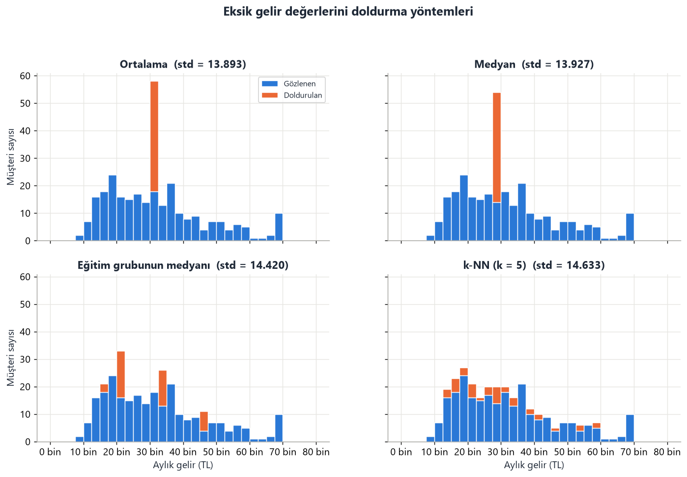
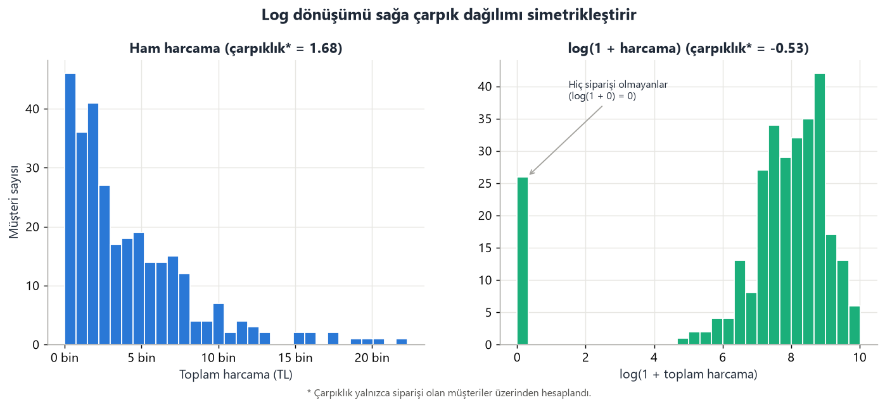
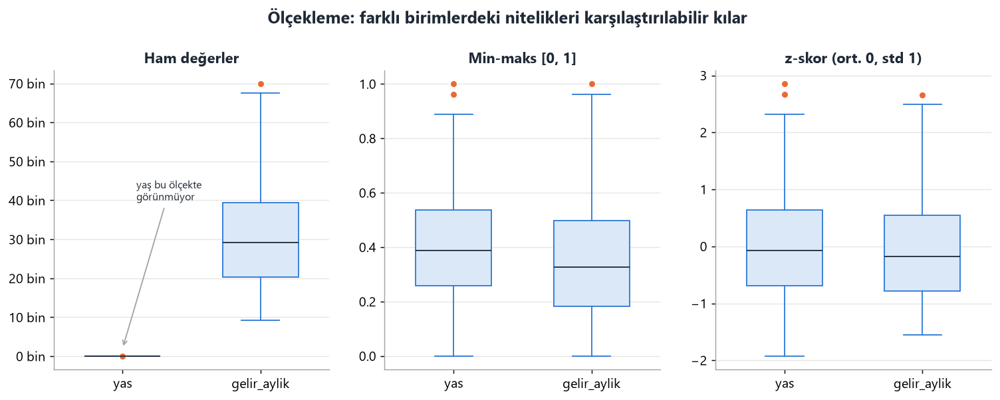
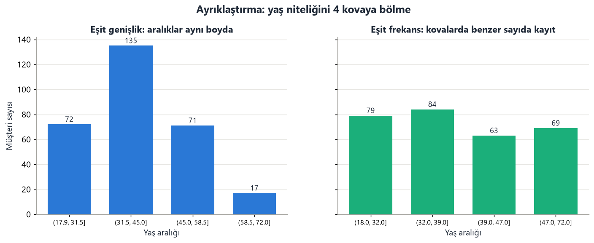
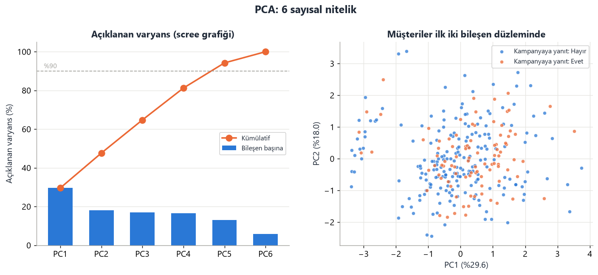

# Uygulama: Veri Ön İşleme (Python ve R)

Bu uygulama, ders notunun **4. Veri Ön İşleme** bölümünde anlatılan adımların hepsini tek bir gerçekçi veri seti üzerinde uygular. Aynı iş iki ayrı dilde yapılır: **Python (pandas)** ve **R (tidyverse)**. İki betik aynı kuralları uygular ve **aynı temiz tabloyu üretir**. Böylece hem teoriyi uygulamada görür hem de iki dilin aynı problemi nasıl çözdüğünü yan yana karşılaştırırsınız.


**Senaryo.** Bir e-ticaret şirketinin pazarlama ekibi, hangi müşterilerin bir kampanyaya yanıt verdiğini tahmin eden bir model kurmak istiyor. Elinde iki kaynak var: CRM sisteminden alınmış müşteri listesi ve e-ticaret sisteminden alınmış sipariş kayıtları. İki dosya da gerçek hayattaki gibi "kirli". Sizin göreviniz, bu veriyi modele hazır hâle getirmek.

## İçindekiler

0. [Klasör yapısı ve çalıştırma](#0-klasör-yapısı-ve-çalıştırma)
1. [Veri seti ve içindeki "kirler"](#veri-seti-ve-içindeki-kirler)
2. [Adım 1 — Veriyi tanıma](#adım-1--veriyi-tanıma)
3. [Adım 2 — Veri temizleme](#adım-2--veri-temizleme)
4. [Adım 3 — Veri bütünleştirme](#adım-3--veri-bütünleştirme)
5. [Adım 4 — Aykırı değerler](#adım-4--aykırı-değerler)
6. [Adım 5 — Eksik değerler](#adım-5--eksik-değerler)
7. [Adım 6 — Veri dönüştürme](#adım-6--veri-dönüştürme)
8. [Adım 7 — Veri indirgeme](#adım-7--veri-indirgeme)
9. [Adım 8 — Kaydetme ve kalite raporu](#adım-8--kaydetme-ve-kalite-raporu)
10. [Python ↔ R karşılık tablosu](#python--r-karşılık-tablosu)
11. [Python ve R sonuçları nerede, neden farklı?](#python-ve-r-sonuçları-nerede-neden-farklı)
12. [Alıştırmalar](#alıştırmalar)

---

## 0. Klasör yapısı ve çalıştırma

```text
uygulamalar/veri_on_isleme/
├── veri/
│   ├── musteriler_kirli.csv     ← CRM'den gelen kirli müşteri verisi (316 satır)
│   └── siparisler.csv           ← sipariş sisteminden gelen veri (1110 satır)
├── python/on_isleme.py          ← Python sürümü
├── r/on_isleme.R                ← R sürümü
├── ciktilar/
│   ├── python/                  ← Python'un ürettiği grafikler ve temiz CSV'ler
│   └── r/                       ← R'ın ürettiği grafikler ve temiz CSV'ler
└── veri_uret.py                 ← kirli veriyi üreten betik (yalnızca öğretici için)
```

**Python** (3.9 veya üstü):

```bash
pip install pandas numpy matplotlib scipy scikit-learn
cd uygulamalar/veri_on_isleme
python python/on_isleme.py
```

**R** (4.1 veya üstü):

```r
install.packages(c("dplyr", "tidyr", "readr", "stringr", "stringi",
                   "ggplot2", "patchwork", "scales", "VIM"))
```

```bash
cd uygulamalar/veri_on_isleme
Rscript r/on_isleme.R
```

RStudio kullanıyorsanız `r/on_isleme.R` dosyasını açıp **Source** düğmesine basmanız yeterlidir.

Her iki betik de konsola adım adım ne yaptığını ve sonucunu yazar; grafikleri `ciktilar/` altına kaydeder. **Önerilen çalışma biçimi:** Betiği bir kez baştan sona çalıştırın, sonra bu belgeyi okurken her adımı konsol çıktısı ve grafikle birlikte inceleyin. Ardından kodu adım adım (Python'da VS Code/Jupyter'de hücre hücre, R'da satır satır `Ctrl+Enter` ile) yeniden çalıştırıp ara sonuçlara kendiniz bakın.

> **Windows notu:** Konsolda Türkçe karakterler bozuk görünürse Python betiği bunu `sys.stdout.reconfigure(encoding="utf-8")` satırıyla zaten düzeltir. Sorun sürerse terminalde önce `chcp 65001` komutunu çalıştırın.

---

## Veri seti ve içindeki "kirler"

`musteriler_kirli.csv` dosyasının sütunları:

| Sütun | Anlamı | Olması gereken tip |
|---|---|---|
| `musteri_id` | Müşteri numarası (birincil anahtar) | tamsayı |
| `ad_soyad` | Ad soyad | metin |
| `cinsiyet` | E / K | kategorik (ikili) |
| `yas` | Yaş | tamsayı |
| `sehir` | Yaşadığı şehir | kategorik (nominal) |
| `egitim` | İlkokul < Lise < Lisans < Yüksek Lisans < Doktora | kategorik (sıralı) |
| `uyelik_tipi` | Standart < Gold < Platin | kategorik (sıralı) |
| `kayit_tarihi` | Üyelik başlangıç tarihi | tarih |
| `gelir_aylik` | Aylık gelir (TL) | sayı |
| `gelir_yillik` | Yıllık gelir (TL) | sayı |
| `memnuniyet` | 1–5 arası memnuniyet puanı | sıralı sayı |
| `e_posta` | E-posta adresi | metin |
| `ulke` | Ülke | kategorik |
| `referans_kodu` | Kampanya referans kodu | metin |
| `kampanya_yanit` | Kampanyaya yanıt verdi mi? (**hedef değişken**) | Evet / Hayır |

`siparisler.csv` ise sipariş başına bir satır içerir: `siparis_no`, `cust_id` (ör. `C-1001`), `tutar`, `para_birimi` (TL veya USD).

Veriye **bilerek** yerleştirilmiş sorunlar ve bunların hangi adımda çözüldüğü:

| Sorun türü | Nerede? | Örnek | Adım |
|---|---|---|---|
| Boş hücre | 11 sütunda | `gelir_aylik` boş | 2.1, 5 |
| **Gizli eksik değer** | `yas`, `sehir`, `gelir_aylik`… | `?`, `-`, `N/A`, `Bilinmiyor` | 2.1 |
| Baş/son boşluk | `sehir`, `egitim`, `ad_soyad` | `" İstanbul  "` | 2.1, 2.2 |
| Yazım / harf tutarsızlığı | kategorik sütunlar | `ISTANBUL`, `istanbul`, `İst.`, `Ankra` | 2.2 |
| Eş anlamlı kodlar | `cinsiyet`, `uyelik_tipi` | `E` / `Erkek`, `Gold` / `Altın` | 2.2 |
| Türkçe harf tuzağı | `sehir` | `i̇stanbul` (i + birleşik nokta) | 2.2 |
| Metin olarak saklanmış sayı | `gelir_aylik`, `yas` | `"36.500 TL"`, `"50 yaş"` | 2.3 |
| Çevrilemeyen değer | `yas` | `"otuz beş"` | 2.3 |
| Karışık tarih biçimi | `kayit_tarihi` | `2023-05-14`, `14/05/2023`, `14.05.2023` | 2.3 |
| Takvimde olmayan tarih | `kayit_tarihi` | `31.02.2022` | 2.3 |
| Birebir mükerrer satır | 10 satır | aynı satır iki kez | 2.4 |
| Yarı mükerrer kayıt | aynı `musteri_id` | farklı yazım, biri daha eksik | 2.4 |
| İmkânsız değer | `yas`, `gelir`, `memnuniyet` | yaş 250, gelir −25.000, memnuniyet 55 | 2.5 |
| Gelecekteki tarih | `kayit_tarihi` | `2029-04-01` | 2.5 |
| Geçersiz e-posta | `e_posta` | `ayse.kaya@`, `selin@ornek` | 2.5 |
| Farklı anahtar biçimi | iki dosya arasında | `C-1001` ↔ `1001` | 3.3 |
| Farklı para birimi | `siparisler.csv` | TL ve USD karışık | 3.2 |
| İkinci kaynakta mükerrer | `siparisler.csv` | aynı sipariş iki kez aktarılmış | 3.1 |
| Yetim kayıt | `siparisler.csv` | CRM'de olmayan müşterinin siparişi | 3.4 |
| Gereksiz (türetilmiş) sütun | `gelir_yillik` | = 12 × `gelir_aylik` | 3.5 |
| Gerçek aykırı değer | `gelir_aylik` | 245.000 TL gelirli müşteri | 4 |
| Çoğunlukla boş sütun | `referans_kodu` | %85 boş | 5.1 |
| Çoğunlukla boş satır | 3 satır | yalnızca kimlik bilgisi dolu | 5.2 |
| Hedefi eksik satır | `kampanya_yanit` | 2 satır | 5.3 |
| Rastgele olmayan eksiklik | `gelir_aylik` | eğitim düzeyine bağlı | 5.4 |
| Çarpık dağılım | `toplam_harcama_tl` | uzun sağ kuyruk | 6.2 |
| Sabit sütun | `ulke` | hepsi "Türkiye" | 7.1 |

> **Neden önce metin olarak okuyoruz?** Bir sütunda tek bir `"?"` varsa pandas ve readr o sütunun tamamını metin kabul eder. Hangi değerin neden sayıya dönmediğini görmek için önce **her şeyi metin** olarak okuyup her sütunu kendimiz, bilinçli olarak dönüştürüyoruz.

---

## Adım 1 — Veriyi tanıma

> **Teori (Bölüm 3):** Ön işlemeye başlamadan önce verinin boyutunu, sütun tiplerini, değer çeşitliliğini ve temel kalite göstergelerini bilmek gerekir. "Neyi temizleyeceğini bilmeyen temizleyemez."

**Python**

```python
saf = pd.read_csv(VERI / "musteriler_kirli.csv")      # pandas tipleri kendisi tahmin etsin
print(saf.dtypes)

ham = pd.read_csv(VERI / "musteriler_kirli.csv", dtype=str,
                  keep_default_na=False, na_values=[""])   # her şeyi metin oku
print(ham["sehir"].nunique())                           # kaç farklı yazım?
print(ham.duplicated().sum())                           # birebir aynı satır
print(ham["musteri_id"].duplicated().sum())             # tekrarlanan anahtar
```

**R**

```r
saf <- read_csv(file.path(VERI, "musteriler_kirli.csv"), show_col_types = FALSE)
sapply(saf, class)

ham <- read_csv(file.path(VERI, "musteriler_kirli.csv"),
                col_types = cols(.default = col_character()), na = "", trim_ws = FALSE)
n_distinct(na.omit(ham$sehir))
sum(duplicated(ham))
sum(duplicated(ham$musteri_id))
```

R'da `trim_ws = FALSE` önemlidir: readr varsayılan olarak baştaki ve sondaki boşlukları sessizce siler, biz ise sorunu **görmek** istiyoruz.

**Çıktı**

```text
yas               object      ← sayı olmalıydı!
gelir_aylik       object      ← sayı olmalıydı!
memnuniyet        object      ← sayı olmalıydı!
gelir_yillik     float64

cinsiyet       :  13 farklı değer -> ['Bilinmiyor', 'E', 'ERKEK', 'Erkek', 'K', 'KADIN', 'Kadin', 'Kadın'] ...
sehir          :  33 farklı değer -> [' Bursa', ' İstanbul  ', '-', '?', 'ANKARA', 'ANTALYA', 'Ankara', 'Ankara '] ...
egitim         :  20 farklı değer -> ['-', '?', 'Bilinmiyor', 'Doktora', 'Lisans', 'Lisans  ', 'Lise', 'Lise '] ...
uyelik_tipi    :  11 farklı değer -> ['Altın', 'GOLD', 'Gold', 'PLATİN', 'Platin', 'Platinum', ...] ...
kampanya_yanit :   9 farklı değer -> ['E', 'EVET', 'Evet', 'H', 'HAYIR', 'Hayır', 'evet', 'hayir'] ...

Boş hücre sayısı (yalnızca tamamen boş olanlar): 404
Birebir aynı (mükerrer) satır sayısı          : 10
Tekrarlanan musteri_id sayısı                 : 16
```

**Yorum.** Daha tek satır temizlemeden sorunların büyük kısmı görünür hâle geldi: 6 şehir 33 farklı biçimde yazılmış, sayısal sütunlar metin okunmuş, 16 müşteri birden fazla kez kayıtlı.

---

## Adım 2 — Veri temizleme

### 2.1 Boşluklar ve gizli eksik değerler

> **Teori:** Eksik değer her zaman boş hücre değildir. Veri giren kişi bilmediği alana `?`, `-`, `N/A`, `Bilinmiyor`, `0` veya `999` yazmış olabilir. Bunlara **gizli (disguised) eksik değer** denir. Yazılımlar bunları gerçek bir değer sanar: `"?"` bir şehir adı, `"-"` bir eğitim düzeyi olarak sayılır.

**Python**

```python
GIZLI_EKSIK = ["?", "-", "N/A", "Bilinmiyor", ""]
for s in df.columns:
    df[s] = df[s].str.strip()                 # baş/son boşlukları sil
df = df.mask(df.isin(GIZLI_EKSIK))            # gizli eksikleri NaN yap
```

**R**

```r
GIZLI_EKSIK <- c("?", "-", "N/A", "Bilinmiyor", "")
df <- df |>
  mutate(across(everything(), str_trim)) |>
  mutate(across(everything(), ~ if_else(.x %in% GIZLI_EKSIK, NA_character_, .x)))
```

**Çıktı**

```text
                bos_hucre  gizli_eksik  toplam  oran_%
referans_kodu         270            0     270    85.4
gelir_aylik            27           15      42    13.3
gelir_yillik           42            0      42    13.3
memnuniyet             18            9      27     8.5
yas                    10           10      20     6.3
egitim                 10            6      16     5.1
sehir                   9            5      14     4.4
...
Gizli eksik değerlerle birlikte toplam eksik hücre: 458
```



**Grafiği okuma.** Soldaki **eksik değer haritasında** her satır bir müşteri, her sütun bir niteliktir; mavi çizgiler eksik hücrelerdir. Üç şey hemen dikkat çeker:

* `referans_kodu` sütunu neredeyse tamamen mavi: Bu sütun doldurulamaz, silinmesi gerekir (Adım 5.1).
* Bazı satırlar (ör. ~160 ve ~200. satırlar) yatay bir şerit gibi boydan boya mavi: Bu müşterilerin neredeyse hiçbir bilgisi yok (Adım 5.2).
* `gelir_aylik` ve `gelir_yillik` sütunlarında maviler **tam olarak aynı satırlarda**: İki sütun aynı kaynaktan geliyor (Adım 3.5'teki fazlalığın ilk ipucu).

Sağdaki grafikte turuncu kısım, yalnızca boş hücrelere bakan birinin **gözden kaçıracağı** eksiklerdir. Örneğin `yas` sütunundaki eksiklerin yarısı gizlidir.

### 2.2 Metin standardizasyonu

> **Teori (Bölüm 4.1):** "İstanbul", "istanbul" ve "Istanbul" bir insan için aynı şehirdir, ama bilgisayar için üç ayrı kategoridir. Bu durum hem kategori sayısını şişirir hem de mükerrer kayıtları gizler.

Kullandığımız yöntem iki aşamalıdır:

1. Her değerden bir **karşılaştırma anahtarı** üretilir: aksanlar atılır, harfler küçültülür, noktalama ve fazla boşluklar silinir (`" İSTANBUL "` → `istanbul`, `"İst."` → `ist`).
2. Anahtar, elle hazırlanmış bir **sözlükle** standart yazıma çevrilir (`ist` → `İstanbul`, `ankra` → `Ankara`). Sözlükte olmayan bir anahtar çıkarsa betik bunu "tanınmayan" olarak raporlar. Yeni bir yazım hatası sessizce kaybolmaz.

**Python**

```python
def anahtar(x):
    x = unicodedata.normalize("NFKD", x)                       # ş -> s + çengel, İ -> I + nokta
    x = "".join(c for c in x if not unicodedata.combining(c))  # birleşik işaretleri at
    x = x.replace("ı", "i").lower()
    x = re.sub(r"[^\w\s]", " ", x)                             # noktalama -> boşluk
    return re.sub(r"\s+", " ", x).strip()

STANDART = {"sehir": {"istanbul": "İstanbul", "ist": "İstanbul", "ankara": "Ankara",
                      "ankra": "Ankara", "izmir": "İzmir", "tekirdag": "Tekirdağ", ...}, ...}
df["sehir"] = df["sehir"].map(anahtar).map(STANDART["sehir"])
```

**R**

```r
anahtar <- function(x) {
  x <- stri_trans_general(x, "NFD; [:Nonspacing Mark:] Remove; NFC")  # aksanları at
  x <- tolower(chartr("ı", "i", x))
  x <- str_replace_all(x, "[^[:alnum:][:space:]]", " ")
  str_squish(x)
}
df$sehir <- unname(STANDART$sehir[anahtar(df$sehir)])
```

**Çıktı**

```text
sehir          :  26 farklı yazım -> 6 kategori
egitim         :  15 farklı yazım -> 5 kategori
uyelik_tipi    :  11 farklı yazım -> 3 kategori
cinsiyet       :  11 farklı yazım -> 2 kategori
kampanya_yanit :   9 farklı yazım -> 2 kategori
```

(Adım 1'de şehir için 33 farklı değer görmüştük; 2.1'de boşluklar silinip `?` ve `-` eksik sayılınca 26'ya düştü, standardizasyonla 6'ya indi.)



> **Türkçe harf tuzakları.** Bu adım Türkçe için özellikle dikkat ister:
> * Python'da `"İstanbul".lower()` sonucu `"istanbul"` değil, `"i̇stanbul"` olur: küçük i'nin üstünde **birleşik bir nokta (U+0307)** kalır. Ekranda neredeyse aynı görünür ama `==` karşılaştırması başarısız olur. Veri setimizde bu tuzaktan doğmuş iki kayıt var; `anahtar()` fonksiyonu birleşik işaretleri silerek bunları yakalar.
> * `"YILMAZ".title()` Python'da `"Yilmaz"` verir (yanlış). Bu yüzden ad-soyad için Türkçe kurallara uygun bir `tr_baslik()` fonksiyonu yazdık. R'da ise `str_to_title(x, locale = "tr")` aynı işi doğru yapar.

### 2.3 Veri tipi dönüşümleri

> **Teori:** Sayısal analiz yapabilmek için sayıların sayı, tarihlerin tarih tipinde olması gerekir. Dönüştürülemeyen değerler **sessizce kaybolmamalı**, raporlanmalıdır.

**Python**

```python
df["yas"] = pd.to_numeric(df["yas"].str.extract(r"(-?\d+)")[0])          # "50 yaş" -> 50
df["gelir_aylik"] = pd.to_numeric(df["gelir_aylik"].str.replace("TL", "")
                                  .str.replace(".", "", regex=False).str.strip())  # "36.500 TL" -> 36500

def tarih_coz(seri):
    sonuc = pd.to_datetime(seri, format="%Y-%m-%d", errors="coerce")
    for bicim in ["%d/%m/%Y", "%d.%m.%Y"]:
        sonuc = sonuc.fillna(pd.to_datetime(seri, format=bicim, errors="coerce"))
    return sonuc
```

**R**

```r
df$yas <- as.numeric(str_extract(df$yas, "-?\\d+"))
df$gelir_aylik <- as.numeric(str_trim(str_remove_all(str_remove(df$gelir_aylik, "TL"), fixed("."))))

tarih_coz <- function(x) {
  coalesce(as.Date(x, format = "%Y-%m-%d"),
           as.Date(x, format = "%d/%m/%Y"),
           as.Date(x, format = "%d.%m.%Y"))
}
```

**Çıktı**

```text
yas         : '... yaş' biçimindekiler -> ['50 yaş', '34 yaş', '38 yaş', '63 yaş'] | sayıya çevrilemeyen -> ['otuz beş']
gelir_aylik : 35 değer 'TL' içeriyordu, ör. ['36500 TL -> 36500', '48500 TL -> 48500', '39000 TL -> 39000']
kayit_tarihi: biçim dağılımı -> {'YYYY-AA-GG': 208, 'GG.AA.YYYY': 75, 'GG/AA/YYYY': 30}
              çözülemeyen -> ['31.02.2022']
```

> **Neden biçimleri tek tek deniyoruz?** `pd.to_datetime(x)` veya `lubridate::parse_date_time()` biçimi kendisi tahmin edebilir. Ama `03/08/2019` 3 Ağustos mu, 8 Mart mı? Otomatik tahmin bu belirsizliği **sessizce** yanlış çözebilir. Biçimleri açıkça yazmak daha güvenlidir. `31.02.2022` gibi takvimde olmayan bir tarih ise hiçbir biçime uymaz ve eksik değer olur.

### 2.4 Mükerrer kayıtlar

> **Teori:** Mükerrer kayıtlar sayımları ve ortalamaları bozar, modelin bazı örnekleri "iki kez öğrenmesine" yol açar. İki türü vardır: **birebir kopyalar** ve aynı varlığın farklı yazılmış **yarı kopyaları** (anahtar bazlı tekrar).

**Python**

```python
df = df.drop_duplicates()                                    # 1) birebir kopyalar

df["_eksik"] = df.isna().sum(axis=1)                         # 2) anahtar bazlı:
df = (df.sort_values(["musteri_id", "_eksik"], kind="stable")  #    en eksiksiz kaydı tut
        .drop_duplicates("musteri_id", keep="first")
        .drop(columns="_eksik"))
```

**R**

```r
df <- distinct(df)
df <- df |>
  mutate(.eksik = rowSums(is.na(across(everything())))) |>
  arrange(musteri_id, .eksik) |>
  distinct(musteri_id, .keep_all = TRUE) |>
  select(-.eksik)
```

**Çıktı**

```text
Ham veride birebir aynı satır      : 10
Standardizasyondan sonra           : 13  (yazım farkı yüzünden görünmeyen kopyalar ortaya çıktı)
Silindikten sonra aynı musteri_id'ye sahip kayıt: 6 (3 müşteri). Örnek:
 musteri_id     ad_soyad   sehir  gelir_aylik  memnuniyet
       1077 Serkan Doğan Antalya      15700.0         3.0
       1077 Serkan Doğan Antalya      15700.0         NaN
Anahtar bazlı tekilleştirmeden sonra: 300 satır, tekrarlanan musteri_id = 0
```

**Yorum.** Sıralama önemlidir. Mükerrer kontrolünü standardizasyondan **önce** yapsaydık 10 kopya bulacaktık; standardizasyondan sonra 13 kopya bulduk. `"  SERKAN DOĞAN "` ile `"Serkan Doğan"` artık aynı yazıldığı için 3 gizli kopya ortaya çıktı. Geriye kalan 3 müşterinin kayıtları yalnızca bir alanın eksik olup olmamasıyla ayrışıyordu; her birinden **en eksiksiz** olanı tuttuk.

### 2.5 Geçersiz değerler (iş kuralları)

> **Teori (Bölüm 4.1, "gürültü ve hatalar"):** Bazı değerler biçim olarak doğrudur ama **anlam olarak imkânsızdır**: 250 yaşında müşteri, eksi gelir, 1–5 ölçeğinde 55 puan. Bunları yakalamak istatistik değil **alan bilgisi** (domain knowledge) gerektirir. Geçersiz değer silinmez, **eksik değere** çevrilir; satırın geri kalanındaki bilgi korunur, eksik değer de Adım 5'te doldurulur.

**Python**

```python
EPOSTA_DESENI = r"^[a-z0-9._%+-]+@[a-z0-9.-]+\.[a-z]{2,}$"
kurallar = {
    "yas 18-100 arasında olmalı":     ("yas", ~df["yas"].between(18, 100) & df["yas"].notna()),
    "gelir_aylik 0 < g < 1.000.000":  ("gelir_aylik", ~df["gelir_aylik"].between(1, 999_999) & ...),
    "memnuniyet 1-5 ölçeğinde olmalı": ("memnuniyet", ~df["memnuniyet"].isin([1, 2, 3, 4, 5]) & ...),
    "kayit_tarihi gelecekte olamaz":  ("kayit_tarihi", df["kayit_tarihi"] > REFERANS_TARIH),
    "e_posta geçerli biçimde olmalı": ("e_posta", ~df["e_posta"].str.match(EPOSTA_DESENI, na=True)),
}
for aciklama, (sutun, ihlal) in kurallar.items():
    df.loc[ihlal, sutun] = np.nan
```

**R**

```r
kurallar <- list(
  "yas 18-100 arasında olmalı" = list("yas", !between(df$yas, 18, 100) %in% TRUE & !is.na(df$yas)),
  ...
)
for (aciklama in names(kurallar)) df[[kurallar[[aciklama]][[1]]]][kurallar[[aciklama]][[2]]] <- NA
```

**Çıktı**

```text
yas 18-100 arasında olmalı        : 4 ihlal -> [-4, 7, 0, 250]
gelir_aylik 0 < g < 1.000.000     : 3 ihlal -> [-25000, -18000, 3500000]
gelir_yillik 0 < g < 12.000.000   : 3 ihlal -> [-300000, -216000, 42000000]
memnuniyet 1-5 ölçeğinde olmalı   : 3 ihlal -> [55, 0, 9]
kayit_tarihi gelecekte olamaz     : 1 ihlal -> ['2029-04-01']
e_posta geçerli biçimde olmalı    : 4 ihlal -> ['kerem koc@ornek.com', 'ayse.kaya@', 'mehmet.demir.ornek.com', 'selin@ornek']
```



**Grafiği okuma.** Sağdaki grafik tek bir hatalı değerin ne kadar yıkıcı olduğunu gösteriyor: Aylık 3.500.000 TL'lik bir veri giriş hatası (büyük olasılıkla fazladan iki sıfır) yüzünden 300 müşterinin geliri grafiğin dibinde tek bir çizgiye sıkışmış. Bu değer ortalamayı, standart sapmayı ve her türlü ölçeklemeyi bozar.

> **Geçersiz değer mi, aykırı değer mi?** Yaş = 250 **imkânsızdır**, o yüzden bu adımda (iş kuralıyla) temizlenir. Aylık gelir = 245.000 TL ise **olası ama nadirdir**. Bu bir aykırı değerdir ve Adım 4'te istatistiksel olarak ele alınır. Bu ayrım önemlidir: Aykırı değer bazen verideki en değerli bilgidir (ör. dolandırıcılık tespiti).

---

## Adım 3 — Veri bütünleştirme

> **Teori (Bölüm 4.3):** Veri çoğunlukla birden fazla kaynaktan gelir. Birleştirirken üç tipik sorun çıkar: **varlık tanımlama** (aynı müşteri iki sistemde farklı anahtarla), **değer çakışmaları** (TL ve USD) ve **fazlalık** (birbirinden türetilebilen nitelikler).

### 3.1–3.3 Mükerrer siparişler, para birimi, anahtar eşleme ve toplulaştırma

**Python**

```python
sip = sip.drop_duplicates("siparis_no")                                     # çift aktarılmış siparişler
sip["tutar_tl"] = np.where(sip["para_birimi"] == "USD", sip["tutar"] * USD_TL, sip["tutar"])
sip["musteri_id"] = sip["cust_id"].str.replace("C-", "", regex=False).astype(int)   # C-1001 -> 1001
ozet = (sip.groupby("musteri_id")
           .agg(siparis_sayisi=("siparis_no", "count"), toplam_harcama_tl=("tutar_tl", "sum"))
           .reset_index())
```

**R**

```r
sip <- distinct(sip, siparis_no, .keep_all = TRUE)
sip <- sip |> mutate(tutar_tl = if_else(para_birimi == "USD", tutar * USD_TL, tutar),
                     musteri_id = as.numeric(str_remove(cust_id, "C-")))
ozet <- sip |> group_by(musteri_id) |>
  summarise(siparis_sayisi = n(), toplam_harcama_tl = round(sum(tutar_tl), 2))
```

Sipariş verisi "sipariş başına bir satır" düzeyinde, müşteri verisi ise "müşteri başına bir satır" düzeyinde. Birleştirmeden önce siparişleri müşteri düzeyine **toplulaştırmamız** (aggregation) gerekir. Toplulaştırmasaydık, birleştirme sonrasında her müşteri sipariş sayısı kadar tekrarlanırdı.

### 3.4 Birleştirme ve eşleşmeyen kayıtlar

```python
yetim = ozet[~ozet["musteri_id"].isin(df["musteri_id"])]       # R: anti_join(ozet, df, by = "musteri_id")
df = df.merge(ozet, on="musteri_id", how="left")               # R: left_join(df, ozet, by = "musteri_id")
df[["siparis_sayisi", "toplam_harcama_tl"]] = df[["siparis_sayisi", "toplam_harcama_tl"]].fillna(0)
```

```text
CRM'de karşılığı olmayan (yetim) sipariş müşterisi: 10 -> [1402, 1407, 1411, ...]
Hiç siparişi olmayan CRM müşterisi              : 28
Bu müşterilerin eksik değeri 'bilinmiyor' değil 'sıfır sipariş' demektir -> 0 ile dolduruldu.
```

> **Önemli ders:** Birleştirmeden sonra siparişi olmayan 28 müşterinin `siparis_sayisi` değeri boş (NaN) çıkar. Bu boşluk "bilmiyoruz" demek değildir, "**hiç sipariş vermedi**" demektir. Doğru doldurma değeri medyan değil **0**'dır. Eksik değeri doldurmadan önce *neden* eksik olduğunu sormak gerekir.

### 3.5 Fazlalık analizi: korelasyon

```python
kor = df[["yas", "gelir_aylik", "gelir_yillik", "memnuniyet",
          "siparis_sayisi", "toplam_harcama_tl"]].corr()        # R: cor(df[sayisal], use = "pairwise.complete.obs")
```



`gelir_aylik` ile `gelir_yillik` arasında r = 1.00 çıktı. Bölme işlemi bunun nedenini gösterir: `gelir_yillik / gelir_aylik = 12`, her satırda. Yani `gelir_yillik` yeni bilgi taşımıyor ve **silinir**. Böyle bir sütun bazı modellerde (ör. doğrusal regresyon) çoklu doğrusal bağlantı (multicollinearity) sorununa da yol açar.

`siparis_sayisi` ile `toplam_harcama_tl` arasındaki r = 0.83 de yüksektir ama 1 değildir. İki sütun ilişkili olsa da farklı bilgi taşır (az ama pahalı sipariş veren müşteri ile çok ama ucuz sipariş veren müşteri farklıdır). Bu yüzden ikisi de tutulur.

### 3.6 Kategorik nitelikler: ki-kare (χ²) testi

```python
tablo = pd.crosstab(df["uyelik_tipi"], df["kampanya_yanit"])   # R: table(df$uyelik_tipi, df$kampanya_yanit)
ki2, p, sd, _ = chi2_contingency(tablo)                         # R: chisq.test(tablo)
```

```text
uyelik_tipi x kampanya_yanit: χ² = 22.95, sd = 2, p = 0.0000 -> ilişki VAR (p < 0.05)
sehir x kampanya_yanit: χ² = 6.31, sd = 5, p = 0.2775 -> anlamlı ilişki yok
kampanya_yanit  Evet  Hayır
Gold            0.43   0.57
Platin          0.56   0.44
Standart        0.22   0.78
```

Pearson korelasyonu yalnızca sayısal nitelikler için geçerlidir. İki kategorik nitelik arasındaki ilişki χ² testiyle ölçülür. Üyelik tipi kampanyaya yanıtla güçlü biçimde ilişkili (Platin üyelerin %56'sı yanıt vermiş, Standart üyelerin %22'si), şehir ise ilişkili değil. Bu bilgi özellik seçiminde (Adım 7) işe yarar.

---

## Adım 4 — Aykırı değerler

> **Teori (Bölüm 4.2 ve 10):** Aykırı değer, verinin genelinden belirgin biçimde ayrılan gözlemdir. İki yaygın istatistiksel kural:
> * **IQR (Tukey) kuralı:** Q1 − 1.5·IQR'nin altında veya Q3 + 1.5·IQR'nin üstündeki değerler aykırıdır. Kutu grafiğinin "bıyıkları" bu sınırları gösterir. Medyan ve çeyrekliklere dayandığı için **sağlamdır** (robust).
> * **z-skor kuralı:** |z| = |x − x̄| / s > 3 olan değerler aykırıdır. Ortalama ve standart sapmaya dayanır; normal dağılım varsayar.

**Python**

```python
q1, q3 = x.quantile([0.25, 0.75])                     # R: quantile(x, c(0.25, 0.75))
alt, ust = q1 - 1.5 * (q3 - q1), q3 + 1.5 * (q3 - q1)
z = (x - x.mean()) / x.std()                          # R: (x - mean(x)) / sd(x)
df["gelir_aylik"] = df["gelir_aylik"].clip(lower=alt, upper=ust)   # R: pmin(pmax(x, alt), ust)
```

**Çıktı**

```text
gelir_aylik: Q1 = 19,675  Q3 = 39,750  IQR = 20,075  sınırlar = [-10,438 ; 69,862]
  IQR yöntemi  : 9 aykırı -> [245000, 230000, 210000, 185000, 160000, 81900, 75200, 74600, 71500]
  z-skor |z|>3 : 5 aykırı -> [245000, 230000, 210000, 185000, 160000]

Maskeleme etkisi: 3.500.000 TL'lik hatalı değer silinmeseydi z-skor yalnızca 1 aykırı bulurdu
(ortalama 47,620, std 217,252 şişerdi).
```



**Üç önemli gözlem:**

1. **İki yöntem farklı sonuç verir.** IQR 9, z-skor 5 aykırı buldu. Gelir sağa çarpık olduğu için normal dağılım varsayan z-skor kuralı burada daha az uygundur.
2. **Maskeleme (masking) etkisi.** Adım 2.5'te 3.500.000 TL'lik hatayı temizlemeseydik ortalama 47.620 TL'ye, standart sapma 217.252 TL'ye fırlayacaktı. z-skor bu durumda yalnızca hatanın kendisini bulur, 245.000 TL'lik gerçek aykırıları **göremezdi**. Bu yüzden önce imkânsız değerler temizlenir, sonra aykırı değer analizi yapılır.
3. **Karar: silmek yerine baskılamak.** Yüksek gelirli müşteriler gerçek kişiler; onları silmek hem bilgi hem örnek kaybıdır. Bunun yerine değerleri IQR üst sınırına (69.862 TL) **baskıladık** (winsorizing / capping). Müşteri veride kalır, ama aşırı değeri modeli tek başına sürükleyemez. Harcama sütununda ise başka bir yol seçtik: Çarpıklığı Adım 6.2'de log dönüşümüyle gidereceğiz.

---

## Adım 5 — Eksik değerler

> **Teori (Bölüm 4.2):** Eksik değerle başa çıkmanın yolları: kaydı silmek, sabit değerle doldurmak, merkezi eğilim ölçüsüyle (ortalama / medyan / mod) doldurmak, sınıf bazında doldurmak ve tahminle (regresyon, k-NN) doldurmak. Hangisinin uygun olduğu, eksikliğin **nedenine** bağlıdır.

### 5.1–5.3 Silme kararları

```python
oranlar = df.isna().mean()                                   # R: colMeans(is.na(df))
df = df.drop(columns=oranlar[oranlar > 0.60].index)          # %60'tan fazla boş sütun
df = df[df.isna().mean(axis=1) <= 0.5]                       # R: df[rowMeans(is.na(df)) <= 0.5, ]
df = df[df["kampanya_yanit"].notna()]                        # hedefi eksik satırlar
```

```text
Silinen sütun(lar): ['referans_kodu'] (eksik oranı: ['%85'])
Değerlerinin yarısından fazlası eksik satır: 3 -> [1092, 1142, 1280]
Hedefi eksik satır: 2 (hedefi tahmin etmeyiz, öğrenmek için kullanırız)
```

* %85'i boş bir sütunu doldurmak, veriyi neredeyse tamamen **uydurmak** demektir.
* Değerlerinin yarısından fazlası eksik bir satır modele bilgi değil gürültü katar.
* Denetimli öğrenmede hedef değişkeni (burada `kampanya_yanit`) eksik olan satır **öğrenme için kullanılamaz**. Hedef asla doldurulmaz.

### 5.4 Eksiklik rastgele mi?

```text
               geliri_eksik  tum_veri
İlkokul                0.08      0.11
Lise                   0.42      0.33
Lisans                 0.32      0.36
Yüksek Lisans          0.18      0.14
Doktora                0.00      0.06
Geliri eksik olanların eğitim dağılımı tüm veriden farklı: eksiklik eğitime bağlı (MAR).
Eğitim gruplarına göre beklenen gelirleri ort. 29,722 TL, genel ortalama ise 31,938 TL.
```

Eksiklik mekanizmaları üçe ayrılır:

| Mekanizma | Anlamı | Örnek |
|---|---|---|
| **MCAR** (tamamen rastgele) | Eksiklik hiçbir şeye bağlı değil | Anket kâğıdına kahve döküldü |
| **MAR** (rastgele) | Eksiklik **gözlenen** başka bir niteliğe bağlı | Lise mezunları gelirini daha sık boş bırakıyor |
| **MNAR** (rastgele değil) | Eksiklik **değerin kendisine** bağlı | Çok yüksek gelirliler gelirini gizliyor |

Verimizde geliri eksik olanlar arasında Lise mezunlarının oranı daha yüksek, Doktora mezunu ise hiç yok. Yani eksiklik eğitime bağlı (MAR). Bu kişilerin eğitim düzeyine göre beklenen geliri (29.722 TL) genel ortalamanın (31.938 TL) altında. **Genel ortalamayla doldurmak bu grubun gelirini sistematik olarak yüksek gösterir.**

### 5.5–5.6 Doldurma yöntemlerinin karşılaştırılması

**Python**

```python
df["sehir"] = df["sehir"].fillna(df["sehir"].mode()[0])               # kategorik: mod

yontemler = {
    "Ortalama": df["gelir_aylik"].fillna(df["gelir_aylik"].mean()),
    "Medyan":   df["gelir_aylik"].fillna(df["gelir_aylik"].median()),
    "Eğitim grubunun medyanı": df["gelir_aylik"].fillna(
        df.groupby("egitim")["gelir_aylik"].transform("median")),   # sınıf bazında
}
knn = KNNImputer(n_neighbors=5).fit_transform(olcekli_girdi)          # tahminle (k-NN)
```

**R**

```r
df$sehir <- replace_na(df$sehir, names(which.max(table(df$sehir))))

grup_medyan <- df |> group_by(egitim) |>
  mutate(g = replace_na(gelir_aylik, median(gelir_aylik, na.rm = TRUE))) |> pull(g)
knn <- VIM::kNN(knn_girdi, variable = "gelir", k = 5,
                dist_var = c("yas", "egitim", "uyelik", "harcama"), numFun = mean)
```

**Çıktı**

```text
Yöntem                       ortalama        std   doldurulan değerlerin ort.
(Gözlenen değerler)            31,938     14,947
Ortalama                       31,938     13,893                       31,938
Medyan                         31,553     13,927                       29,100
Eğitim grubunun medyanı        31,592     14,420                       29,381
k-NN (k = 5)                   31,519     14,633                       28,846
```



**Grafiği okuma.** Turuncu çubuklar doldurulan değerlerdir.

* **Ortalama ve medyan** 40 eksiğin **hepsine aynı değeri** verir: Grafikte tek, yapay bir sivri tepe oluşur. Standart sapma 14.947'den 13.893'e düşer. Veri olduğundan daha "tekdüze" görünür ve nitelikler arası ilişkiler zayıflar.
* **Eğitim grubunun medyanı** her müşteriye kendi eğitim grubunun değerini verir. Hâlâ birkaç tepe vardır (her grup için bir tane), ama dağılım daha gerçekçidir.
* **k-NN** her müşteriye, kendisine en çok benzeyen 5 müşterinin gelir ortalamasını verir. Doldurulan değerler dağılıma en doğal biçimde yayılır.

Bu uygulamada **eğitim grubunun medyanını** seçtik: Hem MAR yapısını hesaba katar hem de basit ve açıklanabilirdir. k-NN çoğu zaman daha iyi sonuç verir ama daha fazla hesaplama ister ve uzaklık hesabından önce ölçekleme gerektirir.

### 5.7 Diğer sütunlar

```text
yas         : 19 eksik -> medyan = 39
memnuniyet  : 21 eksik -> medyan = 4 (sıralı ölçek: ortalama 3.6 gibi ara değer anlamsız)
kayit_tarihi: 2 eksik -> medyan tarih = 2021-11-14
e_posta     : 13 eksik -> DOLDURULMADI (iletişim bilgisi tahmin edilemez, modelde kullanılmayacak)
```

**Her eksik doldurulmak zorunda değildir.** E-posta adresi tahmin edilemez, uydurulması da etik değildir. Model için de gerekli değildir. Bu yüzden boş bırakıldı.

---

## Adım 6 — Veri dönüştürme

> **Teori (Bölüm 4.5):** Dönüştürme, veriyi madencilik algoritmalarının daha iyi çalışacağı biçime getirir: yeni özellikler türetmek, dağılımı düzeltmek, ölçekleri eşitlemek, sürekli değerleri aralıklara bölmek ve kategorileri sayıya çevirmek.

### 6.1 Özellik türetme

```python
df["uyelik_suresi_yil"] = ((REFERANS_TARIH - df["kayit_tarihi"]).dt.days / 365.25).round(2)
df["ort_siparis_tl"] = df["toplam_harcama_tl"] / df["siparis_sayisi"]     # (sıfır siparişte 0)
```

Kayıt tarihi tek başına modele pek bir şey söylemez; ama "kaç yıldır müşterimiz?" sorusunun cevabı anlamlı bir özelliktir. Benzer şekilde ortalama sipariş tutarı, toplam harcama ile sipariş sayısından türetilen ve ikisinden farklı bilgi taşıyan yeni bir niteliktir.

### 6.2 Log dönüşümü

```python
df["log_harcama"] = np.log1p(df["toplam_harcama_tl"])     # R: log1p(df$toplam_harcama_tl)
```

```text
Siparişi olan müşterilerde çarpıklık: 1.68 -> log1p sonrası -0.53
Dikkat: 26 müşterinin harcaması 0; log1p(0) = 0 olduğu için bunlar ayrı bir yığın oluşturur.
```



Gelir ve harcama gibi değişkenler genellikle **sağa çarpıktır**: Çoğu müşteri az harcar, birkaç müşteri çok harcar. Log dönüşümü büyük değerleri "sıkıştırarak" dağılımı simetriye yaklaştırır. `log(x)` yerine `log(1 + x)` kullanmamızın nedeni, hiç sipariş vermemiş müşterilerin harcamasının 0 olması ve log(0)'ın tanımsız olmasıdır.

Sağdaki grafikte 0'daki ayrı yığına dikkat edin: Bu 26 müşteri "harcaması düşük" değil, "**hiç alışveriş yapmamış**" müşterilerdir. Gerçek bir projede bunlar için ayrı bir `siparis_var` (0/1) özelliği eklemek düşünülebilir.

### 6.3 Normalizasyon

```python
minmaks = (x - x.min()) / (x.max() - x.min())       # R: (x - min(x)) / (max(x) - min(x))
zskor   = (x - x.mean()) / x.std()                  # R: scale(x)
```



Ham değerlerde gelir binlerle, yaş onlarla ölçülür. Soldaki grafikte yaşın kutusu sıfırın üstünde bir çizgiye dönüşmüş. k-NN, k-Means veya PCA gibi **uzaklığa ya da varyansa dayalı** bir algoritma bu durumda yaşı neredeyse tamamen yok sayar, çünkü gelirdeki 1.000 TL'lik fark yaştaki 40 yıllık farktan "büyük" görünür. Min-maks her niteliği [0, 1] aralığına, z-skor ise ortalaması 0, standart sapması 1 olan bir ölçeğe taşır. Böylece iki nitelik eşit ağırlıkla karşılaştırılabilir.

> **Dikkat — standart sapma tanımı:** pandas `std()` ve R `sd()` n−1'e bölerek **örneklem** standart sapmasını hesaplar. scikit-learn'ün `StandardScaler`'ı ise n'e bölerek **popülasyon** standart sapmasını kullanır. İki dilde aynı sonucu almak için Python'da z-skoru elle (`x.std()` ile) hesapladık.

### 6.4 Ayrıklaştırma

```python
pd.cut(df["yas"], bins=4)                        # eşit genişlik    R: cut(yas, breaks = 4)
pd.qcut(df["yas"], q=4)                          # eşit frekans     R: cut(yas, quantile(yas, 0:4/4), include.lowest = TRUE)
pd.cut(df["yas"], bins=[17, 29, 49, 100],        # alan bilgisiyle
       labels=["Genç", "Orta yaş", "Olgun"])
```



* **Eşit genişlik:** Her aralık 13.5 yıl genişliğinde, ama kovalardaki müşteri sayısı çok dengesiz (135'e karşı 17).
* **Eşit frekans:** Aralık genişlikleri farklı (32–39 yalnızca 7 yıl, 47–72 ise 25 yıl), ama her kovada benzer sayıda müşteri var. Kovalar tam eşit değil, çünkü 31 müşterinin yaşı tam 39. Bunların çoğu Adım 5.7'de medyanla doldurulanlar. Aynı değer iki farklı kovaya bölünemez. Doldurma kararlarının sonraki adımları nasıl etkilediğine güzel bir örnek!

### 6.5 Kategorik nitelikleri kodlama

```python
df["egitim_kod"] = df["egitim"].map({"İlkokul": 0, "Lise": 1, "Lisans": 2,
                                     "Yüksek Lisans": 3, "Doktora": 4})      # sıralı (ordinal)
df["cinsiyet_K"] = (df["cinsiyet"] == "K").astype(int)                      # ikili (binary)
sehir_dummy = pd.get_dummies(df["sehir"], prefix="sehir", dtype=int)        # one-hot (nominal)
```

```r
df$egitim_kod <- unname(EGITIM_SIRA[df$egitim])
df$cinsiyet_K <- as.integer(df$cinsiyet == "K")
for (d in sort(unique(df$sehir), method = "radix")) df[[paste0("sehir_", d)]] <- as.integer(df$sehir == d)
```

```text
   sehir  sehir_Ankara  sehir_Antalya  sehir_Bursa  sehir_Tekirdağ  sehir_İstanbul  sehir_İzmir
İstanbul             0              0            0               0               1            0
   Bursa             0              0            1               0               0            0
```

* **Sıralı (ordinal) kodlama** yalnızca kategoriler arasında doğal bir sıra varsa doğrudur: Doktora > Lisans > Lise anlamlıdır.
* **Şehre** sıralı kodlama uygulasaydık (Ankara = 0, İstanbul = 4, …) model "İstanbul, Ankara'nın 4 katıdır" gibi anlamsız bir ilişki öğrenebilirdi. Sırası olmayan (nominal) nitelikler için **one-hot kodlama** kullanılır: Her kategori için ayrı bir 0/1 sütunu oluşturulur.

---

## Adım 7 — Veri indirgeme

> **Teori (Bölüm 4.4):** Amaç, analiz sonucunu neredeyse aynı bırakacak şekilde veriyi küçültmektir. Sütun sayısı azaltılır (**boyut indirgeme**: özellik seçimi veya PCA gibi özellik çıkarma) ya da satır sayısı azaltılır (**sayı indirgeme**: örnekleme).

### 7.1 Bilgi taşımayan sütunlar

```python
sabit = [s for s in df.columns if df[s].nunique() == 1]     # R: names(df)[sapply(df, n_distinct) == 1]
```

`ulke` sütununda tek bir değer var ("Türkiye"). Varyansı sıfır olan bir nitelik hiçbir kaydı diğerinden ayıramaz, yani bilgi taşımaz. Benzer biçimde `musteri_id`, `ad_soyad` ve `e_posta` her müşteri için farklıdır. Bunlar da genelleştirilebilir bir örüntü taşımaz; model matrisine alınmaz.

### 7.2 Model için hazır tablo

Son tablo 295 satır ve 17 sütundan oluşur: kimlik, z-skorla ölçeklenmiş 6 sayısal nitelik, 3 sıralı/ikili kod, 6 one-hot şehir sütunu ve hedef değişken.

### 7.3 Temel Bileşenler Analizi (PCA)

```python
pca = PCA().fit(model[OZELLIKLER])               # R: prcomp(model[OZELLIKLER])
pca.explained_variance_ratio_                    # R: pca$sdev^2 / sum(pca$sdev^2)
```

```text
PC1: açıklanan varyans % 29.6   kümülatif % 29.6
PC2: açıklanan varyans % 18.0   kümülatif % 47.6
PC3: açıklanan varyans % 17.1   kümülatif % 64.8
PC4: açıklanan varyans % 16.5   kümülatif % 81.2
PC5: açıklanan varyans % 13.0   kümülatif % 94.2
PC6: açıklanan varyans %  5.8   kümülatif %100.0
Varyansın %90'ı için 5 bileşen gerekiyor (6 nitelik -> 5 bileşen).
```



**Dürüst bir sonuç.** Ders notundaki örnekte (Bölüm 4.4) PC1 tek başına varyansın %94.7'sini açıklıyordu; burada yalnızca %29.6'sını açıklıyor. Nedeni şu: Ders notundaki iki nitelik güçlü biçimde korelasyonluydu; buradaki niteliklerin çoğu ise birbirinden neredeyse bağımsız (Adım 3.5'teki korelasyon matrisine bakın). PCA, **gereksiz tekrar** içeren veride boyutu çok azaltır. Nitelikler zaten farklı bilgiler taşıyorsa sıkıştırılacak pek bir şey yoktur. PC1'in yüklerine bakınca onun büyük ölçüde `siparis_sayisi` ve `log_harcama` niteliklerinden oluştuğu görülür. Bunlar verideki tek güçlü korelasyonlu çifttir (r = 0.83).

> R'da PC1 yüklerinin işaretleri Python'dakinin tersi çıkar (ör. Python 0.652, R −0.652). Bu bir hata değildir: Bir özvektör ile onun −1 katı aynı yönü (aynı doğruyu) tanımlar. Açıklanan varyans oranları iki dilde birebir aynıdır.

### 7.4 Örnekleme: basit rastgele ve tabakalı

```python
model.sample(frac=0.30)                                              # R: slice_sample(model, prop = 0.30)
model.groupby("kampanya_yanit").sample(frac=0.30)                    # R: group_by(kampanya_yanit) |> slice_sample(prop = 0.30)
```

```text
Tüm verideki 'Evet' oranı      : 0.319
Tabakalı örnek (n = 88)        : 0.318
1000 basit rastgele örnek (n = 88): en düşük 0.182, en yüksek 0.477, std 0.043
```

Basit rastgele örneklemeyi 1000 kez tekrarladık: Kampanyaya yanıt verenlerin oranı şansa bağlı olarak %18 ile %48 arasında oynadı. **Tabakalı örnekleme** ise her sınıftan ayrı ayrı %30 örnek aldığı için oranı her seferinde korur. Dengesiz sınıflı verilerde ve eğitim/test ayrımında bu özellikle önemlidir (Python'da `train_test_split(..., stratify=y)`, R'da `rsample::initial_split(..., strata = y)`).

---

## Adım 8 — Kaydetme ve kalite raporu

İki dosya kaydedilir:

* `musteriler_temiz.csv`: İnsanın okuyabileceği temizlenmiş tablo (kategoriler metin, tarih tarih biçiminde).
* `musteriler_model.csv`: Kodlanmış ve ölçeklenmiş, doğrudan bir sınıflandırma modeline verilebilecek tablo.

```text
                                    Ham veri  Temiz veri
Satır                                    316         295
Sütun                                     15          14
Eksik hücre (gizli eksikler dahil)       458          13
Birebir mükerrer satır                    10           0
Tekrarlanan musteri_id                    16           0
Farklı şehir yazımı                       33           6
```

316 satırın 295'i kaldı. Kaybolan 21 satırın 16'sı zaten mükerrer kayıttı; yalnızca 5 gerçek müşteri (3 neredeyse boş, 2 hedefi bilinmeyen) bilinçli olarak çıkarıldı. Kalan 13 eksik hücrenin tamamı, bilinçli olarak doldurulmayan `e_posta` sütunundadır.

> **Gerçek bir projede dikkat — veri sızıntısı (data leakage):** Bu uygulamada doldurma, baskılama ve ölçekleme parametrelerini (medyanlar, IQR sınırları, ortalama, standart sapma) **tüm veriden** hesapladık. Öğretim amacıyla bu kabul edilebilir. Ama gerçek bir modelleme projesinde veri önce eğitim ve test kümelerine ayrılır, bu parametreler **yalnızca eğitim verisinden** öğrenilir ve test verisine aynen uygulanır. Aksi hâlde test verisinin bilgisi eğitime sızar ve model başarısı olduğundan iyi görünür. Ders notundaki `Pipeline` örneği (Bölüm 4.5) tam olarak bu sorunu çözer.

---

## Python ↔ R karşılık tablosu

| İşlem | Python (pandas) | R (tidyverse) |
|---|---|---|
| CSV'yi metin olarak okuma | `pd.read_csv(f, dtype=str)` | `read_csv(f, col_types = cols(.default = "c"))` |
| Boşluk silme | `s.str.strip()` | `str_trim(s)` |
| Fazla boşlukları sadeleştirme | `" ".join(s.split())` | `str_squish(s)` |
| Değer eşleme (sözlük) | `s.map(sozluk)` | `sozluk[s]` (adlandırılmış vektör) |
| Desenle sayı çekme | `s.str.extract(r"(\d+)")` | `str_extract(s, "\\d+")` |
| Sayıya çevirme | `pd.to_numeric(s, errors="coerce")` | `as.numeric(s)` |
| Tarihe çevirme | `pd.to_datetime(s, format=...)` | `as.Date(s, format = ...)` |
| İlk dolu değer | `a.fillna(b)` | `coalesce(a, b)` |
| Birebir mükerrer silme | `df.drop_duplicates()` | `distinct(df)` |
| Anahtara göre tekilleştirme | `df.drop_duplicates("id")` | `distinct(df, id, .keep_all = TRUE)` |
| Aralık kontrolü | `s.between(a, b)` | `between(s, a, b)` |
| Gruplayıp özetleme | `df.groupby(g).agg(...)` | `group_by(g) \|> summarise(...)` |
| Grup içi dönüşüm | `df.groupby(g)[s].transform("median")` | `group_by(g) \|> mutate(m = median(s))` |
| Sol birleştirme | `df.merge(b, on="id", how="left")` | `left_join(df, b, by = "id")` |
| Eşleşmeyenler | `~a["id"].isin(b["id"])` | `anti_join(a, b, by = "id")` |
| Korelasyon matrisi | `df.corr()` | `cor(df, use = "pairwise.complete.obs")` |
| Ki-kare testi | `scipy.stats.chi2_contingency(t)` | `chisq.test(t)` |
| Çeyreklikler | `s.quantile([.25, .75])` | `quantile(s, c(.25, .75))` |
| Baskılama | `s.clip(alt, ust)` | `pmin(pmax(s, alt), ust)` |
| Eksikleri doldurma | `s.fillna(d)` | `replace_na(s, d)` |
| k-NN ile doldurma | `sklearn.impute.KNNImputer` | `VIM::kNN` |
| Eşit genişlikli kovalar | `pd.cut(s, bins=4)` | `cut(s, breaks = 4)` |
| Eşit frekanslı kovalar | `pd.qcut(s, q=4)` | `cut(s, quantile(s, 0:4/4), include.lowest = TRUE)` |
| One-hot kodlama | `pd.get_dummies(s)` | `model.matrix(~ s - 1)` veya döngü |
| PCA | `sklearn.decomposition.PCA` | `prcomp()` |
| Tabakalı örnekleme | `df.groupby(y).sample(frac=.3)` | `group_by(y) \|> slice_sample(prop = .3)` |

---

## Python ve R sonuçları nerede, neden farklı?

İki betiğin ürettiği `musteriler_temiz.csv` ve `musteriler_model.csv` dosyaları **hücre hücre aynıdır**. Konsol çıktılarında ise birkaç bilinçli fark vardır:

| Nerede | Fark | Neden |
|---|---|---|
| Sayı biçimi | `31,938` ↔ `31.938` | Python binlik ayırıcı olarak virgül, R betiği Türkçe gibi nokta kullanır |
| k-NN doldurma | ort. 31.519 ↔ 31.530 | sklearn Öklid uzaklığı, VIM ise Gower uzaklığı kullanır; bu yüzden komşular biraz farklıdır |
| Tabakalı / basit örnek | farklı satırlar seçilir | İki dilin rastgele sayı üreteçleri farklıdır; aynı tohum (seed) aynı sayıları vermez |
| PCA yükleri | işaretler ters | Özvektörün yönü (±) keyfidir; açıklanan varyans aynıdır |
| Histogramlar | çubuk yükseklikleri çok az farklı | matplotlib kutuları `[a, b)`, ggplot2 ise `(a, b]` olarak kapatır |

R sürümünün grafikleri `ciktilar/r/` klasöründedir. Aynı bilgiyi ggplot2'nin görsel diliyle gösterirler.

---

## Alıştırmalar

1. **Yeni bir kir ekleyin.** `musteriler_kirli.csv` dosyasına elle `sehir = "Edirne"` ve `egitim = "Önlisans"` olan bir satır ekleyin (`musteri_id` olarak 1999 verin). Betikleri çalıştırın: Konsolda hangi "tanınmayan" uyarısını görüyorsunuz? Bu değerler sonra mod ile "İstanbul" ve "Lisans" olarak dolduruluyor. Bu doğru mu? Sözlüğü nasıl güncellemelisiniz, "Önlisans" eğitim sırasında nereye girmeli? Aynı satıra `sehir = "Ist"` yazsaydınız ne olurdu, neden?
2. **Sıralamanın etkisi.** Adım 2.4'ü (mükerrer kayıtlar) Adım 2.2'den (standardizasyon) önceye taşıyın. Kaç birebir kopya bulunuyor? Anahtar bazlı (`musteri_id`) tekilleştirme olmasaydı veride kaç kopya kalırdı? Anahtar sütunu olmayan bir veri setinde bu durum neden daha tehlikelidir?
3. **Maskeleme.** Adım 2.5'teki gelir kuralını kaldırın. Adım 4'te IQR ve z-skor kaç aykırı buluyor? IQR neden daha az etkileniyor?
4. **Aykırı değer kararı.** Gelirdeki aykırıları baskılamak yerine silin. Kaç satır kaybediyorsunuz? Doldurma yöntemlerinin karşılaştırma tablosu nasıl değişiyor?
5. **Doldurma yöntemi.** Seçilen yöntemi "Eğitim grubunun medyanı" yerine k-NN yapın. Eşit frekanslı yaş kovaları neden değişmiyor da gelir dağılımı değişiyor?
6. **Veri sızıntısını önleyin.** Python sürümünde veriyi en başta `train_test_split(..., stratify=...)` ile %70 eğitim / %30 test olarak ayırın. Medyan, IQR sınırı, ortalama ve standart sapmayı yalnızca eğitim kümesinden hesaplayıp test kümesine uygulayın. İpucu: Ders notundaki `ColumnTransformer` + `Pipeline` örneği.
7. **Bir adım ileri.** `musteriler_model.csv` üzerinde bir karar ağacı (Bölüm 7.2) eğitin ve `kampanya_yanit`'ı tahmin edin. Aynı modeli ham veriye uygulamayı deneyin. Neler oluyor?

---

## Veri setini yeniden üretme

Kirli veri `veri_uret.py` ile sabit bir tohumla (42) üretilmiştir. Öğrencilerin bu betiği çalıştırması gerekmez. Farklı bir kirli veri seti üretmek isteyen öğretim elemanı tohumu değiştirebilir:

```bash
python veri_uret.py
```
